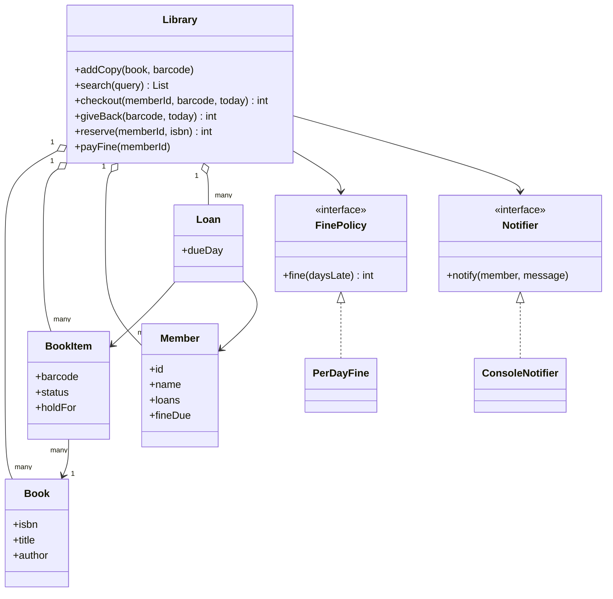
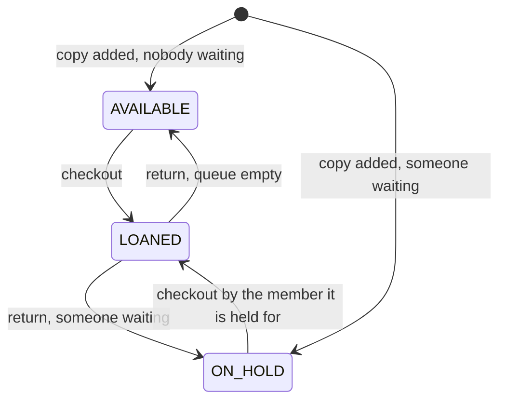

## Requirements

A library looks like CRUD (create, read, update, delete) on books. The interesting part is the rules around lending. Ask questions, then write the rules down.

Clarifying questions:

- Does the library own several physical copies of the same title? (Yes. This shapes the whole model.)
- Who can borrow? (Registered members.)
- How many books at a time, and for how long? (Say 2 books for 14 days here; make both configurable.)
- What if a book is out? (A member can **reserve** it: join a queue and get the next free copy.)
- Fines for late returns? (Yes, per day late.)
- Search by what? (Title or author, case-insensitive.)

Scope for this lesson:

- Add books and copies; register members.
- Search by title or author, showing how many copies are free.
- Check out a copy and return it. Late returns create a fine.
- A member with an unpaid fine cannot borrow. A member at the loan limit cannot borrow.
- Reserve a title when no copy is free. A returned copy is held for the first member in the queue, who is notified.

Out of scope: payments (we just mark a fine as paid), email and SMS delivery, barcodes printing, a database, librarians with different roles.

## Entities

The most important modelling point: a **book** and a **copy of a book** are different things.

- `Book` is the title: ISBN (a standard book number), title, author. Searching works on books.
- `BookItem` is one physical copy, with its own barcode and status. Lending works on copies.

If you merge them, you cannot say "two copies are out, one is on the shelf", and you cannot tell which copy a member has. If you split them, both questions are easy.

| Noun or verb | Becomes |
|---|---|
| Title (isbn, title, author) | `Book`, an immutable record |
| Physical copy (barcode, status) | `BookItem` with `ItemStatus`: available, loaned, on hold |
| Member (id, name, loans, fine) | `Member` |
| A copy lent to a member | `Loan` (item, member, due day) |
| Queue of people waiting for a title | `reservations`: ISBN to a queue of member ids |
| How a fine is computed | `FinePolicy` interface |
| Telling a member something | `Notifier` interface |
| All operations | `Library`, the service |



## The life of a copy

A copy is always in exactly one of three states. All the lending rules are rules about moving between them.



One private method, `release(item)`, owns the two arrows that leave a returned or new copy: if the reservation queue for that title has someone, hold the copy for the first member and notify them; otherwise shelve it as available. Both `giveBack` and `addCopy` call it, so the rule exists in one place.

:::key
Reservations belong to the title (the ISBN), not to a copy. A member waiting for "Clean Code" does not care which of the two copies comes back first.
:::

## Key flows

**Checkout** (`memberId`, `barcode`, `today`):

1. Member and copy must exist.
2. The copy must be available, or on hold for this very member.
3. The member must owe no fine.
4. The member must have fewer than the maximum loans.
5. Mark the copy loaned, record a `Loan` with due day `today + 14`.

**Return** (`barcode`, `today`):

1. Find and remove the loan. A copy that is not on loan is an error.
2. Days late are `today - dueDay`. If positive, ask `FinePolicy` for the amount and add it to the member's fine.
3. Call `release`. If someone is waiting, they are notified.

**Reserve** (`memberId`, `isbn`):

1. If a copy is free, refuse and tell the member to borrow it. Reserving something you can take is a waste.
2. If the member is already in the queue, refuse.
3. Otherwise append the member and return the position (1 is next).

**Search** (`query`): match title or author, ignoring case, and report `free of total` copies. The demo sorts the lines so output is stable.

```quiz
q: Where should the reservation queue live?
options:
  - On each BookItem, because each copy can be reserved
  - On the Book (keyed by ISBN), because members wait for a title, not a particular copy
  - On the Member, as a list of what they want
answer: 1
why: "The first copy of that title to come back goes to the first person waiting, whichever physical copy it is. A queue per copy would split the waiting list and make some members wait longer than needed."
```

## Code

Time is a plain number of days, so the output is the same every run. The money unit is a whole number (think paise or cents), which avoids floating point errors. Each `step` in the demo prints what was attempted, then any notification, then the result.

```java
import java.util.*;

enum ItemStatus { AVAILABLE, LOANED, ON_HOLD }

record Book(String isbn, String title, String author) {}

class BookItem {                      // one physical copy of a Book
    final String barcode;
    final Book book;
    ItemStatus status = ItemStatus.AVAILABLE;
    String holdFor;                   // member id while ON_HOLD
    BookItem(String barcode, Book book) { this.barcode = barcode; this.book = book; }
}

class Member {
    final String id, name;
    final Set<String> loans = new LinkedHashSet<>();   // barcodes
    int fineDue;
    Member(String id, String name) { this.id = id; this.name = name; }
}

record Loan(BookItem item, Member member, int dueDay) {}

interface FinePolicy { int fine(int daysLate); }

class PerDayFine implements FinePolicy {
    private final int rate;
    PerDayFine(int rate) { this.rate = rate; }
    public int fine(int daysLate) { return daysLate * rate; }
}

interface Notifier { void notify(Member m, String message); }

class ConsoleNotifier implements Notifier {
    public void notify(Member m, String message) { System.out.println("  notify " + m.name + ": " + message); }
}

class Library {
    static final int MAX_LOANS = 2, LOAN_DAYS = 14;
    private final FinePolicy finePolicy;
    private final Notifier notifier;
    private final Map<String, Book> books = new LinkedHashMap<>();            // by isbn
    private final Map<String, BookItem> items = new LinkedHashMap<>();        // by barcode
    private final Map<String, Member> members = new HashMap<>();
    private final Map<String, Loan> loans = new HashMap<>();                  // by barcode
    private final Map<String, Deque<String>> reservations = new HashMap<>();  // isbn -> member ids, first in line first

    Library(FinePolicy finePolicy, Notifier notifier) { this.finePolicy = finePolicy; this.notifier = notifier; }

    void join(Member m) { members.put(m.id, m); }

    void addCopy(Book book, String barcode) {
        books.putIfAbsent(book.isbn(), book);
        BookItem item = new BookItem(barcode, book);
        items.put(barcode, item);
        release(item);                // a waiting member may be first in line for this new copy
    }

    List<String> search(String query) {
        String q = query.toLowerCase();
        List<String> out = new ArrayList<>();
        for (Book b : books.values()) {
            if (!b.title().toLowerCase().contains(q) && !b.author().toLowerCase().contains(q)) continue;
            long free = items.values().stream()
                .filter(i -> i.book.equals(b) && i.status == ItemStatus.AVAILABLE).count();
            long total = items.values().stream().filter(i -> i.book.equals(b)).count();
            out.add(b.title() + " by " + b.author() + " (" + free + " of " + total + " available)");
        }
        Collections.sort(out);
        return out;
    }

    int checkout(String memberId, String barcode, int today) {
        Member m = member(memberId);
        BookItem item = items.get(barcode);
        if (item == null) throw new IllegalArgumentException("unknown copy " + barcode);
        boolean mine = item.status == ItemStatus.ON_HOLD && memberId.equals(item.holdFor);
        if (item.status != ItemStatus.AVAILABLE && !mine) throw new IllegalStateException(barcode + " is " + item.status);
        if (m.fineDue > 0) throw new IllegalStateException(m.name + " owes a fine of " + m.fineDue);
        if (m.loans.size() >= MAX_LOANS) throw new IllegalStateException(m.name + " already has " + MAX_LOANS + " loans");
        item.status = ItemStatus.LOANED;
        item.holdFor = null;
        m.loans.add(barcode);
        loans.put(barcode, new Loan(item, m, today + LOAN_DAYS));
        return today + LOAN_DAYS;
    }

    int giveBack(String barcode, int today) {
        Loan loan = loans.remove(barcode);
        if (loan == null) throw new IllegalStateException(barcode + " is not on loan");
        loan.member().loans.remove(barcode);
        int late = today - loan.dueDay();
        int fine = late > 0 ? finePolicy.fine(late) : 0;
        loan.member().fineDue += fine;
        release(loan.item());
        return fine;
    }

    int reserve(String memberId, String isbn) {
        member(memberId);
        boolean free = items.values().stream()
            .anyMatch(i -> i.book.isbn().equals(isbn) && i.status == ItemStatus.AVAILABLE);
        if (free) throw new IllegalStateException("a copy is available, borrow it instead");
        Deque<String> queue = reservations.computeIfAbsent(isbn, k -> new ArrayDeque<>());
        if (queue.contains(memberId)) throw new IllegalStateException("already in the queue");
        queue.addLast(memberId);
        return queue.size();
    }

    void payFine(String memberId) { member(memberId).fineDue = 0; }

    /** A copy just came back (or was just added): hold it for the first member in line, else shelve it. */
    private void release(BookItem item) {
        Deque<String> queue = reservations.get(item.book.isbn());
        if (queue == null || queue.isEmpty()) {
            item.status = ItemStatus.AVAILABLE;
            return;
        }
        item.status = ItemStatus.ON_HOLD;
        item.holdFor = queue.pollFirst();
        notifier.notify(members.get(item.holdFor), item.barcode + " (" + item.book.title() + ") is on hold for you");
    }

    private Member member(String id) {
        Member m = members.get(id);
        if (m == null) throw new IllegalArgumentException("unknown member " + id);
        return m;
    }
}

public class Main {
    interface Action { Object run(); }

    static void step(String label, Action a) {
        System.out.println(label);
        try {
            System.out.println("  -> " + a.run());
        } catch (RuntimeException e) {
            System.out.println("  -> error: " + e.getMessage());
        }
    }

    public static void main(String[] args) {
        Library lib = new Library(new PerDayFine(5), new ConsoleNotifier());
        Book clean = new Book("111", "Clean Code", "Robert Martin");
        Book ddia = new Book("222", "Designing Data-Intensive Applications", "Martin Kleppmann");
        Book pragmatic = new Book("333", "The Pragmatic Programmer", "Andrew Hunt");
        lib.addCopy(clean, "C1");
        lib.addCopy(clean, "C2");
        lib.addCopy(ddia, "D1");
        lib.addCopy(pragmatic, "P1");
        lib.join(new Member("m1", "Asha"));
        lib.join(new Member("m2", "Ravi"));
        lib.join(new Member("m3", "Meera"));

        step("search 'martin'", () -> lib.search("martin"));
        step("day 1  Asha takes D1", () -> "due day " + lib.checkout("m1", "D1", 1));
        step("day 2  Ravi takes D1", () -> lib.checkout("m2", "D1", 2));
        step("day 2  Ravi reserves 222", () -> "position " + lib.reserve("m2", "222"));
        step("day 3  Meera reserves 222", () -> "position " + lib.reserve("m3", "222"));
        step("day 3  Ravi reserves 222", () -> lib.reserve("m2", "222"));
        step("day 20 Asha returns D1", () -> "fine " + lib.giveBack("D1", 20));
        step("day 20 Meera takes D1", () -> lib.checkout("m3", "D1", 20));
        step("day 21 Ravi takes D1", () -> "due day " + lib.checkout("m2", "D1", 21));
        step("day 22 Asha takes C1", () -> lib.checkout("m1", "C1", 22));
        lib.payFine("m1");
        step("day 22 Asha takes C1 after paying", () -> "due day " + lib.checkout("m1", "C1", 22));
        step("day 22 Asha takes C2", () -> "due day " + lib.checkout("m1", "C2", 22));
        step("day 22 Asha takes P1", () -> lib.checkout("m1", "P1", 22));
        step("search 'code'", () -> lib.search("code"));
    }
}
```
```cpp
#include <algorithm>
#include <deque>
#include <functional>
#include <iostream>
#include <map>
#include <memory>
#include <set>
#include <stdexcept>
#include <string>
#include <vector>

enum class ItemStatus { Available, Loaned, OnHold };

std::string statusName(ItemStatus s) {
    switch (s) {
        case ItemStatus::Available: return "AVAILABLE";
        case ItemStatus::Loaned: return "LOANED";
        default: return "ON_HOLD";
    }
}

struct Book {
    std::string isbn, title, author;
};

struct BookItem {   // one physical copy of a Book
    std::string barcode;
    Book book;
    ItemStatus status = ItemStatus::Available;
    std::string holdFor;   // member id while OnHold
};

struct Member {
    std::string id, name;
    std::set<std::string> loans;   // barcodes
    int fineDue = 0;
};

struct Loan {
    BookItem* item;
    Member* member;
    int dueDay;
};

class FinePolicy {
public:
    virtual ~FinePolicy() = default;
    virtual int fine(int daysLate) const = 0;
};

class PerDayFine : public FinePolicy {
public:
    explicit PerDayFine(int rate) : rate_(rate) {}
    int fine(int daysLate) const override { return daysLate * rate_; }
private:
    int rate_;
};

class Notifier {
public:
    virtual ~Notifier() = default;
    virtual void notify(const Member& m, const std::string& message) const = 0;
};

class ConsoleNotifier : public Notifier {
public:
    void notify(const Member& m, const std::string& message) const override {
        std::cout << "  notify " << m.name << ": " << message << "\n";
    }
};

class Library {
public:
    static constexpr int kMaxLoans = 2, kLoanDays = 14;

    Library(std::unique_ptr<FinePolicy> fines, std::unique_ptr<Notifier> notifier)
        : fines_(std::move(fines)), notifier_(std::move(notifier)) {}

    void join(const Member& m) { members_[m.id] = std::make_unique<Member>(m); }

    void addCopy(const Book& book, const std::string& barcode) {
        books_.emplace(book.isbn, book);
        auto item = std::make_unique<BookItem>(BookItem{barcode, book});
        BookItem* raw = item.get();
        items_[barcode] = std::move(item);
        release(*raw);   // a waiting member may be first in line for this new copy
    }

    std::vector<std::string> search(const std::string& query) const {
        std::string q = lower(query);
        std::vector<std::string> out;
        for (const auto& [isbn, b] : books_) {
            if (lower(b.title).find(q) == std::string::npos && lower(b.author).find(q) == std::string::npos) continue;
            int free = 0, total = 0;
            for (const auto& [code, item] : items_) {
                if (item->book.isbn != isbn) continue;
                ++total;
                if (item->status == ItemStatus::Available) ++free;
            }
            out.push_back(b.title + " by " + b.author + " (" + std::to_string(free) + " of " +
                          std::to_string(total) + " available)");
        }
        std::sort(out.begin(), out.end());
        return out;
    }

    int checkout(const std::string& memberId, const std::string& barcode, int today) {
        Member& m = member(memberId);
        auto it = items_.find(barcode);
        if (it == items_.end()) throw std::invalid_argument("unknown copy " + barcode);
        BookItem& item = *it->second;
        bool mine = item.status == ItemStatus::OnHold && item.holdFor == memberId;
        if (item.status != ItemStatus::Available && !mine)
            throw std::logic_error(barcode + " is " + statusName(item.status));
        if (m.fineDue > 0) throw std::logic_error(m.name + " owes a fine of " + std::to_string(m.fineDue));
        if (static_cast<int>(m.loans.size()) >= kMaxLoans)
            throw std::logic_error(m.name + " already has " + std::to_string(kMaxLoans) + " loans");
        item.status = ItemStatus::Loaned;
        item.holdFor.clear();
        m.loans.insert(barcode);
        loans_[barcode] = Loan{&item, &m, today + kLoanDays};
        return today + kLoanDays;
    }

    int giveBack(const std::string& barcode, int today) {
        auto it = loans_.find(barcode);
        if (it == loans_.end()) throw std::logic_error(barcode + " is not on loan");
        Loan loan = it->second;
        loans_.erase(it);
        loan.member->loans.erase(barcode);
        int late = today - loan.dueDay;
        int fine = late > 0 ? fines_->fine(late) : 0;
        loan.member->fineDue += fine;
        release(*loan.item);
        return fine;
    }

    int reserve(const std::string& memberId, const std::string& isbn) {
        member(memberId);
        for (const auto& [code, item] : items_)
            if (item->book.isbn == isbn && item->status == ItemStatus::Available)
                throw std::logic_error("a copy is available, borrow it instead");
        auto& queue = reservations_[isbn];
        if (std::find(queue.begin(), queue.end(), memberId) != queue.end())
            throw std::logic_error("already in the queue");
        queue.push_back(memberId);
        return static_cast<int>(queue.size());
    }

    void payFine(const std::string& memberId) { member(memberId).fineDue = 0; }

private:
    // A copy just came back (or was just added): hold it for the first member in line, else shelve it.
    void release(BookItem& item) {
        auto& queue = reservations_[item.book.isbn];
        if (queue.empty()) {
            item.status = ItemStatus::Available;
            return;
        }
        item.status = ItemStatus::OnHold;
        item.holdFor = queue.front();
        queue.pop_front();
        notifier_->notify(*members_.at(item.holdFor), item.barcode + " (" + item.book.title + ") is on hold for you");
    }

    Member& member(const std::string& id) {
        auto it = members_.find(id);
        if (it == members_.end()) throw std::invalid_argument("unknown member " + id);
        return *it->second;
    }

    static std::string lower(std::string s) {
        std::transform(s.begin(), s.end(), s.begin(), [](unsigned char c) { return std::tolower(c); });
        return s;
    }

    std::unique_ptr<FinePolicy> fines_;
    std::unique_ptr<Notifier> notifier_;
    std::map<std::string, Book> books_;                              // by isbn
    std::map<std::string, std::unique_ptr<BookItem>> items_;         // by barcode
    std::map<std::string, std::unique_ptr<Member>> members_;
    std::map<std::string, Loan> loans_;                              // by barcode
    std::map<std::string, std::deque<std::string>> reservations_;    // isbn -> member ids, first in line first
};

std::string join(const std::vector<std::string>& v) {
    std::string out = "[";
    for (std::size_t i = 0; i < v.size(); ++i) out += (i ? ", " : "") + v[i];
    return out + "]";
}

void step(const std::string& label, const std::function<std::string()>& action) {
    std::cout << label << "\n";
    try {
        std::string result = action();   // run first: it may print too
        std::cout << "  -> " << result << "\n";
    } catch (const std::exception& e) {
        std::cout << "  -> error: " << e.what() << "\n";
    }
}

int main() {
    Library lib(std::make_unique<PerDayFine>(5), std::make_unique<ConsoleNotifier>());
    Book clean{"111", "Clean Code", "Robert Martin"};
    Book ddia{"222", "Designing Data-Intensive Applications", "Martin Kleppmann"};
    Book pragmatic{"333", "The Pragmatic Programmer", "Andrew Hunt"};
    lib.addCopy(clean, "C1");
    lib.addCopy(clean, "C2");
    lib.addCopy(ddia, "D1");
    lib.addCopy(pragmatic, "P1");
    lib.join(Member{"m1", "Asha"});
    lib.join(Member{"m2", "Ravi"});
    lib.join(Member{"m3", "Meera"});

    auto due = [](int d) { return "due day " + std::to_string(d); };
    step("search 'martin'", [&] { return join(lib.search("martin")); });
    step("day 1  Asha takes D1", [&] { return due(lib.checkout("m1", "D1", 1)); });
    step("day 2  Ravi takes D1", [&] { return due(lib.checkout("m2", "D1", 2)); });
    step("day 2  Ravi reserves 222", [&] { return "position " + std::to_string(lib.reserve("m2", "222")); });
    step("day 3  Meera reserves 222", [&] { return "position " + std::to_string(lib.reserve("m3", "222")); });
    step("day 3  Ravi reserves 222", [&] { return "position " + std::to_string(lib.reserve("m2", "222")); });
    step("day 20 Asha returns D1", [&] { return "fine " + std::to_string(lib.giveBack("D1", 20)); });
    step("day 20 Meera takes D1", [&] { return due(lib.checkout("m3", "D1", 20)); });
    step("day 21 Ravi takes D1", [&] { return due(lib.checkout("m2", "D1", 21)); });
    step("day 22 Asha takes C1", [&] { return due(lib.checkout("m1", "C1", 22)); });
    lib.payFine("m1");
    step("day 22 Asha takes C1 after paying", [&] { return due(lib.checkout("m1", "C1", 22)); });
    step("day 22 Asha takes C2", [&] { return due(lib.checkout("m1", "C2", 22)); });
    step("day 22 Asha takes P1", [&] { return due(lib.checkout("m1", "P1", 22)); });
    step("search 'code'", [&] { return join(lib.search("code")); });
}
```
```output
search 'martin'
  -> [Clean Code by Robert Martin (2 of 2 available), Designing Data-Intensive Applications by Martin Kleppmann (1 of 1 available)]
day 1  Asha takes D1
  -> due day 15
day 2  Ravi takes D1
  -> error: D1 is LOANED
day 2  Ravi reserves 222
  -> position 1
day 3  Meera reserves 222
  -> position 2
day 3  Ravi reserves 222
  -> error: already in the queue
day 20 Asha returns D1
  notify Ravi: D1 (Designing Data-Intensive Applications) is on hold for you
  -> fine 25
day 20 Meera takes D1
  -> error: D1 is ON_HOLD
day 21 Ravi takes D1
  -> due day 35
day 22 Asha takes C1
  -> error: Asha owes a fine of 25
day 22 Asha takes C1 after paying
  -> due day 36
day 22 Asha takes C2
  -> due day 36
day 22 Asha takes P1
  -> error: Asha already has 2 loans
search 'code'
  -> [Clean Code by Robert Martin (0 of 2 available)]
```

Compile the C++ with `g++ -std=c++17`.

Work out a fine yourself:

```predict
lang: java
code: |
  int dueDay = 15, today = 20, rate = 5;
  int late = today - dueDay;
  int fine = late > 0 ? late * rate : 0;
  int early = 12 - dueDay;
  int fine2 = early > 0 ? early * rate : 0;
  System.out.println(fine + " " + fine2);
output: 25 0
why: The book is 5 days late, so the fine is 5 times 5 = 25. Returning on day 12 gives a negative lateness, which the check turns into no fine.
```

Put the body of `giveBack` in order:

```order
prompt: Arrange the body of giveBack.
lang: java
code: |
  Loan loan = loans.remove(barcode);
  if (loan == null) throw new IllegalStateException(barcode + " is not on loan");
  loan.member().loans.remove(barcode);
  int late = today - loan.dueDay();
  int fine = late > 0 ? finePolicy.fine(late) : 0;
  loan.member().fineDue += fine;
  release(loan.item());
  return fine;
distractors:
  - "    loan.item().status = ItemStatus.AVAILABLE;"
why: Find the loan first, then update the member, compute and record the fine, and finally call release. Setting the status to AVAILABLE directly would skip the reservation queue and the notification.
```

## Patterns and design decisions

- **Strategy for fines.** `FinePolicy` hides how lateness becomes money. A flat fee, a capped fee or a grace period is a new class.
- **Observer-style notifier.** `Library` calls `Notifier.notify` and does not know if the message is printed, emailed or pushed. A full Observer pattern would allow several listeners; one interface is enough until you need more.
- **State as an enum.** Three states with few transitions do not justify a State pattern with one class per state. If statuses grew (damaged, lost, in repair), each with its own rules, then it would.
- **Time is passed in.** `checkout` and `giveBack` take `today`. No hidden clock means exact, repeatable tests.
- **Errors by exception, queries by return value.** A refused checkout is an exception with a reason; search simply returns a list.
- **Fine as a blocker.** A simple rule: an unpaid fine blocks borrowing. It is stated in one line of `checkout`, so changing it is easy.

:::warn
This code is not thread-safe. Two librarians can both see the last copy as available and both check it out. Make the mutating methods (`checkout`, `giveBack`, `reserve`, `addCopy`) `synchronized` in Java, or hold a `std::mutex` in each in C++. One lock for the whole library is correct and simple; per-title locks are an optimisation you can describe, not need.
:::

:::truth
Search here scans every book and every copy. That is fine for a classroom demo and for a few thousand books. For a real catalogue you would index by ISBN and keep a title index (or hand search to a database or a search engine). Say this if asked about scale; do not build it first.
:::

## Extensibility

| Change request | What changes |
|---|---|
| Member types with different limits | A `MemberPolicy` (or fields on a `MembershipType`) holding limit and loan days; `checkout` asks it instead of using constants |
| Hold expires after 3 days | A `holdUntil` day on the copy and a periodic job that calls `release` again for expired holds |
| Renewals | `renew(barcode, today)`: allowed unless the title's queue is non-empty; extends `dueDay` |
| Search by ISBN, genre or year | A `SearchStrategy` interface, or a list of predicates combined with AND |
| Lost or damaged copy | New `ItemStatus` values; lost copies create a fine for the replacement price |
| Persist data | Replace the maps with repositories behind interfaces; the service logic stays |
| Email or SMS | New `Notifier` classes, or a composite that calls several |

```quiz
q: A member returns a copy of a title with two people waiting. What should the library do with the copy?
options:
  - Mark it available so the first person to check will get it
  - Mark it on hold for the first person in the queue and notify them
  - Add it to the end of the queue as a new reservation
answer: 1
why: "If the copy became available, anyone walking in could take it and the people who waited would lose their place. Holding it for the head of the queue keeps the order fair."
```

## Interview tips

- Start with the model: "Book is the title, BookItem is the copy". It shows you thought about the real world.
- List the rules before writing them: limit, due date, fine, fine blocks borrowing, hold for reservations.
- Put varying rules behind small interfaces (`FinePolicy`, `Notifier`) and say that you will not add more until a rule actually varies.
- Draw the three-state diagram for a copy. It answers most "what if" questions.
- Raise concurrency yourself and name the smallest correct fix: one lock around the mutating methods.

```cards
- q: Why separate Book and BookItem?
  a: Book is the title that members search and reserve. BookItem is one physical copy that is lent. Without the split you cannot track several copies of one title.
- q: Where do reservations live, and why?
  a: In a queue per title (ISBN). Members wait for any copy of the title, so the first returned copy goes to the first in line.
- q: What happens to a returned copy when someone is waiting?
  a: It goes ON_HOLD for the first member in the queue, who is notified, instead of becoming AVAILABLE.
- q: Which parts are behind interfaces, and why?
  a: FinePolicy (how late days become money) and Notifier (how members are told). Both are likely to change, and the Library should not care how.
- q: How is a late fine calculated here?
  a: late = today - dueDay; if late is positive, fine = FinePolicy.fine(late), for example late times the per day rate. Otherwise zero.
```

## Notes

:::notes
- Core split: Book (title, ISBN, searched and reserved) versus BookItem (one physical copy with barcode and status, lent).
- Copy states: AVAILABLE, LOANED, ON_HOLD. The private release(item) decides after a return or a new copy: hold for the first in the reservation queue, or shelve.
- Reservations are a queue per ISBN, not per copy. Reserve is refused if a copy is free or the member is already waiting.
- Checkout rules: copy available (or held for this member), no unpaid fine, below the loan limit. Due date = today + loan days.
- Return: find the loan, compute days late, FinePolicy turns days into money, then release the copy.
- Strategy: FinePolicy. Observer-style: Notifier. Enum for status, because three states do not need the State pattern.
- Pass today in as a number, and keep money as integers, so tests are exact.
- Not thread-safe as written: guard mutating methods with one lock. Search scans everything; index it for real scale.
- Likely follow-ups: member types, hold expiry, renewals, search strategies, persistence.
:::
