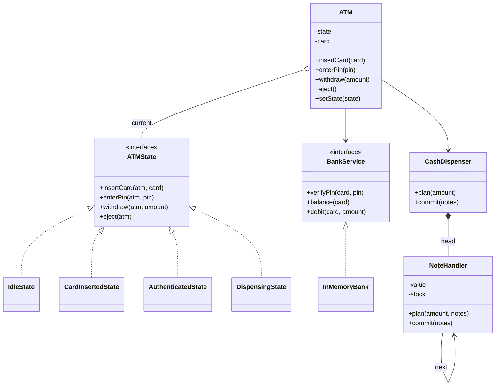
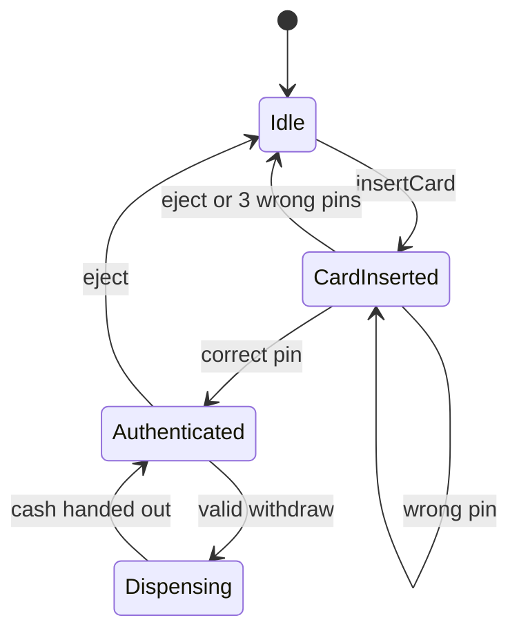

## Requirements

Start with questions. A short list shows the interviewer how you think, and each answer removes work.

| Question | Decision |
|---|---|
| What can a customer do? | Insert a card, enter a PIN (Personal Identification Number), check balance, withdraw cash, eject the card |
| Who holds the money and the PINs? | The bank, behind an interface. The ATM never stores balances |
| What notes does it hold? | 500, 200, 100 and 50, each with a stock count |
| What if the PIN is wrong? | Three wrong tries and the card is retained |
| What if the machine cannot pay exactly? | Refuse the withdrawal. The customer's account is not touched |
| Multiple customers at once? | No. One card, one session at a time |

Out of scope: deposits, transfers, receipts, the network protocol to the bank, hardware faults.

## Entities and responsibilities

| Class | Responsibility |
|---|---|
| `ATM` | The **context**. Holds the current state, the card in the slot and the PIN failure count. Forwards every user action to the state |
| `ATMState` and four states | One class per situation: `Idle`, `CardInserted`, `Authenticated`, `Dispensing`. Each decides what an action means and what comes next |
| `BankService` | Interface to the bank: verify PIN, read balance, debit. `InMemoryBank` is the fake used in the demo |
| `CashDispenser` | Plans and commits a note combination. Owns the head of the note chain |
| `NoteHandler` | One link per note value. Takes as many notes as it can and passes the remainder on |



## Key flows

The **State pattern** puts each situation's behaviour in its own class behind one interface, so the context never branches on a state variable. The same action means different things: "withdraw" in `Idle` says insert a card, in `Authenticated` it starts a withdrawal.



A withdrawal runs these steps, in this order:

1. Check the amount is a positive multiple of 50, the smallest note.
2. Ask the bank for the balance. Refuse if it is too low.
3. **Plan** the notes: walk the chain and record how many of each note would be used. Nothing changes yet.
4. If the chain cannot reach exactly zero, refuse.
5. Enter `Dispensing`, then ask the bank to debit.
6. If the debit succeeds, **commit** the plan (reduce note stock) and hand out the cash. Return to `Authenticated`.

:::key
Plan first, change things later. Every refusal happens before any money or stock moves, so there is nothing to undo.
:::

The note chain is a **chain of responsibility**: a request travels along linked handlers, and each handles its part and forwards the rest. Here, 500 takes what it can, 200 takes from the remainder, and so on. If something remains after the last link, the amount cannot be paid.

```quiz
q: Why does the ATM plan the notes before it debits the bank?
options:
  - Planning is faster than debiting
  - Any refusal then happens before money or note stock changes, so there is nothing to roll back
  - The bank requires a note list before it accepts a debit
answer: 1
why: "If we debited first and the chain then failed, the customer would be charged for cash they never got. Planning is a pure calculation, so it is safe to throw away."
```

## Code

The states hold no data, so the ATM creates one of each. Each line starting with two spaces is the machine's reply; lines with `[A -> B]` are transitions printed by `setState`, which is the single place all transitions pass through. `InMemoryBank` stands in for the real bank.

```java
import java.util.*;

interface BankService {
    boolean verifyPin(String card, String pin);
    int balance(String card);
    boolean debit(String card, int amount);
}

class InMemoryBank implements BankService {
    private final Map<String, String> pins = new HashMap<>();
    private final Map<String, Integer> balances = new HashMap<>();

    void open(String card, String pin, int balance) {
        pins.put(card, pin);
        balances.put(card, balance);
    }
    public boolean verifyPin(String card, String pin) { return pin.equals(pins.get(card)); }
    public int balance(String card) { return balances.getOrDefault(card, 0); }
    public boolean debit(String card, int amount) {
        int b = balance(card);
        if (amount > b) return false;
        balances.put(card, b - amount);
        return true;
    }
}

// One link per note value. A link takes as many notes as it can, then passes the rest on.
class NoteHandler {
    private final int value;
    private int stock;
    private NoteHandler next;

    NoteHandler(int value, int stock) { this.value = value; this.stock = stock; }
    NoteHandler setNext(NoteHandler n) { next = n; return n; }

    // Plan only: record the notes that would be used and return the amount left over.
    int plan(int amount, Map<Integer, Integer> notes) {
        int n = Math.min(amount / value, stock);
        if (n > 0) notes.put(value, n);
        int rest = amount - n * value;
        return next == null ? rest : next.plan(rest, notes);
    }
    void commit(Map<Integer, Integer> notes) {
        stock -= notes.getOrDefault(value, 0);
        if (next != null) next.commit(notes);
    }
    int total() { return value * stock + (next == null ? 0 : next.total()); }
}

class CashDispenser {
    private final NoteHandler head;
    CashDispenser(NoteHandler head) { this.head = head; }

    // Returns the notes to hand out, or null if the machine cannot pay this amount exactly.
    Map<Integer, Integer> plan(int amount) {
        Map<Integer, Integer> notes = new LinkedHashMap<>();
        return head.plan(amount, notes) == 0 ? notes : null;
    }
    void commit(Map<Integer, Integer> notes) { head.commit(notes); }
    int total() { return head.total(); }

    static String describe(Map<Integer, Integer> notes) {
        StringJoiner j = new StringJoiner(" + ");
        notes.forEach((value, n) -> j.add(n + "x" + value));
        return j.toString();
    }
}

interface ATMState {
    String name();
    void insertCard(ATM atm, String card);
    void enterPin(ATM atm, String pin);
    void checkBalance(ATM atm);
    void withdraw(ATM atm, int amount);
    void eject(ATM atm);
}

class IdleState implements ATMState {
    public String name() { return "Idle"; }
    public void insertCard(ATM atm, String card) {
        atm.startSession(card);
        atm.setState(atm.cardInserted);
    }
    public void enterPin(ATM atm, String pin) { atm.say("insert a card first"); }
    public void checkBalance(ATM atm) { atm.say("insert a card first"); }
    public void withdraw(ATM atm, int amount) { atm.say("insert a card first"); }
    public void eject(ATM atm) { atm.say("no card inside"); }
}

class CardInsertedState implements ATMState {
    public String name() { return "CardInserted"; }
    public void insertCard(ATM atm, String card) { atm.say("a card is already inside"); }
    public void enterPin(ATM atm, String pin) {
        if (atm.bank().verifyPin(atm.card(), pin)) {
            atm.say("pin accepted");
            atm.setState(atm.authenticated);
        } else if (atm.recordFailedPin() >= ATM.MAX_PIN_TRIES) {
            atm.say("too many wrong pins, card retained");
            atm.endSession();
            atm.setState(atm.idle);
        } else {
            atm.say("wrong pin");
        }
    }
    public void checkBalance(ATM atm) { atm.say("enter your pin first"); }
    public void withdraw(ATM atm, int amount) { atm.say("enter your pin first"); }
    public void eject(ATM atm) {
        atm.say("card returned");
        atm.endSession();
        atm.setState(atm.idle);
    }
}

class AuthenticatedState implements ATMState {
    public String name() { return "Authenticated"; }
    public void insertCard(ATM atm, String card) { atm.say("a card is already inside"); }
    public void enterPin(ATM atm, String pin) { atm.say("already authenticated"); }
    public void checkBalance(ATM atm) { atm.say("balance " + atm.bank().balance(atm.card())); }
    public void withdraw(ATM atm, int amount) { atm.withdrawCash(amount); }
    public void eject(ATM atm) {
        atm.say("card returned");
        atm.endSession();
        atm.setState(atm.idle);
    }
}

class DispensingState implements ATMState {
    public String name() { return "Dispensing"; }
    public void insertCard(ATM atm, String card) { atm.say("busy dispensing"); }
    public void enterPin(ATM atm, String pin) { atm.say("busy dispensing"); }
    public void checkBalance(ATM atm) { atm.say("busy dispensing"); }
    public void withdraw(ATM atm, int amount) { atm.say("busy dispensing"); }
    public void eject(ATM atm) { atm.say("busy dispensing"); }
}

class ATM {
    static final int MAX_PIN_TRIES = 3;
    static final int NOTE_UNIT = 50;

    final ATMState idle = new IdleState();
    final ATMState cardInserted = new CardInsertedState();
    final ATMState authenticated = new AuthenticatedState();
    final ATMState dispensing = new DispensingState();
    private ATMState state = idle;

    private final BankService bank;
    private final CashDispenser cash;
    private String card;
    private int failedPins;

    ATM(BankService bank, CashDispenser cash) { this.bank = bank; this.cash = cash; }

    // user actions: forwarded to the current state
    void insertCard(String c) { state.insertCard(this, c); }
    void enterPin(String pin) { state.enterPin(this, pin); }
    void checkBalance() { state.checkBalance(this); }
    void withdraw(int amount) { state.withdraw(this, amount); }
    void eject() { state.eject(this); }

    // helpers used by the states
    void setState(ATMState next) {
        say("[" + state.name() + " -> " + next.name() + "]");
        state = next;
    }
    String stateName() { return state.name(); }
    BankService bank() { return bank; }
    String card() { return card; }
    int cashLeft() { return cash.total(); }
    void startSession(String c) { card = c; failedPins = 0; }
    void endSession() { card = null; failedPins = 0; }
    int recordFailedPin() { return ++failedPins; }
    void say(String msg) { System.out.println("  " + msg); }

    void withdrawCash(int amount) {
        if (amount <= 0 || amount % NOTE_UNIT != 0) {
            say("amount must be a positive multiple of " + NOTE_UNIT);
            return;
        }
        if (amount > bank.balance(card)) { say("insufficient funds"); return; }
        Map<Integer, Integer> notes = cash.plan(amount);
        if (notes == null) { say("cannot pay " + amount + " with the notes left"); return; }

        setState(dispensing);
        if (bank.debit(card, amount)) {
            cash.commit(notes);
            say("dispensed " + CashDispenser.describe(notes));
        } else {
            say("bank declined the withdrawal");
        }
        setState(authenticated);
    }
}

public class Main {
    static void run(String cmd, Runnable action) {
        System.out.println("> " + cmd);
        action.run();
    }

    public static void main(String[] args) {
        InMemoryBank bank = new InMemoryBank();
        bank.open("C1", "1234", 5000);
        bank.open("C2", "1111", 300);

        NoteHandler n500 = new NoteHandler(500, 2);
        n500.setNext(new NoteHandler(200, 3)).setNext(new NoteHandler(100, 5)).setNext(new NoteHandler(50, 4));
        ATM atm = new ATM(bank, new CashDispenser(n500));

        run("withdraw 500", () -> atm.withdraw(500));
        run("insert C1", () -> atm.insertCard("C1"));
        run("withdraw 500", () -> atm.withdraw(500));
        run("pin 0000", () -> atm.enterPin("0000"));
        run("pin 1234", () -> atm.enterPin("1234"));
        run("balance", atm::checkBalance);
        run("withdraw 575", () -> atm.withdraw(575));
        run("withdraw 6000", () -> atm.withdraw(6000));
        run("withdraw 1250", () -> atm.withdraw(1250));
        run("withdraw 1000", () -> atm.withdraw(1000));
        run("withdraw 500", () -> atm.withdraw(500));
        run("balance", atm::checkBalance);
        run("eject", atm::eject);
        run("insert C2", () -> atm.insertCard("C2"));
        run("pin 1", () -> atm.enterPin("1"));
        run("pin 2", () -> atm.enterPin("2"));
        run("pin 3", () -> atm.enterPin("3"));
        System.out.println("state: " + atm.stateName() + ", cash left: " + atm.cashLeft());
    }
}
```
```cpp
#include <algorithm>
#include <functional>
#include <iostream>
#include <map>
#include <memory>
#include <string>
#include <unordered_map>
#include <utility>

class BankService {
public:
    virtual ~BankService() = default;
    virtual bool verifyPin(const std::string& card, const std::string& pin) const = 0;
    virtual int balance(const std::string& card) const = 0;
    virtual bool debit(const std::string& card, int amount) = 0;
};

class InMemoryBank : public BankService {
public:
    void open(const std::string& card, const std::string& pin, int balance) {
        pins_[card] = pin;
        balances_[card] = balance;
    }
    bool verifyPin(const std::string& card, const std::string& pin) const override {
        auto it = pins_.find(card);
        return it != pins_.end() && it->second == pin;
    }
    int balance(const std::string& card) const override {
        auto it = balances_.find(card);
        return it == balances_.end() ? 0 : it->second;
    }
    bool debit(const std::string& card, int amount) override {
        if (amount > balance(card)) return false;
        balances_[card] -= amount;
        return true;
    }

private:
    std::unordered_map<std::string, std::string> pins_;
    std::unordered_map<std::string, int> balances_;
};

using Notes = std::map<int, int, std::greater<int>>;  // note value -> count, largest first

// One link per note value. A link takes as many notes as it can, then passes the rest on.
class NoteHandler {
public:
    NoteHandler(int value, int stock) : value_(value), stock_(stock) {}

    NoteHandler* setNext(std::unique_ptr<NoteHandler> next) {
        next_ = std::move(next);
        return next_.get();
    }
    // Plan only: record the notes that would be used and return the amount left over.
    int plan(int amount, Notes& notes) const {
        int n = std::min(amount / value_, stock_);
        if (n > 0) notes[value_] = n;
        int rest = amount - n * value_;
        return next_ ? next_->plan(rest, notes) : rest;
    }
    void commit(const Notes& notes) {
        auto it = notes.find(value_);
        if (it != notes.end()) stock_ -= it->second;
        if (next_) next_->commit(notes);
    }
    int total() const { return value_ * stock_ + (next_ ? next_->total() : 0); }

private:
    int value_;
    int stock_;
    std::unique_ptr<NoteHandler> next_;
};

class CashDispenser {
public:
    explicit CashDispenser(std::unique_ptr<NoteHandler> head) : head_(std::move(head)) {}

    // True if the machine can pay this amount exactly; the notes go into `notes`.
    bool plan(int amount, Notes& notes) const { return head_->plan(amount, notes) == 0; }
    void commit(const Notes& notes) { head_->commit(notes); }
    int total() const { return head_->total(); }

    static std::string describe(const Notes& notes) {
        std::string out;
        for (const auto& [value, n] : notes) {
            if (!out.empty()) out += " + ";
            out += std::to_string(n) + "x" + std::to_string(value);
        }
        return out;
    }

private:
    std::unique_ptr<NoteHandler> head_;
};

class ATM;

class ATMState {
public:
    virtual ~ATMState() = default;
    virtual std::string name() const = 0;
    virtual void insertCard(ATM& atm, const std::string& card) = 0;
    virtual void enterPin(ATM& atm, const std::string& pin) = 0;
    virtual void checkBalance(ATM& atm) = 0;
    virtual void withdraw(ATM& atm, int amount) = 0;
    virtual void eject(ATM& atm) = 0;
};

class IdleState : public ATMState {
public:
    std::string name() const override { return "Idle"; }
    void insertCard(ATM& atm, const std::string& card) override;
    void enterPin(ATM& atm, const std::string& pin) override;
    void checkBalance(ATM& atm) override;
    void withdraw(ATM& atm, int amount) override;
    void eject(ATM& atm) override;
};

class CardInsertedState : public ATMState {
public:
    std::string name() const override { return "CardInserted"; }
    void insertCard(ATM& atm, const std::string& card) override;
    void enterPin(ATM& atm, const std::string& pin) override;
    void checkBalance(ATM& atm) override;
    void withdraw(ATM& atm, int amount) override;
    void eject(ATM& atm) override;
};

class AuthenticatedState : public ATMState {
public:
    std::string name() const override { return "Authenticated"; }
    void insertCard(ATM& atm, const std::string& card) override;
    void enterPin(ATM& atm, const std::string& pin) override;
    void checkBalance(ATM& atm) override;
    void withdraw(ATM& atm, int amount) override;
    void eject(ATM& atm) override;
};

class DispensingState : public ATMState {
public:
    std::string name() const override { return "Dispensing"; }
    void insertCard(ATM& atm, const std::string& card) override;
    void enterPin(ATM& atm, const std::string& pin) override;
    void checkBalance(ATM& atm) override;
    void withdraw(ATM& atm, int amount) override;
    void eject(ATM& atm) override;
};

class ATM {
public:
    static constexpr int kMaxPinTries = 3;
    static constexpr int kNoteUnit = 50;

    ATM(BankService& bank, CashDispenser& cash) : bank_(bank), cash_(cash) {}

    // user actions: forwarded to the current state
    void insertCard(const std::string& c) { state_->insertCard(*this, c); }
    void enterPin(const std::string& pin) { state_->enterPin(*this, pin); }
    void checkBalance() { state_->checkBalance(*this); }
    void withdraw(int amount) { state_->withdraw(*this, amount); }
    void eject() { state_->eject(*this); }

    // helpers used by the states
    ATMState& idle() { return idle_; }
    ATMState& cardInserted() { return cardInserted_; }
    ATMState& authenticated() { return authenticated_; }
    void setState(ATMState& next) {
        say("[" + state_->name() + " -> " + next.name() + "]");
        state_ = &next;
    }
    std::string stateName() const { return state_->name(); }
    BankService& bank() { return bank_; }
    const std::string& card() const { return card_; }
    int cashLeft() const { return cash_.total(); }
    void startSession(const std::string& c) { card_ = c; failedPins_ = 0; }
    void endSession() { card_.clear(); failedPins_ = 0; }
    int recordFailedPin() { return ++failedPins_; }
    void say(const std::string& msg) const { std::cout << "  " << msg << "\n"; }

    void withdrawCash(int amount) {
        if (amount <= 0 || amount % kNoteUnit != 0) {
            say("amount must be a positive multiple of " + std::to_string(kNoteUnit));
            return;
        }
        if (amount > bank_.balance(card_)) { say("insufficient funds"); return; }
        Notes notes;
        if (!cash_.plan(amount, notes)) {
            say("cannot pay " + std::to_string(amount) + " with the notes left");
            return;
        }
        setState(dispensing_);
        if (bank_.debit(card_, amount)) {
            cash_.commit(notes);
            say("dispensed " + CashDispenser::describe(notes));
        } else {
            say("bank declined the withdrawal");
        }
        setState(authenticated_);
    }

private:
    IdleState idle_;
    CardInsertedState cardInserted_;
    AuthenticatedState authenticated_;
    DispensingState dispensing_;
    ATMState* state_ = &idle_;
    BankService& bank_;
    CashDispenser& cash_;
    std::string card_;
    int failedPins_ = 0;
};

void IdleState::insertCard(ATM& atm, const std::string& card) {
    atm.startSession(card);
    atm.setState(atm.cardInserted());
}
void IdleState::enterPin(ATM& atm, const std::string&) { atm.say("insert a card first"); }
void IdleState::checkBalance(ATM& atm) { atm.say("insert a card first"); }
void IdleState::withdraw(ATM& atm, int) { atm.say("insert a card first"); }
void IdleState::eject(ATM& atm) { atm.say("no card inside"); }

void CardInsertedState::insertCard(ATM& atm, const std::string&) { atm.say("a card is already inside"); }
void CardInsertedState::enterPin(ATM& atm, const std::string& pin) {
    if (atm.bank().verifyPin(atm.card(), pin)) {
        atm.say("pin accepted");
        atm.setState(atm.authenticated());
    } else if (atm.recordFailedPin() >= ATM::kMaxPinTries) {
        atm.say("too many wrong pins, card retained");
        atm.endSession();
        atm.setState(atm.idle());
    } else {
        atm.say("wrong pin");
    }
}
void CardInsertedState::checkBalance(ATM& atm) { atm.say("enter your pin first"); }
void CardInsertedState::withdraw(ATM& atm, int) { atm.say("enter your pin first"); }
void CardInsertedState::eject(ATM& atm) {
    atm.say("card returned");
    atm.endSession();
    atm.setState(atm.idle());
}

void AuthenticatedState::insertCard(ATM& atm, const std::string&) { atm.say("a card is already inside"); }
void AuthenticatedState::enterPin(ATM& atm, const std::string&) { atm.say("already authenticated"); }
void AuthenticatedState::checkBalance(ATM& atm) {
    atm.say("balance " + std::to_string(atm.bank().balance(atm.card())));
}
void AuthenticatedState::withdraw(ATM& atm, int amount) { atm.withdrawCash(amount); }
void AuthenticatedState::eject(ATM& atm) {
    atm.say("card returned");
    atm.endSession();
    atm.setState(atm.idle());
}

void DispensingState::insertCard(ATM& atm, const std::string&) { atm.say("busy dispensing"); }
void DispensingState::enterPin(ATM& atm, const std::string&) { atm.say("busy dispensing"); }
void DispensingState::checkBalance(ATM& atm) { atm.say("busy dispensing"); }
void DispensingState::withdraw(ATM& atm, int) { atm.say("busy dispensing"); }
void DispensingState::eject(ATM& atm) { atm.say("busy dispensing"); }

static void run(const std::string& cmd, const std::function<void()>& action) {
    std::cout << "> " << cmd << "\n";
    action();
}

int main() {
    InMemoryBank bank;
    bank.open("C1", "1234", 5000);
    bank.open("C2", "1111", 300);

    auto head = std::make_unique<NoteHandler>(500, 2);
    NoteHandler* tail = head.get();
    tail = tail->setNext(std::make_unique<NoteHandler>(200, 3));
    tail = tail->setNext(std::make_unique<NoteHandler>(100, 5));
    tail->setNext(std::make_unique<NoteHandler>(50, 4));
    CashDispenser cash(std::move(head));
    ATM atm(bank, cash);

    run("withdraw 500", [&] { atm.withdraw(500); });
    run("insert C1", [&] { atm.insertCard("C1"); });
    run("withdraw 500", [&] { atm.withdraw(500); });
    run("pin 0000", [&] { atm.enterPin("0000"); });
    run("pin 1234", [&] { atm.enterPin("1234"); });
    run("balance", [&] { atm.checkBalance(); });
    run("withdraw 575", [&] { atm.withdraw(575); });
    run("withdraw 6000", [&] { atm.withdraw(6000); });
    run("withdraw 1250", [&] { atm.withdraw(1250); });
    run("withdraw 1000", [&] { atm.withdraw(1000); });
    run("withdraw 500", [&] { atm.withdraw(500); });
    run("balance", [&] { atm.checkBalance(); });
    run("eject", [&] { atm.eject(); });
    run("insert C2", [&] { atm.insertCard("C2"); });
    run("pin 1", [&] { atm.enterPin("1"); });
    run("pin 2", [&] { atm.enterPin("2"); });
    run("pin 3", [&] { atm.enterPin("3"); });
    std::cout << "state: " << atm.stateName() << ", cash left: " << atm.cashLeft() << "\n";
}
```
```output
> withdraw 500
  insert a card first
> insert C1
  [Idle -> CardInserted]
> withdraw 500
  enter your pin first
> pin 0000
  wrong pin
> pin 1234
  pin accepted
  [CardInserted -> Authenticated]
> balance
  balance 5000
> withdraw 575
  amount must be a positive multiple of 50
> withdraw 6000
  insufficient funds
> withdraw 1250
  [Authenticated -> Dispensing]
  dispensed 2x500 + 1x200 + 1x50
  [Dispensing -> Authenticated]
> withdraw 1000
  [Authenticated -> Dispensing]
  dispensed 2x200 + 5x100 + 2x50
  [Dispensing -> Authenticated]
> withdraw 500
  cannot pay 500 with the notes left
> balance
  balance 2750
> eject
  card returned
  [Authenticated -> Idle]
> insert C2
  [Idle -> CardInserted]
> pin 1
  wrong pin
> pin 2
  wrong pin
> pin 3
  too many wrong pins, card retained
  [CardInserted -> Idle]
state: Idle, cash left: 50
```

Compile the C++ with `g++ -std=c++17 -pthread`.

Read the output once against the code. A failed PIN, a refused amount and a refused plan all leave the state alone. Only a correct PIN, a successful withdrawal, an eject or the third wrong PIN moves it.

```predict
lang: java
code: |
  int amount = 700;
  int[] value = {500, 200, 100};
  int[] stock = {0, 2, 9};
  StringBuilder out = new StringBuilder();
  for (int i = 0; i < value.length; i++) {
      int n = Math.min(amount / value[i], stock[i]);
      amount -= n * value[i];
      out.append(n).append(' ');
  }
  System.out.println(out + "left " + amount);
output: 0 2 3 left 0
why: The 500 link has no stock, so it takes none. The 200 link would like 3 notes but has 2, leaving 300. The 100 link takes 3.
```

Complete one link of the chain:

```blanks
prompt: Fill in NoteHandler.plan.
lang: java
code: |
  int plan(int amount, Map<Integer, Integer> notes) {
      int n = Math.min(amount / value, [[stock]]);
      if (n > 0) notes.put(value, n);
      int rest = amount - [[n * value|n*value]];
      return next == null ? rest : next.[[plan]](rest, notes);
  }
why: A link takes the smaller of what the amount needs and what it has. The remainder travels to the next link, and the last link's remainder is the answer. Zero means success.
```

Put the core of `withdrawCash` in order:

```order
prompt: Arrange the end of ATM.withdrawCash, after the amount and balance checks.
lang: java
code: |
  Map<Integer, Integer> notes = cash.plan(amount);
  if (notes == null) { say("cannot pay"); return; }
  setState(dispensing);
  if (bank.debit(card, amount)) {
      cash.commit(notes);
      say("dispensed " + CashDispenser.describe(notes));
  }
  setState(authenticated);
distractors:
  - "  cash.commit(cash.plan(amount));"
  - "  setState(idle);"
why: Plan, refuse early if the plan fails, then enter Dispensing. Stock is committed only after the bank accepts the debit, and the machine always returns to Authenticated afterwards.
```

## Patterns used and why

| Pattern | Where | Why |
|---|---|---|
| State | `ATMState` and four states | Each action's meaning depends on the session phase. New phases become new classes |
| Chain of responsibility | `NoteHandler` links | Adding a note value is adding a link. No `if` ladder over denominations |
| Dependency inversion | `BankService` | The ATM depends on an interface, so tests use `InMemoryBank` and production uses a network client |
| Plan, then commit | `CashDispenser` | Keeps failures side-effect free |

:::truth
Greedy note selection is not always correct. With one 500 note and three 200 notes, paying 600 needs 3 x 200, but greedy takes the 500 first, is left with 100 and fails. Real ATMs often have stock rules, cassette limits and a smarter search. In an interview, say the limitation aloud and keep greedy.
:::

```quiz
q: The ATM holds one 500 note and three 200 notes. A customer asks for 600. What does the greedy chain do?
options:
  - Pays 3 x 200
  - Refuses, because it takes the 500 first and cannot make the remaining 100
  - Pays 500 + 100 by borrowing a 100 note from the bank
answer: 1
why: "The 500 link runs first and takes one note. The remaining 100 cannot be made from 200 notes, so the chain ends with a non-zero remainder. A valid answer exists, which shows that greedy can miss it."
```

## Extensibility

| Change request | What changes |
|---|---|
| New note value, say 2000 | One more link at the front of the chain. Nothing else |
| New phase, say `Maintenance` | One new state class and a technician-only transition into it |
| Daily withdrawal limit | A check inside `BankService.debit`, since the bank owns account data |
| Receipts and audit log | Log inside `setState` and after `commit`. One place each |
| Real bank | A new `BankService` implementation. The ATM stays unchanged |

## Interview tips

- Draw the state diagram first. It doubles as your test plan.
- Say "the context delegates, the states decide the next state". Interviewers listen for that.
- Keep money as integers. Never `double`.
- Mention the weak spot yourself: greedy notes, and that a real ATM needs the bank to be the source of truth with idempotent (safe to repeat) debits.
- Do not put balances in the ATM. If asked about concurrency, the bank handles it with transactions.

```cards
- q: Why is a card session a good fit for the State pattern?
  a: The same action (withdraw, enter PIN) means different things in each phase, and phases have clear transitions.
- q: What is a chain of responsibility?
  a: A request moves along linked handlers. Each handles what it can and forwards the rest.
- q: Why plan notes before debiting?
  a: So every refusal happens before any money or stock changes. Planning has no side effects.
- q: When does greedy note selection fail?
  a: When stock limits force a different mix, such as 600 with one 500 and three 200 notes.
- q: Where do the PIN and the balance live?
  a: In the bank, behind BankService. The ATM only asks questions and requests debits.
- q: What does the ATM do after three wrong PINs?
  a: Retains the card, ends the session and returns to Idle.
```

## Notes

:::notes
- ATM = context plus four states: Idle, CardInserted, Authenticated, Dispensing.
- The context forwards every action to the current state. States choose the next state through setState.
- BankService is an interface. The ATM holds no balances or PINs.
- Notes are dispensed by a chain of responsibility: one NoteHandler per value, largest first.
- Withdrawal is plan, then debit, then commit. Refusals happen before any change.
- Greedy can fail with limited stock (600 from one 500 and three 200 notes). Say so in the interview.
- Three wrong PINs retain the card and return to Idle.
- Log all transitions inside setState. New notes are new links, new phases are new state classes.
:::
