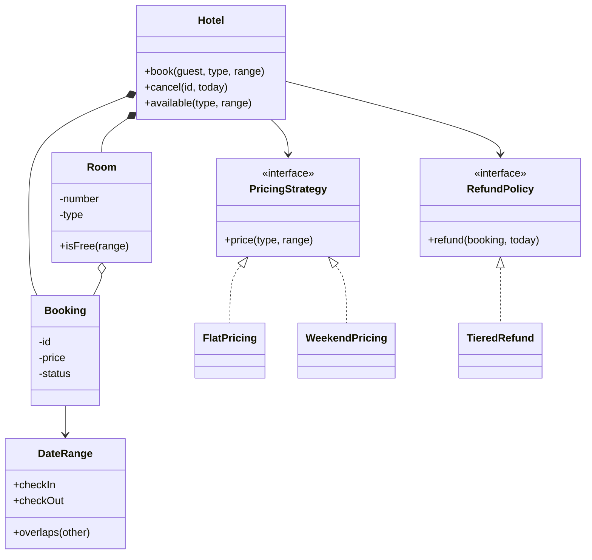

## Requirements

| Question | Decision |
|---|---|
| What is booked? | A room, for a range of nights |
| How do guests choose? | By room type (Standard, Deluxe, Suite). The system picks any free room of that type |
| Can two bookings share a night? | Not in the same room. Back-to-back is fine: one guest checks out the day the next checks in |
| How is the price set? | Base rate per type, with a pricing rule that can change |
| What happens on cancellation? | The room is released. The refund depends on how close the stay is |
| Real dates? | We use day numbers in code so Java and C++ behave identically; real code uses `LocalDate` or `std::chrono` |

Out of scope: payments, guest profiles, room amenities, overbooking, multi-hotel search.

## Entities and responsibilities

| Class | Responsibility |
|---|---|
| `Hotel` | Facade over rooms and bookings: search, book, cancel |
| `Room` | A number, a type and its bookings. Answers "are you free for this range?" |
| `RoomType` | Enum with a base rate. A type is data, not a subclass |
| `DateRange` | Value object for nights `[checkIn, checkOut)`. Owns the overlap rule |
| `Booking` | Id, guest, room number, range, price and a status (confirmed or cancelled) |
| `PricingStrategy` | Interface that turns a type and a range into a price |
| `RefundPolicy` | Interface that turns a booking and today's date into a refund |



## The overlap rule

A stay occupies **nights**, not days. Check in on day 4 and out on day 6, and you occupy nights 4 and 5. Model this as a **half-open range** `[checkIn, checkOut)`: the start is included and the end is not.

Two ranges `A` and `B` overlap when each starts before the other ends:

$$ A.in < B.out \;\text{and}\; B.in < A.out $$

| A | B | Overlap? | Why |
|---|---|---|---|
| [4, 6) | [6, 8) | No | `6 < 6` is false. B starts the day A ends |
| [4, 6) | [5, 7) | Yes | Both want night 5 |
| [4, 6) | [2, 4) | No | `4 < 4` is false |

:::key
Half-open ranges make back-to-back stays correct with no special case. With closed ranges you end up writing `<=` in one place and `<` in another, and the bugs live there.
:::

```predict
lang: java
code: |
  int[][] others = {{6, 8}, {5, 7}, {2, 4}, {3, 5}};
  for (int[] b : others)
      System.out.println(4 < b[1] && b[0] < 6);
prompt: The stay is nights [4, 6). What does each line print for the other ranges?
output: |
  false
  true
  false
  true
why: "[6, 8) starts when ours ends. [5, 7) and [3, 5) both share one night with [4, 6). [2, 4) ends when ours starts."
```

## Key flows

**Book**

1. Build a `DateRange`. It throws if check-out is not after check-in, so no invalid range exists.
2. Collect rooms of the requested type where `isFree(range)` is true. A room is free when no **confirmed** booking overlaps.
3. If none, report that and stop.
4. Pick one (here the first by room number), ask the `PricingStrategy` for the price, create the booking and attach it to the room.

**Cancel**

1. Find the booking. Unknown or already cancelled is an error message, not a crash.
2. Mark it cancelled. The room frees up automatically because `isFree` only considers confirmed bookings.
3. Ask the `RefundPolicy` for the refund.

```quiz
q: Alice holds a room for nights [4, 6). Which new booking for the same room is rejected?
options:
  - "[6, 8)"
  - "[2, 4)"
  - "[5, 7)"
answer: 2
why: "[5, 7) includes night 5, which Alice holds. The other two touch Alice's stay only at a boundary day, and half-open ranges treat that as free."
```

## Code

Prices are whole rupees. Weekend pricing adds a quarter of the base rate on Friday and Saturday nights, using integer maths. Day 0 is a Monday, so `day % 7` equals 4 or 5 for a weekend night.

```java
import java.util.*;

enum RoomType {
    STANDARD(2000), DELUXE(3500), SUITE(6000);
    final int baseRate;   // rupees per night
    RoomType(int baseRate) { this.baseRate = baseRate; }
}

// Nights [checkIn, checkOut). Days are plain numbers; day 0 is a Monday.
// Real code would use LocalDate; numbers keep the demo identical in Java and C++.
final class DateRange {
    final int checkIn, checkOut;
    DateRange(int checkIn, int checkOut) {
        if (checkOut <= checkIn) throw new IllegalArgumentException("check-out must be after check-in");
        this.checkIn = checkIn;
        this.checkOut = checkOut;
    }
    int nights() { return checkOut - checkIn; }
    boolean overlaps(DateRange o) { return checkIn < o.checkOut && o.checkIn < checkOut; }
    @Override public String toString() { return "days " + checkIn + "-" + checkOut; }
}

enum Status { CONFIRMED, CANCELLED }

class Booking {
    final int id, roomNumber, price;
    final String guest;
    final DateRange range;
    Status status = Status.CONFIRMED;
    Booking(int id, String guest, int roomNumber, DateRange range, int price) {
        this.id = id; this.guest = guest; this.roomNumber = roomNumber; this.range = range; this.price = price;
    }
    boolean active() { return status == Status.CONFIRMED; }
}

class Room {
    final int number;
    final RoomType type;
    private final List<Booking> bookings = new ArrayList<>();
    Room(int number, RoomType type) { this.number = number; this.type = type; }

    boolean isFree(DateRange r) {
        for (Booking b : bookings)
            if (b.active() && b.range.overlaps(r)) return false;
        return true;
    }
    void add(Booking b) { bookings.add(b); }
}

interface PricingStrategy { int price(RoomType type, DateRange range); }

class FlatPricing implements PricingStrategy {
    public int price(RoomType type, DateRange range) { return type.baseRate * range.nights(); }
}

// Friday and Saturday nights cost 25% more. Integer maths, no floating point for money.
class WeekendPricing implements PricingStrategy {
    public int price(RoomType type, DateRange range) {
        int total = 0;
        for (int day = range.checkIn; day < range.checkOut; day++) {
            boolean weekend = day % 7 == 4 || day % 7 == 5;
            total += weekend ? type.baseRate + type.baseRate / 4 : type.baseRate;
        }
        return total;
    }
}

interface RefundPolicy { int refund(Booking booking, int today); }

class TieredRefund implements RefundPolicy {
    public int refund(Booking b, int today) {
        int daysBefore = b.range.checkIn - today;
        if (daysBefore >= 2) return b.price;
        if (daysBefore == 1) return b.price / 2;
        return 0;
    }
}

class Hotel {
    private final List<Room> rooms = new ArrayList<>();
    private final Map<Integer, Booking> bookings = new TreeMap<>();
    private final PricingStrategy pricing;
    private final RefundPolicy refunds;
    private int nextId = 1;

    Hotel(PricingStrategy pricing, RefundPolicy refunds) { this.pricing = pricing; this.refunds = refunds; }

    void addRoom(int number, RoomType type) { rooms.add(new Room(number, type)); }

    List<Room> available(RoomType type, DateRange range) {
        List<Room> free = new ArrayList<>();
        for (Room r : rooms)
            if (r.type == type && r.isFree(range)) free.add(r);
        return free;
    }

    String freeRooms(RoomType type, DateRange range) {
        StringJoiner j = new StringJoiner(" ");
        for (Room r : available(type, range)) j.add(String.valueOf(r.number));
        return j.length() == 0 ? "none" : j.toString();
    }

    int book(String guest, RoomType type, DateRange range) {
        List<Room> free = available(type, range);
        if (free.isEmpty()) {
            say("no " + type + " room free for " + range);
            return -1;
        }
        Room room = free.get(0);
        int price = pricing.price(type, range);
        Booking b = new Booking(nextId++, guest, room.number, range, price);
        room.add(b);
        bookings.put(b.id, b);
        say("booking " + b.id + ": room " + room.number + ", " + range.nights() + (range.nights() == 1 ? " night, " : " nights, ") + price);
        return b.id;
    }

    void cancel(int id, int today) {
        Booking b = bookings.get(id);
        if (b == null) { say("no such booking " + id); return; }
        if (!b.active()) { say("booking " + id + " is already cancelled"); return; }
        b.status = Status.CANCELLED;
        say("cancelled " + id + ", refund " + refunds.refund(b, today) + " of " + b.price);
    }

    static void say(String msg) { System.out.println("  " + msg); }
}

public class Main {
    public static void main(String[] args) {
        Hotel hotel = new Hotel(new WeekendPricing(), new TieredRefund());
        hotel.addRoom(101, RoomType.STANDARD);
        hotel.addRoom(102, RoomType.STANDARD);
        hotel.addRoom(201, RoomType.DELUXE);
        hotel.addRoom(301, RoomType.SUITE);

        System.out.println("> book Alice STANDARD days 4-6");
        hotel.book("Alice", RoomType.STANDARD, new DateRange(4, 6));
        System.out.println("> book Bob STANDARD days 5-7");
        hotel.book("Bob", RoomType.STANDARD, new DateRange(5, 7));
        System.out.println("> book Cara STANDARD days 5-6");
        hotel.book("Cara", RoomType.STANDARD, new DateRange(5, 6));
        System.out.println("> book Dan STANDARD days 6-8");
        hotel.book("Dan", RoomType.STANDARD, new DateRange(6, 8));
        System.out.println("> free STANDARD days 5-6");
        System.out.println("  " + hotel.freeRooms(RoomType.STANDARD, new DateRange(5, 6)));
        System.out.println("> book Zed STANDARD days 6-6");
        try {
            hotel.book("Zed", RoomType.STANDARD, new DateRange(6, 6));
        } catch (IllegalArgumentException e) {
            Hotel.say("rejected: " + e.getMessage());
        }
        System.out.println("> cancel 1 on day 3");
        hotel.cancel(1, 3);
        System.out.println("> free STANDARD days 5-6");
        System.out.println("  " + hotel.freeRooms(RoomType.STANDARD, new DateRange(5, 6)));
        System.out.println("> book Cara STANDARD days 5-6");
        hotel.book("Cara", RoomType.STANDARD, new DateRange(5, 6));
        System.out.println("> cancel 1 on day 3");
        hotel.cancel(1, 3);
        System.out.println("> cancel 9 on day 3");
        hotel.cancel(9, 3);
        System.out.println("> book Eve SUITE days 0-3");
        hotel.book("Eve", RoomType.SUITE, new DateRange(0, 3));
    }
}
```
```cpp
#include <iostream>
#include <map>
#include <memory>
#include <stdexcept>
#include <string>
#include <utility>
#include <vector>

enum class RoomType { Standard, Deluxe, Suite };

int baseRate(RoomType t) {  // rupees per night
    switch (t) {
        case RoomType::Standard: return 2000;
        case RoomType::Deluxe: return 3500;
        case RoomType::Suite: return 6000;
    }
    return 0;
}

std::string toString(RoomType t) {
    switch (t) {
        case RoomType::Standard: return "STANDARD";
        case RoomType::Deluxe: return "DELUXE";
        case RoomType::Suite: return "SUITE";
    }
    return "?";
}

// Nights [checkIn, checkOut). Days are plain numbers; day 0 is a Monday.
// Real code would use std::chrono dates; numbers keep the demo identical in Java and C++.
struct DateRange {
    int checkIn, checkOut;
    DateRange(int in, int out) : checkIn(in), checkOut(out) {
        if (out <= in) throw std::invalid_argument("check-out must be after check-in");
    }
    int nights() const { return checkOut - checkIn; }
    bool overlaps(const DateRange& o) const { return checkIn < o.checkOut && o.checkIn < checkOut; }
    std::string str() const { return "days " + std::to_string(checkIn) + "-" + std::to_string(checkOut); }
};

enum class Status { Confirmed, Cancelled };

struct Booking {
    int id;
    std::string guest;
    int roomNumber;
    DateRange range;
    int price;
    Status status = Status::Confirmed;
    bool active() const { return status == Status::Confirmed; }
};

class Room {
public:
    Room(int number, RoomType type) : number_(number), type_(type) {}
    int number() const { return number_; }
    RoomType type() const { return type_; }

    bool isFree(const DateRange& r) const {
        for (const Booking* b : bookings_)
            if (b->active() && b->range.overlaps(r)) return false;
        return true;
    }
    void add(Booking* b) { bookings_.push_back(b); }  // the Hotel owns the booking

private:
    int number_;
    RoomType type_;
    std::vector<Booking*> bookings_;
};

class PricingStrategy {
public:
    virtual ~PricingStrategy() = default;
    virtual int price(RoomType type, const DateRange& range) const = 0;
};

class FlatPricing : public PricingStrategy {
public:
    int price(RoomType type, const DateRange& range) const override { return baseRate(type) * range.nights(); }
};

// Friday and Saturday nights cost 25% more. Integer maths, no floating point for money.
class WeekendPricing : public PricingStrategy {
public:
    int price(RoomType type, const DateRange& range) const override {
        int total = 0;
        for (int day = range.checkIn; day < range.checkOut; ++day) {
            bool weekend = day % 7 == 4 || day % 7 == 5;
            total += weekend ? baseRate(type) + baseRate(type) / 4 : baseRate(type);
        }
        return total;
    }
};

class RefundPolicy {
public:
    virtual ~RefundPolicy() = default;
    virtual int refund(const Booking& booking, int today) const = 0;
};

class TieredRefund : public RefundPolicy {
public:
    int refund(const Booking& b, int today) const override {
        int daysBefore = b.range.checkIn - today;
        if (daysBefore >= 2) return b.price;
        if (daysBefore == 1) return b.price / 2;
        return 0;
    }
};

class Hotel {
public:
    Hotel(std::unique_ptr<PricingStrategy> pricing, std::unique_ptr<RefundPolicy> refunds)
        : pricing_(std::move(pricing)), refunds_(std::move(refunds)) {}

    void addRoom(int number, RoomType type) { rooms_.emplace_back(number, type); }

    std::vector<Room*> available(RoomType type, const DateRange& range) {
        std::vector<Room*> free;
        for (Room& r : rooms_)
            if (r.type() == type && r.isFree(range)) free.push_back(&r);
        return free;
    }

    std::string freeRooms(RoomType type, const DateRange& range) {
        std::string out;
        for (Room* r : available(type, range)) out += (out.empty() ? "" : " ") + std::to_string(r->number());
        return out.empty() ? "none" : out;
    }

    int book(const std::string& guest, RoomType type, const DateRange& range) {
        auto free = available(type, range);
        if (free.empty()) {
            say("no " + toString(type) + " room free for " + range.str());
            return -1;
        }
        Room* room = free.front();
        int price = pricing_->price(type, range);
        auto b = std::make_unique<Booking>(Booking{nextId_++, guest, room->number(), range, price});
        room->add(b.get());
        int id = b->id;
        bookings_[id] = std::move(b);
        say("booking " + std::to_string(id) + ": room " + std::to_string(room->number()) + ", " +
            std::to_string(range.nights()) + (range.nights() == 1 ? " night, " : " nights, ") + std::to_string(price));
        return id;
    }

    void cancel(int id, int today) {
        auto it = bookings_.find(id);
        if (it == bookings_.end()) { say("no such booking " + std::to_string(id)); return; }
        Booking& b = *it->second;
        if (!b.active()) { say("booking " + std::to_string(id) + " is already cancelled"); return; }
        b.status = Status::Cancelled;
        say("cancelled " + std::to_string(id) + ", refund " + std::to_string(refunds_->refund(b, today)) +
            " of " + std::to_string(b.price));
    }

    static void say(const std::string& msg) { std::cout << "  " << msg << "\n"; }

private:
    std::vector<Room> rooms_;
    std::map<int, std::unique_ptr<Booking>> bookings_;
    std::unique_ptr<PricingStrategy> pricing_;
    std::unique_ptr<RefundPolicy> refunds_;
    int nextId_ = 1;
};

int main() {
    Hotel hotel(std::make_unique<WeekendPricing>(), std::make_unique<TieredRefund>());
    hotel.addRoom(101, RoomType::Standard);
    hotel.addRoom(102, RoomType::Standard);
    hotel.addRoom(201, RoomType::Deluxe);
    hotel.addRoom(301, RoomType::Suite);

    std::cout << "> book Alice STANDARD days 4-6\n";
    hotel.book("Alice", RoomType::Standard, DateRange(4, 6));
    std::cout << "> book Bob STANDARD days 5-7\n";
    hotel.book("Bob", RoomType::Standard, DateRange(5, 7));
    std::cout << "> book Cara STANDARD days 5-6\n";
    hotel.book("Cara", RoomType::Standard, DateRange(5, 6));
    std::cout << "> book Dan STANDARD days 6-8\n";
    hotel.book("Dan", RoomType::Standard, DateRange(6, 8));
    std::cout << "> free STANDARD days 5-6\n";
    std::cout << "  " << hotel.freeRooms(RoomType::Standard, DateRange(5, 6)) << "\n";
    std::cout << "> book Zed STANDARD days 6-6\n";
    try {
        hotel.book("Zed", RoomType::Standard, DateRange(6, 6));
    } catch (const std::invalid_argument& e) {
        Hotel::say(std::string("rejected: ") + e.what());
    }
    std::cout << "> cancel 1 on day 3\n";
    hotel.cancel(1, 3);
    std::cout << "> free STANDARD days 5-6\n";
    std::cout << "  " << hotel.freeRooms(RoomType::Standard, DateRange(5, 6)) << "\n";
    std::cout << "> book Cara STANDARD days 5-6\n";
    hotel.book("Cara", RoomType::Standard, DateRange(5, 6));
    std::cout << "> cancel 1 on day 3\n";
    hotel.cancel(1, 3);
    std::cout << "> cancel 9 on day 3\n";
    hotel.cancel(9, 3);
    std::cout << "> book Eve SUITE days 0-3\n";
    hotel.book("Eve", RoomType::Suite, DateRange(0, 3));
}
```
```output
> book Alice STANDARD days 4-6
  booking 1: room 101, 2 nights, 5000
> book Bob STANDARD days 5-7
  booking 2: room 102, 2 nights, 4500
> book Cara STANDARD days 5-6
  no STANDARD room free for days 5-6
> book Dan STANDARD days 6-8
  booking 3: room 101, 2 nights, 4000
> free STANDARD days 5-6
  none
> book Zed STANDARD days 6-6
  rejected: check-out must be after check-in
> cancel 1 on day 3
  cancelled 1, refund 2500 of 5000
> free STANDARD days 5-6
  101
> book Cara STANDARD days 5-6
  booking 4: room 101, 1 night, 2500
> cancel 1 on day 3
  booking 1 is already cancelled
> cancel 9 on day 3
  no such booking 9
> book Eve SUITE days 0-3
  booking 5: room 301, 3 nights, 18000
```

Compile the C++ with `g++ -std=c++17 -pthread`.

In the demo, Cara's first request fails because rooms 101 and 102 are both taken somewhere in her range. After Alice cancels, room 101 is free for night 5. Dan's booking in the same room, starting on the day Alice would have left, was never in conflict.

```blanks
prompt: Complete the overlap check in DateRange.
lang: java
code: |
  boolean overlaps(DateRange o) {
      return checkIn < o.[[checkOut]] && o.[[checkIn]] < checkOut;
  }
why: Each range must start before the other one ends. Equal boundaries do not overlap, which is why the comparisons are strict.
```

```order
prompt: Arrange the core of Hotel.book after the free rooms are found.
lang: java
code: |
  List<Room> free = available(type, range);
  if (free.isEmpty()) { say("none free"); return -1; }
  Room room = free.get(0);
  int price = pricing.price(type, range);
  Booking b = new Booking(nextId++, guest, room.number, range, price);
  room.add(b);
  bookings.put(b.id, b);
  return b.id;
distractors:
  - "  room.number = nextId++;"
  - "  pricing = new FlatPricing();"
why: Search, handle the empty case, pick a room, price it, create the booking, then register it on the room and in the hotel. The id is consumed only after success, so failed attempts do not burn ids.
```

## Patterns used and why

| Pattern | Where | Why |
|---|---|---|
| Strategy | `PricingStrategy`, `RefundPolicy` | Rules change often and independently. `Hotel` calls an interface and never branches on a rule name |
| Value object | `DateRange` | Validation and the overlap rule live in one tiny immutable class |
| Facade | `Hotel` | Callers use three methods and never touch rooms or bookings directly |
| Enum with data | `RoomType` | A new type is one line. A subclass per type would add no behaviour |

:::truth
The scan in `isFree` is fine for a machine-coding round. In production, the hard part is not the loop. It is making "check free, then book" atomic. Two requests can both see the room free and both book it. In memory, hold a lock per room. In a database, use a transaction with a uniqueness or exclusion constraint on room and dates.
:::

```quiz
q: A stay starts on Friday (day 4) and ends on Monday (day 7). Base rate 2000, weekend nights cost 25 percent more. What is the price?
options:
  - "6000"
  - "7000"
  - "7500"
answer: 1
why: "Nights are Friday 2500, Saturday 2500 and Sunday 2000. The total is 7000. Monday is the check-out day and is not a night."
```

## Extensibility

| Change request | What changes |
|---|---|
| Seasonal or festival pricing | A new `PricingStrategy`, or one that wraps another and multiplies |
| Stricter refund rules | A new `RefundPolicy`. Booking and cancel code stay |
| Search by price or amenities | A filter step in `available`, ideally as small predicate objects |
| Faster overlap check | Sorted bookings per room, compare with the two neighbours of the new range |
| Choose the cheapest free room | Replace `free.get(0)` with a room-selection strategy |

## Interview tips

- Say "half-open ranges" in the first five minutes. It shows you have met this bug before.
- Ask about back-to-back stays and the time of check-out. Both change the overlap rule.
- Keep money in integers and the date logic in one class.
- Name the concurrency risk without being asked, then say what protects it.
- Keep `Hotel` thin: it coordinates, while rules sit in strategies and the overlap rule sits in `DateRange`.

```cards
- q: What is a half-open range and why use it for stays?
  a: "[in, out) includes the first night and excludes the check-out day. Back-to-back stays then never overlap."
- q: When do two ranges overlap?
  a: When A.in < B.out and B.in < A.out.
- q: Which pattern gives swappable pricing and refund rules?
  a: Strategy. Hotel depends on an interface, and each rule is a class.
- q: What makes booking unsafe under concurrency?
  a: Check-then-act. Two requests see the room free and both book it. Fix it with a lock per room or a database constraint.
- q: Why keep a cancelled booking instead of deleting it?
  a: It keeps history and refunds auditable. The room treats only confirmed bookings as occupying nights.
- q: Why store money as integers?
  a: Floating point cannot represent most decimals exactly, so totals drift.
```

## Notes

:::notes
- A stay is nights [checkIn, checkOut). Overlap: A.in < B.out and B.in < A.out.
- Back-to-back stays are allowed because ranges are half-open.
- Room owns the "am I free" check, Hotel coordinates, DateRange owns the overlap rule.
- PricingStrategy and RefundPolicy are Strategy interfaces. New rules are new classes.
- Cancelling marks the booking cancelled; isFree ignores cancelled bookings.
- Room scan is linear in that room's bookings. Sorted bookings give O(log n).
- Real systems need an atomic check-and-book: per-room lock or database constraint.
- Money is an integer. Dates are a value object, not scattered ints.
:::
