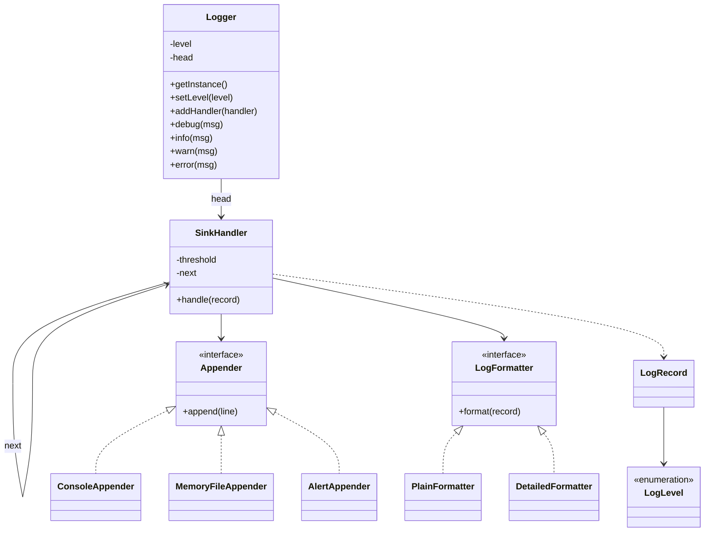

## Requirements

| Question | Decision |
|---|---|
| What are the levels? | DEBUG, INFO, WARN, ERROR, in increasing severity |
| Can one message go to several places? | Yes. Console for warnings, a file for everything, an alert channel for errors |
| Can each place format differently? | Yes. A plain line on the console, a detailed line in the file |
| Can the level change while running? | Yes. A global threshold drops anything below it |
| Thread safety? | Many threads log at once. Lines must not interleave |
| One logger or many? | One shared logger here. Named loggers are an extension |

Out of scope: real timestamps and files, rotation, configuration files, structured (JSON) logs.

## Entities and responsibilities

| Class | Responsibility |
|---|---|
| `LogLevel` | Enum ordered by severity. Comparing levels compares positions |
| `LogRecord` | One event: a sequence number, a level and the text |
| `LogFormatter` | **Strategy** that turns a record into one line |
| `Appender` | **Strategy** (also called a sink) that sends a line somewhere: console, file, alert |
| `SinkHandler` | One link of a chain. Writes the record if its level is high enough, then forwards it |
| `Logger` | **Singleton** entry point: checks the global level, builds a record, starts the chain |



## Key flows

Calling `warn("disk 91% full")` does this:

1. `Logger` takes its lock and compares the level with the global threshold. If the message is below it, return. No record is built, no sink is touched.
2. Build a `LogRecord` with the next sequence number.
3. Give it to the head of the chain.
4. Each `SinkHandler` compares the record's level with **its own** threshold. If high enough, it formats the record and hands the line to its appender. Either way it passes the record to the next link.

There are two levels of filtering. The global level is a cheap early exit for the whole logger. The per-sink threshold decides which places receive the message.

:::note
The classic chain of responsibility stops at the first handler that handles the request. A logger usually wants every matching sink to receive the record, so here each link always forwards. It is the same structure with a different stop rule. A link that wanted to veto a record (for example a rate limiter) could simply not forward.
:::

```predict
lang: java
code: |
  enum Level { DEBUG, INFO, WARN, ERROR }
  Level threshold = Level.WARN;
  for (Level l : Level.values())
      if (l.ordinal() >= threshold.ordinal()) System.out.print(l + " ");
output: WARN ERROR
why: "Enum values are numbered in declaration order, so comparing ordinal() compares severity. Everything at or above the threshold passes."
```

## Code

Appenders print with a prefix so you can see which sink received each line. `MemoryFileAppender` keeps lines in a list instead of writing a file, so the demo is repeatable. The tick counter replaces a real timestamp for the same reason.

```java
import java.util.*;

enum LogLevel { DEBUG, INFO, WARN, ERROR }   // declared in increasing severity

class LogRecord {
    final long tick;       // a counter stands in for a timestamp so the demo is deterministic
    final LogLevel level;
    final String text;
    LogRecord(long tick, LogLevel level, String text) { this.tick = tick; this.level = level; this.text = text; }
}

// Formatter: turns a record into one line of text.
interface LogFormatter { String format(LogRecord r); }

class PlainFormatter implements LogFormatter {
    public String format(LogRecord r) { return "[" + r.level + "] " + r.text; }
}

class DetailedFormatter implements LogFormatter {
    public String format(LogRecord r) { return "t=" + r.tick + " " + r.level + " " + r.text; }
}

// Appender (sink): decides where a finished line goes.
interface Appender { void append(String line); }

class ConsoleAppender implements Appender {
    public void append(String line) { System.out.println("  console> " + line); }
}

class AlertAppender implements Appender {
    public void append(String line) { System.out.println("  ALERT> " + line); }
}

// Keeps lines in memory so the demo can print them. A real FileAppender would write to disk.
class MemoryFileAppender implements Appender {
    final List<String> lines = new ArrayList<>();
    public void append(String line) { lines.add(line); }
}

// One link of the chain: writes the record if it is severe enough, then passes it on.
class SinkHandler {
    private final LogLevel threshold;
    private final Appender appender;
    private final LogFormatter formatter;
    private SinkHandler next;

    SinkHandler(LogLevel threshold, Appender appender, LogFormatter formatter) {
        this.threshold = threshold;
        this.appender = appender;
        this.formatter = formatter;
    }
    SinkHandler setNext(SinkHandler n) { next = n; return n; }

    void handle(LogRecord r) {
        if (r.level.ordinal() >= threshold.ordinal()) appender.append(formatter.format(r));
        if (next != null) next.handle(r);
    }
}

final class Logger {
    private static final Logger INSTANCE = new Logger();   // created once, when the class loads

    static Logger getInstance() { return INSTANCE; }

    private LogLevel level = LogLevel.INFO;
    private SinkHandler head, tail;
    private long tick = 0;

    private Logger() {}

    synchronized void setLevel(LogLevel level) { this.level = level; }

    synchronized void addHandler(SinkHandler h) {
        if (head == null) head = tail = h;
        else tail = tail.setNext(h);
    }

    void debug(String msg) { log(LogLevel.DEBUG, msg); }
    void info(String msg) { log(LogLevel.INFO, msg); }
    void warn(String msg) { log(LogLevel.WARN, msg); }
    void error(String msg) { log(LogLevel.ERROR, msg); }

    // One lock keeps lines from different threads from interleaving.
    private synchronized void log(LogLevel l, String text) {
        if (head == null || l.ordinal() < level.ordinal()) return;   // cheap early exit
        head.handle(new LogRecord(++tick, l, text));
    }
}

public class Main {
    public static void main(String[] args) {
        MemoryFileAppender file = new MemoryFileAppender();
        Logger log = Logger.getInstance();
        log.setLevel(LogLevel.DEBUG);
        log.addHandler(new SinkHandler(LogLevel.WARN, new ConsoleAppender(), new PlainFormatter()));
        log.addHandler(new SinkHandler(LogLevel.DEBUG, file, new DetailedFormatter()));
        log.addHandler(new SinkHandler(LogLevel.ERROR, new AlertAppender(), new PlainFormatter()));

        System.out.println("> level DEBUG");
        log.debug("cache warm-up started");
        log.info("server started");
        log.warn("disk 91% full");
        log.error("database unreachable");

        System.out.println("> level WARN");
        log.setLevel(LogLevel.WARN);
        log.info("request served");
        log.error("second failure");

        System.out.println("same instance: " + (log == Logger.getInstance()));
        System.out.println("file has " + file.lines.size() + " lines");
        for (String line : file.lines) System.out.println("  " + line);
    }
}
```
```cpp
#include <iostream>
#include <memory>
#include <mutex>
#include <string>
#include <utility>
#include <vector>

enum class LogLevel { Debug, Info, Warn, Error };  // declared in increasing severity

std::string toString(LogLevel l) {
    switch (l) {
        case LogLevel::Debug: return "DEBUG";
        case LogLevel::Info: return "INFO";
        case LogLevel::Warn: return "WARN";
        case LogLevel::Error: return "ERROR";
    }
    return "?";
}

struct LogRecord {
    long tick;  // a counter stands in for a timestamp so the demo is deterministic
    LogLevel level;
    std::string text;
};

// Formatter: turns a record into one line of text.
class LogFormatter {
public:
    virtual ~LogFormatter() = default;
    virtual std::string format(const LogRecord& r) const = 0;
};

class PlainFormatter : public LogFormatter {
public:
    std::string format(const LogRecord& r) const override { return "[" + toString(r.level) + "] " + r.text; }
};

class DetailedFormatter : public LogFormatter {
public:
    std::string format(const LogRecord& r) const override {
        return "t=" + std::to_string(r.tick) + " " + toString(r.level) + " " + r.text;
    }
};

// Appender (sink): decides where a finished line goes.
class Appender {
public:
    virtual ~Appender() = default;
    virtual void append(const std::string& line) = 0;
};

class ConsoleAppender : public Appender {
public:
    void append(const std::string& line) override { std::cout << "  console> " << line << "\n"; }
};

class AlertAppender : public Appender {
public:
    void append(const std::string& line) override { std::cout << "  ALERT> " << line << "\n"; }
};

// Keeps lines in memory so the demo can print them. A real FileAppender would write to disk.
class MemoryFileAppender : public Appender {
public:
    void append(const std::string& line) override { lines.push_back(line); }
    std::vector<std::string> lines;
};

// One link of the chain: writes the record if it is severe enough, then passes it on.
class SinkHandler {
public:
    SinkHandler(LogLevel threshold, std::shared_ptr<Appender> appender, std::shared_ptr<LogFormatter> formatter)
        : threshold_(threshold), appender_(std::move(appender)), formatter_(std::move(formatter)) {}

    SinkHandler* setNext(std::unique_ptr<SinkHandler> n) {
        next_ = std::move(n);
        return next_.get();
    }
    void handle(const LogRecord& r) const {
        if (static_cast<int>(r.level) >= static_cast<int>(threshold_)) appender_->append(formatter_->format(r));
        if (next_) next_->handle(r);
    }

private:
    LogLevel threshold_;
    std::shared_ptr<Appender> appender_;
    std::shared_ptr<LogFormatter> formatter_;
    std::unique_ptr<SinkHandler> next_;
};

class Logger {
public:
    static Logger& getInstance() {
        static Logger instance;  // created on first use; C++11 makes this initialisation thread-safe
        return instance;
    }
    Logger(const Logger&) = delete;
    Logger& operator=(const Logger&) = delete;

    void setLevel(LogLevel level) {
        std::lock_guard<std::mutex> lock(mu_);
        level_ = level;
    }
    void addHandler(std::unique_ptr<SinkHandler> h) {
        std::lock_guard<std::mutex> lock(mu_);
        SinkHandler* raw = h.get();
        if (!head_) head_ = std::move(h);
        else tail_->setNext(std::move(h));
        tail_ = raw;
    }

    void debug(const std::string& msg) { log(LogLevel::Debug, msg); }
    void info(const std::string& msg) { log(LogLevel::Info, msg); }
    void warn(const std::string& msg) { log(LogLevel::Warn, msg); }
    void error(const std::string& msg) { log(LogLevel::Error, msg); }

private:
    Logger() = default;

    // One lock keeps lines from different threads from interleaving.
    void log(LogLevel l, const std::string& text) {
        std::lock_guard<std::mutex> lock(mu_);
        if (!head_ || static_cast<int>(l) < static_cast<int>(level_)) return;  // cheap early exit
        head_->handle(LogRecord{++tick_, l, text});
    }

    std::mutex mu_;
    LogLevel level_ = LogLevel::Info;
    std::unique_ptr<SinkHandler> head_;
    SinkHandler* tail_ = nullptr;
    long tick_ = 0;
};

int main() {
    auto file = std::make_shared<MemoryFileAppender>();
    Logger& log = Logger::getInstance();
    log.setLevel(LogLevel::Debug);
    log.addHandler(std::make_unique<SinkHandler>(LogLevel::Warn, std::make_shared<ConsoleAppender>(),
                                                 std::make_shared<PlainFormatter>()));
    log.addHandler(std::make_unique<SinkHandler>(LogLevel::Debug, file, std::make_shared<DetailedFormatter>()));
    log.addHandler(std::make_unique<SinkHandler>(LogLevel::Error, std::make_shared<AlertAppender>(),
                                                 std::make_shared<PlainFormatter>()));

    std::cout << "> level DEBUG\n";
    log.debug("cache warm-up started");
    log.info("server started");
    log.warn("disk 91% full");
    log.error("database unreachable");

    std::cout << "> level WARN\n";
    log.setLevel(LogLevel::Warn);
    log.info("request served");
    log.error("second failure");

    std::cout << "same instance: " << std::boolalpha << (&log == &Logger::getInstance()) << "\n";
    std::cout << "file has " << file->lines.size() << " lines\n";
    for (const auto& line : file->lines) std::cout << "  " << line << "\n";
}
```
```output
> level DEBUG
  console> [WARN] disk 91% full
  console> [ERROR] database unreachable
  ALERT> [ERROR] database unreachable
> level WARN
  console> [ERROR] second failure
  ALERT> [ERROR] second failure
same instance: true
file has 5 lines
  t=1 DEBUG cache warm-up started
  t=2 INFO server started
  t=3 WARN disk 91% full
  t=4 ERROR database unreachable
  t=5 ERROR second failure
```

Compile the C++ with `g++ -std=c++17 -pthread`.

Trace the output. The first `error` reaches three sinks: console (threshold WARN), file (DEBUG) and alert (ERROR). After the global level moves to WARN, `info("request served")` produces nothing at all, not even a tick number, because it is dropped before a record exists.

```blanks
prompt: Complete SinkHandler.handle.
lang: java
code: |
  void handle(LogRecord r) {
      if (r.level.[[ordinal]]() >= threshold.ordinal())
          appender.append(formatter.[[format]](r));
      if (next != null) next.[[handle]](r);
  }
why: The handler compares severity, writes through its two strategies, and always forwards to the next link so later sinks still get the record.
```

```order
prompt: Arrange Logger.log.
lang: java
code: |
  private synchronized void log(LogLevel l, String text) {
      if (head == null || l.ordinal() < level.ordinal()) return;
      LogRecord r = new LogRecord(++tick, l, text);
      head.handle(r);
  }
distractors:
  - "    tail.handle(r);"
  - "    level = l;"
why: The cheap level check comes first so dropped messages cost almost nothing. Only then is a record built and handed to the head of the chain.
```

```quiz
q: In this design, a WARN message goes to the console and the file but the console handler is first in the chain. Why does the file still receive it?
options:
  - The file handler runs before the console handler
  - Each handler writes if its threshold allows, then always forwards to the next one
  - The Logger sends the message to every appender directly
answer: 1
why: "Each link is independent. A pure chain of responsibility would stop at the first handler that handled the message, which is the wrong rule for logging to several sinks."
```

## Patterns used and why

| Pattern | Where | Why |
|---|---|---|
| Strategy | `LogFormatter`, `Appender` | Formatting and destination vary independently. Two small interfaces give every combination without a class per pair |
| Chain of responsibility | `SinkHandler` | Add, remove or reorder sinks without touching `Logger` |
| Singleton | `Logger` | One shared configuration for the whole program |
| Early exit | global level check | Disabled levels cost one comparison |

### Singleton trade-offs

- **Good:** a one-line call from anywhere, one set of sinks, no object passed through every constructor.
- **Bad:** it is a global. Tests share state, so one test's `setLevel` leaks into the next.
- **Bad:** code that calls `Logger.getInstance()` hides its dependency. A constructor parameter would show it.
- **Middle ground:** keep the class normal and give it a public constructor. Offer a shared instance for convenience, and inject a test instance where you need isolation. Real frameworks hand out loggers by name from a registry.

:::truth
This logger holds one lock while it formats and writes. Under heavy logging, every thread queues behind the slowest sink. That is fine for a machine-coding round. It is not fine for a hot path in production.
:::

## Async logging

Writing to disk or the network is slow, and the application thread should not wait for it. The usual fix:

- `log()` only puts the record on a **bounded queue** (a queue with a size limit) and returns.
- One background thread takes records off the queue and runs the chain.
- You must decide what a full queue does: block the caller, drop the newest message, or drop the oldest. Each loses something different.
- On shutdown, flush the queue first, or the last and most interesting messages vanish.
- Ordering inside one thread is preserved. Across threads the queue order is the only order that exists.

This fits the design without changes: an `AsyncAppender` can wrap any `Appender` and push to its own queue. Callers and handlers stay the same.

## Extensibility

| Change request | What changes |
|---|---|
| New destination (HTTP, database) | One new `Appender` |
| New line layout (JSON) | One new `LogFormatter` |
| New level, say TRACE | One enum value at the bottom. Comparisons keep working |
| Filter by text or logger name | A new link in the chain that may stop forwarding |
| Per-class loggers | A `getLogger(name)` registry. Handlers are shared |

## Interview tips

- Start with the flow: level check, record, chain, sinks. Then name the patterns.
- Say out loud why the chain forwards everywhere, so the interviewer sees you know the textbook version.
- Bring up singleton costs before you are asked, and offer the injectable alternative.
- Mention async logging as an extension, with the full-queue and shutdown questions. Do not build it unless asked.
- Never log secrets such as PINs, tokens or card numbers. It is a real incident source.

```cards
- q: Which two things vary independently in a logger sink?
  a: The layout of the line (LogFormatter) and the destination (Appender). Both are Strategy interfaces.
- q: How does the chain here differ from the textbook chain of responsibility?
  a: Each link writes if its level allows, then always forwards. The textbook version stops at the first handler that handles the request.
- q: What does the global level check buy you?
  a: Disabled messages cost one comparison, with no record, formatting or sink work.
- q: Name two costs of a singleton logger.
  a: Hidden global state that leaks between tests, and a hidden dependency in every caller.
- q: What must you decide when logging asynchronously?
  a: What a full queue does (block or drop), and how to flush queued messages at shutdown.
- q: Why does a logger need a lock or a queue?
  a: Several threads write at once. Without serialising writes, lines interleave or sinks get corrupted.
```

## Notes

:::notes
- Levels are an enum in severity order. Compare ordinal values, or ints in C++.
- Logger: check level, build record, call head of the chain.
- Chain of SinkHandlers: each has a threshold, writes if allowed, always forwards.
- Appender = destination strategy. LogFormatter = layout strategy. Both swap freely.
- Logger is a singleton: easy to call, but global state and hard to test. Allow an injectable instance.
- One lock keeps lines from interleaving. Heavy logging needs async.
- Async: bounded queue, one writer thread, a policy for full queues, flush on shutdown.
- New sinks, formats and levels are new classes or enum values, not edits to Logger.
:::
