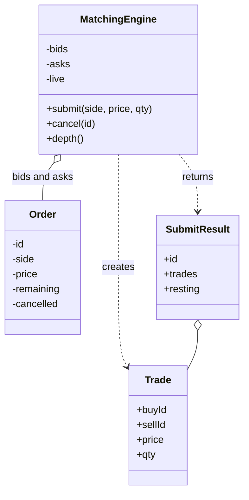

## Requirements

A **limit order** is an instruction to buy or sell up to a quantity at a price no worse than a limit: a buy limit of 101 means "pay 101 or less", a sell limit of 101 means "receive 101 or more".

| Question | Decision |
|---|---|
| Which orders? | Limit orders only. Market orders are an extension |
| Which side matches first? | The best price: the highest buy (bid) and the lowest sell (ask) |
| Same price? | The earlier order goes first. This is **price-time priority** |
| At what price does a trade happen? | The price of the order that was already resting on the book |
| Partial fills? | Yes. An order can trade in several pieces and the unfilled rest stays on the book |
| Cancel? | Yes, by id, while the order is still resting |

Out of scope: market orders, many symbols, persistence, fees, auctions.

## Entities and responsibilities

| Class | Responsibility |
|---|---|
| `Order` | Id, side, limit price and remaining quantity, plus a cancelled flag |
| `Trade` | Buy id, sell id, price, quantity. The output of matching |
| `MatchingEngine` | Owns both sides of the book. Accepts orders, matches, cancels, reports depth |
| Bid heap | Priority queue ordered by highest price, then earliest id |
| Ask heap | Priority queue ordered by lowest price, then earliest id |
| Live map | Resting orders by id, for cancel and depth |



## The order book

The **order book** has two sides. Bids are buyers waiting, asks are sellers waiting. Orders cross, and a trade happens, when the best bid is at or above the best ask.

The book after the first four orders of the demo (orders 1-3 are sells, order 4 is a buy):

| Side | Price | Resting orders (earliest first) | Total |
|---|---|---|---|
| Ask | 102 | #2 (5) | 5 |
| Ask | 101 | #1 (5), #3 (3) | 8 |
| Bid | 100 | #4 (4) | 4 |

The best ask is 101 and the best bid is 100. The gap between them is the **spread**. Nothing trades while the best bid is below the best ask. Order 1 sits ahead of order 3 at price 101 because it arrived first.

## Key flows

**Submit** an incoming order:

1. Take the opposite side's heap. A buy looks at asks, a sell looks at bids.
2. Look at its best order. Drop cancelled orders from the top first.
3. If there is no such order, or the prices do not cross, stop matching.
4. Trade `min(incoming remaining, resting remaining)`. The price is the resting order's price.
5. If the resting order is empty, remove it. Go back to step 2 while the incoming order has quantity left.
6. If quantity remains, add the incoming order to its own side's heap and to the live map.

**Cancel** by id:

1. Look the order up in the live map. If it is missing, it was filled or already cancelled.
2. Remove it from the map and set `cancelled = true`. It stays inside the heap.
3. When it reaches the top later, `best()` discards it. This is **lazy deletion**.

:::key
The trade price is the resting order's price, not the incoming one. A sell limit of 99 against a resting bid of 100 trades at 100. The seller is guaranteed "99 or better" and gets 100.
:::

Why lazy deletion? A binary heap cannot remove an arbitrary element cheaply: finding it costs $O(n)$. Marking is $O(1)$, and the cost is paid only if the order ever reaches the top, in $O(\log n)$.

```quiz
q: A sell limit of 99 for 6 arrives. The best resting bid is 100 for 4. At what price does the first trade happen?
options:
  - 99, the incoming order's limit
  - 100, the resting order's price
  - 99.5, the midpoint
answer: 1
why: "The resting order set its price first, so trades happen there. The incoming seller gets a better price than the limit requires."
```

## Code

Heap ordering is the part that goes wrong. In Java, `PriorityQueue` pops the smallest element by the comparator, so the bid comparator negates price. In C++, `std::priority_queue` pops the *largest*, so each comparator answers "does `a` rank below `b`?" and the signs flip.

```java
import java.util.*;

enum Side { BUY, SELL }

// Prices are integers (for example paise) and ids grow with arrival,
// so a smaller id means an earlier order: that is the time priority.
class Order {
    final int id, price;
    final Side side;
    int remaining;
    boolean cancelled;
    Order(int id, Side side, int price, int qty) { this.id = id; this.side = side; this.price = price; this.remaining = qty; }
}

class Trade {
    final int buyId, sellId, price, qty;
    Trade(int buyId, int sellId, int price, int qty) { this.buyId = buyId; this.sellId = sellId; this.price = price; this.qty = qty; }
}

class SubmitResult {
    final int id, resting;       // resting = quantity left on the book after matching
    final List<Trade> trades;
    SubmitResult(int id, List<Trade> trades, int resting) { this.id = id; this.trades = trades; this.resting = resting; }
}

class MatchingEngine {
    // Best bid first: highest price, then earliest id.
    private final PriorityQueue<Order> bids = new PriorityQueue<>(
        Comparator.comparingInt((Order o) -> -o.price).thenComparingInt(o -> o.id));
    // Best ask first: lowest price, then earliest id.
    private final PriorityQueue<Order> asks = new PriorityQueue<>(
        Comparator.comparingInt((Order o) -> o.price).thenComparingInt(o -> o.id));
    private final Map<Integer, Order> live = new HashMap<>();   // resting orders by id
    private int nextId = 1;

    SubmitResult submit(Side side, int price, int qty) {
        Order in = new Order(nextId++, side, price, qty);
        PriorityQueue<Order> opposite = side == Side.BUY ? asks : bids;
        List<Trade> trades = new ArrayList<>();

        while (in.remaining > 0) {
            Order best = best(opposite);
            if (best == null || !crosses(in, best)) break;
            int q = Math.min(in.remaining, best.remaining);
            in.remaining -= q;
            best.remaining -= q;
            Order buy = side == Side.BUY ? in : best;
            Order sell = side == Side.BUY ? best : in;
            trades.add(new Trade(buy.id, sell.id, best.price, q));   // trades happen at the resting price
            if (best.remaining == 0) {
                opposite.poll();
                live.remove(best.id);
            }
        }
        if (in.remaining > 0) {
            (side == Side.BUY ? bids : asks).add(in);
            live.put(in.id, in);
        }
        return new SubmitResult(in.id, trades, in.remaining);
    }

    // Lazy cancellation: mark the order; it is dropped when it reaches the top of its heap.
    int cancel(int id) {
        Order o = live.remove(id);
        if (o == null) return -1;
        o.cancelled = true;
        return o.remaining;
    }

    private Order best(PriorityQueue<Order> q) {
        while (!q.isEmpty() && q.peek().cancelled) q.poll();
        return q.peek();
    }

    private static boolean crosses(Order incoming, Order resting) {
        return incoming.side == Side.BUY ? incoming.price >= resting.price : incoming.price <= resting.price;
    }

    String depth() {
        TreeMap<Integer, Integer> b = new TreeMap<>(Comparator.reverseOrder());
        TreeMap<Integer, Integer> a = new TreeMap<>();
        for (Order o : live.values()) (o.side == Side.BUY ? b : a).merge(o.price, o.remaining, Integer::sum);
        return "bids " + levels(b) + " | asks " + levels(a);
    }

    private static String levels(Map<Integer, Integer> m) {
        if (m.isEmpty()) return "-";
        StringJoiner j = new StringJoiner(" ");
        m.forEach((price, qty) -> j.add(price + "x" + qty));
        return j.toString();
    }
}

public class Main {
    static void submit(MatchingEngine e, Side side, int price, int qty) {
        SubmitResult r = e.submit(side, price, qty);
        System.out.println("> " + side + " " + qty + " @ " + price + " -> order " + r.id);
        for (Trade t : r.trades)
            System.out.println("  trade " + t.qty + " @ " + t.price + " (buy#" + t.buyId + " sell#" + t.sellId + ")");
        if (r.resting > 0) System.out.println("  resting " + r.resting);
    }

    static void cancel(MatchingEngine e, int id) {
        int left = e.cancel(id);
        System.out.println("> cancel " + id);
        System.out.println(left < 0 ? "  order " + id + " not found (filled or cancelled)"
                                    : "  cancelled, " + left + " was unfilled");
    }

    public static void main(String[] args) {
        MatchingEngine e = new MatchingEngine();
        submit(e, Side.SELL, 101, 5);
        submit(e, Side.SELL, 102, 5);
        submit(e, Side.SELL, 101, 3);
        submit(e, Side.BUY, 100, 4);
        System.out.println("  " + e.depth());
        submit(e, Side.BUY, 101, 7);
        submit(e, Side.BUY, 102, 4);
        submit(e, Side.SELL, 99, 6);
        System.out.println("  " + e.depth());
        submit(e, Side.BUY, 98, 10);
        submit(e, Side.BUY, 99, 1);
        cancel(e, 7);
        cancel(e, 7);
        submit(e, Side.BUY, 102, 5);
        System.out.println("  " + e.depth());
    }
}
```
```cpp
#include <algorithm>
#include <functional>
#include <iostream>
#include <map>
#include <memory>
#include <queue>
#include <string>
#include <unordered_map>
#include <vector>

enum class Side { Buy, Sell };

// Prices are integers (for example paise) and ids grow with arrival,
// so a smaller id means an earlier order: that is the time priority.
struct Order {
    int id;
    Side side;
    int price;
    int remaining;
    bool cancelled = false;
};
using OrderPtr = std::shared_ptr<Order>;  // shared: the heap and the id map both refer to the order

struct Trade {
    int buyId, sellId, price, qty;
};

struct SubmitResult {
    int id;
    std::vector<Trade> trades;
    int resting;  // quantity left on the book after matching
};

// std::priority_queue keeps the element that compares as "largest" on top.
// So each comparator answers: does a rank below b?
struct BidOrder {  // best bid first: highest price, then earliest id
    bool operator()(const OrderPtr& a, const OrderPtr& b) const {
        return a->price != b->price ? a->price < b->price : a->id > b->id;
    }
};
struct AskOrder {  // best ask first: lowest price, then earliest id
    bool operator()(const OrderPtr& a, const OrderPtr& b) const {
        return a->price != b->price ? a->price > b->price : a->id > b->id;
    }
};

class MatchingEngine {
public:
    SubmitResult submit(Side side, int price, int qty) {
        auto in = std::make_shared<Order>(Order{nextId_++, side, price, qty});
        std::vector<Trade> trades;

        while (in->remaining > 0) {
            OrderPtr best = side == Side::Buy ? best_(asks_) : best_(bids_);
            if (!best || !crosses(*in, *best)) break;
            int q = std::min(in->remaining, best->remaining);
            in->remaining -= q;
            best->remaining -= q;
            const Order& buy = side == Side::Buy ? *in : *best;
            const Order& sell = side == Side::Buy ? *best : *in;
            trades.push_back(Trade{buy.id, sell.id, best->price, q});  // trades happen at the resting price
            if (best->remaining == 0) {
                if (side == Side::Buy) asks_.pop(); else bids_.pop();
                live_.erase(best->id);
            }
        }
        if (in->remaining > 0) {
            if (side == Side::Buy) bids_.push(in); else asks_.push(in);
            live_[in->id] = in;
        }
        return SubmitResult{in->id, trades, in->remaining};
    }

    // Lazy cancellation: mark the order; it is dropped when it reaches the top of its heap.
    int cancel(int id) {
        auto it = live_.find(id);
        if (it == live_.end()) return -1;
        OrderPtr o = it->second;
        live_.erase(it);
        o->cancelled = true;
        return o->remaining;
    }

    std::string depth() const {
        std::map<int, int, std::greater<int>> b;
        std::map<int, int> a;
        for (const auto& [id, o] : live_) (o->side == Side::Buy ? b[o->price] : a[o->price]) += o->remaining;
        return "bids " + levels(b) + " | asks " + levels(a);
    }

private:
    template <class Heap>
    static OrderPtr best_(Heap& q) {
        while (!q.empty() && q.top()->cancelled) q.pop();
        return q.empty() ? nullptr : q.top();
    }

    static bool crosses(const Order& incoming, const Order& resting) {
        return incoming.side == Side::Buy ? incoming.price >= resting.price : incoming.price <= resting.price;
    }

    template <class Map>
    static std::string levels(const Map& m) {
        if (m.empty()) return "-";
        std::string out;
        for (const auto& [price, qty] : m) out += (out.empty() ? "" : " ") + std::to_string(price) + "x" + std::to_string(qty);
        return out;
    }

    std::priority_queue<OrderPtr, std::vector<OrderPtr>, BidOrder> bids_;
    std::priority_queue<OrderPtr, std::vector<OrderPtr>, AskOrder> asks_;
    std::unordered_map<int, OrderPtr> live_;  // resting orders by id
    int nextId_ = 1;
};

void submit(MatchingEngine& e, Side side, int price, int qty) {
    SubmitResult r = e.submit(side, price, qty);
    std::cout << "> " << (side == Side::Buy ? "BUY" : "SELL") << " " << qty << " @ " << price << " -> order " << r.id << "\n";
    for (const Trade& t : r.trades)
        std::cout << "  trade " << t.qty << " @ " << t.price << " (buy#" << t.buyId << " sell#" << t.sellId << ")\n";
    if (r.resting > 0) std::cout << "  resting " << r.resting << "\n";
}

void cancel(MatchingEngine& e, int id) {
    int left = e.cancel(id);
    std::cout << "> cancel " << id << "\n";
    if (left < 0) std::cout << "  order " << id << " not found (filled or cancelled)\n";
    else std::cout << "  cancelled, " << left << " was unfilled\n";
}

int main() {
    MatchingEngine e;
    submit(e, Side::Sell, 101, 5);
    submit(e, Side::Sell, 102, 5);
    submit(e, Side::Sell, 101, 3);
    submit(e, Side::Buy, 100, 4);
    std::cout << "  " << e.depth() << "\n";
    submit(e, Side::Buy, 101, 7);
    submit(e, Side::Buy, 102, 4);
    submit(e, Side::Sell, 99, 6);
    std::cout << "  " << e.depth() << "\n";
    submit(e, Side::Buy, 98, 10);
    submit(e, Side::Buy, 99, 1);
    cancel(e, 7);
    cancel(e, 7);
    submit(e, Side::Buy, 102, 5);
    std::cout << "  " << e.depth() << "\n";
}
```
```output
> SELL 5 @ 101 -> order 1
  resting 5
> SELL 5 @ 102 -> order 2
  resting 5
> SELL 3 @ 101 -> order 3
  resting 3
> BUY 4 @ 100 -> order 4
  resting 4
  bids 100x4 | asks 101x8 102x5
> BUY 7 @ 101 -> order 5
  trade 5 @ 101 (buy#5 sell#1)
  trade 2 @ 101 (buy#5 sell#3)
> BUY 4 @ 102 -> order 6
  trade 1 @ 101 (buy#6 sell#3)
  trade 3 @ 102 (buy#6 sell#2)
> SELL 6 @ 99 -> order 7
  trade 4 @ 100 (buy#4 sell#7)
  resting 2
  bids - | asks 99x2 102x2
> BUY 10 @ 98 -> order 8
  resting 10
> BUY 1 @ 99 -> order 9
  trade 1 @ 99 (buy#9 sell#7)
> cancel 7
  cancelled, 1 was unfilled
> cancel 7
  order 7 not found (filled or cancelled)
> BUY 5 @ 102 -> order 10
  trade 2 @ 102 (buy#10 sell#2)
  resting 3
  bids 102x3 98x10 | asks -
```

Compile the C++ with `g++ -std=c++17 -pthread`.

Follow three events in the output:

- Order 5 buys 7 at 101 and meets order 1 first, then order 3. Same price, so the earlier id wins.
- Order 7 sells 6 at 99 and trades only 4, since the single resting bid held 4. The other 2 rest as the best ask.
- Order 7 is cancelled while it is the top of the ask heap. Order 10 then skips it and trades with order 2.

```predict
lang: java
code: |
  PriorityQueue<int[]> asks = new PriorityQueue<>(
      (a, b) -> a[0] != b[0] ? a[0] - b[0] : a[1] - b[1]);   // {price, id}
  asks.add(new int[]{102, 2});
  asks.add(new int[]{101, 3});
  asks.add(new int[]{101, 1});
  int[] top = asks.poll();
  System.out.println(top[0] + " " + top[1]);
output: 101 1
why: The lowest price is 101. Two orders share it, so the smaller id (earlier arrival) comes out first.
```

```blanks
prompt: Complete the crossing test.
lang: java
code: |
  private static boolean crosses(Order incoming, Order resting) {
      return incoming.side == Side.BUY
          ? incoming.price [[>=]] resting.price
          : incoming.price [[<=]] resting.price;
  }
why: A buyer accepts any ask at or below its limit. A seller accepts any bid at or above its limit.
```

```order
prompt: Arrange the body of the matching loop.
lang: java
code: |
  while (in.remaining > 0) {
      Order best = best(opposite);
      if (best == null || !crosses(in, best)) break;
      int q = Math.min(in.remaining, best.remaining);
      in.remaining -= q;
      best.remaining -= q;
      if (best.remaining == 0) opposite.poll();
  }
distractors:
  - "    best.price = in.price;"
  - "    in.remaining = 0;"
why: Find the best resting order, stop if none or no cross, trade the smaller quantity, reduce both sides, and remove the resting order only once it is empty. A partial fill leaves it in place with a smaller quantity.
```

## Patterns used and why

| Choice | Why |
|---|---|
| Two priority queues | Best bid and best ask are always at the top, in $O(1)$ to read and $O(\log n)$ to update |
| Id as time priority | Ids only grow, so earlier means smaller. One sequence gives fairness |
| Lazy cancellation | $O(1)$ cancel without searching a heap |
| Live map | $O(1)$ lookup by id and the source for depth |
| Integer prices | Exact comparisons. A price of 101.25 becomes 10125 ticks |
| `SubmitResult` | The engine returns facts, the caller prints. Matching has no output logic |

:::truth
Real exchanges keep each symbol on a single thread and feed it from a queue. No locks inside the book, and the order of events is the order of the queue. A multi-threaded book with locks is slower and harder to make fair. For a machine-coding round, say "single-threaded per symbol" and move on.
:::

Complexity: matching one order that fills against $k$ resting orders costs $O(k \log n)$, where $n$ is the number of resting orders. Cancel is $O(1)$ plus the later lazy removal.

## Extensibility

| Change request | What changes |
|---|---|
| Market orders | A price of "any": a very high price for buys, zero for sells. Leftover quantity is discarded, not rested |
| IOC and fill-or-kill | A flag on the order and one branch after the matching loop |
| Order modify | Cancel plus new order. The modified order loses its time priority |
| Many symbols | One engine per symbol, picked by a map |
| Market data feed | Publish each `Trade` and each depth change to subscribers (Observer) |

## Interview tips

- State price-time priority and "trade at the resting price" in your first minute. Both are checked.
- Draw a small book with three price levels and run one order through it.
- Be ready to explain lazy deletion and what it costs, and offer the price-level map as the alternative.
- Decide that the engine returns trades, so it can be tested with plain assertions.
- If asked about scale: one thread per symbol, a sequencer that stamps arrival order, and an append-only log for recovery.

```cards
- q: What is price-time priority?
  a: Better prices match first. At the same price, the order that arrived earlier matches first.
- q: At what price does a trade execute?
  a: At the price of the resting order, not the incoming one.
- q: When do a buy and a sell cross?
  a: When the buy's limit is greater than or equal to the sell's limit.
- q: Why lazy deletion for cancels?
  a: A heap cannot remove an arbitrary element cheaply. Marking is O(1), and removal happens when the order reaches the top.
- q: What happens to the unfilled part of a limit order?
  a: It rests on the book at its limit price, keeping its place in the time queue.
- q: Why store prices as integers?
  a: Exact comparison. Floating point can make two equal prices compare as different.
```

## Notes

:::notes
- Limit order book: bids (buyers) and asks (sellers) at limit prices.
- Priority: best price first, then earliest arrival (price-time priority).
- A buy crosses an ask when buy.price >= ask.price. A sell crosses when sell.price <= bid.price.
- Trades execute at the resting order's price, in quantity min(incoming, resting).
- Partial fill: the resting order stays with less quantity, or the incoming remainder rests.
- Two heaps (max by price for bids, min by price for asks) plus a live map by id.
- Cancel is lazy: mark cancelled, drop it when it reaches the top of its heap.
- Java PriorityQueue pops the smallest; C++ priority_queue pops the largest. Flip the comparator.
- Keep one thread per symbol and integer prices.
:::
