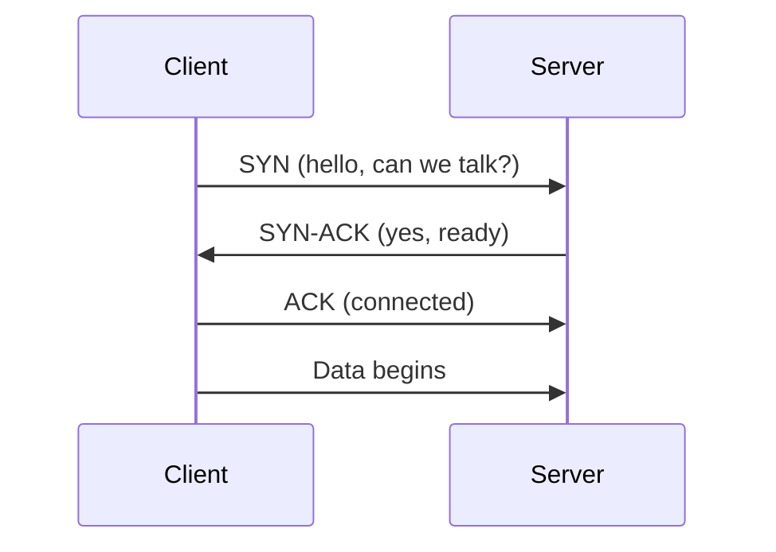

## Why networking shows up in system design

Every box in a design diagram is connected to another box by a network. Each arrow is a cost: time, a chance of failure, and bytes to pay for. You cannot judge a design without a feel for what those arrows cost.

This lesson covers four ideas: addresses, ports, the two main ways to send data, and the numbers.

## IP addresses and ports

An **IP address** (Internet Protocol address) identifies a machine on a network, like a street address.

- **IPv4** addresses are 32 bits, written as four numbers: `142.250.77.46`. That gives about 4.3 billion addresses, which ran out.
- **IPv6** addresses are 128 bits, written in hex: `2001:db8::1`. The space is effectively unlimited.
- **Private ranges** such as `10.0.0.0/8` and `192.168.0.0/16` are only valid inside one network. **NAT** (Network Address Translation) lets many private machines share one public address.

A machine runs many programs, so the address alone is not enough. A **port** is a number from 0 to 65535 that picks the program on that machine. Address plus port is a **socket address**, such as `142.250.77.46:443`.

| Port | Used for |
|---|---|
| 22 | SSH (remote login) |
| 53 | DNS (name lookup) |
| 80 | HTTP |
| 443 | HTTPS |
| 5432 | PostgreSQL |
| 6379 | Redis |

:::note
A **connection** is identified by four values: source address, source port, destination address, destination port. A server on port 443 can hold tens of thousands of connections because each client brings a different source address and port.
:::

## TCP versus UDP

Data travels in small chunks called **packets**. Two protocols (agreed sets of rules) decide how packets are handled.

| | TCP (Transmission Control Protocol) | UDP (User Datagram Protocol) |
|---|---|---|
| Connection | Set up first with a handshake | None, just send |
| Delivery | Guaranteed, retransmits lost packets | Not guaranteed |
| Order | Preserved | Not preserved |
| Speed | Slower start, extra overhead | Low overhead |
| Typical use | Web pages, databases, file transfer | DNS lookups, video calls, games, QUIC |

TCP starts with a **three-way handshake**. It costs one **round trip** (a message there and the reply back) before any data can flow.



TCP also slows itself down when it sees packet loss, to avoid flooding a congested network. That is good for the network and sometimes bad for one stream.

```quiz
q: A live video call drops a packet. Which behaviour is usually better for the user?
options:
  - "TCP: pause until the packet is retransmitted, so nothing is lost"
  - "UDP: skip the lost packet and keep playing the newest data"
  - Either one, they behave the same
answer: 1
why: A retransmitted packet from half a second ago is no longer useful in a live call. A brief glitch is better than a growing delay, which is why real-time media usually runs over UDP.
```

## Latency versus bandwidth

These two are often confused.

- **Latency** is how long one piece of data takes to arrive. Measured in milliseconds.
- **Bandwidth** is how much data can be sent per second. Measured in bits per second.

A pipe analogy: latency is the length of the pipe, bandwidth is its width. A wide pipe does not make water arrive sooner.

:::key
Small requests are limited by latency. Large transfers are limited by bandwidth. Most API calls are small, so round trips matter more than megabits.
:::

Light in fibre travels at roughly two thirds of its speed in vacuum, so distance sets a hard floor. No software fixes the physics of a 200 ms round trip between continents. You fix it by moving data closer (CDNs, regional servers) or by making fewer round trips.

```estimate
q: A client opens a new TCP connection to a server with a 100 ms round-trip time, then sends one request and waits for the response. How long until the response starts arriving, counting only network round trips?
answer: 200
unit: ms
tolerance: 0.2
hint: The handshake costs one round trip. The request and first response bytes cost another.
solution: "Handshake: 1 round trip = 100 ms. Request out and response back: another 100 ms. Total about 200 ms, before the server does any work. This is why reusing connections matters."
```

```estimate
q: You download a 100 MB file over a 100 Mbps link. Approximately how many seconds does the transfer take once it is running at full speed?
answer: 8
unit: s
tolerance: 0.3
hint: Bandwidth is in bits. One byte is 8 bits.
solution: "100 MB = 800 megabits. 800 Mb divided by 100 Mbps = 8 s. Mixing up bytes and bits is the most common error."
```

## Latency numbers worth knowing

These are rounded and vary by hardware, but the ratios hold up. Memorise the shape, not the exact values.

| Operation | Approximate time |
|---|---|
| Read from CPU cache | 1 ns |
| Read from main memory (RAM) | 100 ns |
| Read 4 KB from an SSD | 100 microseconds |
| Round trip inside one data centre | 0.5 ms |
| Disk seek on a spinning hard drive | 10 ms |
| Round trip between continents | 100 to 200 ms |

Three conclusions follow:

1. Memory is about 1,000 times faster than SSD, which is why caches such as Redis exist.
2. A call to another service costs thousands of times more than a function call.
3. Crossing an ocean is the slowest thing in the table by far.

```quiz
questions:
  - q: Roughly how much faster is reading from RAM than a round trip inside the same data centre?
    options:
      - About 2 times
      - About 50 times
      - About 5,000 times
    answer: 2
    why: 100 ns versus 0.5 ms (500,000 ns) is a ratio of about 5,000. This is why in-process caching beats even a fast remote cache.
  - q: Which change reduces latency for a user far from your server?
    options:
      - Buying a larger network link
      - Serving from a location closer to the user
      - Compressing the database
    answer: 1
    why: Extra bandwidth does not shorten distance. Moving content or servers closer cuts the round-trip time itself.
```

:::truth
These numbers are a mental model, not a benchmark. Real systems differ by cloud, hardware and load. Use them to spot a design that is off by a factor of 100, not to argue about 20 percent.
:::

```cards
- q: What identifies a TCP connection?
  a: Source address, source port, destination address, destination port.
- q: TCP versus UDP in one line each.
  a: TCP is reliable and ordered with a handshake. UDP is fire-and-forget with no handshake or ordering.
- q: Latency versus bandwidth?
  a: Latency is the delay of one message. Bandwidth is the data volume per second. Small requests care about latency.
- q: How many round trips does a new TCP connection cost before data can flow?
  a: One, for the three-way handshake.
- q: RAM read versus SSD read versus cross-continent round trip?
  a: About 100 ns, 100 microseconds, and 100 to 200 ms. Each step is roughly a thousand times slower.
```

## Notes

:::notes
- IP address identifies a machine, port identifies a program. A connection is the 4-tuple of both ends.
- IPv4 is 32 bits (about 4.3 billion addresses). IPv6 is 128 bits. NAT lets private networks share a public address.
- Common ports: 22 SSH, 53 DNS, 80 HTTP, 443 HTTPS, 5432 PostgreSQL, 6379 Redis.
- TCP: handshake, reliable, ordered. UDP: no handshake, no guarantees, lower overhead.
- Latency is delay, bandwidth is throughput. Small calls are latency bound, big transfers are bandwidth bound.
- A new TCP connection costs one round trip before data. Reuse connections.
- RAM about 100 ns, SSD about 100 microseconds, same data centre 0.5 ms, cross-continent 100 to 200 ms.
- Bits versus bytes: divide megabits by 8 to get megabytes.
:::
