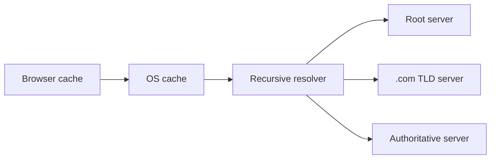
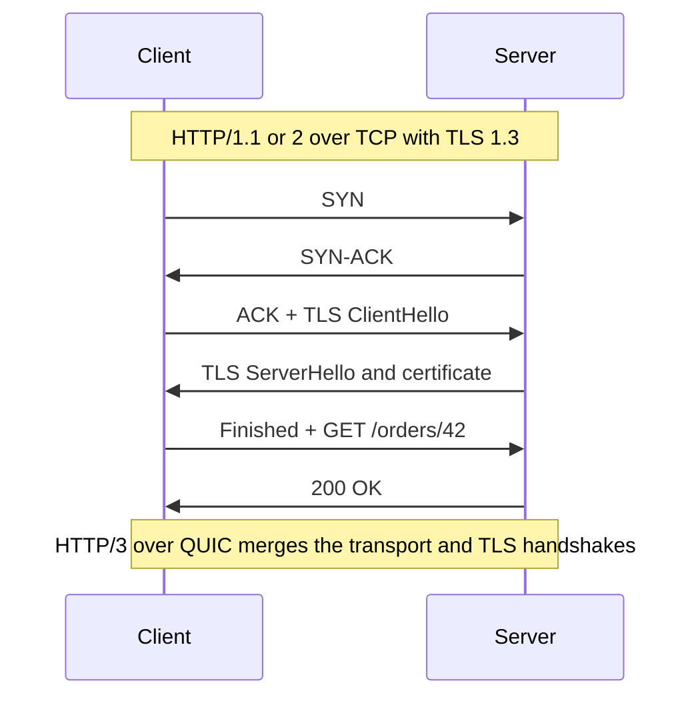

## What happens before the first byte

You type `shop.example.com`. Your browser cannot send anything yet, because networks route by IP address, not by name. Two systems fix that:

- **DNS** (Domain Name System) turns a name into an IP address.
- **HTTP** (HyperText Transfer Protocol) is the language the browser and server then speak. **HTTPS** is HTTP wrapped in encryption.

## DNS: the lookup chain

DNS is a distributed phone book. No single server knows everything, so the lookup walks a chain.



- **Recursive resolver**: a server run by your ISP or a public service (for example 1.1.1.1 or 8.8.8.8). It does the walking for you and caches answers.
- **Root server**: knows which servers handle each top-level domain (TLD) such as `.com` or `.in`.
- **TLD server**: knows which server is authoritative for `example.com`.
- **Authoritative server**: holds the real records for the domain. Route 53 and Cloudflare DNS are common examples.

```order
prompt: Put a cold-cache lookup of shop.example.com in order.
lang: text
code: |
  Browser and OS caches have no answer
  Resolver asks a root server and is pointed to the .com servers
  Resolver asks a .com server and is pointed to the authoritative server
  Authoritative server returns the IP address
  Resolver caches the answer and returns it to the browser
why: Each layer only knows who to ask next. The final answer is cached at every level on the way back, so the long walk is rare.
```

### Records and TTL

| Record | Meaning | Example |
|---|---|---|
| A | name to IPv4 address | `shop.example.com -> 203.0.113.10` |
| AAAA | name to IPv6 address | same, for IPv6 |
| CNAME | name is an alias of another name | `www -> shop.example.com` |
| NS | which servers are authoritative | `ns1.provider.com` |

Every record has a **TTL** (time to live): how many seconds caches may keep the answer. A TTL of 300 means a change can take up to five minutes to reach everyone.

:::key
DNS is also a cheap load-balancing and failover tool: return several IPs, or change the answer when a data centre fails. The catch is that you cannot recall an answer that is already cached.
:::

```quiz
q: You must move your service to a new IP address next week. Which preparation helps most?
options:
  - Lower the record's TTL a few days ahead, then change the IP
  - Raise the TTL so caches hold the answer longer
  - Nothing, DNS updates instantly everywhere
answer: 0
why: Caches obey the old TTL. If it is low by the time you switch, almost every cache expires quickly and sees the new IP. Raising it does the opposite.
```

## HTTP: request and response

HTTP is request-response: the client asks, the server answers. It is **stateless**, meaning the server keeps no memory between requests unless you send something (a cookie or token) that identifies you.

```http
GET /orders/42 HTTP/1.1
Host: shop.example.com
Authorization: Bearer <token>
Accept: application/json
```

```http
HTTP/1.1 200 OK
Content-Type: application/json
Cache-Control: max-age=60

{"id": 42, "status": "shipped"}
```

### Methods

| Method | Use | Safe (no change) | Idempotent (repeat is harmless) |
|---|---|---|---|
| GET | read | yes | yes |
| POST | create, or run an action | no | no |
| PUT | replace a whole resource | no | yes |
| PATCH | change part of a resource | no | not guaranteed |
| DELETE | remove | no | yes |

### Status codes

- **2xx** success: 200 OK, 201 Created, 204 No Content.
- **3xx** redirect: 301 moved permanently, 304 not modified (use your cached copy).
- **4xx** the client erred: 400 bad request, 401 not authenticated, 403 not allowed, 404 not found, 429 too many requests.
- **5xx** the server erred: 500 internal error, 502 bad gateway, 503 unavailable, 504 gateway timeout.

### Headers worth knowing

- `Cache-Control`: how long a response may be cached.
- `Content-Type`: the format of the body.
- `Authorization`: credentials.
- `Cookie` / `Set-Cookie`: small state kept by the browser.
- `ETag`: a version fingerprint; the client can ask "has this changed?" and get a cheap 304.

```quiz
questions:
  - q: A request returns 502. Whose problem is it most likely?
    options:
      - The client sent malformed JSON
      - A proxy or gateway could not get a valid answer from the server behind it
      - The user is not logged in
    answer: 1
    why: 5xx codes blame the server side. 502 means a gateway such as Nginx received a bad response, or none, from the upstream server. Malformed input would be 400 and a missing login 401.
  - q: Which method is both safe and idempotent?
    options:
      - POST
      - DELETE
      - GET
    answer: 2
    why: GET changes nothing, so it is safe, and repeating it changes nothing more, so it is idempotent. DELETE is idempotent but not safe.
```

## TLS: what the S in HTTPS adds

**TLS** (Transport Layer Security) wraps the connection to give three things:

- **Encryption**: eavesdroppers see random bytes.
- **Integrity**: tampering is detected.
- **Authentication**: the server proves its identity with a **certificate** signed by a trusted authority, so you know `shop.example.com` is really that site.

The handshake agrees on a shared secret key; after that, fast symmetric encryption protects the data. TLS 1.3 needs one round trip for this, and sessions can resume faster later. In practice a load balancer or CDN often does the TLS work, called **TLS termination**.

## HTTP/1.1, HTTP/2, HTTP/3

Each version fixes the main waste of the one before.

| Version | Runs on | Key idea | Weakness |
|---|---|---|---|
| 1.1 | TCP | one request at a time per connection; browsers open about 6 connections per origin | head-of-line blocking: a slow response holds up the ones behind it |
| 2 | TCP | many requests interleaved on one connection (multiplexing), compressed headers | one lost TCP packet stalls every stream |
| 3 | QUIC over UDP | independent streams; TLS built in | newer; some networks block UDP |



Counting round trips: TCP takes 1, TLS 1.3 takes 1 more, then the request takes 1. HTTP/3 merges the first two.

```estimate
q: A client is 100 ms round-trip from the server. A first-ever HTTPS request over TCP with TLS 1.3 needs one round trip for TCP, one for TLS and one for the request and response. How long until the response arrives, ignoring DNS and server time?
answer: 300
unit: ms
tolerance: 0.2
hint: Count round trips and multiply by the round-trip time.
solution: "3 round trips × 100 ms = 300 ms. A reused connection needs only 1, which is 100 ms. This is why keep-alive connections and CDNs close to users matter."
```

:::truth
Most latency complaints blamed on "the server" are really connection setup, DNS misses, or distance. Measure with browser developer tools (the Network tab splits DNS, connect, TLS and waiting time) before you optimise.
:::

## In the real world

- **Nginx** or **HAProxy** terminate TLS and speak HTTP/2 to browsers, often plain HTTP/1.1 to your app servers.
- **CloudFront** and **Cloudflare** serve HTTP/3 at the edge, close to the user.
- **Route 53** offers weighted and health-checked DNS records for failover.

```blanks
prompt: Complete the response meanings.
lang: text
code: |
  [[404]] means the resource was not found.
  [[429]] means the client sent too many requests.
  [[503]] means the server is temporarily unavailable.
why: 404 is a client error about the URL, 429 is rate limiting, 503 is a server-side outage or overload.
```

## Interview angle

- Say what happens when you type a URL: DNS, TCP, TLS, request, response. Most candidates stop after DNS.
- Mention TTL trade-offs: low TTL gives fast failover but more lookups.
- Know why HTTP/2 helps (one connection, many streams) without claiming it fixes everything.

```cards
- q: Name the four stops of a cold DNS lookup.
  a: Recursive resolver, root server, TLD server (.com), authoritative server.
- q: What does a DNS TTL control?
  a: How many seconds a cache may reuse an answer. It limits how fast a change spreads.
- q: Safe versus idempotent HTTP methods?
  a: Safe means no change to the server. Idempotent means repeating gives the same result. GET is both; PUT and DELETE are idempotent only.
- q: What three things does TLS provide?
  a: Encryption, integrity and server authentication via certificates.
- q: What problem does HTTP/2 multiplexing solve?
  a: Many requests share one TCP connection, so a slow response no longer blocks the ones behind it at the HTTP level.
- q: Why is HTTP/3 built on QUIC over UDP?
  a: Independent streams avoid TCP-level head-of-line blocking, and the transport and TLS handshakes merge to save a round trip.
```

## Notes

:::notes
- DNS chain: browser/OS cache, recursive resolver, root, TLD, authoritative server. Answers are cached at every level.
- TTL is the cache lifetime of a record. Lower it before a planned migration; you cannot recall cached answers.
- Records: A (IPv4), AAAA (IPv6), CNAME (alias), NS (authoritative servers).
- HTTP is stateless request-response. State travels in cookies or tokens.
- GET, PUT and DELETE are idempotent; only GET is also safe. POST is neither.
- Status classes: 2xx ok, 3xx redirect, 4xx client error, 5xx server error. 502/504 usually mean a proxy problem.
- TLS gives encryption, integrity and authentication. TLS 1.3 handshake costs one round trip.
- Cold HTTPS request over TCP: about 3 round trips; reused connection: 1.
- HTTP/1.1 blocks head of line, HTTP/2 multiplexes on TCP, HTTP/3 uses QUIC over UDP.
:::
