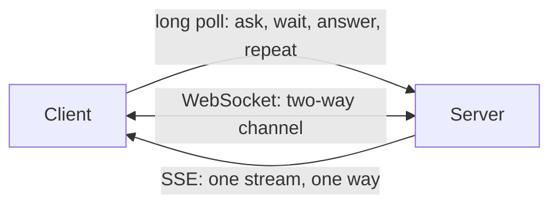

## What an API is

An **API** (Application Programming Interface) is the contract that lets one program call another: what you may ask for, the shape of the request, the shape of the answer. In system design you meet two kinds:

- **Request-response**: the client asks, the server answers (REST, gRPC, GraphQL).
- **Push**: the server sends data without being asked each time (WebSockets, SSE, long polling).

## REST

**REST** (Representational State Transfer) is a style: everything is a *resource* with a URL, and HTTP methods say what to do.

```http
GET    /v1/orders/42          -> read one order
GET    /v1/orders?limit=20    -> list orders
POST   /v1/orders             -> create an order (201 Created)
PUT    /v1/orders/42          -> replace it
DELETE /v1/orders/42          -> remove it (204 No Content)
```

Rules of thumb:

- Nouns in URLs (`/orders`), verbs from the method.
- JSON bodies, correct status codes, stateless requests.
- Each request carries what the server needs, such as an auth token.

:::truth
Most "REST APIs" are JSON over HTTP with sensible URLs. Few follow the full academic definition (such as hypermedia links), and interviews do not expect it.
:::

### Idempotency

A request is **idempotent** if sending it twice has the same effect as sending it once. Networks lose responses, clients retry, so a retried `POST /payments` could charge twice.

Fix: the client sends a unique `Idempotency-Key` header. The server stores the key with the result; a repeat returns the stored result instead of acting again.

```http
POST /v1/payments
Idempotency-Key: 7c9e6b1a-4f2d-4d6a-9a53-1d2f
```

```quiz
q: A mobile client times out after sending POST /payments and retries automatically. What prevents a double charge?
options:
  - Switching the call to GET
  - An idempotency key stored by the server with the first result
  - Using HTTPS
answer: 1
why: HTTPS protects the data in transit, not duplicates. The server must recognise the retry by its key and return the earlier outcome. GET must not change data.
```

### Pagination

Never return an unbounded list. Two common ways:

| Style | Request | Good | Bad |
|---|---|---|---|
| Offset | `?offset=40&limit=20` | simple, jump to any page | slow for large offsets (database scans and skips rows); items shift when data changes |
| Cursor | `?after=1050&limit=20` | fast, stable under inserts | no jumping to page 7 |

A cursor query uses an indexed column, so the database seeks straight to the position:

```blanks
prompt: Complete a cursor page of newest-first posts after id 1050.
lang: sql
code: |
  SELECT * FROM posts
  WHERE id [[<]] 1050
  ORDER BY id [[DESC]]
  LIMIT 20;
why: Newest first means ids decrease. The next page starts with ids smaller than the last one seen, in descending order.
```

### Versioning

Clients you do not control keep running old code, so changes must not break them.

- Put the version in the URL (`/v1/orders`) or a header. URL is the most common.
- Adding fields is safe. Removing or renaming fields needs a new version.
- Announce deprecations and support the old version for a stated period.

## gRPC

**gRPC** is Google's RPC (Remote Procedure Call: call a function on another machine) framework. You define services and messages in a `.proto` file; tools generate client and server code. Data is sent as compact binary **Protocol Buffers** over HTTP/2.

- Fast and small, strongly typed, supports streaming in both directions.
- Hard to call by hand from a browser or inspect with plain tools.
- Common for service-to-service calls inside a company.

## GraphQL

**GraphQL** gives clients one endpoint and lets them name exactly the fields they want.

```text
query { user(id: 7) { name, orders(first: 3) { id, total } } }
```

- Solves over-fetching (too much data) and under-fetching (several round trips) for varied clients such as mobile and web.
- Costs: caching is harder than with URL-per-resource, and a careless query can be expensive, so you need depth limits and query cost checks.

| | REST | gRPC | GraphQL |
|---|---|---|---|
| Format | JSON | binary Protobuf | JSON |
| Best for | public APIs | internal services | varied client screens |
| Caching | easy (HTTP) | manual | harder |
| Typed contract | optional (OpenAPI) | built in | built in |

## Pushing data to clients

Plain HTTP cannot let the server speak first. Three workarounds:

- **Long polling**: the client asks, the server holds the request open until it has news or a timeout (often 30 seconds), then the client asks again. Works everywhere, wastes some capacity.
- **SSE** (Server-Sent Events): one long-lived HTTP response, server to client only, with automatic reconnect. Good for feeds and notifications.
- **WebSocket**: an upgrade of an HTTP connection into a two-way channel. Good for chat and games; stateful, so load balancing and reconnects need care.



```quiz
q: Which fits a live score ticker where the client only needs updates, never sends any?
options:
  - WebSocket, because it is always the best
  - SSE, because it is one-way and reconnects automatically
  - Offset pagination every second
answer: 1
why: One-way push is exactly SSE. A WebSocket works but adds two-way state you do not need. Polling every second creates constant load.
```

```estimate
q: One million clients use long polling with a 30-second timeout, and no events arrive. Each client re-sends its request when the timeout hits. Requests per second reaching the servers?
answer: 33000
unit: req/s
tolerance: 0.3
hint: Divide the client count by the timeout in seconds.
solution: "10^6 clients ÷ 30 s ≈ 33,000 req/s, even when nothing happens. Real events add more. This is why SSE or WebSockets suit large audiences."
```

## In the real world

- **Stripe** popularised idempotency keys; **GitHub** offers both REST and GraphQL.
- **Envoy**, **Nginx** and cloud load balancers can proxy gRPC and WebSockets.
- Chat products usually hold WebSockets behind a gateway; **Redis** pub/sub or **Kafka** fans messages out between servers.

## Interview angle

- Start with REST unless the requirements point elsewhere; justify any other choice.
- Always raise pagination and idempotency for list and write endpoints.
- For real-time features, name the push mechanism and how many open connections one server can hold.

```cards
- q: What does idempotent mean for an API call?
  a: Sending it several times has the same effect as sending it once. Achieved for POST with an idempotency key.
- q: Offset versus cursor pagination?
  a: Offset is simple but slow and unstable at depth. Cursor seeks by an indexed value, is fast and stable, but cannot jump to arbitrary pages.
- q: When is gRPC a good choice?
  a: Internal service-to-service calls needing speed, compact messages, typed contracts and streaming.
- q: What problem does GraphQL solve and what does it cost?
  a: It lets clients fetch exactly the fields they need in one call. Costs are harder caching and the need to limit expensive queries.
- q: Long polling versus SSE versus WebSocket?
  a: Long polling repeats held requests, SSE is a one-way stream, WebSocket is a two-way channel.
```

## Notes

:::notes
- REST: resources as nouns in URLs, HTTP methods as verbs, status codes for outcomes, JSON bodies.
- Idempotency key lets clients retry writes safely; the server stores the first result per key.
- Offset pagination is simple but degrades with depth; cursor pagination is fast and stable.
- Version in the URL; adding fields is safe, removing needs a new version.
- gRPC: binary Protobuf over HTTP/2, typed, streaming; best between internal services.
- GraphQL: one endpoint, client picks fields; watch caching and query cost.
- Push options: long polling (universal, wasteful), SSE (one-way, simple), WebSocket (two-way, stateful).
- Long polling with N clients and timeout T costs about N/T requests per second even when idle.
:::
