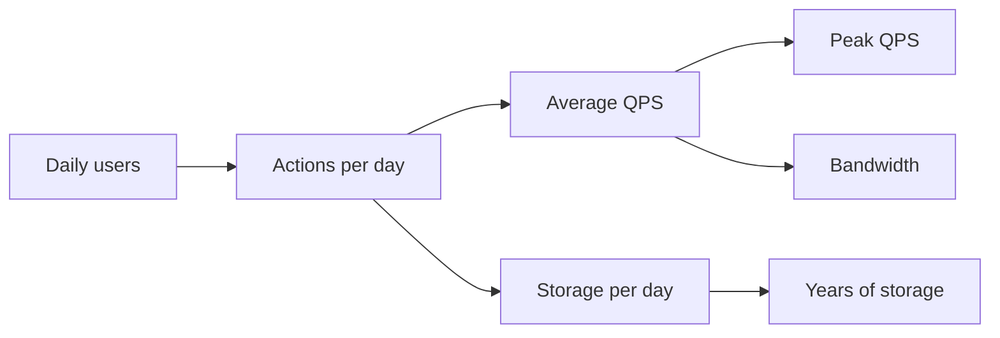

## Why estimate at all

Design choices depend on scale. A system for 100 requests per second can be one server and one database. One for 100,000 cannot. An estimate tells you which world you are in.

- It is **order of magnitude** work: 1,000 versus 10,000 matters, 1,200 versus 1,500 does not.
- Round aggressively. State assumptions out loud. The interviewer checks your method, not your decimals.

## Numbers to carry in your head

### Powers of two

| Power | Approx. value | Name | Unit |
|---|---|---|---|
| 2^10 | 1 thousand | kilo | KB |
| 2^20 | 1 million | mega | MB |
| 2^30 | 1 billion | giga | GB |
| 2^40 | 1 trillion | tera | TB |
| 2^50 | 1 quadrillion | peta | PB |

### Time

- 1 day = 86,400 seconds, call it **1e5** (100,000) seconds. It is off by about 15%, which is fine.
- 1 month is about 2.5 million seconds. 1 year is about 3e7 seconds (30 million).
- 1 million requests per day is about **12 requests per second**. Memorise this one.

### Typical sizes

- A text message or short post: about 100 bytes to 1 KB.
- A database row: about 1 KB.
- A web image: 200 KB to 2 MB. A minute of video: 5 to 50 MB depending on quality.

### Typical server capacity (rough)

- A web or app server: about 1,000 requests per second for simple work.
- A single relational database such as PostgreSQL or MySQL: low thousands of writes per second, more for reads with caching.
- Redis: 100,000+ operations per second on one node for simple commands.
- One server NIC (network card): 1 to 10 Gbps.

:::truth
These capacities swing by 10x depending on hardware and workload. Use them to pick a design shape, then say you would load-test to confirm.
:::

## The method

1. Start from **daily active users** (DAU) and actions per user per day.
2. Convert to **QPS** (queries per second): total per day divided by 1e5.
3. Multiply by 2 to 3 for **peak** traffic; averages hide spikes.
4. Multiply by item size for **storage** and **bandwidth**.
5. Divide by per-server capacity for a rough fleet size.



## Worked example: a photo-sharing app

Assumptions: 100 million DAU, each views 10 photos a day, and 10 million photos are uploaded daily at 2 MB each.

```estimate
q: 100 million daily users view 10 photos each per day. Average read requests per second?
answer: 11500
unit: req/s
tolerance: 0.5
hint: Total views per day is 10^9. Divide by the seconds in a day.
solution: "10^8 × 10 = 10^9 views/day ÷ 86,400 ≈ 11,600 req/s. Using 10^5 gives 10,000, close enough. Peak is about 2-3x, so plan for 30,000."
```

```estimate
q: 10 million photos are uploaded per day at 2 MB each. Storage added per day?
answer: 20
unit: TB/day
tolerance: 0.2
hint: 10^7 × 2 MB is 2×10^7 MB. A TB is 10^6 MB.
solution: "10^7 × 2 MB = 2×10^7 MB = 20 TB per day."
```

```estimate
q: At 20 TB per day, how much photo storage after 5 years, before keeping replicas?
answer: 36
unit: PB
tolerance: 0.3
hint: 20 TB × 365 days × 5 years, then convert TB to PB (1 PB = 1000 TB).
solution: "20 TB × 365 × 5 ≈ 36,500 TB ≈ 36 PB. With 3 copies, about 110 PB. Object storage such as Amazon S3 is built for this; one database is not."
```

```estimate
q: Photos average 200 KB when served. At 10,000 reads per second, what outbound bandwidth is needed in gigabits per second?
answer: 16
unit: Gbps
tolerance: 0.3
hint: 10,000 × 200 KB is bytes per second. Multiply bytes by 8 for bits.
solution: "10,000 × 200 KB = 2 GB/s = 16 Gbps. That is more than one server's network card, which is a strong argument for a CDN (Content Delivery Network, servers near users) such as CloudFront."
```

```estimate
q: Peak traffic is 30,000 requests per second and one app server handles about 1,000. How many servers, ignoring redundancy?
answer: 30
unit: servers
tolerance: order
hint: Divide peak QPS by per-server capacity.
solution: "30,000 ÷ 1,000 = 30 servers. Add spare capacity so losing a few does not overload the rest, perhaps 40 to 45."
```

:::key
The estimate changes the design: 16 Gbps pushes you to a CDN, 36 PB to object storage, 30 servers to a load balancer. If a number does not change a decision, stop calculating it.
:::

```quiz
questions:
  - q: About how many requests per second is 1 million requests per day?
    options:
      - "1"
      - "12"
      - "1,200"
    answer: 1
    why: 10^6 ÷ 86,400 ≈ 11.6. Using 10^5 seconds you get 10, so "about 12" is a fast and safe memory aid.
  - q: Which is closest to 2^30 bytes?
    options:
      - 1 MB
      - 1 GB
      - 1 TB
    answer: 1
    why: 2^10 is about a thousand, so 2^30 is about a thousand million, which is a gigabyte.
  - q: Why multiply average QPS by 2 to 3?
    options:
      - To account for peak hours, since traffic is uneven through the day
      - To pay for replication
      - Because servers run at half speed
    answer: 0
    why: Users are not spread evenly across 24 hours. Systems must handle the busy hour, not the average.
```

## Common mistakes

- Mixing bytes and bits: network speed is in bits, storage in bytes. Multiply by 8.
- Forgetting replication, indexes and metadata when estimating storage.
- Using averages for capacity and ignoring peak.
- Spending five minutes on exact arithmetic. Round 86,400 to 100,000 and move on.

## In the real world

- Teams do the same maths in capacity-planning documents, then confirm with load tests (tools like k6 or JMeter).
- Cloud metrics (CloudWatch, Prometheus) replace guesses once a system is live.

## Interview angle

- Write assumptions on the board first, then calculations.
- Show only the numbers that drive a choice: read-heavy or write-heavy, hot data size, bandwidth.
- Ask the interviewer to confirm your assumptions. Agreement matters more than accuracy.

```cards
- q: Seconds in a day for estimation?
  a: About 1e5 (exactly 86,400).
- q: 1 million requests per day is how many per second?
  a: About 12.
- q: What are 2^10, 2^20, 2^30, 2^40 roughly?
  a: Thousand (KB), million (MB), billion (GB), trillion (TB).
- q: Why compute peak QPS?
  a: Traffic is uneven. Design for the busy hour, typically 2 to 3 times the average.
- q: How do you convert bytes per second to network bandwidth?
  a: Multiply by 8 to get bits per second.
- q: What should an estimate drive?
  a: A design decision such as cache, CDN, sharding or object storage. Skip numbers that decide nothing.
```

## Notes

:::notes
- Estimates are order of magnitude; state assumptions and round hard.
- 1 day is about 1e5 seconds. 1 million per day is about 12 per second.
- 2^10 thousand, 2^20 million, 2^30 billion, 2^40 trillion, 2^50 quadrillion.
- Flow: DAU, actions per day, average QPS, peak QPS (2 to 3x), then storage and bandwidth.
- Storage per day = items per day x size; multiply by days, years and replication.
- Bandwidth = QPS x size x 8 bits. Compare against about 1 to 10 Gbps per server.
- Rough capacity: app server about 1,000 requests per second, Redis 100,000+ operations per second.
- Use results to choose: CDN, object storage, cache, sharding, more servers.
:::
