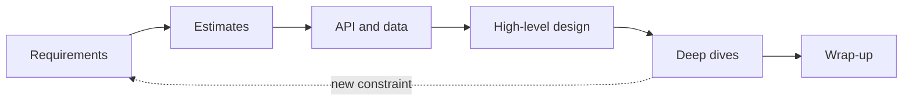

## What the interview tests

A system design interview is a conversation about an open-ended problem such as "design a chat app". There is no single correct answer. The interviewer watches for:

- **Structure**: do you break a vague problem into steps?
- **Requirements thinking**: do you ask before building?
- **Trade-offs**: can you say what each choice costs?
- **Depth**: can you go deep on one or two parts when asked?
- **Communication**: can they follow you and steer you?

:::truth
This is a skill built by practice, not by memorising. Candidates who recite a famous diagram without reasons do worse than those who build a simpler design and explain it.
:::

## The 45-minute plan

| Step | Minutes | Output |
|---|---|---|
| 1. Requirements | 5 | functional and non-functional list, scope agreed |
| 2. Estimates | 5 | QPS, storage, bandwidth, read/write ratio |
| 3. API and data model | 5 | endpoints, main tables or collections |
| 4. High-level design | 10 | boxes-and-arrows diagram that meets the requirements |
| 5. Deep dives | 15 | two or three hard parts examined in detail |
| 6. Wrap-up | 5 | bottlenecks, failures, monitoring, next steps |



Times are a guide. If the interviewer pulls you into a deep dive early, follow them.

```order
prompt: Put the interview steps in a sensible order.
lang: text
code: |
  Clarify requirements and agree on scope
  Estimate traffic, storage and bandwidth
  Define the API and the data model
  Draw the high-level design
  Deep dive into the hardest components
  Discuss bottlenecks, failures and monitoring
why: Each step feeds the next. Requirements decide the numbers, numbers decide the architecture, and the architecture shows where the hard parts are.
```

## Step by step

### 1. Requirements

- **Functional**: what the system does. "Users post messages and read their feed."
- **Non-functional**: how well it does it: latency, availability (the share of time it works), scale, consistency (do all users see the same data at once).
- Ask about scope. "Is this mobile, web or both? Do we need search?"
- Say what is out of scope, then get agreement.

### 2. Estimates

Use the previous lesson. Compute only what shapes the design: read-heavy or write-heavy, hot data size, peak QPS.

### 3. API and data model

- List 3 to 6 endpoints with request and response shapes.
- Sketch the core entities and choose a store, SQL (PostgreSQL) or NoSQL (Cassandra, DynamoDB), with one sentence of reasoning.

### 4. High-level design

- Start simple: client, load balancer, app servers, database. Then add parts only when a requirement or number demands them (cache, queue, CDN, search index).
- Trace one request and one write through the diagram out loud.

### 5. Deep dives

- Pick the parts with the most risk: hot partitions, fan-out, ordering, duplicates, consistency.
- For each, state the problem, two options, your choice and what it costs.

### 6. Wrap-up

- Name the bottleneck and the single points of failure (anything whose failure takes the system down).
- Mention monitoring: latency, error rate, queue depth.
- Say what you would build next with more time.

```quiz
questions:
  - q: The prompt is "design a video platform". What should you do first?
    options:
      - Draw a CDN and a transcoding pipeline immediately
      - Ask clarifying questions and agree on scope
      - Pick a database
    answer: 1
    why: Without scope you may design the wrong system. "Upload only", "live streaming" and "recommendations" lead to very different designs.
  - q: Your estimate shows 50 reads per second and 1 write per second. Which design is most reasonable?
    options:
      - Sharded database with a message queue
      - One database with a replica, maybe a small cache
      - A global multi-region cluster
    answer: 1
    why: This load fits a single machine. Adding complexity that no number demands is a common failure and reads as poor judgement.
```

## Common mistakes

- **Jumping to the diagram.** You solve the wrong problem and cannot defend choices.
- **Buzzword stacking.** Kafka, Redis and microservices with no reason. Every box needs a requirement behind it.
- **No numbers.** "It should scale" means nothing. Scale for what?
- **Silence.** Think aloud. The interviewer cannot reward reasoning they cannot hear.
- **Ignoring failure.** What happens when a server, a disk or a data centre dies?
- **Never saying the trade-off.** Say "this costs us X, and I accept it because Y".
- **Arguing.** If the interviewer hints at a problem, treat it as information and adapt.

## In the real world

Real design review is the same loop: a design document with requirements, numbers, alternatives considered and risks, discussed by the team. The interview is a 45-minute compressed version, so the habits transfer.

## How to practise

- Do one design per week for a few months: set a 45-minute timer, speak aloud, draw on paper.
- Afterwards, compare with a reference article and write what you missed.
- Build one small project that has a cache or a queue. It teaches failure modes that reading cannot.
- Practise with a friend as interviewer. Being questioned is a skill of its own.

```blanks
prompt: Complete the trade-off sentence.
lang: text
code: |
  I chose [[a cache|cache|Redis]] to cut read latency, and this costs us possible stale data.
why: A trade-off names what you gain and what you pay. Caches speed up reads but data can be out of date until it expires or is invalidated.
```

## Interview angle

- Pace yourself with the table above, and glance at the clock.
- Lead the conversation, but check in: "Shall I go deeper here or move on?"
- Finish with a short summary of the design and its known weak spots.

```cards
- q: What are the six steps of the 45-minute framework?
  a: Requirements, estimates, API and data model, high-level design, deep dives, wrap-up.
- q: Functional versus non-functional requirements?
  a: "Functional is what the system does. Non-functional is how well it does it: latency, availability, scale, consistency."
- q: When do you add a component to the design?
  a: When a requirement or a number demands it, never because it is popular.
- q: What is a single point of failure?
  a: A component whose failure takes down the whole system.
- q: How should you present any design choice?
  a: Problem, options, your choice, and what it costs.
```

## Notes

:::notes
- Interviews test structure, trade-offs and communication, not memorised diagrams.
- Plan: requirements 5, estimates 5, API and data model 5, high-level design 10, deep dives 15, wrap-up 5 minutes.
- Requirements: functional (what) and non-functional (latency, availability, scale, consistency). Agree on scope.
- Start simple; add cache, queue or CDN only when a number or requirement needs it.
- For each deep dive: problem, options, choice, cost.
- Wrap up with bottlenecks, single points of failure and monitoring.
- Common mistakes: jumping to diagrams, buzzwords, no numbers, silence, ignoring failures.
- Practise weekly, aloud, timed, then compare with a reference and note gaps.
:::
