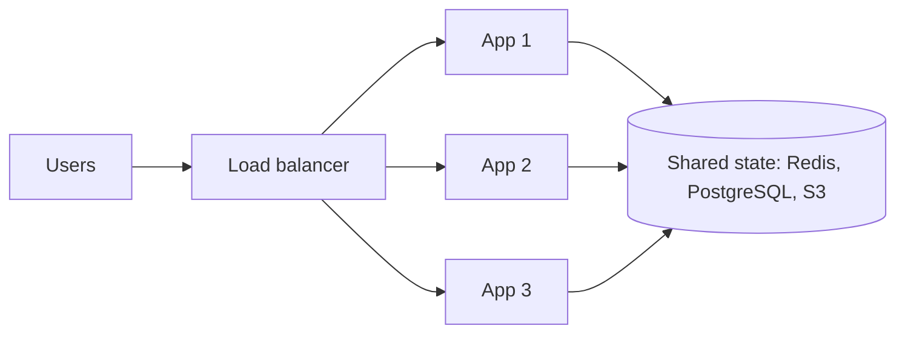

## What scaling means

**Scaling** means making a system handle more load: more users, more requests per second, more data. You scale when one machine can no longer keep up, or when one machine failing would take you down.

Two questions come first:

- What is the bottleneck: CPU, memory, disk, network, or the database?
- Is the load growing, or is it just spiky?

Without numbers, scaling is guessing. Estimate requests per second first (see the back-of-the-envelope lesson), then pick a fix.

```estimate
q: A service gets 50 million requests per day, spread evenly. Roughly how many requests per second is that on average?
answer: 580
unit: req/s
tolerance: 0.5
hint: A day has about 86,400 seconds, close to 10^5.
solution: "5×10^7 ÷ 86,400 ≈ 580 req/s on average. Real traffic is not even; peak is often 2-3x the average, so plan for about 1,500 req/s."
```

## Vertical versus horizontal

- **Vertical scaling (scale up)**: buy a bigger machine. More CPU cores, more RAM, faster disk.
- **Horizontal scaling (scale out)**: add more machines and share the work between them.

| | Vertical | Horizontal |
|---|---|---|
| Effort | Almost none, same code | Needs a load balancer and stateless design |
| Ceiling | Hard limit: the biggest machine you can rent | Far higher, add nodes as needed |
| Failure | One machine, single point of failure (SPOF) | Others keep serving when one dies |
| Cost curve | Gets steep at the top end | Roughly linear |
| Good for | Databases, early stage, quick wins | Web and app tiers, caches, workers |

:::truth
Vertical scaling is underrated. A single modern server with a managed PostgreSQL instance handles far more than most products ever see. Many teams add machines long before they need to, and pay for it in complexity.
:::

```quiz
q: Your app has 2,000 users and CPU is at 85% on one server. What is the sensible first move?
options:
  - Rewrite it as microservices
  - Move to a bigger instance, or profile the code for an obvious hot spot
  - Shard the database across 10 nodes
answer: 1
why: At small scale the cheapest fix is a bigger box or removing waste. Microservices and sharding add large operational cost for a problem you do not have yet.
```

## Stateless services

**State** is data that a server remembers between requests: a login session, a shopping cart, an uploaded file.

A **stateless** server keeps nothing between requests. Everything it needs arrives with the request or is fetched from a shared store. Any server can answer any request, so a load balancer can send traffic anywhere and you can add or remove servers freely.

A **stateful** server remembers things locally. The next request from that user must go back to the same machine, or the data is missing.



:::key
Scaling the app tier is easy only because you push state out of it. The state does not disappear; it moves to a tier built to hold it.
:::

## Where the state goes

| State | Move it to | Why |
|---|---|---|
| Login sessions | Redis (in-memory key-value store) or a signed token such as a JWT (JSON Web Token) | Every server can check it |
| Uploaded files | Object storage such as Amazon S3 | Local disks vanish with the server |
| Frequently read data | A cache like Redis or Memcached | Shared, fast, rebuildable |
| Records that must not be lost | A database like PostgreSQL | Durable, with transactions |
| Background work | A queue like Kafka or RabbitMQ | Survives restarts, spreads work |

Two ways to handle sessions:

- **Server-side session**: server stores data in Redis, browser holds only a session ID cookie. Easy to revoke, one extra lookup per request.
- **Token (JWT)**: the data is inside a signed token the client sends back. No lookup, but hard to revoke before it expires.

```predict
lang: text
prompt: App servers keep sessions in local memory. Two servers sit behind a round-robin load balancer (requests alternate A, B, A, B). A user logs in on request 1. What happens on request 2?
code: |
  request 1 -> server A : POST /login   (session stored in A's memory)
  request 2 -> server B : GET /cart     (B has no such session)
output: 401 Unauthorized
why: Server B never saw the login, so it treats the user as logged out. The fix is a shared session store (Redis) or sticky routing, which you will meet in the load balancing lesson.
```

## The database is different

App servers are easy to clone. Databases are not, because copies must agree on the data.

Typical order of moves when the database becomes the bottleneck:

1. Add indexes and fix slow queries.
2. Put a cache in front for repeated reads.
3. Scale up the database machine.
4. Add **read replicas**: copies that serve reads while one primary takes writes.
5. Split data across machines (**sharding**). This is the hardest step, so it comes last.

You will study replication and sharding later. The point here: scale the stateless tiers by cloning, and treat the data tier carefully.

```quiz
questions:
  - q: Which design can add servers without any code change to session handling?
    options:
      - Sessions in each server's memory
      - Sessions in a shared Redis
      - Sessions in a local file on each server
    answer: 1
    why: A shared store means any server can read any session. Local memory and local files tie the user to one machine.
  - q: Which statement about horizontal scaling is true?
    options:
      - It removes the need for a load balancer
      - It makes every tier equally easy to scale
      - It works best when servers are stateless
    answer: 2
    why: Stateless servers are interchangeable. Databases and other stateful tiers need extra machinery such as replication and sharding.
```

## Interview angle

- Start with the simplest design that meets the numbers, then say what breaks first.
- Name the bottleneck before proposing a fix.
- Say "stateless app tier, state in Redis, S3 and the database" early. It signals you know why scaling works.
- Do not jump to sharding or microservices without a number that justifies them.

```cards
- q: What is the difference between vertical and horizontal scaling?
  a: Vertical makes one machine bigger. Horizontal adds more machines and spreads load across them.
- q: What makes a service stateless?
  a: It keeps nothing between requests, so any server can handle any request.
- q: Why is local-memory session storage a problem with several app servers?
  a: The next request may hit a different server that has no record of the session.
- q: Where should uploaded files live in a scaled-out web app?
  a: In object storage such as S3, not on an app server's local disk.
- q: Which tier is hardest to scale horizontally, and why?
  a: The database, because copies of the data must stay consistent.
```

## Notes

:::notes
- Scaling = handling more load. Find the bottleneck first, using numbers.
- Vertical = bigger machine (simple, has a ceiling, SPOF). Horizontal = more machines (needs a load balancer).
- Vertical scaling is often the right first step; do not over-engineer early.
- Stateless server: keeps nothing between requests, so any server can serve any request.
- State moves out of the app tier: sessions to Redis or tokens, files to S3, data to a database, jobs to a queue.
- JWT avoids a lookup but is hard to revoke; server-side sessions are easy to revoke.
- Database order: indexes, cache, bigger machine, read replicas, then sharding last.
- Interview: simplest design first, then name what breaks and fix that.
:::
