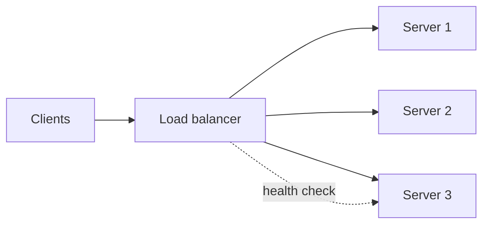

## What it is

A **load balancer** (LB) sits in front of several servers and forwards each incoming request to one of them. Clients talk to one address; the LB picks the server.

It gives you:

- **Capacity**: many servers share the work.
- **Availability**: if one server dies, the LB stops sending traffic to it.
- **Flexibility**: add or remove servers without clients noticing.



Real tools: Nginx, HAProxy, Envoy, AWS Elastic Load Balancing (ALB and NLB), Google Cloud Load Balancing.

## Layer 4 versus layer 7

Network traffic is described in layers. The two that matter here:

- **L4 (transport layer)**: the LB sees IP addresses and TCP/UDP ports only. It forwards connections without reading the content.
- **L7 (application layer)**: the LB reads the HTTP request: URL path, headers, cookies. It can make smarter decisions.

| | L4 | L7 |
|---|---|---|
| Sees | IP, port | URL, headers, cookies, body |
| Speed | Very fast, little work per packet | Slower, must parse HTTP |
| Routing | By address only | By path (`/api`, `/images`), host, header |
| Extras | Few | TLS termination, compression, rate limits, caching |
| Example | AWS NLB, HAProxy in TCP mode | AWS ALB, Nginx, Envoy |

**TLS termination** means the LB decrypts HTTPS once, so backend servers speak plain HTTP and do not each need certificates.

```quiz
q: You want `/api/*` to go to one server group and `/static/*` to another. Which LB type do you need?
options:
  - L4, because it is faster
  - L7, because it can read the URL path
  - Either, the path is in the IP header
answer: 1
why: The path lives inside the HTTP request. Only an L7 balancer parses HTTP, so only it can route by path.
```

## Algorithms

How does the LB choose a server?

- **Round robin**: A, B, C, A, B, C. Simple and fair when requests cost about the same.
- **Weighted round robin**: bigger servers get a larger share.
- **Least connections**: send to the server with the fewest active requests. Better when request durations vary a lot.
- **IP hash**: hash the client address so the same client usually lands on the same server.
- **Consistent hashing**: hash a key (user or URL) onto a ring so adding a server moves few keys. Common in front of caches. It has its own lesson.
- **Random with two choices**: pick two servers at random, take the less loaded. Surprisingly effective and cheap.

Try it. Round robin ignores how busy a server is. In the trace below, request 0 takes 6 seconds. Watch what happens with each strategy, then switch `strategy` to `round-robin` and compare.

```viz
algo: load-balancer
input:
  servers: 3
  strategy: least-connections
  requests: [[0, 6], [0.5, 1], [1, 1], [1.5, 5], [2, 1], [2.5, 1], [3, 2]]
```

:::note
Each request is `[arrival time, duration]` in seconds. With round robin a slow request can pile more work onto a server that is already busy. Least connections avoids that.
:::

## Health checks

An LB must know which servers are alive.

- **Active check**: the LB calls `GET /health` every few seconds. After N failures, the server is removed. After M successes, it returns.
- **Passive check**: the LB watches real traffic; too many errors or timeouts mark a server as bad. Nginx open source does this.

Good health endpoints are cheap and honest. If `/health` always returns 200 even when the database is unreachable, the LB keeps routing traffic to a broken server.

:::warn
Do not make the health check too deep. If every server checks the database and the database slows down, all servers fail the check at once and the LB has nothing left to route to.
:::

```predict
lang: text
prompt: Health check every 5 s. A server is removed after 3 failed checks in a row. The server crashes just after a successful check. Roughly how long can the LB keep sending it traffic?
code: |
  t=0   check ok
  t=1   server crashes
  t=5   check fails (1)
  t=10  check fails (2)
  t=15  check fails (3) -> removed
output: 14 seconds
why: From the crash at t=1 to removal at t=15 is 14 seconds, during which some requests fail. Shorter intervals or passive checks (retry on the next server after an error) reduce this window.
```

## Sticky sessions

**Sticky sessions** (session affinity) route one user to the same server every time, using a cookie or IP hash.

- Use when the server keeps session data in local memory.
- Costs: uneven load, and the user loses their session if that server dies.

:::key
Prefer stateless servers with a shared session store. Treat stickiness as a patch, not a design.
:::

## The LB is a single point of failure

One LB machine is itself a **single point of failure** (SPOF). Fixes:

- Run two LBs, active and standby, sharing a floating IP (tools like keepalived).
- Use a managed LB (AWS ALB) that runs across several zones for you.
- Use DNS to return several LB addresses.

```quiz
questions:
  - q: Requests vary from 10 ms to 10 s. Which algorithm usually spreads load best?
    options:
      - Round robin
      - Least connections
      - IP hash
    answer: 1
    why: Least connections reacts to servers that are busy with long requests. Round robin and IP hash ignore current load.
  - q: Why can sticky sessions cause trouble?
    options:
      - They disable health checks
      - Load becomes uneven and a server failure loses its users' sessions
      - They require an L4 balancer
    answer: 1
    why: Users are pinned to a server, so one heavy user cannot be moved, and a crash discards whatever lived in that server's memory.
```

## Interview angle

- Mention the LB early, then say L7 for HTTP routing and TLS, L4 when you need raw speed.
- Pick least connections or round robin and say why.
- Always cover health checks and the LB's own redundancy.

```cards
- q: L4 versus L7 load balancer in one line each?
  a: L4 routes by IP and port without reading content. L7 reads HTTP (path, headers, cookies) and routes on it.
- q: When does least connections beat round robin?
  a: When request durations vary widely, so equal counts do not mean equal load.
- q: What does a health check do?
  a: It lets the LB detect dead servers and stop routing to them, and bring them back when healthy.
- q: What is TLS termination?
  a: The LB decrypts HTTPS so backend servers receive plain HTTP.
- q: Why avoid sticky sessions?
  a: They cause uneven load and lose the session when the pinned server dies. Use a shared session store instead.
```

## Notes

:::notes
- Load balancer: one front address, many backend servers. Gives capacity and availability.
- L4 sees IP and port (fast, simple). L7 reads HTTP (path routing, TLS termination, headers).
- Round robin for similar requests; least connections for varied durations; IP or consistent hash for affinity.
- Health checks: active (probe /health) and passive (watch real errors). Keep them cheap and honest.
- Health check interval times failure count is how long a dead server keeps getting traffic.
- Sticky sessions are a patch for stateful servers; prefer shared session storage.
- The LB is a SPOF: use an active-standby pair or a managed multi-zone LB.
- Tools: Nginx, HAProxy, Envoy, AWS ALB and NLB.
:::
