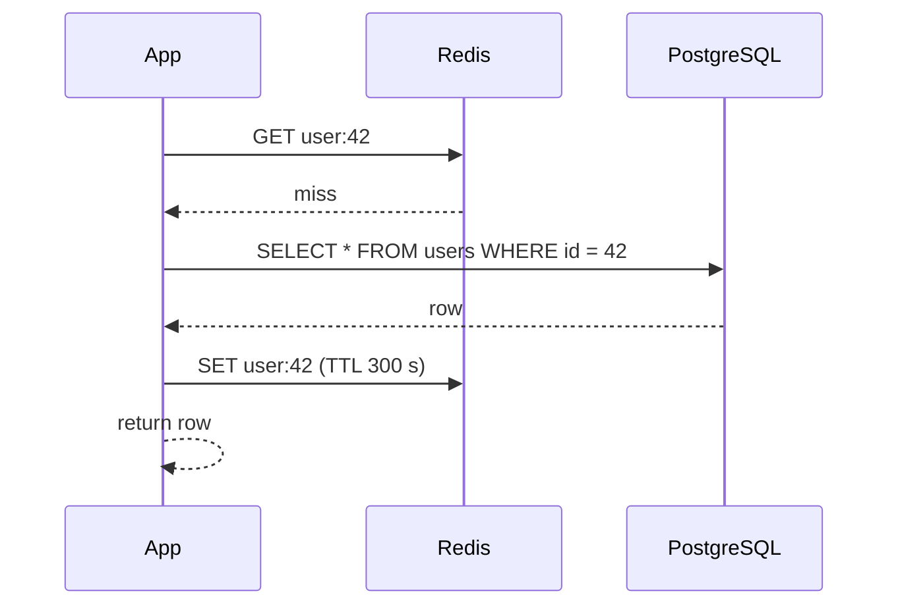

## What a cache is

A **cache** is a small, fast store that keeps copies of data that is expensive to fetch or compute. Reading from memory takes well under a millisecond. A database query over the network often takes 5 to 50 ms.

- A **hit** means the data was in the cache. A **miss** means it was not, so you go to the slower source.
- The **hit ratio** is hits divided by total requests. It is the one number that tells you if a cache is worth having.
- Typical tools: **Redis** and **Memcached** (in-memory key-value servers), plus caches inside your app process, your browser and your CDN.

Why it works: real traffic is lopsided. A small share of keys gets most of the reads, so a cache that holds only the hot keys catches most requests.

```estimate
q: Your API takes 10,000 reads/s. The cache hit ratio is 90%. How many reads per second reach the database?
answer: 1000
unit: reads/s
tolerance: 0.2
hint: Only misses go through. Misses are 10% of traffic.
solution: "10,000 x (1 - 0.9) = 1,000 reads/s. Going from 90% to 99% hits cuts that to 100 reads/s, which is why the last few percent matter."
```

## Four ways to read and write

The patterns differ in who talks to the database and when.

| Pattern | Read path | Write path | Good for |
|---|---|---|---|
| **Cache-aside** | App checks cache, on miss reads DB and fills cache | App writes DB, then deletes or updates the cache entry | The default for most apps |
| **Read-through** | App asks the cache; the cache loads from DB on a miss | Separate from reads | Less app code, needs a smart cache layer |
| **Write-through** | Normal reads | Write goes to cache and DB together, returns after both succeed | Data read soon after writing, no stale reads |
| **Write-back** (write-behind) | Normal reads | Write goes to cache only; DB is updated later in a batch | Heavy write bursts; risk of losing data if the cache dies |

Cache-aside, step by step:



```order
prompt: Arrange a cache-aside read.
lang: python
code: |
  def get_user(id):
      user = cache.get(id)
      if user is not None:
          return user
      user = db.query(id)
      cache.set(id, user, ttl=300)
      return user
distractors:
  - "    cache.delete(id)"
why: Check the cache first, return on a hit, otherwise read the database, store the result with a TTL, and return it. Deleting the key would throw away the very copy you want.
```

## Expiry and eviction

Memory is limited and data goes stale, so entries must leave.

- **TTL** (time to live): each entry expires after N seconds. Simple, and it puts a ceiling on how stale data can get.
- **Eviction**: when memory is full, the cache removes something to make room.
  - **LRU** (Least Recently Used) removes the entry not touched for the longest time.
  - **LFU** (Least Frequently Used) removes the entry used the fewest times.
  - **FIFO** removes the oldest inserted. Rarely the best choice.

LRU is the common default. Redis offers it as `allkeys-lru` (and LFU as `allkeys-lfu`); Redis approximates LRU by sampling keys, which is cheaper than tracking exact order.

Step through an LRU cache of size 3 below. Watch which key leaves when `d` arrives, and what the later `get b` returns.

```viz
algo: lru-cache
input:
  capacity: 3
  ops: ["put a 1", "put b 2", "put c 3", "get a", "put d 4", "get b", "get c"]
```

:::key
An LRU cache is a hash map (find any key in O(1)) plus a doubly linked list (move an entry to the front in O(1)). You will be asked to code this in interviews.
:::

```quiz
q: Which pattern can lose acknowledged writes if the cache node crashes?
options:
  - Cache-aside
  - Write-through
  - Write-back
  - Read-through
answer: 2
why: Write-back returns success after writing only to the cache and flushes to the database later. If the node dies before the flush, those writes are gone. Write-through waits for the database too.
```

## Invalidation and other trouble

Phil Karlton's old joke says the two hard problems are naming things and cache invalidation. Invalidation means making sure readers stop seeing old data after the source changes.

- **TTL only**: easy, but readers may see old data until it expires.
- **Delete on write**: after updating the DB, delete the cache key. The next read refills it. Safer than updating the cache, because two racing writers can leave a stale value.
- **Versioned keys**: put a version in the key (`product:42:v7`). A change means a new key, and the old one simply ages out.

Three classic failures, each with a fix:

| Problem | What happens | Fix |
|---|---|---|
| **Stampede** (thundering herd) | A hot key expires and thousands of requests miss at once, all hitting the DB | A lock so one request refills it; refresh before expiry; add random jitter to TTLs |
| **Penetration** | Requests for keys that do not exist always miss | Cache the "not found" result briefly; a Bloom filter (compact set that says "definitely absent" or "maybe present") |
| **Avalanche** | Many keys share one TTL and expire together | Add random jitter to TTLs; keep replicas warm |

```blanks
prompt: Complete the cache-aside update path.
lang: python
code: |
  def update_price(id, price):
      db.execute("UPDATE products SET price = %s WHERE id = %s", price, id)
      cache.[[delete|del]](f"product:{id}")
      # the next read misses, reads the new row, and refills the cache
why: Update the source of truth first, then remove the stale copy. Deleting is safer than writing the new value into the cache.
```

:::truth
A cache adds a second copy of the data, and two copies can disagree. Accept that on purpose: decide how stale each kind of data may be (a product description for minutes, an account balance for zero seconds) and do not cache what must be exact. Also measure the hit ratio before and after; a cache with a 30% hit ratio is often just more machinery.
:::

## In the real world

- **Redis**: the usual shared cache. Supports TTLs, eviction policies, replication and persistence options.
- **Memcached**: simpler, multi-threaded, no persistence. Good for pure caching.
- **Local cache** (Caffeine in Java, an in-process map): fastest, but each server has its own copy, so they drift apart.
- **CDN**: caches HTTP responses near users. Covered in the next lesson.

Layering is normal: browser, CDN, local cache, Redis, database. Each layer cuts load on the one behind it.

## Interview angle

- Say what you cache, the key, the TTL and how it is invalidated, in that order.
- State the read-to-write ratio first. Caching helps read-heavy data most.
- Name the stampede problem before the interviewer asks.
- Give a consistency answer: "stale for up to 5 minutes is fine here because..."

```cards
- q: What is the cache hit ratio and why does it matter?
  a: Hits divided by total requests. Database load is proportional to the miss rate, so 99% hits means one tenth of the DB load of 90% hits.
- q: Describe cache-aside in one line.
  a: The app checks the cache, on a miss reads the database and fills the cache; on writes it updates the database and deletes the cache key.
- q: What does write-back risk that write-through does not?
  a: Losing recent writes if the cache fails before it flushes them to the database.
- q: What is a cache stampede and one fix?
  a: A hot key expires and many requests miss together, overloading the database. Fix with a refill lock, early refresh or jittered TTLs.
- q: LRU vs LFU?
  a: LRU evicts the entry unused for the longest time; LFU evicts the entry used the fewest times.
```

## Notes

:::notes
- A cache stores copies of hot data in fast memory; hit ratio decides its value.
- Cache-aside is the default: read cache, on miss read DB and fill; on write update DB and delete the key.
- Write-through keeps cache and DB in step; write-back is fast but can lose writes.
- TTL bounds staleness; LRU or LFU evicts when memory is full.
- LRU = hash map + doubly linked list, O(1) get and put.
- Stampede: lock the refill, refresh early, jitter TTLs. Penetration: cache misses for absent keys or use a Bloom filter.
- Delete on write beats update on write, because racing writers can leave stale values.
- Do not cache data that must be exact; decide acceptable staleness per data type.
- Tools: Redis, Memcached, in-process caches, CDNs.
:::
