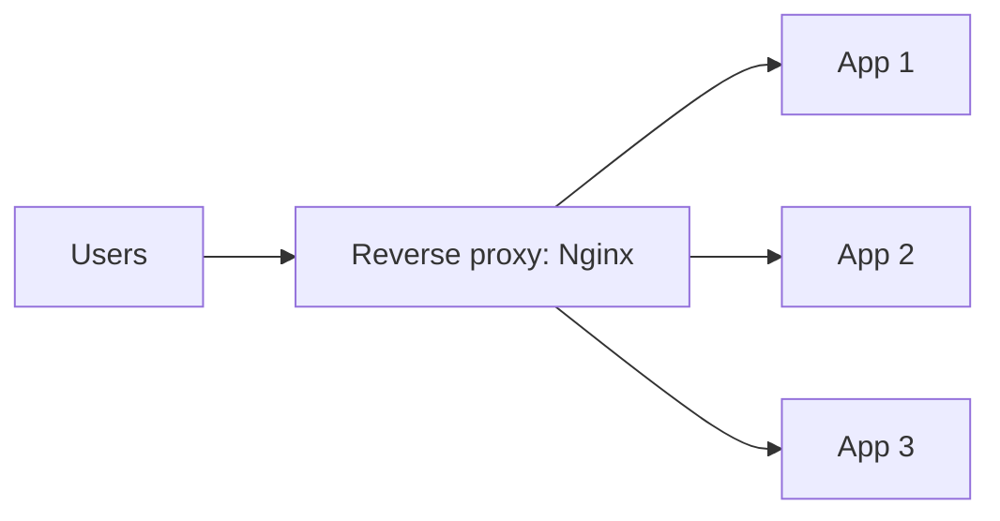
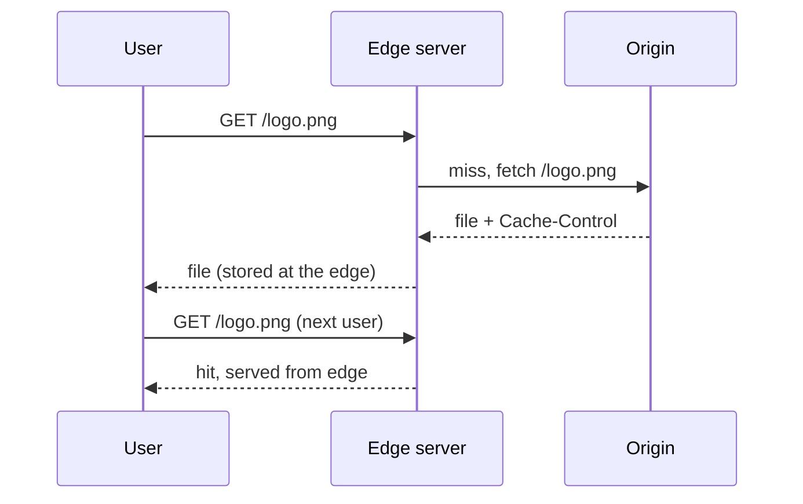

## Proxies

A **proxy** is a server that sits in the middle and forwards requests on behalf of someone else. Which side it represents decides the name.

| | Forward proxy | Reverse proxy |
|---|---|---|
| Acts for | The client | The server |
| Hides | The client's identity from the website | The servers from the client |
| Typical use | Company network filters, privacy, caching for an office | Load balancing, TLS, caching, security in front of your app |
| Example tools | Squid, corporate proxy | **Nginx**, HAProxy, Envoy, Cloudflare |

You will almost always design with a **reverse proxy**. The user talks to `example.com`; behind it, the proxy picks one of many app servers.



What a reverse proxy usually does for you:

- **TLS termination**: it handles HTTPS encryption, so the app servers speak plain HTTP inside the private network.
- **Load balancing** across app servers (the previous lesson).
- **Caching** of responses, **compression** (gzip, Brotli) and **rate limiting**.
- **Hiding** internal addresses, so attackers see one entry point.

:::note
A load balancer and a reverse proxy overlap a lot. Nginx is both. Say "reverse proxy" when you mean the extra jobs (TLS, caching, compression) and "load balancer" when you mean spreading traffic.
:::

## What a CDN is

A **CDN** (Content Delivery Network) is a worldwide fleet of caching reverse proxies. Each location is an **edge server** or **PoP** (Point of Presence). Your own servers are the **origin**.

Why it exists:

- **Latency**: light in fibre needs about 70 ms to cross from Mumbai to London one way. Serving from a server in the same city can take a few milliseconds.
- **Load**: popular files are served by the edge, so your origin sees a small fraction of the traffic.
- **Protection**: a CDN absorbs traffic spikes and many DDoS (Distributed Denial of Service) attacks before they reach you.

Examples: **CloudFront** (AWS), **Cloudflare**, **Akamai**, **Fastly**.

```estimate
q: A page loads 2 MB of static files. It gets 1,000,000 views a day and the CDN hit ratio is 95%. How much data does your origin serve per day?
answer: 100
unit: GB/day
tolerance: 0.3
hint: Total is 2 MB x 1,000,000. Only the 5% of misses reach the origin.
solution: "2 MB x 10^6 = 2 TB/day in total. 5% of that is about 100 GB/day from the origin; the CDN serves the other 1.9 TB."
```

## Pull and push

How does content reach the edge?

| | Pull CDN | Push CDN |
|---|---|---|
| How | Edge fetches from origin on the first request, then keeps a copy | You upload files to the CDN yourself |
| First user | Slow (a miss) | Fast (already there) |
| Work for you | Almost none | You manage uploads and deletions |
| Storage | Only what is requested | Everything you pushed, wanted or not |
| Fits | Most websites and APIs | Large, rarely changing files such as game patches or video libraries |

Pull is the default. The first request flows like this:



Users reach the nearest edge through DNS or **anycast** (many servers announce the same IP address and the network routes you to the closest one).

## Controlling the cache

The origin tells caches what to do with HTTP headers.

```http
Cache-Control: public, max-age=31536000, immutable
```

- `max-age=N`: any cache may reuse the response for N seconds.
- `public`: shared caches (CDN) may store it. `private`: only the user's browser may. `no-store`: nobody stores it.
- `s-maxage=N`: like `max-age`, but only for shared caches such as the CDN.
- `ETag` and `If-None-Match`: let a cache ask "has it changed?" and get a tiny `304 Not Modified` reply.

```blanks
prompt: Complete the header for a personal account page that only the user's own browser may store, for 60 seconds.
lang: http
code: |
  Cache-Control: [[private]], max-age=[[60]]
why: private keeps shared caches such as a CDN from storing it, so one user never receives another user's page. max-age=60 sets the lifetime.
```

## Purging and fingerprinting

What if you ship a new `app.js` but edges hold the old one for a year?

- **Purge** (invalidate): ask the CDN to drop the object. Works, but it is slow to spread worldwide and some CDNs charge or limit it.
- **Fingerprinted URLs**: put a hash in the file name, `app.9f3c1a.js`. A new release means a new URL, so there is nothing to purge and the old file can keep a one-year TTL.
- **Short TTL on HTML**: the HTML page points to the current fingerprinted files and expires quickly.

:::key
Cache static files for a long time under a URL that changes whenever the content changes. Cache the HTML that references them for a short time.
:::

```quiz
questions:
  - q: A CDN caches `/api/me`, which returns the logged-in user's profile. What can go wrong?
    options:
      - Nothing, CDNs only cache images
      - The response may be served to a different user
      - The origin will run out of memory
      - The browser will refuse to render it
    answer: 1
    why: If the CDN keys the cache only on the URL, the first user's profile is stored and handed to everyone. Personal responses need `private` or `no-store`, or a cache key that includes the user.
  - q: Which fits a pull CDN better?
    options:
      - A 40 GB game patch you must have at every edge before launch
      - A blog with images that are requested unpredictably
    answer: 1
    why: Pull fetches only what users actually ask for. Large, planned releases that must be everywhere on day one suit push or pre-warming.
```

:::truth
A CDN does not make a slow backend fast. It helps with content that many users share and that does not change per request. Dynamic, personalised pages still reach your origin, though a CDN can shorten the network path and reuse connections. Misconfigured caching is a common cause of real data leaks, so test what is cached before you launch.
:::

## In the real world

- **Nginx** as a reverse proxy with `proxy_cache` for small setups.
- **CloudFront** in front of **S3** (object storage) for static sites and downloads, and in front of load balancers for APIs.
- **Cloudflare** or **Fastly** for edge caching plus security rules; both can run small code at the edge.
- Video platforms run their own CDNs, because traffic volume makes it cheaper than renting.

## Interview angle

- Mention a CDN as soon as you see images, video or static assets.
- Say how invalidation works: fingerprinted URLs first, purge second.
- Separate static and dynamic content in the diagram.
- Name the privacy risk of caching personal data.

```cards
- q: Forward proxy vs reverse proxy?
  a: A forward proxy acts for clients and hides them from servers; a reverse proxy acts for servers and hides them from clients.
- q: What does a CDN do?
  a: Caches content at edge servers near users, cutting latency and origin load.
- q: Pull vs push CDN?
  a: Pull fetches from the origin on the first request; push means you upload content to the CDN yourself.
- q: How do you ship a new JS file without waiting for expiry?
  a: Fingerprint the file name (app.9f3c1a.js) so the new release has a new URL; keep HTML on a short TTL.
- q: What does Cache-Control private do?
  a: Only the end user's browser may store the response; shared caches like a CDN must not.
```

## Notes

:::notes
- Reverse proxy sits in front of servers: TLS termination, load balancing, caching, compression, rate limiting. Forward proxy sits in front of clients.
- A CDN is a global fleet of caching reverse proxies (edge servers) in front of your origin.
- Benefits: lower latency, less origin load, protection from spikes and DDoS.
- Pull CDN fills on first request (default); push CDN needs you to upload.
- Control caching with Cache-Control: max-age, s-maxage, public, private, no-store, plus ETag.
- Use fingerprinted file names for static assets; short TTL for HTML; purge only when needed.
- Never let a shared cache store per-user responses.
- Tools: Nginx, CloudFront, Cloudflare, Fastly, Akamai.
:::
