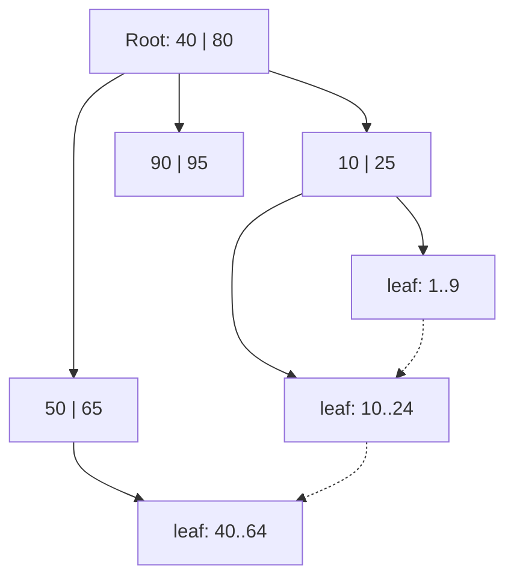

## What an index is

Without help, finding rows with `user_id = 42` means reading the whole table. That is a **full table scan**: cost grows with table size.

An **index** is a second, smaller structure kept sorted (or hashed) by one or more columns. It maps a column value to the location of the row. The idea is the same as the index at the back of a book.

- Reads that match the index get much faster.
- Every write now has extra work to keep the index current.
- The index uses disk and memory.

:::key
An index trades write speed and space for read speed. It is never free.
:::

## B+tree: the default

A **B+tree** is a balanced tree whose nodes are sized to one disk page (often 8 KB in PostgreSQL, 16 KB in MySQL InnoDB). Internal nodes hold keys and pointers to children. Leaf nodes hold the keys plus the row location, and leaves are linked left to right.



Why it dominates:

- **Shallow**: each node holds hundreds of keys, so 3 to 4 levels cover hundreds of millions of rows. A lookup is about 3 to 4 page reads, and the top levels usually sit in memory.
- **Supports ranges**: find the start leaf, then walk the linked leaves. This serves `BETWEEN`, `ORDER BY` and `<`.
- **Sorted order for free**: no separate sort step.

```estimate
q: A B+tree node holds about 500 keys. How many rows can a tree with 3 levels address (500 cubed)?
answer: 125000000
unit: rows
tolerance: 0.3
hint: Each level multiplies the reach by the fan-out of 500.
solution: "500 x 500 x 500 = 125 million entries from just 3 page reads. A fourth level reaches about 62 billion."
```

## Hash indexes

A **hash index** applies a hash function to the key and jumps straight to a bucket. Lookup by exact value is $O(1)$ on average.

- It cannot do ranges, prefixes or sorting, since hashing destroys order.
- It is rare as an on-disk database index. PostgreSQL has one, but most teams use B+tree. In-memory stores such as Redis use hash tables everywhere.

```quiz
q: Which query can a hash index on `email` serve, but a B+tree on `email` serves just as well or better?
options:
  - "WHERE email = 'a@x.com'"
  - "WHERE email LIKE 'a%'"
  - "WHERE email > 'm' ORDER BY email"
answer: 0
why: "Equality works on both. Prefix matching and range scans need sorted order, which only the B+tree keeps. So a B+tree covers everything a hash index does, which is why it is the default."
```

## Composite and covering indexes

A **composite index** covers several columns, for example `(user_id, created_at)`. It is sorted by the first column, then by the second inside each first value. Like a phone book: sorted by last name, then first name.

- **Leftmost prefix rule**: the index helps queries that filter on `user_id`, or on `user_id` and `created_at`. It does not help a query on `created_at` alone.
- **Column order**: put equality columns first, then the range or sort column.

```sql
CREATE INDEX idx_orders_user_time ON orders (user_id, created_at DESC);

SELECT id, total FROM orders
WHERE user_id = 42
ORDER BY created_at DESC LIMIT 20;
```

A **covering index** contains every column the query needs, so the database answers from the index alone and never visits the table (an "index-only scan"). In PostgreSQL: `CREATE INDEX ... ON orders (user_id, created_at) INCLUDE (total)`.

```blanks
prompt: Index on (status, created_at). Which part does the filter use?
lang: sql
code: |
  -- helps: equality on the first column, then range on the second
  SELECT * FROM orders
  WHERE [[status]] = 'PENDING' AND [[created_at]] < now() - interval '1 hour';
why: The equality column comes first in the index, and the range column second. Reversing the order would force scanning many status groups.
```

## The write cost

Each `INSERT` or `UPDATE` of an indexed column must update every index on the table.

- A B+tree insert may split a full page, causing extra random disk writes.
- 9 indexes means about 10 structures changed per insert (table plus 9).
- Low-selectivity columns (a boolean with 2 values) rarely deserve an index, because the database still reads half the table.

:::truth
Most slow queries in production are fixed by one missing index. Most slow writes are caused by too many. Use `EXPLAIN` (PostgreSQL, MySQL) to see whether a query uses an index before guessing.
:::

```quiz
q: A table has index (a, b). Which query can use it efficiently?
options:
  - "WHERE b = 5"
  - "WHERE a = 1 AND b > 5"
  - "WHERE a > 1 AND b = 5, ordered by b"
answer: 1
why: "Equality on the leading column then a range on the next is the ideal shape. A filter on b alone skips the leading column. In the third, the range on a breaks the ordering by b."
```

## LSM trees: indexes for write-heavy stores

B+trees update pages in place, which means random writes. An **LSM tree** (Log-Structured Merge tree) turns writes into sequential ones:

1. Write to an in-memory sorted table (**memtable**) and an append-only log for crash safety.
2. When the memtable is full, flush it as an immutable sorted file (**SSTable**, Sorted String Table).
3. Background **compaction** merges files and drops overwritten or deleted keys.
4. Reads check the memtable, then files newest to oldest. A **Bloom filter** (a compact structure that says "definitely not here" or "maybe here") skips most files.

Used by Cassandra, RocksDB, LevelDB and HBase.

| | B+tree | LSM tree |
|---|---|---|
| Writes | Random, in place | Sequential, batched |
| Reads | One path, predictable | May check several files |
| Extra work | Page splits | Compaction in background |
| Typical use | PostgreSQL, MySQL | Cassandra, RocksDB |

## Inverted index: search by words

A B+tree cannot answer "which documents contain the word shoes". An **inverted index** flips the mapping: for each word (term), store the list of document ids containing it (a **posting list**).

```text
red     -> [1, 4, 9]
running -> [4, 9, 12]
shoes   -> [4, 7, 9]
"red running shoes" -> intersect lists -> [4, 9]
```

- Text is first split into terms and normalised (lowercase, stemming such as "running" to "run"). This step is called **analysis**.
- Multi-word queries intersect or merge posting lists, then rank results, usually with BM25 (a relevance formula based on term frequency and rarity).
- **Elasticsearch** and Apache Lucene (the library inside it) are built on this. PostgreSQL offers it through GIN indexes.

```cards
- q: What does an index trade away to speed up reads?
  a: Write speed and storage. Every insert or update must also update each index.
- q: Why are B+trees shallow?
  a: Each node is one disk page holding hundreds of keys, so 3 to 4 levels cover hundreds of millions of rows.
- q: What is the leftmost prefix rule?
  a: A composite index on (a, b) helps filters on a, or on a and b, but not on b alone.
- q: What is a covering index?
  a: An index containing every column a query needs, so the table itself is never read.
- q: How does an LSM tree make writes fast?
  a: It buffers writes in a memtable, flushes sorted immutable files sequentially, and merges them later by compaction.
- q: What does an inverted index store?
  a: For each term, the list of documents containing it (a posting list).
```

## Interview angle

- Say which queries you must serve, then derive the indexes. Do not index everything.
- Name the column order and justify it: equality first, range or sort last.
- Mention the write cost and one way to limit it, such as fewer indexes or a read replica for heavy reporting.
- For search or autocomplete, reach for an inverted index (Elasticsearch) rather than `LIKE '%word%'`, which cannot use a B+tree.

## Notes

:::notes
- An index is a separate sorted or hashed structure mapping values to row locations. It speeds reads and slows writes.
- B+tree is the default: shallow (3 to 4 page reads), supports equality, ranges and ordering.
- Hash index: exact match only, no ranges or ordering.
- Composite index (a, b): leftmost prefix rule. Equality columns first, range or sort column last.
- Covering index holds all needed columns, so the table is not visited.
- Each extra index adds work to every insert and update. Check with EXPLAIN before adding or dropping.
- LSM tree (Cassandra, RocksDB): memtable, SSTables, compaction, Bloom filters. Fast sequential writes, reads may touch several files.
- Inverted index (Elasticsearch, Lucene): term to posting list. Powers full-text search.
:::
