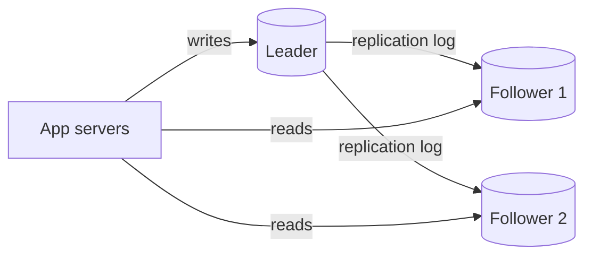
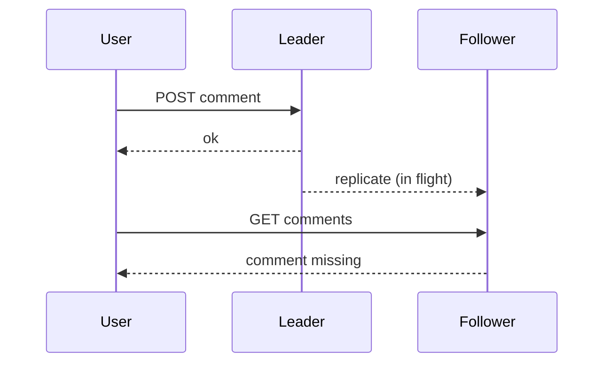

## Why copy data

**Replication** means keeping the same data on more than one machine. Three reasons:

- **Availability**: if one machine dies, another still serves the data.
- **Read scaling**: spread read traffic over several copies.
- **Latency**: keep a copy near users in another region.

It does not help with data that is too big for one machine. That is sharding, the next lesson.

The hard part is not copying once. It is keeping copies in agreement while writes keep arriving and machines keep failing.

## Leader-follower

The most common design, also called **primary-replica** (older: master-slave).

- One **leader** accepts all writes and records them in a log.
- **Followers** receive that log and apply the changes in the same order.
- Reads can go to the leader or to any follower.



Real tools: PostgreSQL streaming replication (ships the WAL, Write-Ahead Log), MySQL (ships the binlog, binary log), MongoDB replica sets, Redis replicas.

## Sync versus async

When does the leader tell the client "write done"?

| | Synchronous | Asynchronous |
|---|---|---|
| Client is told success | After follower confirms | Right after leader writes |
| Data loss if leader dies | None for confirmed writes | Recent writes may be lost |
| Write latency | Higher, waits on network | Low |
| If a follower is down | Writes can stall | Writes continue |

Most systems use a middle path: **semi-synchronous**, where one follower is synchronous and the rest are asynchronous. At least two machines then hold every confirmed write.

## Replication lag

With asynchronous followers, a follower is always slightly behind. That delay is **replication lag**. Normally milliseconds, but it can reach seconds or minutes under load or a network problem.



Three anomalies, each with a standard fix:

- **Read-your-writes** broken: you post, refresh, your post is gone. Fix: read your own recent data from the leader, or track the log position of your last write and read only from a follower that has reached it.
- **Monotonic reads** broken: you see new data, refresh, and see older data from a lagging follower. Fix: pin each user to one follower.
- **Consistent prefix** broken: an answer shows up before its question. Fix: keep causally related writes in the same partition or order.

```quiz
q: A user changes their profile photo, reloads at once and sees the old photo. Reads go to followers. What is the most direct fix?
options:
  - Add more followers
  - Serve a user's own recent writes from the leader
  - Make all replication synchronous to every follower
answer: 1
why: "More followers do not shrink lag. Fully synchronous replication works but makes writes slow and fragile. Routing the writer's own reads to the leader for a short window fixes just the visible problem."
```

## Failover

When the leader dies, a follower must be **promoted**. Steps: detect the failure (heartbeat timeouts), choose the follower with the most recent log, reconfigure clients, and make the old leader rejoin as a follower.

Things that go wrong:

- **Lost writes**: the new leader may lack writes the old one confirmed asynchronously.
- **Split brain**: the old leader comes back and still believes it is leader, so two nodes accept writes. Prevent it by fencing (refusing the old leader) or by electing with a majority vote, as Raft (a consensus algorithm) does.
- **Wrong timeout**: too short and a slow network triggers needless failovers. Too long and users wait.

```order
prompt: Arrange a basic leader failover.
lang: text
code: |
  Detect that the leader missed its heartbeats
  Pick the follower with the most up-to-date log
  Promote it to leader
  Point clients and other followers at the new leader
  Demote the old leader when it returns
distractors:
  - Promote a random follower immediately
why: Picking the most up-to-date follower limits lost writes. The old leader must be demoted, otherwise two leaders cause split brain.
```

## Multi-leader and leaderless

**Multi-leader**: several nodes accept writes, usually one per data centre. Each leader replicates to the others.

- Good: local writes in each region, survives a whole region going down.
- Bad: two leaders can change the same row at once, a **write conflict**. Resolution options: last-write-wins by timestamp (simple but silently drops data), merge with CRDTs (Conflict-free Replicated Data Types), or ask the application.
- Examples: MySQL group replication in multi-primary mode, CouchDB, collaborative editors.

**Leaderless** (Dynamo style: Cassandra, Riak): the client sends each write to several replicas directly. No failover is needed, and quorums decide correctness.

## Quorums

With $N$ replicas per key, a write must be acknowledged by $W$ nodes and a read must ask $R$ nodes. If

$$ W + R > N $$

then every read set overlaps every write set in at least one node, so a read sees the latest acknowledged write (as long as the read picks the newest version, by timestamp or version number).

```estimate
q: N = 5 replicas, you set W = 3. What is the smallest R that guarantees a read overlaps the latest write?
answer: 3
unit: nodes
tolerance: 0.01
hint: You need W + R greater than N.
solution: "W + R > 5 means R >= 3. With W = 3 and R = 3 you can lose 2 nodes and still read and write."
```

| N, W, R | Behaviour |
|---|---|
| 3, 2, 2 | Common default. Tolerates 1 node down. |
| 3, 3, 1 | Fast reads, writes fail if any node is down. |
| 3, 1, 1 | Fast and available, but stale reads possible. |

:::truth
A quorum is not a guarantee of perfect consistency. Clock skew, sloppy quorums (writing to substitute nodes during failures) and concurrent writes can still return stale or conflicting values. Do not call it "strongly consistent" in an interview without caveats.
:::

```cards
- q: What does the leader do in leader-follower replication?
  a: It accepts all writes, logs them, and ships the log to followers, which apply it in the same order.
- q: Why is async replication risky on failover?
  a: The leader confirmed writes the followers had not received yet, so the promoted follower may lack them.
- q: What is read-your-writes consistency and a simple fix?
  a: A user must see their own writes. Serve their recent reads from the leader, or from a follower that has caught up to their last write.
- q: What is split brain?
  a: Two nodes both believe they are the leader and accept conflicting writes. Fencing and majority election prevent it.
- q: State the quorum rule.
  a: With N replicas, W write acks and R read acks, W + R > N makes read and write sets overlap.
- q: Why is multi-leader hard?
  a: Concurrent writes to the same data on different leaders conflict and need a resolution rule.
```

## Interview angle

- Default answer: one leader, a few followers, async or semi-sync, reads on followers for scale.
- Name the lag problem unprompted and say how you handle read-your-writes.
- Discuss failover risks: lost writes and split brain.
- Move to multi-leader or leaderless only if you need multi-region writes or very high write availability, and say how conflicts get resolved.

## Notes

:::notes
- Replication = copies on several machines for availability, read scaling and latency. It does not add storage capacity.
- Leader-follower: leader takes writes, followers apply its log. Used by PostgreSQL, MySQL, MongoDB, Redis.
- Sync = no confirmed-write loss but slower; async = fast but may lose recent writes; semi-sync is the usual compromise.
- Replication lag causes stale reads: fix read-your-writes by reading from the leader or a caught-up follower; fix monotonic reads by pinning a user to one follower.
- Failover risks: lost writes and split brain. Use heartbeats, majority election and fencing.
- Multi-leader allows local writes in many regions but needs conflict resolution (LWW, CRDTs, app logic).
- Quorum: W + R > N gives overlap. Typical N = 3, W = 2, R = 2.
- Quorums reduce, but do not remove, staleness and conflict problems.
:::
