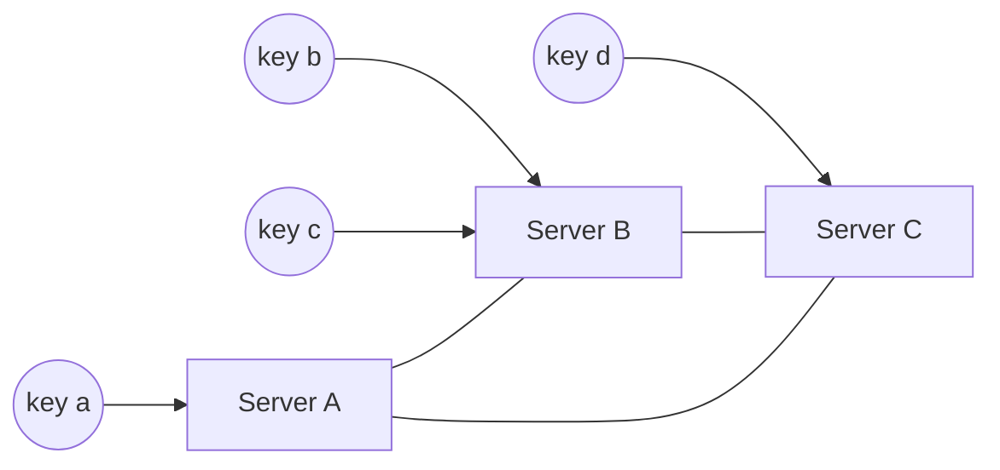

## The problem with mod N

Suppose a cache cluster of $N$ servers picks a server with `hash(key) mod N`. It works until $N$ changes, because a server is added, or one crashes.

```predict
lang: python
prompt: "12 keys are numbered 0 to 11. Count how many land on a different server when the cluster grows from 3 servers to 4 (key mod 3 versus key mod 4)."
code: |
  print(sum(k % 3 != k % 4 for k in range(12)))
output: "9"
why: Only keys 0, 1 and 2 keep their server. In general, going from N to N+1 servers moves about N/(N+1) of all keys, almost everything.
```

For a cache that means a sudden wave of **cache misses**: almost every key now looks for its data on the wrong server, and the database behind it gets flooded. For a sharded database it means moving almost all data.

:::key
We want a scheme where adding or removing one of N servers moves only about 1/N of the keys.
:::

## The ring

**Consistent hashing** maps both servers and keys onto the same circular space.

1. Pick a hash function with a large output range, for example 0 to $2^{32}-1$. Imagine those values arranged on a circle (the **ring**).
2. Hash each server's name or address to a point on the ring.
3. Hash each key to a point on the ring.
4. A key belongs to the first server found going **clockwise** from the key's point.



(The diagram shows ownership; the true shape is a circle where each server owns the arc just before its point.)

What happens when the set of servers changes:

- **Add a server**: it takes over only the arc between itself and the previous server. Keys elsewhere do not move.
- **Remove a server**: its keys move to the next server clockwise. Others stay.

On average only $K / N$ of the $K$ keys move.

```order
prompt: Arrange a ring lookup. Positions are sorted, and a key goes to the first server at or after its hash, wrapping around.
lang: python
code: |
  positions = [p for p, _ in ring]
  x = h(key)
  i = bisect.bisect_left(positions, x)
  if i == len(ring):
      i = 0
  return ring[i][1]
why: Binary search finds the first position at or after the key's hash. If it runs past the end, the key wraps to the start of the ring. Lookup is O(log N) with a sorted array.
```

## Virtual nodes

With only a few points on the ring, arcs have very different lengths. One server may own 50 percent of the keys by bad luck, and when it dies, all its load lands on a single neighbour.

The fix is **virtual nodes** (vnodes): each physical server is hashed to many points, such as `A#1`, `A#2`, ... `A#100`.

- **Even load**: many small arcs average out, so each server gets close to its fair share.
- **Smooth recovery**: when a server leaves, its many small arcs go to many different neighbours, not one.
- **Weights**: a server with twice the capacity gets twice as many vnodes.
- **Cost**: a bigger lookup table and more bookkeeping on membership changes.

Try it. Add and remove servers, change vnodes, and watch how many keys move.

```viz
algo: consistent-hashing
input:
  servers: 3
  vnodes: 3
  keys: 24
```

```quiz
q: With 1 vnode per server, you remove one of 4 servers. What is the weakness compared with 100 vnodes per server?
options:
  - Lookups become slower
  - The removed server's keys all go to a single neighbour, which may be overloaded
  - Keys can no longer be found
answer: 1
why: "With one point per server, the removed server's whole arc is absorbed by the next server clockwise. With many vnodes, its small arcs are scattered among many servers, so the extra load is shared."
```

## Numbers

```estimate
q: A ring has 10 servers holding 1,000,000 keys. You add an 11th server. About how many keys move?
answer: 91000
unit: keys
tolerance: 0.4
hint: The new server should end up with about 1/11 of all keys.
solution: "1,000,000 / 11 is about 91,000 keys. With mod N, about 10/11 of them (roughly 909,000) would move."
```

## Replication on the ring

Systems often store each key on $R$ servers for safety. Rule: walk clockwise from the key and take the next $R$ **distinct physical servers**, skipping extra vnodes of a machine already chosen. Otherwise two replicas could sit on the same machine and die together.

## In the real world

| System | How it uses the ring |
|---|---|
| Amazon Dynamo / DynamoDB | Partitioning and replica placement (Dynamo paper) |
| Apache Cassandra | Token ring with vnodes per node |
| Memcached clients (ketama) | Pick the cache server for each key |
| Envoy, HAProxy, Nginx | Ring-hash or consistent load balancing, so a client sticks to one backend |
| Redis Cluster | Not a ring: 16,384 fixed hash slots, a related idea with the same goal |

:::truth
Consistent hashing is a means, not a goal. It limits data movement, but it does not fix hot keys, and it does not copy data by itself: you still need replication and a way to stream data to a new node. Simpler schemes such as fixed partitions (Redis, Kafka) are often easier to run. Alternatives you may meet are rendezvous hashing and jump consistent hash.
:::

```cards
- q: What goes wrong with hash(key) mod N when N changes?
  a: Almost every key (about N/(N+1)) maps to a different server, causing mass cache misses or data movement.
- q: How does a key find its server on the ring?
  a: Hash the key to a point and go clockwise to the first server point, wrapping around at the end.
- q: What fraction of keys move when one server is added to N?
  a: About 1/(N+1) of the keys, only those the new server takes over.
- q: Why use virtual nodes?
  a: They even out load, spread a failed server's keys over many neighbours, and let you weight stronger machines.
- q: How are replicas chosen on a ring?
  a: Take the next R distinct physical servers clockwise from the key.
- q: Name two systems that use consistent hashing.
  a: Cassandra and Dynamo (and cache client libraries such as ketama for Memcached).
```

## Interview angle

- Start with the mod N failure, then introduce the ring. Do not just recite the name.
- Mention vnodes unprompted, and why.
- Say what moves when a node joins or leaves, and where replicas go.
- Offer fixed partitions as a simpler alternative if the interviewer asks about operations.

## Notes

:::notes
- hash(key) mod N moves about N/(N+1) of the keys when N changes. That is a disaster for caches and shards.
- Ring: servers and keys hashed to the same circle. A key belongs to the first server clockwise.
- Adding or removing a server moves only about K/N keys, those on its arc.
- Lookup: sorted positions plus binary search, O(log N), wrap at the end.
- Virtual nodes: many points per server for even load, shared recovery and weighted capacity.
- Replicas: next R distinct physical servers clockwise.
- Used by Cassandra, Dynamo, ketama Memcached clients, ring-hash load balancers.
- Does not solve hot keys. Fixed partitions (Redis 16,384 slots) are a common simpler alternative.
:::
