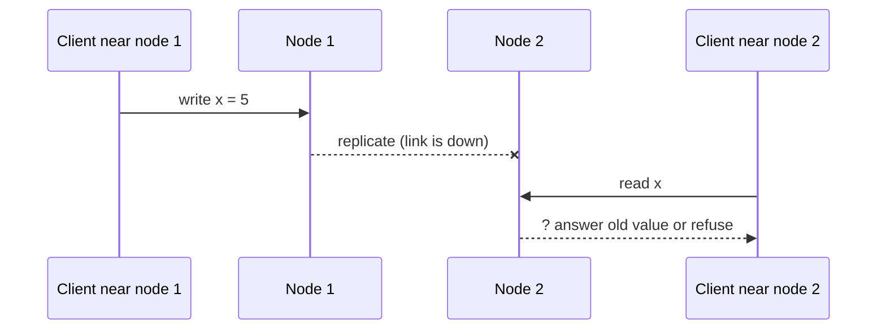

## Why consistency is a question

Once data lives on several machines (replication), two copies can disagree for a moment. **Consistency** describes what a reader is allowed to see when that happens.

Stronger promises are simpler for programmers but cost speed and availability. Weaker promises are fast and resilient but push complexity into your application. Every distributed database picks a point on that line.

## CAP, stated precisely

**CAP** stands for Consistency, Availability, Partition tolerance. The CAP theorem (Brewer, proved by Gilbert and Lynch) says that during a network partition, a system must give up one of the first two.

- **Consistency (C)**: linearizability. Every read returns the latest completed write, as if there were one copy of the data.
- **Availability (A)**: every request to a working node gets a non-error response.
- **Partition (P)**: the network splits and nodes cannot talk to each other. Cables fail, switches misbehave, cloud zones lose links.



At the last arrow node 2 has two options:

- **Return its old value (choose A)**: it answered, but it is stale. Consistency is broken.
- **Refuse or wait (choose C)**: the reader is correct but gets an error or timeout. Availability is broken.

:::warn
"Pick any two of three" is a misleading summary. Partitions happen whether you want them or not, so P is not optional on a network. The real choice is C or A during a partition. When the network is healthy, you can have both.
:::

```quiz
q: A system keeps accepting writes on both sides of a network split and merges them later. Which side of CAP did it choose?
options:
  - "CP, it prefers consistency"
  - "AP, it prefers availability"
  - "Neither, it avoids the theorem"
answer: 1
why: "Both sides keep answering requests, so it is available, but the sides disagree until they merge. That is AP. Cassandra and DynamoDB in their default modes work like this."
```

## PACELC: the everyday trade-off

Partitions are rare. The more common trade-off is the one in normal operation. **PACELC** (Abadi) says:

- If there is a **P**artition, choose **A** or **C**.
- **E**lse (no partition), choose **L**atency or **C**onsistency.

Why latency? Making all replicas agree before replying needs network round trips. Across regions that is slow.

```estimate
q: A synchronous write from Mumbai must be confirmed by a replica in N. Virginia before replying. Roughly what is the network round trip time alone?
answer: 200
unit: ms
tolerance: 0.5
hint: Light in fibre covers about 200 km per millisecond, and the route is long and indirect, about 13,000 km each way.
solution: "Roughly 180 to 250 ms per round trip. Every strongly consistent cross-region write pays at least this. That is why many systems keep strong consistency inside a region and relax it across regions."
```

| System | During partition | Normally | Label |
|---|---|---|---|
| Cassandra, DynamoDB (default) | Available | Low latency | PA/EL |
| HBase, ZooKeeper, etcd | Consistent | Consistent | PC/EC |
| Google Spanner | Consistent | Consistent, pays latency | PC/EC |

Cassandra is **tunable**: with quorum reads and writes (W + R > N) it moves toward consistency and pays in latency.

```blanks
prompt: Complete the definition.
lang: text
code: |
  PACELC: if there is a partition, choose between [[availability|A]] and [[consistency|C]];
  else, choose between [[latency|L]] and consistency.
why: Partitioned, you trade availability against consistency. In normal operation, you trade latency against consistency.
```

## The consistency spectrum

From strongest to weakest:

- **Linearizable (strong)**: behaves like one copy; once a write completes, all later reads see it. Needs coordination. Examples: etcd, ZooKeeper, Spanner, a single PostgreSQL primary.
- **Sequential / causal**: operations respect order or cause and effect (an answer never appears before its question), but not real-time order across everyone.
- **Eventual**: if writes stop, all replicas converge to the same value after some time. No promise about how long, or about what you read meanwhile.

**Session guarantees** are small, cheap promises given to one client, even on an eventually consistent store:

| Guarantee | Meaning |
|---|---|
| Read-your-writes | You see your own writes |
| Monotonic reads | Later reads never show older data than earlier reads |
| Monotonic writes | Your writes apply in the order you made them |
| Writes-follow-reads | A write based on something you read lands after what you read |

Often implemented by routing a session to one replica, or by passing a version token between calls.

## Choosing in practice

Ask: what does a stale or conflicting read cost the business?

| Data | Choose | Reason |
|---|---|---|
| Account balance, inventory at checkout | Strong | A wrong read means lost money or overselling |
| Shopping cart | Eventual with merging | Availability matters more; merge carts later |
| Likes, view counters, feeds | Eventual | Off by a few for seconds is fine |
| Chat message order inside a conversation | Causal or per-conversation order | Users notice reordering |

:::truth
Most applications mix levels: a strongly consistent store for money and identity, eventually consistent systems for feeds and counters. Saying "we use an AP database, so we are fine" is not an answer. Say what a stale read looks like to the user and who handles conflicts.
:::

```cards
- q: What does CAP actually say?
  a: During a network partition, a system must choose between consistency (latest value or an error) and availability (always an answer, possibly stale).
- q: Why is "pick two of three" misleading?
  a: Partitions cannot be avoided, so the real choice is C or A when one happens. With a healthy network you can have both.
- q: What does PACELC add?
  a: Even without a partition there is a trade-off between latency and consistency.
- q: What is eventual consistency?
  a: If no new writes arrive, all replicas converge to the same value eventually, with no bound on how long.
- q: Name two session guarantees.
  a: Read-your-writes and monotonic reads.
- q: Give a CP and an AP example.
  a: etcd or ZooKeeper are CP. Cassandra and DynamoDB (default settings) are AP.
```

## Interview angle

- Define C as linearizable and A as every working node answering. This precision stands out.
- Say partitions are a given, then discuss the real choice per feature.
- Use PACELC to justify latency decisions across regions.
- Pair the choice with the repair story: read repair, anti-entropy, conflict resolution, idempotent writes.

## Notes

:::notes
- CAP: during a network partition choose consistency (linearizable) or availability (every working node answers).
- Partition tolerance is not optional on a real network. With a healthy network you can have both C and A.
- PACELC: partition then A or C; else latency or consistency. Strong consistency across regions costs round-trip time (about 200 ms Mumbai to Virginia).
- CP examples: etcd, ZooKeeper, HBase, Spanner. AP examples: Cassandra and DynamoDB by default.
- Spectrum: linearizable, causal, eventual. Stronger needs more coordination.
- Session guarantees: read-your-writes, monotonic reads, monotonic writes, writes-follow-reads.
- Pick per data type: strong for money and inventory, eventual for feeds and counters.
- Always state what a stale read looks like and how conflicts get repaired.
:::
