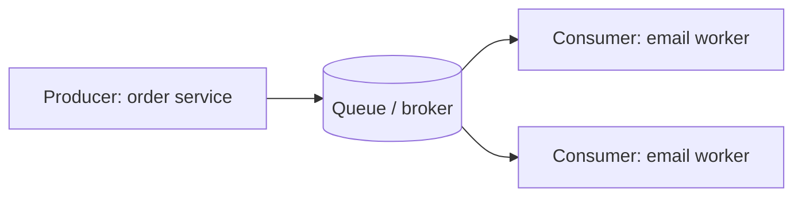
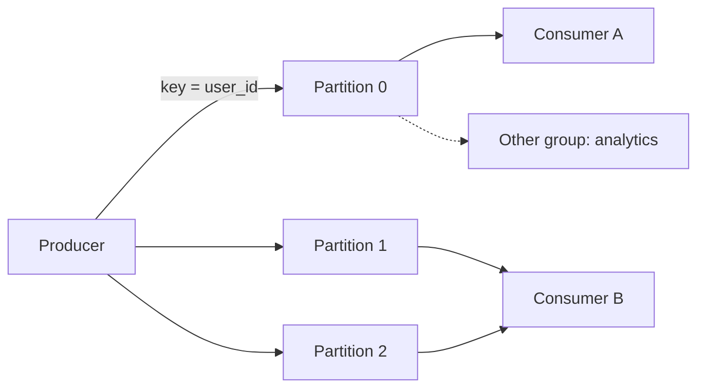

## What a message queue is

A **message queue** is a durable buffer between two services. A **producer** (the sender) writes a **message** (a small piece of data describing work or an event). A **consumer** (the receiver) reads it later and processes it.

Without a queue, service A calls service B directly. If B is slow or down, A is slow or down too. With a queue in between:

- **Decoupling.** A does not know who consumes, or how many consumers there are.
- **Spike absorption.** A burst of 10,000 messages waits in the queue instead of crashing the consumer.
- **Async work.** The user gets a reply now; the email, thumbnail or report is produced afterwards.
- **Retry.** A failed message can be tried again without the producer knowing.



A **broker** is the server that stores and delivers messages. Common ones: **RabbitMQ**, **Amazon SQS** (Simple Queue Service), **Apache Kafka**, **Google Pub/Sub**.

## Queue versus pub/sub

Two delivery models, often confused.

| | Work queue | Pub/sub (publish/subscribe) |
|---|---|---|
| Each message goes to | One consumer | Every subscriber |
| Purpose | Share work among workers | Broadcast an event to many interested services |
| Example | 20 workers resize images | "OrderPlaced" read by email, inventory and analytics |
| Tools | SQS, RabbitMQ queue | SNS (Simple Notification Service), Kafka topic, Google Pub/Sub |

In pub/sub, a **topic** is the named channel. Publishers do not know their subscribers, so you add a new consumer without touching the producer.

```quiz
q: A "UserSignedUp" event must trigger a welcome email, a CRM sync and an analytics record, each done by a different service. Which model fits?
options:
  - A single work queue with three workers
  - "Pub/sub: each service subscribes to the topic and gets its own copy"
  - Three services calling each other in a chain
answer: 1
why: "Every service needs the same event, so each needs its own copy. A single work queue would hand each message to just one worker, so two of the three jobs would never run."
```

## How Kafka organises messages

**Kafka** is a distributed log: messages are appended to disk and kept for a retention period (for example 7 days), even after they are read. That is different from SQS, which deletes a message once it is processed.

- A **topic** is split into **partitions**. Each partition is an ordered, append-only list of messages.
- Each message has an **offset**: its position number in that partition (0, 1, 2, ...).
- The producer picks the partition, usually by hashing a **key** (such as `user_id`). The same key always lands in the same partition.
- A **consumer group** is a set of consumers that share one topic. Each partition is read by exactly one consumer in the group.
- Each group tracks its own **committed offset**: "I have processed up to here".



:::key
Order is guaranteed only inside one partition. Messages for the same key stay in order because they share a partition; messages across partitions have no global order.
:::

Parallelism is capped by partitions. With 3 partitions, a group of 5 consumers has 2 idle. To scale reads, add partitions first.

```estimate
q: A topic receives 50,000 messages/s of 1 KB each. You keep 7 days of data (one copy, no replication). How much storage is that?
answer: 30
unit: TB
tolerance: 0.3
hint: Bytes per second times seconds in 7 days (about 600,000).
solution: "50,000 x 1 KB = 50 MB/s. 50 MB/s x 604,800 s = about 30 TB. With replication factor 3 (common in Kafka) it is about 90 TB across the cluster."
```

## Delivery guarantees

A consumer does two things: process the message, and tell the broker it is done (commit the offset, or acknowledge in SQS). A crash can land between them.

| Guarantee | How | Risk |
|---|---|---|
| At-most-once | Commit first, then process | Crash after commit loses the message |
| At-least-once | Process first, then commit | Crash before commit means the message is delivered again |
| Exactly-once | At-least-once plus de-duplication | Hard; works end to end only if the final effect is idempotent |

**Idempotent** means doing it twice has the same effect as doing it once. Most real systems pick at-least-once and make the consumer idempotent, for example by storing processed message ids in the database in the same transaction as the effect.

:::truth
"Exactly-once" is a marketing-friendly phrase. Kafka offers exactly-once within Kafka (idempotent producers and transactions). The moment your consumer sends an email or calls a payment API, you are back to at-least-once and need idempotency yourself.
:::

```order
prompt: Arrange an at-least-once consumer loop.
lang: java
code: |
  while (true) {
      var records = consumer.poll(Duration.ofMillis(500));
      for (var r : records) process(r);
      consumer.commitSync();
  }
distractors:
  - "      consumer.commitSync(); // before processing"
why: Committing after processing means a crash replays the batch instead of losing it. That is at-least-once.
```

## Failures: retries and dead-letter queues

A **poison message** is one that always fails, such as malformed JSON. If you retry forever, it blocks everything behind it.

- Retry a few times with a delay (see the reliability lesson).
- After N failures, move it to a **dead-letter queue (DLQ)**: a separate queue for messages that could not be processed. SQS supports this with a redrive policy and a max receive count.
- Alert on DLQ depth, inspect messages, fix the bug, then replay them.

In SQS, a **visibility timeout** hides a received message from other consumers for a while. If the consumer does not delete it in time, the message reappears. That is at-least-once behaviour built in.

:::warn
Queues hide problems rather than remove them. A growing queue means consumers are slower than producers. Watch **consumer lag** (how far the committed offset is behind the latest offset).
:::

## When not to use a queue

- The caller needs the answer now (login, search). Use a direct call.
- Volume is tiny and one service. A database table plus a cron job is simpler.
- You need a strict global order across all messages. One partition does that but cannot scale.

```quiz
q: Messages for one user must be processed in order, but different users are independent. What partitioning fits a Kafka topic?
options:
  - Random partition per message
  - Use user_id as the key so one user always maps to one partition
  - One partition per topic, always
answer: 1
why: "Hashing the key keeps one user's messages in a single ordered partition while different users spread across partitions in parallel."
```

## Interview angle

- Name the reason for the queue first: spike absorption, decoupling, or async work.
- State the guarantee you want (at-least-once plus idempotent consumers) and what happens on failure (retry, DLQ).
- Choose the partition key and say what it protects (ordering per key) and what it risks (a hot key overloads one partition).

```cards
- q: Work queue versus pub/sub?
  a: A work queue gives each message to one consumer to share work. Pub/sub gives each message to every subscriber.
- q: What is an offset in Kafka?
  a: The position of a message inside one partition. Consumer groups commit offsets to remember progress.
- q: Where does Kafka guarantee ordering?
  a: Only within a single partition, so choose a key that keeps related messages together.
- q: Why is at-least-once usually chosen?
  a: Losing messages is worse than repeating them, and repeats are handled by idempotent consumers.
- q: What is a dead-letter queue?
  a: A side queue for messages that failed after the allowed retries, kept for inspection and replay.
```

## Notes

:::notes
- A queue decouples producers from consumers, absorbs spikes and moves slow work off the request path.
- Work queue: each message to one consumer. Pub/sub: each message to every subscriber.
- Kafka: topic -> partitions -> ordered messages with offsets; messages are retained, not deleted on read.
- Consumer group: each partition is read by one consumer in the group; max parallelism equals partition count.
- Ordering is per partition; pick a key (such as user_id) to keep related messages together.
- At-most-once = commit then process; at-least-once = process then commit; exactly-once needs idempotent effects.
- Retry a few times, then send to a dead-letter queue and alert on its size.
- Watch consumer lag; a growing lag means consumers are too slow.
:::
