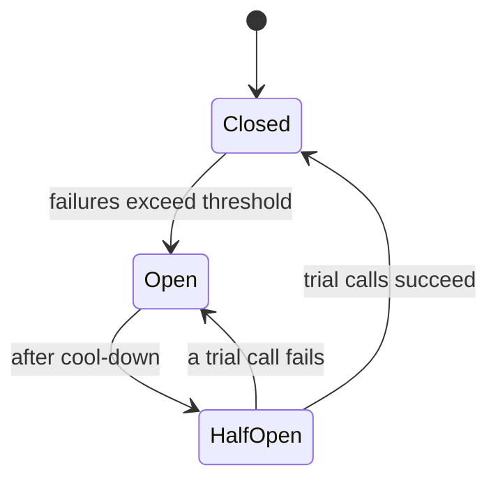

## What reliable means

**Reliability** is the system doing the right thing over time. **Availability** is the share of time it is up and answering. Everything fails eventually: disks, networks, deploys, other teams' services. Design assumes failure and limits the damage.

Three terms that people mix up:

| Term | Meaning | Example |
|---|---|---|
| **SLI** (Service Level Indicator) | A measured number | 99.95% of requests returned non-5xx in the last 30 days |
| **SLO** (Service Level Objective) | The internal target for an SLI | 99.9% success over 30 days |
| **SLA** (Service Level Agreement) | A contract with penalties if missed | Refund credits if monthly uptime falls below 99.9% |

The SLA is looser than the SLO so you have room to react before you owe money.

## The nines

Availability is quoted in "nines". More nines cost much more.

| Availability | Downtime per year | Per 30-day month |
|---|---|---|
| 99% | 3.65 days | 7.2 hours |
| 99.9% | 8.76 hours | 43.2 minutes |
| 99.99% | 52.6 minutes | 4.3 minutes |
| 99.999% | 5.26 minutes | 26 seconds |

The allowed downtime is the **error budget**. If the SLO is 99.9%, you may fail 0.1% of the time. Spend it on deploys and experiments; when it is gone, freeze risky releases and fix reliability.

```estimate
q: Your SLO is 99.95% availability over a 30-day month. How many minutes of downtime does the error budget allow?
answer: 21.6
unit: minutes
tolerance: 0.1
hint: A 30-day month has 43,200 minutes. The budget is the failing fraction.
solution: "Failing fraction is 0.05% = 0.0005. 43,200 x 0.0005 = 21.6 minutes per month."
```

### Combining availability

- **In series** (A needs B needs C): multiply. Three services at 99.9% give 0.999^3, about 99.7%. Every dependency lowers your ceiling.
- **In parallel** (either replica can serve): the chance both are down is small. Two replicas at 99% give $1 - 0.01^2 = 99.99\%$, if failures are independent.

:::truth
Independence is the catch. Two replicas in the same rack, sharing one power feed, or running the same buggy build, fail together. That is why teams spread across zones and roll out gradually.
:::

```quiz
q: Service A depends on B and C, called in sequence. B is 99.9% available and C is 99.9% available. Roughly what availability can A promise at best?
options:
  - 99.9%
  - 99.8%
  - 99.99%
answer: 1
why: "Series availability multiplies: 0.999 x 0.999 = 0.998. A can never be more available than the product of its hard dependencies."
```

## Retries, backoff and jitter

Many failures are transient: a dropped packet, a restarting pod. **Retrying** the request often works. Done badly, it makes outages worse.

- **Timeout first.** Every call needs a timeout. Without one, a hung dependency ties up your threads.
- **Exponential backoff.** Wait longer after each failure: 1 s, 2 s, 4 s, 8 s, up to a cap.
- **Jitter.** Add randomness to the wait. Without it, 10,000 clients that failed together all retry at the same instants, a **thundering herd** that hits a recovering server again.
- **Limit attempts.** Three tries is common. Retrying at every layer multiplies: 3 layers with 3 tries each can turn one request into 27.
- **Retry only safe errors.** Retry timeouts, 503 and 429. Do not retry 400 or 404.

```predict
lang: python
prompt: Backoff delay is base 1 second, doubling each attempt, capped at 30 seconds. What does this print?
code: |
  delays = [min(30, 1 * 2 ** a) for a in range(6)]
  print(" ".join(str(d) for d in delays))
output: "1 2 4 8 16 30"
why: Attempts 0 to 4 give 1, 2, 4, 8, 16. Attempt 5 would be 32, which the cap reduces to 30.
```

A common jittered form ("full jitter"): `sleep = random(0, min(cap, base * 2^attempt))`.

## Idempotency keys

Retrying a payment that timed out is dangerous. Did the first attempt go through? An **idempotent** operation gives the same result no matter how many times it runs. `GET` and `PUT` are idempotent by design; `POST /charges` is not.

The fix is an **idempotency key**: a unique value the client generates per intended action and sends with each attempt.

```text
POST /charges
Idempotency-Key: 7c1f9e0a-2b4d-4a8e-9a55-0f3d2c1b6e44
```

Server flow:

1. Look up the key in a store (a database table or Redis).
2. Found: return the saved response without charging again.
3. Not found: do the work, save the response under the key, return it.
4. Keep keys for a day or more. Stripe's API works this way.

Insert the key and perform the effect in one database transaction, otherwise a crash between them recreates the duplicate risk.

## Circuit breakers

When a dependency is failing, hammering it wastes your resources and slows its recovery. A **circuit breaker** (named after the electrical part) stops calls for a while.



- **Closed**: calls pass; failures are counted.
- **Open**: calls fail immediately (fail fast), or return a fallback such as cached data.
- **Half-open**: a few trial calls test whether the dependency recovered.

Libraries: Resilience4j (Java), Polly (.NET), and service meshes such as Envoy and Istio apply the same idea at the network layer.

```blanks
prompt: Fill in the breaker states.
lang: text
code: |
  [[Closed]] -> failures pile up -> [[Open]] -> cool-down passes -> Half-open -> trial succeeds -> Closed
why: Closed lets traffic through, open blocks it, and half-open probes with a few calls before closing again.
```

## Other tools

- **Bulkheads**: separate thread pools or connection pools per dependency, so one slow service cannot use all your capacity.
- **Load shedding**: reject low-priority traffic when overloaded instead of failing everything.
- **Graceful degradation**: show the page without recommendations if that service is down.
- **Health checks and redundancy**: load balancers stop sending traffic to failed instances; spread across zones.

## Interview angle

- Ask for the availability target and convert it to downtime per month.
- For each dependency, state the timeout, retry policy and fallback.
- For writes that can be retried, add an idempotency key.
- Mention that redundancy only helps when failures are independent.

```cards
- q: SLI, SLO, SLA?
  a: SLI is the measurement, SLO is the internal target for it, SLA is the contract with penalties.
- q: Downtime per year at 99.99%?
  a: About 52.6 minutes, roughly 4.3 minutes per month.
- q: Why add jitter to exponential backoff?
  a: It spreads retries over time so many clients do not retry at the same instant and overload a recovering server.
- q: What does an idempotency key do?
  a: It lets the server recognise a repeated request and return the saved result instead of repeating the action.
- q: What are the three circuit breaker states?
  a: Closed (calls pass), open (calls fail fast), half-open (trial calls test recovery).
```

## Notes

:::notes
- SLI = measured number, SLO = target, SLA = contract with penalties; SLA is looser than SLO.
- 99.9% allows about 43 minutes of downtime per month; 99.99% about 4.3 minutes.
- Error budget = allowed failure; spend it on change, freeze risky releases when exhausted.
- Series dependencies multiply availability; parallel replicas help only if failures are independent.
- Always set timeouts; retry with exponential backoff plus jitter; cap attempts; retry only transient errors.
- Retries at several layers multiply load, so retry at one layer.
- Idempotency key plus stored result makes retrying a write safe.
- Circuit breaker: closed, open (fail fast), half-open (probe). Add bulkheads and graceful degradation.
:::
