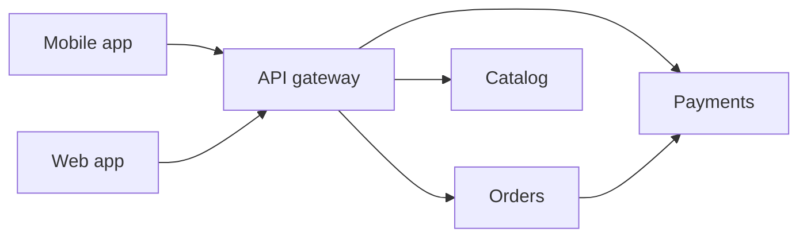
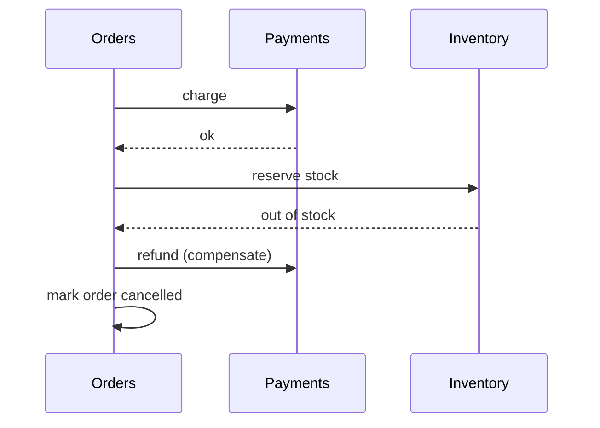

## Monolith first

A **monolith** is one deployable application containing all features. A **microservice** architecture splits the system into small services, each owning one business capability (orders, payments, search), deployed and scaled independently and talking over the network (HTTP/REST, gRPC, or messages).

| | Monolith | Microservices |
|---|---|---|
| Deploy | One unit; any change redeploys everything | Each service on its own schedule |
| Scaling | Scale the whole app | Scale only the hot service |
| Team fit | Small team, one codebase | Many teams, clear ownership |
| Debugging | One stack trace | Requests cross many services; needs tracing |
| Data | One database, real transactions | Database per service; no cross-service transactions |
| Failure modes | In-process calls rarely fail | Every call can time out or fail |
| Cost | Low operational overhead | Needs CI/CD, containers, monitoring, platform team |

:::truth
Microservices solve an organisation problem (many teams blocked on each other) more than a technical one. For a small team they add network failures, versioning and operational work with little benefit. Many successful products run as a **modular monolith**: one deployable, clean internal module boundaries, split later if needed.
:::

```quiz
q: Which situation most justifies moving from a monolith to microservices?
options:
  - Three developers want the code to look modern
  - Forty developers across eight teams block each other's releases, and one component needs to scale 50x more than the rest
  - The single database is slow, and splitting code will fix it
answer: 1
why: "Independent deploys and independent scaling are the real payoffs. A slow database is usually fixed with indexes, caching or replicas, not by splitting code."
```

## Drawing service boundaries

- Split by **business capability** (orders, billing, catalog), not by technical layer ("all database code").
- Each service **owns its data**. Others must go through its API, never read its tables. Shared databases bring back tight coupling.
- Prefer few, coarse services over dozens of tiny ones. Chatty services mean the boundary is wrong.
- Chains of synchronous calls multiply latency and combine availability (see the reliability lesson).

```estimate
q: A request passes through 10 services in sequence, each 99.9% available. What is the overall availability?
answer: 99
unit: "%"
tolerance: 0.01
hint: Multiply 0.999 by itself 10 times.
solution: "0.999^10 is about 0.990, so 99.0%. Instead of 43 minutes of downtime a month, the chain allows about 7 hours. Fewer hops, caches and async messaging reduce this."
```

## Service discovery

Instances start, stop and move (autoscaling, deploys), so IPs change constantly. **Service discovery** lets a caller find healthy instances of "payments" by name.

- A **service registry** is a database of live instances. Instances register on startup and send heartbeats (periodic "I am alive" signals). Examples: **Consul**, **etcd**, **Eureka**.
- **Client-side discovery**: the caller asks the registry, picks an instance and load-balances itself.
- **Server-side discovery**: the caller sends to a stable name and a load balancer or proxy chooses. **Kubernetes** does this: a `Service` gives a stable virtual IP and DNS name (via CoreDNS), and kube-proxy spreads traffic across pods.

On Kubernetes you rarely build discovery yourself; you call `http://payments` and the platform resolves it.

## API gateway

An **API gateway** is the single entry point between clients and your services. It is a reverse proxy with extra duties:

- **Routing**: `/orders/*` goes to the orders service.
- **Authentication** and **rate limiting** in one place.
- **TLS termination**: decrypt HTTPS once at the edge.
- **Aggregation**: combine several backend calls into one response for the client.
- **Protocol translation, caching and request logging.**



Tools: **Kong**, **Nginx**, **Envoy**, **AWS API Gateway**, **Apigee**. A **BFF** (backend for frontend) is a gateway tailored to one client type, such as one for mobile and one for web.

:::warn
A gateway is a single point of failure and a bottleneck by design. Run several instances behind a load balancer, keep business logic out of it, and do not let it become a second monolith.
:::

```blanks
prompt: Match each job to the right component.
lang: text
code: |
  Finding live instances of "payments": service [[registry|discovery]]
  Verifying API keys and routing /orders to the right service: API [[gateway]]
why: The registry tracks which instances are alive; the gateway is the front door that authenticates and routes.
```

## Data across services: the saga

With one database, a transaction updates orders, payments and stock together or not at all. With a database per service, there is no such transaction. **Two-phase commit** (2PC, a protocol where all participants vote then commit together) exists but is slow, locks resources and fails badly when the coordinator crashes, so it is rarely used across services.

A **saga** is a sequence of local transactions. If a step fails, earlier steps are undone by **compensating actions** (a new transaction that reverses the effect, such as a refund).



Two styles:

- **Orchestration**: a central coordinator tells each service what to do next. Easy to follow; the coordinator must be reliable.
- **Choreography**: services react to each other's events (via Kafka or similar). No coordinator, but the flow is harder to see.

```order
prompt: Arrange the orchestrated order saga with its compensation.
lang: java
code: |
  orders.create(orderId);
  payments.charge(orderId);
  try {
      inventory.reserve(orderId);
  } catch (Exception e) {
      payments.refund(orderId);
      orders.cancel(orderId);
  }
distractors:
  - "    orders.delete(orderId);"
why: Each success is a local commit. When the later step fails, the earlier effects are reversed with a refund and a cancel, not by deleting history.
```

Sagas are not isolated: other users may see the intermediate state (an order pending while payment is taken). Compensations must themselves be retryable and idempotent.

## Interview angle

- Say you would start with a modular monolith unless team size or scaling demands otherwise.
- Draw services owning their data, a gateway at the edge, and async events between services.
- For multi-service writes, propose a saga with compensations rather than a distributed transaction.

```cards
- q: What does "database per service" mean?
  a: Each service owns its data and others access it only through the service's API, never its tables.
- q: Client-side versus server-side discovery?
  a: "Client-side: the caller queries the registry and picks an instance. Server-side: the caller uses a stable name and a load balancer picks."
- q: Name four jobs of an API gateway.
  a: Routing, authentication, rate limiting and TLS termination (also aggregation and logging).
- q: What is a saga?
  a: A chain of local transactions where a failure triggers compensating actions that undo earlier steps.
- q: Orchestration versus choreography?
  a: Orchestration uses a central coordinator; choreography has services react to each other's events.
```

## Notes

:::notes
- Microservices split by business capability; each service owns its data and deploys independently.
- Main payoff is team independence and targeted scaling; costs are network failures, debugging and ops overhead.
- Start with a modular monolith; split when teams or scaling demand it.
- Serial calls multiply latency and combine availability: ten 99.9% services give about 99.0%.
- Service discovery: registry (Consul, etcd, Eureka) or Kubernetes Services plus DNS.
- API gateway: routing, auth, rate limiting, TLS termination, aggregation. Keep it thin and replicated.
- No cross-service ACID transactions; use sagas with compensating actions (orchestration or choreography).
- Make saga steps and compensations idempotent and retryable.
:::
