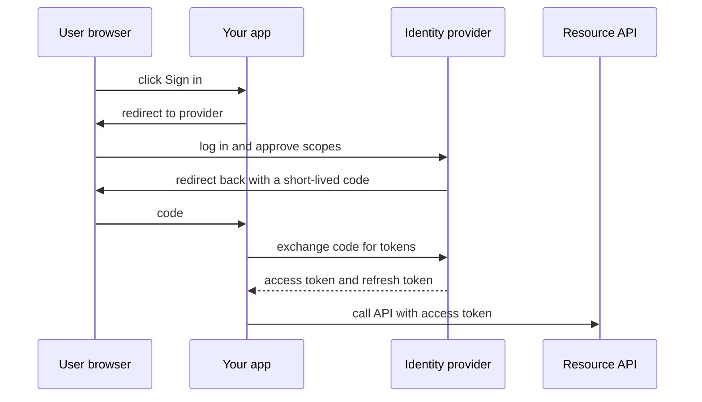

## Part 1: Observability

**Observability** is how well you can understand what a system is doing from the outside, using the data it emits. When something breaks at 3 a.m., you need answers without logging into servers. Three kinds of data work together.

| Signal | What it is | Answers | Tools |
|---|---|---|---|
| **Logs** | Timestamped records of events | What exactly happened to this request? | Elasticsearch + Kibana, Loki, CloudWatch Logs |
| **Metrics** | Numbers sampled over time | Is something wrong, and how bad? | Prometheus + Grafana, Datadog |
| **Traces** | The path of one request across services | Where did the time go? | Jaeger, Zipkin, Tempo |

Use metrics to notice, traces to locate, logs to explain.

### Logs

- Write **structured logs** (JSON with fields) instead of free text, so they can be searched: `{"level":"error","order_id":"o-17","msg":"payment timeout"}`.
- Include a **request id** or trace id in every line, so one request can be followed across services.
- Never log passwords, tokens or card numbers.
- Logs are expensive at volume. Sample or lower the level for noisy paths.

### Metrics

Watch the **RED** signals for each service:

- **Rate**: requests per second.
- **Errors**: share of failed requests.
- **Duration**: how long requests take, as percentiles.

A **percentile** says what share of requests were faster than a value. **p99 latency** of 800 ms means 99% of requests took 800 ms or less and 1% took longer. Averages hide the slow tail, so alert on p95 or p99.

```estimate
q: A page makes 100 backend calls in parallel. Each call is slower than its p99 threshold 1% of the time, independently. What percent of page loads see at least one slow call?
answer: 63
unit: "%"
tolerance: 0.15
hint: Compute the chance that all 100 are fast, then subtract from 1.
solution: "All fast: 0.99^100 is about 0.366. At least one slow: 1 - 0.366 = 63%. Tail latency compounds with fan-out, which is why p99 matters more than the average."
```

### Traces

A **trace** is the whole journey of one request. It is made of **spans**: one per step, with a start time and duration. A trace id is passed in an HTTP header (the W3C `traceparent` standard) so each service attaches its span to the same trace. **OpenTelemetry** is the vendor-neutral standard for producing logs, metrics and traces.

```quiz
q: Checkout p99 latency doubled at 14:00. You need to know which downstream service added the time. Which signal is best?
options:
  - Average CPU metric of the checkout service
  - Distributed traces showing the span durations of slow requests
  - The access log of the load balancer
answer: 1
why: "Traces break one slow request into per-service spans, so the slow hop is visible directly. CPU and load balancer logs show symptoms but not which dependency is slow."
```

Alerts should fire on user pain (error rate, latency against the SLO) and link to a runbook. Alerts on every CPU spike train people to ignore them.

## Part 2: Security basics

### Authentication versus authorization

- **Authentication (authN)**: who are you? Password, passkey, one-time code.
- **Authorization (authZ)**: what are you allowed to do? Roles and permissions.

Passwords are stored as slow salted hashes (**bcrypt**, **argon2**), never plain text and never fast hashes like plain SHA-256. A **salt** is a random value added per password so equal passwords hash differently.

### OAuth 2.0

**OAuth 2.0** lets a user give an app limited access to their account on another service without sharing their password. "Sign in with Google" combines it with **OpenID Connect** (a layer on top of OAuth that adds identity).

The authorization code flow, the standard for web and mobile apps:



- The **access token** is short-lived (minutes) and sent with each API call. The **refresh token** is long-lived and used to get new access tokens.
- **Scopes** list what is allowed, such as `read:profile`.
- Mobile and single-page apps add **PKCE** (Proof Key for Code Exchange), a one-time secret that stops a stolen code from being used.

### JWT

A **JWT** (JSON Web Token) is a common access token format: three base64url parts, `header.payload.signature`. The server signs it, so any service holding the key can verify it without calling the identity provider. That makes it stateless and fast.

```predict
lang: python
prompt: This is the payload part of a JWT. What does it print?
code: |
  import base64, json
  p = "eyJzdWIiOiI0MiJ9"
  print(json.loads(base64.urlsafe_b64decode(p + "==")))
output: "{'sub': '42'}"
why: A JWT payload is only encoded, not encrypted. Anyone holding the token can read it, so never put secrets in it.
```

:::warn
JWTs are hard to revoke before expiry because servers do not look anything up. Keep them short-lived (5 to 15 minutes), check `exp` (expiry) and `aud` (intended audience), and pin the allowed signing algorithm.
:::

```blanks
prompt: Complete the request that presents an access token.
lang: http
code: |
  GET /v1/orders HTTP/1.1
  [[Authorization]]: [[Bearer]] eyJhbGciOi...
why: The Authorization header with the Bearer scheme carries the token. Always send it over HTTPS.
```

### TLS

**TLS** (Transport Layer Security) encrypts traffic; HTTPS is HTTP over TLS. In the handshake the server proves its identity with a **certificate** (a public key signed by a trusted certificate authority, such as Let's Encrypt), and both sides agree on a session key for fast symmetric encryption. TLS 1.3 needs one round trip.

- Terminate TLS at the load balancer or gateway for simplicity.
- Use **mTLS** (mutual TLS, where the client also presents a certificate) between internal services if you want them to authenticate each other. Service meshes automate this.
- Automate certificate renewal. Expired certificates are a classic outage.

### Secrets

A **secret** is any credential: database passwords, API keys, signing keys.

- Never in Git, container images or client-side code.
- Store in a secret manager: **HashiCorp Vault**, **AWS Secrets Manager**, Kubernetes Secrets with encryption enabled.
- Inject at runtime, give each service only the secrets it needs, and **rotate** (replace) them regularly.
- If one leaks, rotate first, clean up later. Deleting the Git commit does not unleak it.

:::truth
Most breaches come from basic failures: leaked keys, missing authorization checks, unpatched software. Authentication proves identity, but forgetting to check that this user owns this order is the bug that ships most often.
:::

## Interview angle

- Name the three signals and the RED metrics when asked how you would monitor a design.
- Separate authN from authZ; describe OAuth 2.0 code flow with short-lived tokens.
- Mention TLS at the edge, encryption at rest, secrets in a manager and least privilege.

```cards
- q: "Logs, metrics, traces: when to use which?"
  a: Metrics detect a problem, traces locate where it is, logs explain what happened.
- q: What are the RED metrics?
  a: Rate (requests per second), Errors (failure share) and Duration (latency percentiles).
- q: Authentication versus authorization?
  a: Authentication proves who you are. Authorization decides what you may do.
- q: Is a JWT encrypted?
  a: No. It is signed and base64url-encoded, so anyone can read the payload but cannot alter it without breaking the signature.
- q: What does TLS give you?
  a: Encryption in transit, server identity through certificates, and tamper detection.
```

## Notes

:::notes
- Observability = logs (what happened), metrics (is it wrong), traces (where is the time going).
- Use structured logs with a request id; never log secrets.
- Track RED per service: rate, errors, duration as p95 or p99; averages hide tail latency.
- Tail latency compounds: 100 parallel calls at 1% slow each makes 63% of pages slow.
- AuthN = who you are; authZ = what you may do. Hash passwords with bcrypt or argon2.
- OAuth 2.0 code flow: redirect, login, code, exchange for short-lived access token plus refresh token; add PKCE for public clients.
- JWT is signed, not encrypted; keep it short-lived and verify exp, aud and algorithm.
- TLS encrypts in transit; automate certificate renewal; use mTLS between internal services if needed.
- Keep secrets in a secret manager, rotate them, and rotate immediately after any leak.
:::
