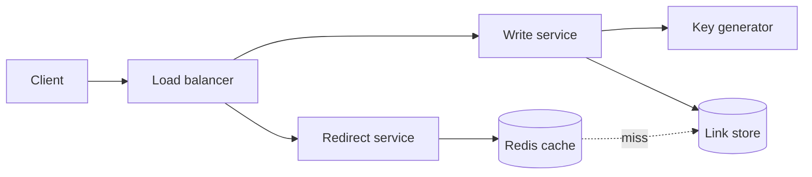

## Requirements

A **URL shortener** turns `https://example.com/very/long/path?x=1` into something like `https://sho.rt/aZ3k9Qp`. Visiting the short link redirects to the original.

Functional:

- Create a short link from a long URL.
- Redirect a short link to its long URL.
- Optional expiry; optional custom alias.

Non-functional:

- Redirects are fast, ideally under 50 ms server time, and highly available. A broken link is a visible failure.
- Short codes are unique and hard to guess one by one.
- Reads vastly outnumber writes.

Out of scope for this lesson: user accounts, abuse and phishing detection (real services need both).

## Estimates

Assume 100 million new links per month and 100 reads per write.

```estimate
q: 100 million new short links are created per month (about 2.6 million seconds). Average writes per second?
answer: 40
unit: writes/s
tolerance: 0.4
hint: Divide 10^8 by roughly 2.6 x 10^6.
solution: "10^8 / 2.6 x 10^6 is about 38 writes/s. With a 100:1 read ratio that is roughly 4,000 redirects/s on average, perhaps 10,000/s at peak."
```

```estimate
q: Keep every link for 5 years at about 500 bytes per row (code, long URL, timestamps, owner). How much storage?
answer: 3
unit: TB
tolerance: 0.5
hint: 100 million x 12 months x 5 years = 6 billion rows.
solution: "6 x 10^9 rows x 500 B = 3 x 10^12 B, about 3 TB. That fits on a handful of ordinary database servers."
```

:::truth
These numbers are small. 4,000 reads/s and 3 TB can run on one well-tuned PostgreSQL primary with replicas and a Redis cache. The case study is popular because the ideas (key generation, caching, sharding later) are clean, not because the scale is extreme.
:::

## API

```http
POST /v1/links
{ "long_url": "https://example.com/a/b", "expires_at": "2027-01-01T00:00:00Z" }
-> 201 { "code": "aZ3k9Qp", "short_url": "https://sho.rt/aZ3k9Qp" }

GET /aZ3k9Qp
-> 302 Found
   Location: https://example.com/a/b
```

- **301 Moved Permanently** tells browsers and caches to remember the redirect, so later clicks skip your servers. Cheaper, but you lose click counts and cannot change the target.
- **302 Found** is temporary, so every click reaches you. Use it when analytics or edits matter.

## Data model

One access pattern dominates: look up by `code`. That is a key-value read.

| Column | Type | Note |
|---|---|---|
| `code` | string(7), primary key | The short code |
| `long_url` | text | Original URL |
| `created_at`, `expires_at` | timestamps | Expiry may be null |
| `owner_id` | bigint | Optional |

No joins, no multi-row transactions. Either PostgreSQL (sharded by `code` later) or a key-value store such as DynamoDB or Cassandra fits. Start with the one your team already runs.

## High-level design



- Writes and reads are separate services so each scales on its own. Reads need far more instances.
- The redirect service checks **Redis** (an in-memory key-value store) first and falls back to the database on a miss.
- A **load balancer** (Nginx, HAProxy or a cloud one) spreads requests across instances.

## Deep dive: generating the short code

A code of 7 characters from a 62-symbol alphabet (`0-9`, `a-z`, `A-Z`), called **base62**, gives $62^7 \approx 3.5 \times 10^{12}$ combinations, far above the 6 billion needed.

| Approach | How | Weak spot |
|---|---|---|
| Hash and truncate | MD5 or SHA-256 of the URL, keep 7 characters | Collisions; each insert must check and retry with a salt |
| Counter + base62 | Global counter, encode the number | Codes are sequential and guessable |
| Pre-generated keys | A key service creates random unused codes in advance | One more component to run |

A common compromise: each write server asks a coordinator (a database sequence, Redis `INCR`, ZooKeeper or etcd) for a **block** of, say, 1,000 numbers, then hands them out locally with no network call per link. To avoid guessable codes, scramble the number first (a bit shuffle or a keyed permutation) before encoding.

```predict
lang: python
prompt: Encode the counter value 1000 in base62 using this alphabet. What is printed?
code: |
  A = "0123456789abcdefghijklmnopqrstuvwxyzABCDEFGHIJKLMNOPQRSTUVWXYZ"
  n, s = 1000, ""
  while n:
      n, r = divmod(n, 62)
      s = A[r] + s
  print(s)
output: g8
why: 1000 = 16 x 62 + 8. Digit 16 is "g" (a=10, so g=16) and digit 8 is "8".
```

```quiz
q: Two different long URLs hash (MD5, first 7 characters kept) to the same code. What is the right handling?
options:
  - Overwrite the old row, because the newest link wins
  - Insert with a unique constraint on `code`; on conflict, add a salt to the input and hash again
  - Ignore it, because MD5 collisions never happen
answer: 1
why: "Truncating a hash to 7 characters makes collisions real once the table holds billions of rows. The database unique constraint is the safe judge, and a retry with a salt resolves it."
```

## Deep dive: fast, cached redirects

Link popularity follows a long tail: a small fraction of links gets most clicks. A cache pays off.

- **Cache-aside**: check Redis for `code`; on a miss read the database and store the result with a TTL (time to live).
- Eviction policy **LRU** (least recently used) keeps hot links. Even 20 percent of daily data in memory can serve most reads.
- Cache negative results briefly too, so a bot hammering unknown codes does not reach the database.
- Add a CDN (CloudFront, Fastly) in front for 301 responses of very popular links.

```viz
algo: lru-cache
input:
  capacity: 3
  ops: ["put a 1", "put b 2", "put c 3", "get a", "put d 4", "get b", "get c"]
```

:::warn
Do not delete an expired code and reuse it immediately. Old caches and 301-cached browsers still point to the previous target. Keep a quiet period or never reuse codes.
:::

## Trade-offs

- **301 vs 302**: speed and cost against analytics and control.
- **Hash vs counter**: no coordination but collisions, against coordination but guessable codes.
- **SQL vs key-value**: familiar tooling against effortless horizontal scale.
- **Cache TTL**: long TTLs reduce database load, but edited or deleted links stay visible longer.

## Interview angle

- State the read:write ratio first; it justifies everything else.
- Do the arithmetic aloud, then say the scale is modest.
- Explain code generation with one clear choice and name its weakness.
- Likely follow-ups: custom aliases, analytics without slowing redirects (log click events to Kafka, aggregate later), rate limiting creation per user, multi-region deployment.

```cards
- q: Why can a 7-character base62 code cover 6 billion links?
  a: $62^7 \approx 3.5 \times 10^{12}$ combinations, hundreds of times more than needed.
- q: 301 vs 302 for a shortener?
  a: 301 is cached by browsers so later clicks skip you but you lose analytics; 302 is temporary so every click hits your service.
- q: What is the weakness of hashing the URL and truncating it?
  a: Collisions. You must insert with a unique constraint and retry with a salt on conflict.
- q: How do write servers avoid a network call per new code?
  a: They reserve a block of counter values (for example 1,000) and issue them locally.
- q: What is the main access pattern of the link store?
  a: Single-key lookup by code, so a key-value model or a sharded SQL table works.
```

## Notes

:::notes
- Shortener = key-value lookup, read-heavy (about 100:1); about 40 writes/s and 4,000 reads/s at 100M links/month.
- 6B links x 500 B = about 3 TB over 5 years; modest, so keep the stack simple.
- API: POST /links creates, GET /{code} answers 301 or 302 with a Location header.
- 301 is cacheable and cheap but hides clicks; 302 gives analytics and editability.
- 7 base62 characters give about 3.5 trillion codes.
- Code generation: hash plus truncate needs collision retry; counter blocks need scrambling to avoid guessable codes.
- Cache-aside with Redis and LRU; cache misses and negatives briefly; popular links can sit behind a CDN.
- Separate write and redirect services so reads scale independently.
- Add analytics through an async event log (Kafka), never in the redirect path.
:::
