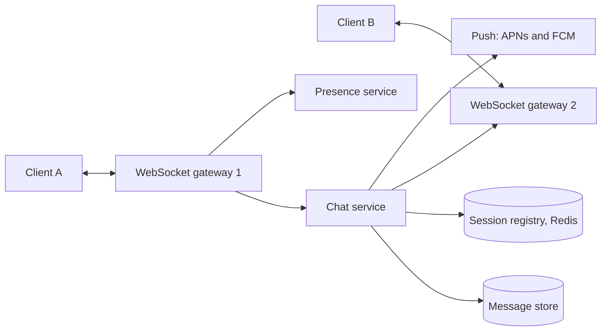
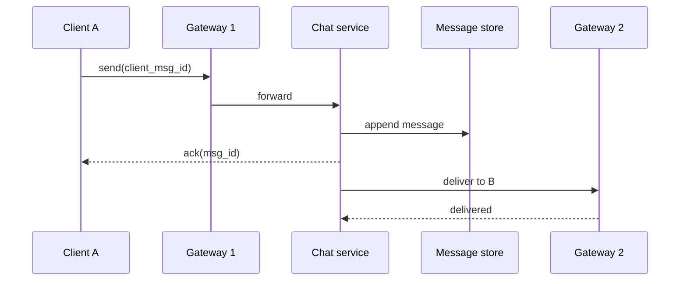

## Requirements

A **chat system** lets users send messages to one person or a group and see them arrive in real time.

Functional:

- One-to-one and group chat (up to a few hundred members).
- Message history, available on a new device.
- Delivery to offline users when they return.
- Online or last-seen status, called **presence**.
- Text first; media goes through object storage.

Non-functional:

- Low latency, a few hundred milliseconds end to end.
- **Ordering**: messages in one conversation appear in the same order for everyone.
- No lost messages; duplicates are hidden from users.
- Stays up when a server dies.

## Estimates

Assume 50 million daily active users (DAU), 40 messages sent per user per day, 100 bytes per message.

```estimate
q: 50 million users each send 40 messages a day. Average messages per second?
answer: 23000
unit: msg/s
tolerance: 0.4
hint: 50M x 40 = 2 billion messages a day; a day is about 86,400 seconds.
solution: "2 x 10^9 / 86,400 is about 23,000 msg/s on average. Plan for 2 to 3 times that at peak. Group messages multiply the delivery work further."
```

```estimate
q: At 100 bytes per message and 2 billion messages a day, how much new data per year (before replication)?
answer: 73
unit: TB
tolerance: 0.4
hint: 2 x 10^9 x 100 B = 200 GB a day.
solution: "200 GB x 365 is about 73 TB per year, so about 220 TB with three replicas. Storage is manageable; write rate and connection count are the harder parts."
```

Connections: if 10 million users are online at once and one tuned server holds about 100,000 idle connections, you need roughly 100 gateway servers.

## Protocol: why WebSocket

HTTP request and response cannot push data to a client. Options:

| Option | How | Verdict |
|---|---|---|
| Polling | Client asks every few seconds | Wasteful, slow |
| Long polling | Server holds the request until data exists | Works, but heavy |
| **WebSocket** | One long-lived two-way TCP connection | Standard for chat |

Messages travel over the socket as small JSON or binary frames:

```json
{ "type": "send", "client_msg_id": "c-91f", "conv_id": 42, "body": "hi" }
{ "type": "ack",  "client_msg_id": "c-91f", "msg_id": 8812345 }
```

History uses a normal REST call: `GET /conversations/42/messages?before=8812345&limit=50`.

## Data model

Access pattern: "the latest N messages of one conversation".

| Table | Key | Notes |
|---|---|---|
| `messages` | partition `conv_id`, sort by `msg_id` descending | Wide-column store: Cassandra, ScyllaDB or HBase |
| `conversations` | `conv_id` | Members, title |
| `user_inbox` | partition `user_id`, sort by `msg_id` | Per-user unread pointers |

`msg_id` is a time-ordered ID (Snowflake style, see unique ID generation) so sorting by it sorts by time. For very busy conversations, add a time bucket (for example month) to the partition key so one partition does not grow without limit.

## High-level design



- **Gateways** only hold connections. They are stateless apart from "who is connected here".
- The **session registry** maps `user_id` to the gateway holding their socket.
- **APNs and FCM** (Apple Push Notification service, Firebase Cloud Messaging) wake phones that are offline.



## Deep dive: delivery guarantees

- Networks drop things, so use **at-least-once** delivery: the sender retries until it sees an ack.
- Retries create duplicates, so the server de-duplicates on `client_msg_id`. Result: effectively once.
- The ack means "durably stored". Send it only after the write, never before.

```order
prompt: Arrange the server handler so a retried send never duplicates a message and an ack always means stored.
lang: python
code: |
  def on_send(msg):
      if seen(msg.client_msg_id):
          return ack_existing(msg)
      msg.id = next_id(msg.conv_id)
      store.append(msg)
      ack(msg.sender, msg.id)
      for u in members(msg.conv_id):
          deliver_or_push(u, msg)
distractors:
  - "      ack(msg.sender, msg.id)  # ack first, store later"
why: The duplicate check comes first so retries are harmless. The write happens before the ack so a crash cannot leave a sender believing an unsaved message exists.
```

- Receivers ack too. If no ack arrives, the message stays in the user's inbox and is resent on reconnect.
- On reconnect the client says "my last seen `msg_id` is X" and the server replays everything after X.

## Deep dive: ordering and groups

- Order inside one conversation by `msg_id`; global order across conversations is not needed.
- **Small groups**: fan out on write, delivering a copy to each member's gateway or inbox.
- **Large groups or channels**: write once to the conversation log and let members read from it, otherwise one message costs thousands of writes.

```quiz
q: Why is round-robin load balancing a weak fit for chat gateways?
options:
  - It cannot be used with TCP
  - Connections last hours, so equal request counts do not mean equal load; least-connections spreads the long-lived sockets better
  - It makes messages arrive out of order
answer: 1
why: "A socket stays open for a long time. Round-robin balances new connections at the moment they arrive but ignores how long each one lives, so some gateways accumulate more."
```

```viz
algo: load-balancer
input:
  servers: 3
  strategy: least-connections
  requests: [[0, 6], [0.5, 1], [1, 1], [1.5, 5], [2, 1], [2.5, 1], [3, 2]]
```

## Deep dive: presence

- Each client sends a **heartbeat** every ~30 seconds. The presence service stores `user_id -> last_seen` in Redis with a TTL slightly longer than the heartbeat.
- Key expiry means "offline". No explicit logout message is needed, which is good because crashes send none.
- Do not broadcast every status flip to every friend. Send presence only to users who have that chat open or a small recent-contacts list.

:::truth
Exactly-once delivery over an unreliable network is impossible. "At-least-once plus de-duplication" is the practical version, and honest chat apps describe it that way.
:::

## Trade-offs

- **Fan-out on write vs read** for groups: fast reads against write amplification.
- **Cassandra vs SQL** for messages: easy horizontal write scale against weaker joins and transactions.
- **Eventual consistency** across regions: acceptable if per-conversation order holds.
- **Server stores history vs end-to-end encryption**: features such as search and multi-device sync get harder.

## Interview angle

- Begin with WebSocket and the session registry; it shows you know the core problem.
- Say ack and dedup out loud.
- Expect follow-ups: media upload (pre-signed S3 URL, thumbnail in the message), multi-device sync, gateway failure, hot groups.

```cards
- q: Why WebSocket for chat?
  a: One long-lived two-way connection lets the server push messages instantly without polling.
- q: What does the session registry store?
  a: A map from user id to the gateway server holding that user's connection, usually in Redis.
- q: How do you get effectively-once delivery?
  a: Retry until acked (at-least-once) and de-duplicate on a client-generated message id.
- q: How are messages ordered inside a conversation?
  a: By a time-ordered message id (Snowflake style) used as the sort key within the conversation partition.
- q: How does presence work without logout events?
  a: Heartbeats refresh a Redis key with a TTL; when it expires, the user is offline.
```

## Notes

:::notes
- 50M DAU x 40 msgs = 2B/day, about 23k msg/s average, 200 GB/day of text.
- Use WebSocket gateways; about 100k connections per tuned server, so roughly 100 gateways for 10M online.
- Session registry (Redis) maps user_id to gateway; the chat service routes through it.
- Store messages in a wide-column store keyed by conversation, sorted by time-ordered message id.
- Ack only after the durable write; clients retry; server de-dupes on client_msg_id.
- Offline users: keep messages in the inbox, push via APNs or FCM, replay after last seen id on reconnect.
- Small groups fan out on write; big groups read from a shared log.
- Presence = heartbeat + TTL key; limit who is notified.
- Least-connections beats round-robin for long-lived sockets.
:::
