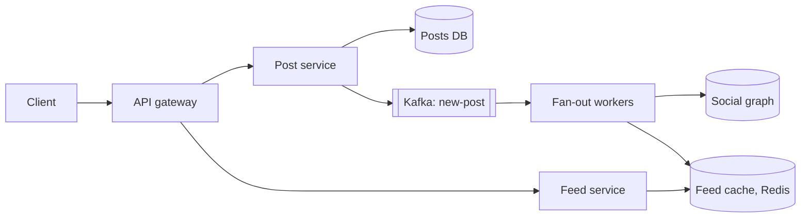

## Requirements

A **news feed** (or timeline) is the home page that lists recent posts from people you follow.

Functional:

- Publish a post (text, plus image or video links).
- Follow and unfollow users.
- Open the feed: newest-first posts from followed accounts, loaded in pages.

Non-functional:

- Feed loads in a few hundred milliseconds.
- A new post appears in followers' feeds within seconds, not minutes.
- Highly available; slightly stale content is acceptable.

Out of scope here: ranking models, ads, comments, likes counting.

## Estimates

Assume 200 million daily active users (DAU). Each opens the feed 5 times a day and posts 0.5 times a day; the average user has 200 followers.

```estimate
q: 200 million users each open the feed 5 times a day. Average feed reads per second?
answer: 11500
unit: req/s
tolerance: 0.4
hint: 10^9 reads a day divided by about 86,400 seconds.
solution: "200M x 5 = 10^9 reads/day, about 11,600 reads/s on average, perhaps 30,000/s at peak."
```

```estimate
q: Posts per day are 100 million and each is delivered to 200 followers' feeds. Feed writes per second if you push to every follower?
answer: 230000
unit: writes/s
tolerance: 0.5
hint: 100M x 200 = 2 x 10^10 deliveries a day.
solution: "2 x 10^10 / 86,400 is about 230,000 writes/s. That is 20 times the read rate, which is the cost of precomputing feeds."
```

Storage for cached feeds: keep the latest 800 post IDs (8 bytes each) per user, about 6.4 KB. For 200 million users that is roughly 1.3 TB, easily spread across a Redis cluster.

## API

```http
POST /v1/posts            { "text": "hello", "media": ["s3://..."] }
POST /v1/follow/{user_id}
GET  /v1/feed?cursor=<post_id>&limit=20
-> 200 { "posts": [...], "next_cursor": "8812001" }
```

Use a **cursor** (the ID of the last post seen) instead of page numbers. With an offset, new posts arriving at the top shift every page and the user sees duplicates.

## Data model

| Store | Content | Why |
|---|---|---|
| `posts` | post_id, author_id, text, media refs, created_at | Key-value or sharded SQL by post_id |
| `follows` | follower_id, followee_id | Two lookups: "who do I follow" and "who follows me" |
| Feed cache | `feed:{user_id}` as a list of post IDs | Redis; only IDs, not post bodies |
| Media | Images and video | S3 behind a CDN |

The feed cache holds IDs. A separate batch lookup hydrates them into full posts, usually from a post cache.

## Two ways to build a feed

- **Fan-out on read (pull)**: when you open the feed, fetch recent posts from each followed account and merge them. Cheap to write, expensive to read.
- **Fan-out on write (push)**: when someone posts, copy the post ID into every follower's feed list. Expensive to write, cheap to read.

| | Pull | Push |
|---|---|---|
| Write cost | 1 write | One per follower |
| Read cost | Query every followee, then merge | One cache read |
| Weak spot | Slow reads for users following many accounts | Celebrity with millions of followers |
| Freshness | Always current | Delayed by fan-out queue |

```quiz
q: A celebrity with 50 million followers posts once. What goes wrong with pure push?
options:
  - Nothing, Redis is fast
  - One post triggers 50 million feed writes, so a backlog delays everyone else's posts and wastes work on inactive followers
  - The post cannot be read by followers
answer: 1
why: "Push multiplies each post by the follower count. For a mega-account the queue backs up, and many of those followers will not open the app that day."
```

## High-level design



Flow of a post:

1. Post service writes the post and publishes a `new-post` event to **Kafka** (a durable log used as a queue).
2. Fan-out workers read the event, look up the author's followers in the social graph and push the post ID into each follower's Redis list, trimming to 800.
3. The client calls the feed service, which reads IDs from Redis, hydrates the posts and returns a page.

## Deep dive: the hybrid approach

Real systems combine both models.

- Normal accounts (say under 100,000 followers) use push.
- Celebrities are not pushed. At read time the feed service merges the user's cached feed with recent posts from the celebrities they follow.
- Skip fan-out to users inactive for 30 days; rebuild their feed on return.

```blanks
prompt: Complete the hybrid read path.
lang: python
code: |
  def get_feed(user, n):
      ids = inbox.get(user)                       # pushed posts
      for star in followed_celebrities(user):
          ids += recent_posts([[star]])           # pulled at read time
      ids.sort(reverse=[[True]])                  # newest first
      return ids[:[[n]]]
why: Pushed IDs are already in the inbox; celebrity posts are pulled per celebrity, then everything is sorted newest first and cut to one page.
```

## Deep dive: caching and hydration

- The feed cache is only a list of IDs, so memory stays small.
- Hot posts live in a second cache so hydrating 20 posts is one batched read (`MGET` in Redis).
- Counts such as likes change constantly; fetch them separately and let them lag by a few seconds.
- Media never passes through these services: the post holds an S3 URL and the CDN serves bytes.

:::warn
Do not delete from every follower's list when a post is removed. Store a "deleted" flag on the post and filter at hydration. The same trick handles blocking and unfollowing cheaply.
:::

## Trade-offs

- **Push vs pull**: read latency against write amplification.
- **Hybrid**: best of both, but two code paths to test and operate.
- **Cache only IDs**: small memory, but an extra hydration step on every read.
- **Chronological vs ranked**: ranking adds a scoring service and makes caching harder, since order is per-user and changes with time.

:::truth
A feed that is a few seconds stale is acceptable; a feed that is down is not. Choosing eventual consistency here is what makes the design affordable.
:::

## Interview angle

- Name push, pull and the celebrity problem within the first few minutes.
- Say what you cache (IDs) and why.
- Likely follow-ups: ranking, sharding the social graph by user_id, handling a user who follows 10,000 accounts, backfilling feeds for a new follower.

```cards
- q: Fan-out on write in one line?
  a: On posting, copy the post ID into every follower's precomputed feed; reads become one cache lookup.
- q: Why pure push fails for celebrities?
  a: One post becomes millions of writes, delaying the queue and wasting work on inactive followers.
- q: What does the hybrid design do?
  a: Push for normal accounts; pull celebrity posts at read time and merge with the cached feed.
- q: Why use a cursor instead of page numbers?
  a: New posts shift offsets, causing duplicates or gaps; a cursor anchors on the last post seen.
- q: What does the feed cache store?
  a: Only post IDs per user (for example the latest 800), hydrated into full posts at read time.
```

## Notes

:::notes
- Feed = recent posts from followed accounts; reads far outnumber posts.
- 200M DAU x 5 opens = about 11.6k reads/s; push at 200 followers = about 230k feed writes/s.
- Pull computes on read (slow reads); push precomputes on write (heavy writes).
- Celebrity accounts break push; hybrid pulls them at read time.
- Pipeline: post service, Kafka new-post event, fan-out workers, Redis list of IDs per user.
- Cache IDs only; hydrate posts in a batch; media lives in S3 behind a CDN.
- Use cursor pagination, not offsets.
- Handle deletes and unfollows with filters at read time rather than rewriting lists.
- Eventual consistency of a few seconds is fine for a feed.
:::
