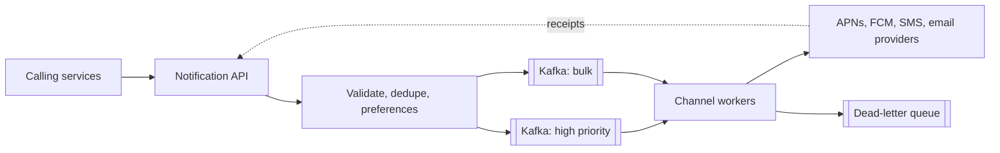

## Requirements

A **notification system** sends messages to users on several channels: mobile push, SMS, email and in-app.

Functional:

- Other services call it ("order shipped", "OTP", "weekly digest").
- Channels: push, SMS, email.
- Users can opt out per channel and per category.
- Templates, scheduling, and a record of what was sent.

Non-functional:

- OTPs (one-time passwords) arrive in seconds; marketing can wait minutes.
- Never send the same notification twice (annoying) and rarely lose an important one (costly).
- Survive provider outages.
- Scale to bursts: a campaign can be millions of messages at once.

## Estimates

Assume 100 million notifications a day, spread unevenly, plus campaign bursts.

```estimate
q: 100 million notifications a day. Average sends per second?
answer: 1160
unit: req/s
tolerance: 0.4
hint: Divide by about 86,400 seconds.
solution: "10^8 / 86,400 is about 1,160/s on average."
```

```estimate
q: A campaign targets 10 million users and must finish in 10 minutes. Sends per second needed?
answer: 16700
unit: req/s
tolerance: 0.3
hint: 10 minutes is 600 seconds.
solution: "10^7 / 600 is about 16,700/s, over ten times the daily average. This burst, not the average, sizes the system."
```

:::truth
Your own servers are rarely the limit. Providers are. APNs, FCM, SMS carriers and email services all impose rate limits and charge per message; SMS costs real money per send, so duplicates and spam have a direct bill.
:::

## API

Internal services call one endpoint:

```http
POST /v1/notifications
{
  "idempotency_key": "order-991-shipped",
  "user_id": 42,
  "category": "order_update",
  "priority": "high",
  "template": "order_shipped",
  "params": { "order_id": 991 }
}
-> 202 Accepted
```

`202 Accepted` means "queued", not "delivered". Delivery status is a separate lookup or a callback.

## Data model

| Table | Key columns | Purpose |
|---|---|---|
| `devices` | user_id, platform, push_token | Push targets; a user has several |
| `preferences` | user_id, category, channel, enabled | Opt-outs |
| `templates` | template_id, channel, body | Message text with placeholders |
| `notifications` | id, idempotency_key (unique), status, channel, attempts | Audit and deduplication |

Statuses: `queued`, `sent`, `delivered`, `failed`. Provider receipts and webhooks update them.

## High-level design



- The API does cheap work synchronously (validate, check preferences, dedupe) and queues the rest.
- **Kafka** or **RabbitMQ** or **SQS** queues absorb bursts so workers pull at their own pace.
- Separate queues for **priority classes**: an OTP never waits behind a million marketing messages.
- Workers per channel render the template and call the provider: APNs (Apple push), FCM (Google push), Twilio or Amazon SNS for SMS, Amazon SES or SendGrid for email.

```quiz
q: Why give OTP messages their own queue and workers rather than one shared queue with a "priority" field?
options:
  - Queues cannot hold a priority field
  - A shared FIFO queue makes an OTP wait behind earlier bulk messages; separate queues and capacity guarantee it a fast lane
  - It reduces the number of providers needed
answer: 1
why: "A first-in-first-out queue serves in arrival order. A burst of bulk messages ahead of an OTP delays it. Separate queues isolate the failure and the delay."
```

## Deep dive: retries and failures

Providers fail temporarily. Workers retry with **exponential backoff**: wait 1 s, 2 s, 4 s and so on up to a cap, plus random **jitter** (a small random offset so retries from many workers do not all land at once).

```predict
lang: python
prompt: Delays in seconds for 7 attempts, with base 1 and a cap of 30. What is printed?
code: |
  base, cap = 1, 30
  print([min(cap, base * 2**i) for i in range(7)])
output: "[1, 2, 4, 8, 16, 30, 30]"
why: "The delay doubles each attempt (1, 2, 4, 8, 16, 32) but is capped at 30, so the sixth and seventh are both 30."
```

- After N failed attempts, move the message to a **dead-letter queue** (DLQ) for inspection instead of retrying forever.
- Distinguish errors: a 5xx or timeout is retryable; "invalid token" means delete the device token; "user unsubscribed" means stop.
- Fail over: if one SMS provider is down, switch to a second.

## Deep dive: no duplicates

The queue delivers **at least once**, so a worker may process a message twice after a crash. Defences:

- The `idempotency_key` has a unique constraint; a repeated API call is a no-op.
- Workers record `sent` before or atomically with calling the provider where possible, and pass the notification id as a provider idempotency token when supported.
- Accept the leftover edge case: crash after the provider accepted but before the record was written. For OTPs this is harmless; for marketing, prefer losing one over sending two.

## Deep dive: protecting users from noise

- **Per-user rate limit**: at most N marketing messages per day. A **token bucket** (a counter that refills at a fixed rate and spends one token per send) fits well.
- **Preferences and quiet hours** are checked before queuing; held messages go to a scheduled queue.
- **Collapse** similar events: ten likes become "10 people liked your post".

```viz
algo: token-bucket
input:
  capacity: 3
  refillPerSec: 1
  requests: [0, 0.2, 0.4, 0.6, 1.5, 2.1, 2.2, 4, 4.1, 4.2]
```

## Trade-offs

| Choice | Benefit | Cost |
|---|---|---|
| At-least-once + dedupe | No lost messages | Extra bookkeeping |
| Separate priority queues | Fast OTPs | More infrastructure |
| Sync check of preferences | Opt-outs honoured | Extra read per request |
| Single provider | Simple | Outage means no notifications |

## Interview angle

- Start with channels and priorities; they shape the whole design.
- Show the queue between API and workers, and say why (bursts, provider limits).
- Mention retries with backoff, DLQ, idempotency, preferences and rate limits.
- Likely follow-ups: tracking opens and clicks, scheduling at user-local time, template localisation, multi-region.

```cards
- q: Why queue notifications instead of calling providers directly?
  a: Queues absorb bursts, let workers respect provider rate limits and allow retries without blocking callers.
- q: What is exponential backoff with jitter?
  a: Waiting longer after each failure (1, 2, 4, 8 seconds, capped) plus a random offset so retries do not synchronise.
- q: What does a dead-letter queue hold?
  a: Messages that failed after the maximum retries, kept for inspection or manual replay.
- q: How do you stop duplicate sends?
  a: A unique idempotency key per notification, checked on the API and recorded before or with the provider call.
- q: Why separate queues for OTP and marketing?
  a: A burst of bulk messages must never delay a time-critical OTP.
```

## Notes

:::notes
- Channels: push (APNs, FCM), SMS (Twilio, SNS), email (SES, SendGrid), in-app.
- Average load is small (about 1,160/s at 100M/day); campaign bursts (about 16,700/s) set the size.
- API validates, dedupes on idempotency_key, checks preferences, then queues and returns 202.
- Separate queues per priority and channel; workers scale independently.
- Retry with exponential backoff and jitter; send to a dead-letter queue after the limit.
- Classify errors: retry transient ones, drop invalid tokens, honour unsubscribes.
- At-least-once delivery plus idempotency gives practical no-duplicates.
- Protect users: per-user token bucket, quiet hours, collapsing similar events.
- Providers, not your servers, are usually the bottleneck and the cost.
:::
