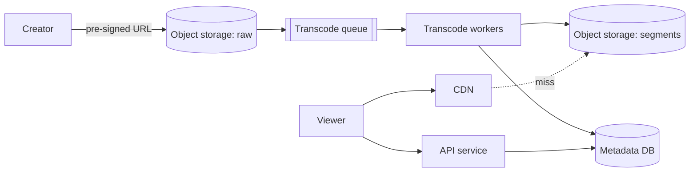

## Requirements

A **video streaming service** lets creators upload videos and viewers watch them on any device and network.

Functional:

- Upload a video file.
- Play a video with seek, pause and quality that adapts to the connection.
- Search and browse by title (metadata only here).

Non-functional:

- Playback starts in about a second or two and rarely stalls.
- Works on phones, TVs and browsers over varying bandwidth.
- Highly available for viewing; uploads may take minutes to become playable.
- Cost-aware: bandwidth and storage dominate the bill.

Out of scope: recommendations, copyright detection, comments, live streaming (see exercises).

## Estimates

Assume 50 million daily active users (DAU), 30 minutes of viewing each, an average stream of 2 Mbps (megabits per second), and 500,000 uploads a day.

```estimate
q: 50 million users each stream 30 minutes a day at 2 Mbps. Average outgoing bandwidth in Tbps (terabits per second)?
answer: 2
unit: Tbps
tolerance: 0.5
hint: One user per day is 1,800 s x 2 Mb = 3,600 Mb = 450 MB. Multiply by 50M, divide by 86,400 s.
solution: "450 MB x 50M = 22.5 PB a day. Over 86,400 s that is about 260 GB/s, roughly 2 Tbps on average, and several Tbps at the evening peak. No origin data centre can serve this; a CDN must."
```

```estimate
q: Each uploaded video averages 5 minutes (300 s) and all transcoded versions together total 10 Mbps of stream data. Stored size per video in MB?
answer: 375
unit: MB
tolerance: 0.3
hint: 300 s x 10 Mb = 3,000 Mb; divide by 8 for bytes.
solution: "3,000 Mb / 8 = 375 MB per video. At 500,000 uploads a day that is about 190 TB of new storage daily, which is why cold videos move to cheaper storage tiers."
```

:::truth
Storage and compute are real costs but bandwidth is the largest. Large platforms run their own CDNs or negotiate directly with ISPs; a small team simply buys CloudFront, Fastly or Cloudflare.
:::

## How video reaches a screen

A raw video file is huge and plays only in one format. Three ideas fix this:

- **Codec** (coder-decoder): compresses video. H.264 is universal, VP9 and AV1 compress better but cost more to encode and need newer devices.
- **Transcoding**: converting the upload into several resolutions and bitrates, called **renditions** (for example 240p to 1080p).
- **Segmenting**: cutting each rendition into short chunks of 2 to 10 seconds so a player can fetch, seek and switch quality chunk by chunk.

## Adaptive bitrate streaming

With **ABR** (adaptive bitrate), the player measures download speed and chooses a rendition for each segment. Two common protocols are **HLS** (HTTP Live Streaming, by Apple) and **MPEG-DASH**. Both serve ordinary files over plain HTTP, so any CDN works.

A **manifest** file (`.m3u8` in HLS) lists the renditions and their segment URLs:

```text
#EXTM3U
#EXT-X-STREAM-INF:BANDWIDTH=800000,RESOLUTION=640x360
360p/index.m3u8
#EXT-X-STREAM-INF:BANDWIDTH=2500000,RESOLUTION=1280x720
720p/index.m3u8
```

```predict
lang: python
prompt: The player keeps a 20 percent safety margin. Which height does it pick at 3.0 Mbps?
code: |
  ladder = [(240, 0.4), (480, 1.0), (720, 2.5), (1080, 5.0)]   # (height, Mbps)
  bw = 3.0
  best = max(h for h, m in ladder if m <= bw * 0.8)
  print(best)
output: "480"
why: "The usable bandwidth is 3.0 x 0.8 = 2.4 Mbps. 720p needs 2.5, which is too much, so the best fit is 480p."
```

```steps
title: Quality per segment as bandwidth drops and recovers
view: array
frames:
  - arr: [720]
    note: Bandwidth is good, so segment 1 is fetched at 720p.
  - arr: [720, 720]
    note: Still stable.
  - arr: [720, 720, 720, 480]
    highlight: {3: bad}
    note: Bandwidth falls. The player drops to 480p before the buffer empties.
  - arr: [720, 720, 720, 480, 360]
    highlight: {4: bad}
    note: It falls again, so 360p. The video keeps playing, only blurrier.
  - arr: [720, 720, 720, 480, 360, 480, 720]
    highlight: {5: done, 6: done}
    note: Bandwidth recovers and the player steps back up.
```

## High-level design



Upload path:

1. The client asks the API for an upload; the API returns a **pre-signed URL** (a temporary link that lets the client write directly to S3) so large files never pass through your servers.
2. The client uploads in parts (S3 multipart upload) so a dropped connection resumes.
3. An event enqueues a transcoding job.
4. Workers split the video into pieces, encode each piece for every rendition in parallel, then write segments and a manifest to storage.
5. Metadata status moves from `processing` to `ready`.

## Deep dive: the transcoding pipeline

- A job is a **DAG** (directed acyclic graph) of tasks: probe the file, split into chunks, encode each chunk per rendition, merge audio, generate thumbnails, write the manifest.
- Chunk-level parallelism turns a one-hour encode into minutes on many workers. Tools: FFmpeg inside containers, scheduled by a queue (SQS, Kafka, or a workflow engine such as Temporal).
- Failed tasks retry independently. The job is idempotent: re-running a chunk overwrites the same output path.
- Cost trick: encode the popular renditions first and make the rest on demand.

```quiz
q: Why upload straight to object storage with a pre-signed URL instead of through your API servers?
options:
  - Object storage is faster than any server at hashing files
  - Gigabytes of upload traffic would tie up API servers and bandwidth; the client sends bytes directly to S3 while the API only issues the permission
  - It lets you skip authentication
answer: 1
why: "API servers should handle small, quick requests. A pre-signed URL gives the client narrow, time-limited access to storage, so the heavy transfer bypasses your fleet."
```

## Deep dive: delivery through a CDN

- A **CDN** (content delivery network) keeps copies of segments in edge servers close to viewers. Segments are immutable files, so they cache perfectly with long TTLs.
- Hit ratio decides cost. Popular videos are cached everywhere; the long tail goes to origin.
- Tiered caching: edge, then a regional cache, then origin, so one origin fetch serves many edges.
- Playback start-up: begin with a low rendition to start fast, then climb.

## Data model

| Table | Key columns |
|---|---|
| `videos` | video_id, owner_id, title, status, duration, created_at |
| `renditions` | video_id, resolution, bitrate, manifest_path |
| `views` | video_id, day, count (aggregated asynchronously) |

Metadata fits PostgreSQL or a key-value store sharded by `video_id`. View counts are written through Kafka and batched; never increment a counter row on every play.

## Trade-offs

- **Many renditions** give smooth playback but multiply storage and encode cost.
- **Short segments** (2 s) adapt faster but add requests and overhead; long segments (10 s) are efficient but slower to adapt.
- **Newer codecs (AV1)** save bandwidth but encode slowly and need compatible devices.
- **Pre-encode all vs on demand**: storage cost against first-play delay.

## Interview angle

- Split the problem into upload, processing and playback; draw them as three flows.
- Do the bandwidth estimate, then say "so we need a CDN".
- Show ABR and segments; interviewers listen for it.
- Likely follow-ups: resumable uploads, live streaming, DRM (digital rights management), regional caching, thumbnails and previews.

```cards
- q: What is adaptive bitrate streaming?
  a: The video is cut into short segments in several qualities; the player picks each segment's quality based on current bandwidth.
- q: Why transcode a video into many renditions?
  a: Different devices and networks need different resolutions and bitrates.
- q: What does a pre-signed URL do?
  a: Grants a client temporary permission to upload directly to object storage, bypassing your servers.
- q: Why do video segments cache well on a CDN?
  a: They are immutable files served over plain HTTP, so edges can keep them with long TTLs.
- q: What dominates the cost of a video platform?
  a: Bandwidth (egress), followed by storage and transcoding compute.
```

## Notes

:::notes
- Three flows: upload, process (transcode), play.
- Bandwidth example: 50M users x 30 min x 2 Mbps is about 2 Tbps average; a CDN is mandatory.
- Upload via pre-signed URL and multipart upload straight to object storage (S3).
- Transcode into renditions and segments (2 to 10 s) with a DAG of parallel chunk tasks (FFmpeg workers on a queue).
- Playback uses HLS or DASH: manifest plus segments over HTTP; the player switches quality per segment.
- Segments are immutable, so CDN caching works well; use tiered caches to protect origin.
- Metadata in SQL or key-value by video_id; counts aggregated asynchronously.
- Trade-offs: renditions vs cost, segment length vs adaptation speed, codec vs device support.
:::
