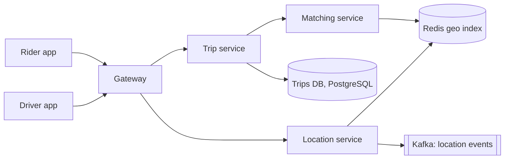
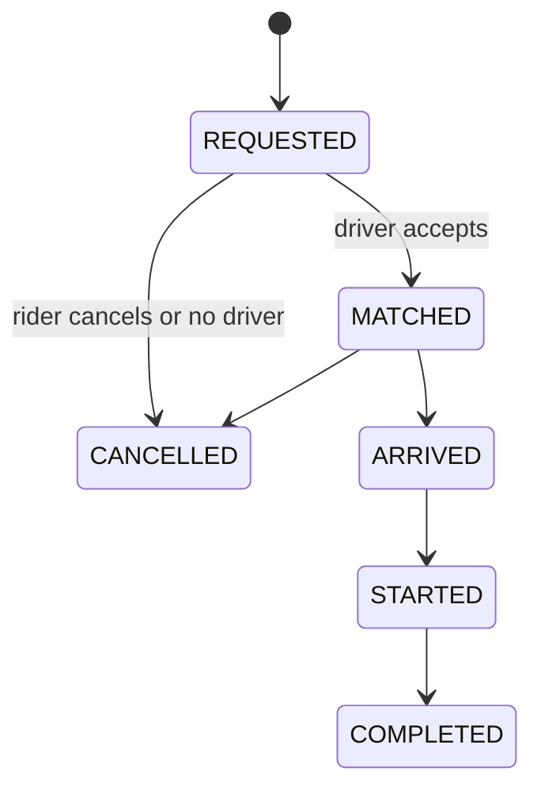

## Requirements

A **ride-sharing service** connects a rider who needs a trip with a nearby available driver.

Functional:

- Drivers go online and send their location continuously.
- A rider requests a ride from A to B and sees nearby drivers and a fare estimate.
- The system matches the request to a driver, who accepts or declines.
- Both sides track the trip live; payment happens at the end.

Non-functional:

- Matching in seconds; location shown with a delay of a few seconds at most.
- No driver is assigned to two riders, and no rider gets two drivers.
- Available in busy cities during peaks.

Out of scope: payment internals (see the payment lesson), maps and routing engines, pooling.

## Estimates

Assume 1 million drivers online at peak, each sending a location every 4 seconds, and 20 million trips a day.

```estimate
q: 1 million online drivers each send a GPS location every 4 seconds. Location updates per second?
answer: 250000
unit: updates/s
tolerance: 0.2
hint: 1,000,000 divided by 4.
solution: "10^6 / 4 = 250,000 updates/s. Each is about 50 bytes, so only about 12 MB/s, but the write rate is far too high for a disk-based relational database."
```

```estimate
q: 20 million trips a day. Average new trip requests per second?
answer: 230
unit: req/s
tolerance: 0.4
hint: 2 x 10^7 divided by 86,400.
solution: "About 230 requests/s on average, maybe 1,000/s at the peak. Trips are rare compared with location pings, so the two workloads use different stores."
```

:::key
Two very different workloads: a firehose of tiny location writes (250,000/s) and a low-rate stream of important, transactional trip events (hundreds per second). Design them separately.
:::

## API

```http
POST /v1/drivers/location   { "lat": 28.6139, "lng": 77.2090 }        (every ~4 s over WebSocket or HTTP)
POST /v1/rides              { "pickup": {...}, "dropoff": {...} }  -> 202 { "ride_id": "r-77" }
GET  /v1/rides/r-77         -> { "state": "MATCHED", "driver": {...}, "eta_s": 240 }
POST /v1/rides/r-77/accept  (driver)
```

## Finding nearby drivers: geospatial indexing

"Find drivers within 2 km" cannot scan all 1 million drivers per request. A **geospatial index** divides the map into cells so you only look at nearby ones.

| Method | Idea |
|---|---|
| **Grid** | Fixed squares; the cell id is a simple function of latitude and longitude |
| **Geohash** | A string encoding of location; longer shared prefix means closer (usually) |
| **Quadtree** | Recursively split busy squares into four, so dense areas get smaller cells |
| **S2 / H3** | Google S2 and Uber H3 cover the sphere in cells (H3 uses hexagons) with neighbour lookups built in |

```predict
lang: python
prompt: A simple grid with cells of 0.01 degrees (about 1.1 km). Which cell holds this point?
code: |
  lat, lng = 28.6139, 77.2090
  cell = (int(lat * 100), int(lng * 100))
  print(cell)
output: "(2861, 7720)"
why: "28.6139 x 100 = 2861.39, truncated to 2861. 77.2090 x 100 = 7720.9, truncated to 7720."
```

- Store drivers as `cell -> set of driver ids` in **Redis**. Redis also has built-in geo commands (`GEOADD`, `GEOSEARCH`) that use a geohash internally.
- A driver near a cell edge can be closer to someone in the next cell, so a query reads the rider's cell plus its 8 neighbours, then sorts by real distance.
- When a driver's location changes cell, remove from the old set and add to the new one.
- Location is ephemeral. Keep only the latest point in memory with a short TTL; stream history to Kafka for analytics, not to the main database.

```quiz
q: Why query the rider's cell plus the 8 neighbouring cells?
options:
  - Redis requires 9 keys per query
  - A nearby driver can sit just across a cell boundary, so checking only one cell would miss closer drivers
  - It makes the index smaller
answer: 1
why: "Cells are only a coarse filter. Distance across a border can be tiny, so you collect candidates from adjacent cells and rank them by true distance."
```

## High-level design



- The **location service** only does fast writes to Redis and publishes to Kafka.
- The **trip service** owns trip state in a relational database because money and correctness are involved.
- The **matching service** reads candidates from the index and decides who gets the offer.

## Scaling the location store

One Redis cannot take 250,000 writes per second plus reads forever, so shard by **cell**. Use **consistent hashing** so adding a location node moves only a small share of cells.

```viz
algo: consistent-hashing
input:
  servers: 3
  vnodes: 3
  keys: 24
```

A hot downtown cell may overload one node. Split busy cells into smaller ones, which is exactly what quadtrees and H3 resolutions do.

## Deep dive: matching

1. Rider requests; trip is created in state `REQUESTED`.
2. Matching service fetches candidates from the rider's cell and neighbours, filters by availability, and ranks by distance or ETA.
3. It offers the trip to the best driver with a timeout of about 10 seconds.
4. If the driver accepts, state becomes `MATCHED`; if declined or timed out, offer the next one.

**Preventing double assignment**: before offering, lock the driver with an atomic operation such as Redis `SET driver:99:lock ride:r-77 NX EX 15` (set only if absent, expires in 15 seconds). Only one request can hold the lock. The trip row update to `MATCHED` is a database transaction.



## Deep dive: live tracking and surge

- During a trip the driver's position is pushed to the rider over **WebSocket** (a persistent two-way connection) by the gateway; a slightly delayed position is fine.
- **Surge pricing**: count open requests and available drivers per cell every minute. A high ratio raises the multiplier, which attracts drivers and trims demand. It is a feedback loop, so smooth the multiplier to avoid flicker.
- Fare estimate uses distance, time and surge, and is stored on the trip so the quote does not change mid-ride.

:::truth
Real dispatch systems optimise across many riders and drivers at once (batching requests every few seconds and solving an assignment problem) rather than greedily picking the nearest driver per request. Nearest-first is the right starting answer in an interview.
:::

## Trade-offs

- **Grid vs quadtree or H3**: simple and uniform against adaptive to density.
- **In-memory location store**: very fast but loses state on failure; acceptable because drivers re-send within seconds.
- **Greedy vs batched matching**: lower latency against better global efficiency.
- **Ping frequency**: faster pings give accuracy but multiply load and battery use.

## Interview angle

- Separate the write-heavy location path from the transactional trip path early.
- Explain one geo index clearly (geohash or grid) and the neighbour-cell query.
- Cover the driver lock for double assignment and the trip state machine.
- Likely follow-ups: surge, ETA, driver cancellation, region-based sharding, what happens when Redis dies.

```cards
- q: Why not store every driver ping in PostgreSQL?
  a: 250,000 updates per second is too high, and only the latest position matters; use an in-memory store.
- q: What is a geohash?
  a: A string encoding of a location where a longer shared prefix usually means closer points.
- q: Why search neighbouring cells too?
  a: A closer driver may be just across a cell boundary.
- q: How do you prevent assigning a driver to two riders?
  a: Take an atomic lock (Redis SET NX with expiry) on the driver before offering, and update trip state in a transaction.
- q: What is surge pricing based on?
  a: The ratio of ride requests to available drivers in an area.
```

## Notes

:::notes
- Two workloads: 250k location writes/s (ephemeral) and a few hundred trip events/s (transactional).
- Store latest driver positions in Redis, indexed by grid cell, geohash, S2 or H3.
- Nearby search = rider cell plus neighbours, then sort by true distance.
- Shard the location store by cell with consistent hashing; split hot cells.
- Trips live in PostgreSQL with a state machine: REQUESTED, MATCHED, ARRIVED, STARTED, COMPLETED, CANCELLED.
- Offer to one driver at a time with a timeout; lock the driver atomically to avoid double assignment.
- Stream location history to Kafka for analytics and ETA models.
- Surge pricing = demand to supply ratio per cell, smoothed.
- Real dispatchers batch and optimise; nearest-first is the baseline.
:::
