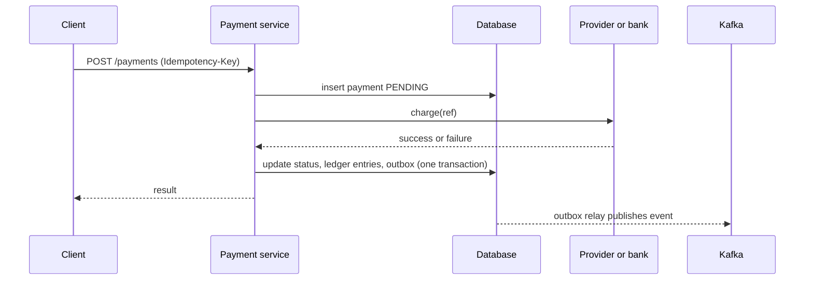

## Requirements

A **payment system** lets a customer pay a merchant, moves the money through a payment provider or bank, and records every step so the books balance.

Functional:

- Create a payment (card, UPI, wallet) for a merchant order.
- Report its status: pending, success or failed.
- Refund a payment, fully or partly.
- Settle money to merchants and produce statements.

Non-functional:

- **Correctness first**: never charge twice, never lose a payment, always explain every rupee.
- Auditable: nothing is silently edited or deleted.
- Available, but a safe error beats a wrong success.
- Secure: card data is handled under PCI DSS (Payment Card Industry Data Security Standard), usually by delegating it to a provider.

## Estimates

Assume 1 million payments a day and a peak of 10 times the average during sales.

```estimate
q: 1 million payments a day, peak 10 times the average. Peak payments per second?
answer: 120
unit: req/s
tolerance: 0.4
hint: Average is 10^6 / 86,400, about 12 per second.
solution: "Average about 12/s, peak about 120/s. This is low traffic. Payments are a correctness problem, not a throughput problem."
```

```estimate
q: Each payment writes 3 ledger rows. How many ledger rows per year?
answer: 1100000000
unit: rows
tolerance: order
hint: 3 x 10^6 rows a day x 365.
solution: "3 million a day x 365 is about 1.1 billion rows a year. At about 100 bytes each, roughly 110 GB. One PostgreSQL cluster with partitioning by month handles this."
```

:::truth
Most payment design effort goes into failure handling, not scale. The hard question is always "what if the network breaks right after we asked the bank to move money?"
:::

## API and idempotency

Money is stored as an **integer in the smallest unit** (paise, cents), never as a float, because $0.1 + 0.2$ is not exactly $0.3$ in binary floating point.

```http
POST /v1/payments
Idempotency-Key: 6f1c-order-991-attempt-1
{ "merchant_id": "m-12", "order_id": "o-991", "amount_minor": 50000, "currency": "INR", "method": "upi" }
-> 201 { "payment_id": "p-77", "status": "PENDING" }
```

If the client times out, it does not know whether the payment happened. It repeats the request with the **same** `Idempotency-Key`. A request is **idempotent** when repeating it has the same effect as doing it once.

Server rules:

- Store the key with a unique constraint on `(merchant_id, key)`.
- Same key and same body: return the stored response; do not charge again.
- Same key and a different body: reject (HTTP 422 or 409). It is a client bug.
- Same key arriving while the first is still running: the unique insert makes one request the owner; the other waits or gets 409.

```order
prompt: Arrange an idempotent create-payment handler so concurrent retries cannot charge twice.
lang: python
code: |
  def create_payment(key, req):
      inserted = db.insert_if_absent(key, req)
      if not inserted:
          return db.get(key).response
      result = psp.charge(req, ref=key)
      db.save_result(key, result)
      return result
distractors:
  - "      psp.charge(req, ref=key)  # charge first, record the key afterwards"
why: The unique insert decides the single owner before any money moves. Passing the key to the provider (psp is the payment service provider) lets the provider deduplicate too.
```

## Data model

| Table | Key columns | Notes |
|---|---|---|
| `payments` | payment_id, merchant_id, idempotency_key (unique with merchant), amount_minor, currency, status, psp_ref | Status follows a state machine |
| `ledger_entries` | entry_id, txn_id, account_id, direction, amount_minor, created_at | Append-only |
| `accounts` | account_id, type, currency | Customer funds, merchant payable, fees, bank |
| `outbox` | id, event, published | Events to send after commit |

Status flow: `CREATED -> PENDING -> SUCCESS` or `FAILED`; later `REFUNDED`. Only allowed transitions are accepted, and success is never reverted; a refund is a new record.

Use a relational database with ACID transactions: **PostgreSQL** or MySQL. This is the textbook case for SQL, not for eventual consistency.

## The double-entry ledger

**Double-entry bookkeeping** records every money movement as at least two entries: debits and credits that sum to zero. Money never appears or vanishes, it only moves between accounts.

Example, a customer pays INR 500 and the platform fee is INR 10:

| Account | Debit | Credit |
|---|---|---|
| Provider receivable (money coming in) | 500 | |
| Merchant payable (owed to merchant) | | 490 |
| Fee revenue | | 10 |

```predict
lang: python
prompt: Debits are positive, credits negative. What is the sum that every transaction must have?
code: |
  entries = [("provider_receivable", +500), ("merchant_payable", -490), ("fee_revenue", -10)]
  print(sum(a for _, a in entries))
output: "0"
why: Debits equal credits, so the signed sum of a valid transaction is zero. A database check or job can verify this for every txn_id.
```

Rules:

- Ledger rows are **append-only**. To fix a mistake, post a reversing entry, never `UPDATE` or `DELETE`.
- Insert all entries of one transaction in a single database transaction.
- A balance is the sum of entries (cache it, but the entries are the truth).
- A refund posts the opposite entries and checks that total refunded does not exceed the amount paid.

## High-level design



The **outbox pattern** writes the "payment succeeded" event into the same database transaction as the status change; a relay then publishes it to Kafka. This avoids the bug where the database commits but the event is lost (or the reverse).

## Deep dive: unknown outcomes

A timeout from the bank means unknown, not failed.

- Keep the payment `PENDING`. Never mark failed on a timeout.
- Resolve by asking the provider for the status using your reference, on a schedule (polling) and through **webhooks** (callbacks the provider sends).
- Show the customer "processing", not an error that invites a second payment.
- Webhooks are at-least-once and out of order, so handle them idempotently and compare status versions.

```quiz
q: A call to the bank times out after 30 seconds. What should the payment status be?
options:
  - FAILED, so the customer can retry quickly
  - SUCCESS, since most calls succeed
  - PENDING, then confirm with the bank by reference through polling or a webhook
answer: 2
why: "The bank may or may not have taken the money. Guessing either way risks a double charge or a lost payment. Stay pending and ask."
```

## Deep dive: reconciliation

**Reconciliation** compares your ledger with an external source of truth, such as the bank or provider settlement file that arrives daily, usually a day later.

1. Load the external file.
2. Match each line to your records by provider reference and amount.
3. Classify the differences.

| Difference | Typical cause | Action |
|---|---|---|
| In ours, not in theirs | Payment never completed, or file delay | Query provider; mark failed or wait |
| In theirs, not in ours | Lost callback, crash before save | Create the record, notify the merchant |
| Amount differs | Fee, currency or rounding issue | Manual review |
| Duplicate on their side | Retry without idempotency | Refund and fix the cause |

Automate the simple matches, queue the rest for humans. A daily report with a zero mismatch count is a health check for the whole system.

## Trade-offs

- **Strong consistency (SQL transactions)** costs some scale but removes whole classes of bugs.
- **Synchronous confirmation vs async**: instant answers are nicer, but long provider calls should not hold user requests; return `PENDING` and notify.
- **Multiple providers**: resilience and cost routing against reconciliation work in several formats.
- **Retry aggressively vs carefully**: retries recover failures but multiply risk without idempotency.

## Interview angle

- Say "idempotency key", "double-entry ledger", "reconciliation" and "unknown state" early; these are the signals.
- Use SQL with transactions and justify it.
- Draw the sequence including the crash point after the provider call.
- Likely follow-ups: refunds, payouts to merchants, multi-currency, fraud checks, PCI scope.

```cards
- q: Why store money as integers?
  a: Floats cannot represent most decimals exactly; use the smallest currency unit (paise, cents).
- q: What does an idempotency key guarantee?
  a: Repeating the same request returns the same result and does not charge again.
- q: What is double-entry bookkeeping?
  a: Every transaction has equal debits and credits, so entries sum to zero and money only moves between accounts.
- q: Why is a bank timeout not a failure?
  a: The money may have moved; keep PENDING and confirm by reference with polling or webhooks.
- q: What is reconciliation?
  a: Comparing your ledger with the provider or bank settlement file to find and fix mismatches.
```

## Notes

:::notes
- Payments are a correctness problem; around 120/s peak at 1M payments a day is easy.
- Store amounts as integer minor units, never floats.
- Idempotency-Key with a unique constraint makes retries safe; same key with a different body is an error.
- Use a relational database with ACID transactions for payments and the ledger.
- Double-entry ledger: append-only entries, debits equal credits, fix errors with reversing entries.
- State machine: CREATED, PENDING, SUCCESS or FAILED, then REFUNDED as a new record.
- Timeout means unknown: stay PENDING, then poll or use webhooks to learn the truth.
- Outbox pattern keeps database state and published events consistent.
- Daily reconciliation against the bank or provider file catches missing, extra and mismatched payments.
:::
