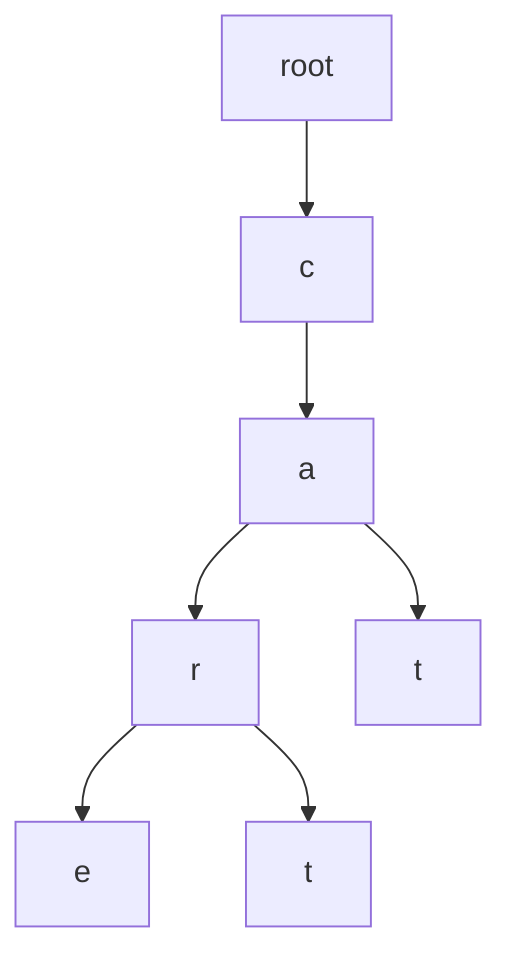
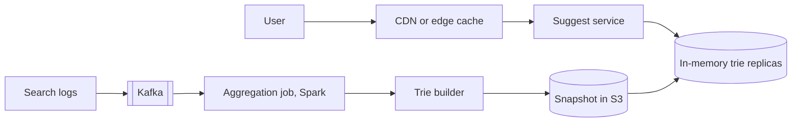

## Requirements

**Autocomplete** (also called **typeahead**) shows suggested searches while you type. Typing `ca` might show `car insurance`, `cat videos`, `cake recipe`.

Functional:

- For a typed prefix, return the top 5 suggested queries, ranked by popularity.
- Suggestions reflect real past searches.

Non-functional:

- Very fast: under about 100 ms end to end, since it runs on every keystroke.
- Highly available; stale suggestions are fine, slow ones are not.
- Updates can lag by hours for ordinary queries.
- Never suggest offensive or banned terms.

## Estimates

Assume 10 million daily active users (DAU), 10 searches each, and about 4 suggestion requests per search after the client waits briefly between keystrokes.

```estimate
q: 10 million users x 10 searches x 4 suggestion requests each. Average requests per second?
answer: 4600
unit: req/s
tolerance: 0.4
hint: 4 x 10^8 requests a day divided by 86,400.
solution: "4 x 10^8 / 86,400 is about 4,600/s on average, perhaps 10,000 to 15,000/s at peak. Each response is tiny, under 1 KB."
```

```estimate
q: Suppose 20 million distinct popular queries are kept, averaging 30 bytes of text. Raw text size in MB?
answer: 600
unit: MB
tolerance: 0.3
hint: 2 x 10^7 x 30 bytes.
solution: "2 x 10^7 x 30 B = 6 x 10^8 B, about 600 MB. Even with trie overhead and top-k lists it is a few GB, so the whole index fits in memory on one server."
```

## API

```http
GET /v1/suggest?q=ca&limit=5
-> 200 { "prefix": "ca", "suggestions": ["car insurance", "cat videos", "cake recipe", "cafe near me", "calendar"] }
```

The response depends only on the prefix (and optionally the language), so it is easy to cache.

## The data structure: a trie

A **trie** (prefix tree) stores strings character by character; every node represents a prefix and its children are the next characters.



Finding the node for `ca` takes $O(L)$ steps where $L$ is the prefix length. The naive way to get suggestions is then to scan the entire subtree below it and sort by popularity. For a short prefix such as `a`, that subtree holds millions of queries, far too slow.

```predict
lang: python
prompt: This naive version scans every query matching the prefix. What does it print?
code: |
  counts = {"car": 50, "cart": 30, "care": 80, "dog": 90, "cat": 60}
  pre = "car"
  top = sorted((q for q in counts if q.startswith(pre)), key=lambda q: -counts[q])[:2]
  print(top)
output: "['care', 'car']"
why: "Matches are car (50), cart (30) and care (80). Sorted by count descending that is care, car, cart; the top 2 are care and car."
```

:::key
Precompute the answer. Store the top-k list (for example the 5 best queries) at every node. A lookup is then: walk $L$ characters, return the stored list. Cost is $O(L)$ regardless of how many queries live below.
:::

The price is memory: every node carries up to 5 strings (or ids). Keep ids and a shared string table, and prune rare queries.

```order
prompt: Arrange insertion into a trie that keeps a top-k list at each node.
lang: python
code: |
  def insert(root, word, freq):
      node = root
      for ch in word:
          node = node.children.setdefault(ch, Node())
          node.update_topk(word, freq)
      node.is_end = True
distractors:
  - "      node = root  # restart at the root for every character"
why: The walk goes down one character at a time, and every node on the path is a prefix of the word, so each one updates its own top-k list with the word.
```

## High-level design

There are two separate paths: a read path that must be fast, and a build path that can be slow.



Build path:

1. Search services publish each query to **Kafka**.
2. A batch job (Spark or Flink) counts queries over a window, for example the last 7 days with recent days weighted more.
3. A builder creates the trie with top-k per node, filters banned words and writes a snapshot to object storage such as S3.
4. Suggest servers load the new snapshot and swap it in atomically, so reads never see a half-built trie.

Read path: the suggest service holds the trie in memory and answers in microseconds; network time dominates.

## Deep dive: serving fast

- **Client**: **debounce** (wait 100 to 200 ms after the last keystroke before sending), cancel outdated requests and cache earlier prefixes locally.
- **HTTP caching**: responses for popular prefixes are identical for everyone. Use `Cache-Control: max-age=300` and a CDN (CloudFront, Cloudflare) so most requests never reach your servers.
- **Replicas**: the trie is read-only between builds, so scale by adding identical replicas behind a load balancer.
- **Sharding** only if the index outgrows memory. Split by prefix range (first one or two letters), but beware skew: far more queries start with `s` than `x`. Split on measured traffic, not the alphabet evenly.

```quiz
q: Why store a top-k list at every trie node instead of computing it on each request?
options:
  - It reduces the memory used by the trie
  - A short prefix has a huge subtree; scanning it per request is too slow, whereas a stored list makes lookup cost depend only on prefix length
  - It makes the trie writable in real time
answer: 1
why: "Precomputation trades memory for latency. The expensive ranking happens once per build, not once per keystroke."
```

## Deep dive: freshness and trending

- A daily build misses breaking news. Add a small real-time layer: a stream job (Flink or Kafka Streams) counts queries in the last few minutes and publishes a short list of trending terms.
- The suggest service merges trending items into the static results, with a score boost.
- Use **decayed counts** (older searches count less) so yesterday's spike fades.
- Always run a **blocklist** filter at build time and again at serve time.

:::truth
Quality comes from data and filtering, not from the trie. A trie is only the fast container. Real teams spend most of their time on ranking signals, spam and abuse queries, and legal or safety filtering.
:::

## Alternatives

| Option | Fit |
|---|---|
| Redis sorted sets, one per prefix (`ZADD prefix score query`, `ZREVRANGE 0 4`) | Simple, easy to update live, more memory per prefix |
| Elasticsearch completion suggester | Built in (backed by an FST, a compact automaton); good if you already run Elasticsearch |
| Custom in-memory trie | Fastest and most compact; you own the build pipeline |

## Trade-offs

- **Freshness vs cost**: frequent rebuilds track trends but cost compute.
- **Top-k at nodes** costs memory but gives constant-time answers.
- **Longer cache TTL** reduces load but delays updates and removal of bad suggestions.
- **Personalisation** raises relevance but kills shared caching.

## Interview angle

- Introduce the trie and immediately point out the subtree scan problem; then give the top-k fix.
- Separate the offline build from the online read path.
- Mention debouncing and CDN caching; these are cheap wins interviewers like.
- Likely follow-ups: multi-language, typo tolerance, trending, shard design, removing a harmful suggestion quickly (blocklist at serve time).

```cards
- q: What is a trie?
  a: A tree where each node is a prefix and each edge adds a character; looking up a prefix takes time proportional to its length.
- q: Why keep a top-k list at each node?
  a: So a lookup returns the best suggestions without scanning the large subtree below the prefix.
- q: How is the trie kept up to date?
  a: An offline pipeline aggregates query logs, builds a new snapshot and swaps it in; a streaming layer adds trending terms.
- q: Why debounce keystrokes on the client?
  a: It cuts requests by waiting briefly after the last key, and stale responses can be cancelled.
- q: Why is sharding by first letter risky?
  a: Letter frequencies are very uneven, so some shards become hot; split on measured traffic.
```

## Notes

:::notes
- Autocomplete = top 5 queries for a typed prefix, under about 100 ms.
- About 4,600 requests/s on average at 10M DAU; the whole index (a few GB) fits in memory.
- Trie gives prefix lookup in O(L); store top-k at every node to avoid scanning subtrees.
- Build offline: logs to Kafka, aggregate counts with Spark, build trie snapshot, publish to S3, swap atomically.
- Serve from in-memory replicas; shard only if needed and by measured traffic.
- Cache popular prefixes at the client and CDN with short TTLs; debounce keystrokes.
- Trending layer: streaming counts with decay merged into static results.
- Filter banned and harmful queries at build time and at serve time.
- Alternatives: Redis sorted sets per prefix, Elasticsearch completion suggester.
:::
