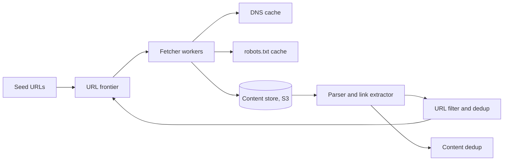

## Requirements

A **web crawler** (also called a spider or bot) starts from some known pages, downloads them, extracts the links inside and repeats. Search engines use it to collect pages to index. Other uses are price monitoring, archiving and training-data collection.

Functional:

- Start from a list of **seed URLs** (the starting pages) and discover new pages through links.
- Download pages and store their content for later processing (indexing, analysis).
- Revisit pages over time to pick up changes.

Non-functional:

- **Polite**: never overload a website, and obey its rules (`robots.txt`, explained below).
- **Scalable**: hundreds of pages per second, spread across many machines.
- **Robust**: the web is full of broken HTML, endless redirects, slow servers and traps. One bad page must not stop a worker.
- **Extensible**: new content types (images, PDFs) should be easy to add.

## Estimates

Assume the crawler downloads 1 billion pages a month, averaging 100 KB each.

```estimate
q: 1 billion pages per month. Average pages fetched per second?
answer: 390
unit: pages/s
tolerance: 0.3
hint: A month has about 2.6 million seconds (30 x 86,400).
solution: "10^9 / 2.6 x 10^6 is about 390 pages/s on average. Plan for 2x peak, so around 800 pages/s, spread over many fetcher machines."
```

```estimate
q: 1 billion pages per month at 100 KB each. Raw storage added per month, in TB?
answer: 100
unit: TB
tolerance: 0.3
hint: 10^9 x 10^5 bytes.
solution: "10^9 x 100 KB = 10^14 bytes = 100 TB per month before compression. Text compresses roughly 3 to 5 times, and you store it in object storage such as S3 or HDFS, not in a database."
```

```estimate
q: To remember 10 billion URLs already seen using a Bloom filter at about 10 bits per URL, how much memory in GB?
answer: 12
unit: GB
tolerance: 0.3
hint: 10^10 x 10 bits, then divide by 8 to get bytes.
solution: "10^11 bits = 1.25 x 10^10 bytes, about 12 GB. Storing the raw URLs (about 100 bytes each) would take roughly 1 TB. A Bloom filter at this size has about a 1% false positive rate."
```

## API

A crawler is mostly a background system. The only external API is for operators:

```http
POST /v1/seeds        { "urls": ["https://example.com/"], "priority": 5 }
GET  /v1/stats        -> { "fetched": 812340112, "queued": 4120000000, "errors": 1.4e6 }
```

Internally the contract is a **crawl record** that every worker reads and writes.

## Data model

| Store | Holds | Notes |
|---|---|---|
| URL frontier | URLs waiting to be fetched, with priority and next-fetch time | Kafka topics or Redis sorted sets plus a durable copy |
| URL metadata | `url_hash`, `last_fetched`, `content_hash`, `change_rate`, `status` | Cassandra or DynamoDB, keyed by URL hash |
| Content store | Raw HTML (and parsed text) | S3 or HDFS, keyed by content hash |
| Host table | `host`, `robots_txt`, `crawl_delay`, `ip`, `ip_expiry` | Redis cache with a database behind it |

## High-level design



The loop, in order:

1. The **frontier** hands a fetcher a URL that is allowed to be fetched now.
2. The fetcher resolves the host through a DNS cache and checks the cached `robots.txt`.
3. It downloads the page with a timeout and a size limit.
4. The page goes to the content store; the parser extracts text and links.
5. Links are normalised, filtered and checked against the "already seen" set; new ones go back to the frontier.

```order
prompt: Arrange the main loop of one fetcher worker.
lang: python
code: |
  while True:
      url = frontier.next_ready()
      if not robots_allows(url):
          continue
      html = fetch(url)
      if is_duplicate(html):
          continue
      store(html)
      for link in extract_links(html):
          if not seen(link):
              frontier.add(link)
distractors:
  - "          frontier.add(link)  # add every link, even ones seen before"
why: "robots.txt is checked before any download, content is deduplicated before it is stored, and only unseen links go back to the frontier. Adding every link would re-crawl the same pages forever."
```

## Deep dive: the URL frontier and politeness

The **frontier** is the heart of a crawler. It is not a plain FIFO queue, because it must do two jobs at once:

- **Priority**: important pages (a news homepage) before obscure ones.
- **Politeness**: at most one request at a time to a host, with a gap between requests. Hammering a small site can look like an attack, and it gets your IPs blocked.

The usual design, from the Mercator crawler, has two layers:

1. **Front queues** by priority. A URL gets a score from signals such as site importance, depth and past change rate.
2. **Back queues**, one per host. Each fetcher thread is bound to a set of hosts, and a small heap holds the next allowed fetch time per host (`now + crawl delay`). A thread takes the host whose time has arrived.

Because each host lives in exactly one back queue, politeness needs no cross-machine locking. To spread the frontier over machines, pick the machine with `hash(host) mod N` or, better, consistent hashing, so adding a machine moves few hosts.

**robots.txt** is a text file at `/robots.txt` on each site that lists paths crawlers may not visit and sometimes a `Crawl-delay`. Fetch it once per host, cache it for about a day, and obey it before every request.

:::warn
A single host can be 10 million URLs and a single IP can host thousands of hosts. Politeness should be limited per host and also per IP, or a shared host takes the load of all its tenants at once.
:::

```quiz
q: Why does the frontier keep one back queue per host instead of one global queue?
options:
  - It makes the queue faster to write to
  - A host is owned by one queue, so enforcing "one request at a time, with a delay" is local and needs no distributed locks
  - It guarantees the most important pages are fetched first
answer: 1
why: "A global queue would hand several workers URLs for the same site at once. Giving each host a single owner makes politeness a local timer check. Priority is handled separately by the front queues."
```

## Deep dive: avoiding duplicate work

There are two different duplicates.

**Duplicate URLs.** The same page can appear as `http://A.com/x`, `http://a.com:80/x`, and `/x#top`. First **normalise**: lowercase the host, drop the default port and the fragment, sort query parameters, strip known tracking parameters. Then check whether the URL was seen.

- Exact set of 10 billion URLs: about 1 TB. Too large for one machine's memory.
- **Bloom filter**: a bit array plus several hash functions. It answers "definitely never seen" or "probably seen". It never forgets a URL, but it can wrongly say "seen" for a new URL (a false positive, about 1% at 10 bits per URL). You skip 1% of new pages, which is acceptable for a crawler. For exact answers, check a key-value store only when the Bloom filter says "probably seen".

**Duplicate content.** Different URLs can hold the same page (mirrors, `?sessionid=` variants). Hash the page body (SHA-256, or **SimHash** for near-duplicates) and keep the hash in the metadata store. If it already exists, do not store or parse the page again.

```predict
lang: python
prompt: What does this content-based duplicate check print?
code: |
  import hashlib
  pages = ["<p>hi</p>", "<p>hello</p>", "<p>hi</p>"]
  seen = set()
  out = []
  for p in pages:
      h = hashlib.md5(p.encode()).hexdigest()
      out.append("dup" if h in seen else "new")
      seen.add(h)
  print(out)
output: "['new', 'new', 'dup']"
why: "Only the third page has the same hash as an earlier page. Different text gives a different hash, so the second page is new."
```

:::truth
No filter catches **spider traps**: calendars with infinite "next month" links, or URLs that grow forever (`/a/b/a/b/...`). In practice you cap the URL length and path depth, limit pages per host, and watch for hosts whose queue keeps growing.
:::

## Deep dive: distributed fetching, DNS and recrawling

- **Fetchers** are stateless workers: they pull a URL, download it, write the result and ask for the next one. Add machines to raise throughput. Use asynchronous I/O, since each fetch is mostly waiting for the network.
- **DNS** (the system that turns `example.com` into an IP address) becomes a bottleneck, since every new host needs a lookup that can take 10 to 200 ms. Run your own resolver cluster, cache answers per host for their TTL and reuse the cached IP for all URLs of that host.
- **Recrawl scheduling**: pages change at different speeds. Track the time between changes for each URL and estimate a change rate. Revisit a news homepage every few minutes and a stale blog every few weeks. Send `If-Modified-Since` or an `ETag` so an unchanged page costs a tiny 304 response, not a full download.
- **Failures**: retry with exponential backoff, and lower a host's priority after repeated errors.

```blanks
prompt: Complete the logic that decides when a URL is next fetched.
lang: python
code: |
  def next_fetch_time(now, change_rate_per_day, politeness_delay):
      interval = 1 / change_rate_per_day   # days between expected changes
      return [[now]] + interval + [[politeness_delay]]
why: "The next fetch is the current time plus how long we expect to wait for a change. The host's politeness delay must also be added so we never exceed its allowed request rate."
```

## Trade-offs

| Choice | Benefit | Cost |
|---|---|---|
| Bloom filter for seen URLs | 100x less memory | About 1% of new URLs skipped |
| BFS crawl order | Finds important, shallow pages first | Slow on very deep sites |
| Short robots.txt cache | Reacts to rule changes | More requests to each host |
| Exact content hash | Cheap | Misses near-duplicates (use SimHash) |
| Headless browser rendering | Gets script-built pages | 10 to 100 times slower and costlier |

## Interview angle

- Start with the basic loop (seed, fetch, parse, enqueue), then say the frontier is where the real design lives.
- Name the two frontier jobs, priority and politeness, and how per-host queues solve politeness.
- Explain why the Bloom filter is acceptable here (a false positive just means one skipped page).
- Likely follow-ups: spider traps, JavaScript rendering, how to scale to 100 billion pages, how to keep freshness for news, how to respect legal and ethical limits.

```cards
- q: What two jobs must the URL frontier do?
  a: Order URLs by priority, and enforce politeness so each host gets at most one request at a time, with a delay.
- q: How do you enforce politeness without distributed locks?
  a: Map each host to exactly one back queue (and one worker), with a per-host next-allowed-time.
- q: What can a Bloom filter tell you, and what can it not?
  a: It answers definitely-not-seen or probably-seen. It has false positives but never false negatives.
- q: Why store pages by content hash?
  a: Identical content reached through different URLs is stored and parsed only once.
- q: What is a spider trap and a defence against it?
  a: A page set that generates endless new URLs. Cap URL length, depth and pages per host.
- q: How does a crawler decide how often to revisit a page?
  a: It estimates the page's change rate from past visits, and uses conditional requests (ETag, If-Modified-Since) to make unchanged revisits cheap.
```

## Notes

:::notes
- Crawler loop: frontier, fetch, parse, extract links, dedup, back to the frontier.
- Scale: 1B pages/month is about 390 pages/s and 100 TB/month raw; store pages in S3 or HDFS.
- Frontier = front queues for priority + one back queue per host for politeness (Mercator design).
- Shard hosts across machines by hash(host), preferably with consistent hashing.
- Obey robots.txt; cache it per host for about a day; limit requests per host and per IP.
- URL dedup: normalise, then a Bloom filter (10 bits per URL is about 1% false positives). Content dedup: hash the body, SimHash for near-duplicates.
- Cache DNS per host; reuse the IP; run your own resolvers.
- Recrawl by estimated change rate; use ETag and If-Modified-Since to save bandwidth.
- Defend against spider traps with caps on URL length, depth and pages per host.
:::
