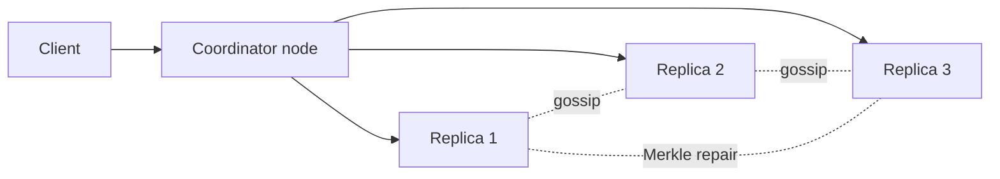

## Requirements

A **key-value store** maps a key to a value: `put("cart:42", {...})` and `get("cart:42")`. Amazon's **Dynamo** paper (2007) described one built for the shopping cart, where a customer must always be able to add an item, even during failures. Cassandra, Riak and Voldemort follow the same ideas. Amazon DynamoDB, the managed service, is a different system that shares the name.

Functional:

- `put(key, value)` and `get(key)`. Values are opaque blobs, up to about 1 MB.
- Keys spread over many machines, with no single master.

Non-functional:

- **Highly available for writes**: accept a write even when some nodes are down or unreachable.
- **Scalable**: add nodes and capacity grows roughly linearly.
- **Low latency**: single-digit milliseconds at the median.
- **Eventually consistent** by default, with tunable strength. Eventual means that if writes stop, all replicas converge to the same value.

:::note
This choice follows the **CAP theorem** (Consistency, Availability, Partition tolerance): when a network partition splits the cluster, you must pick between rejecting requests (consistency) and answering with possibly stale data (availability). Dynamo-style stores pick availability.
:::

## Estimates

Assume 1 billion keys with 1 KB values, replicated 3 times, and 100,000 writes per second at peak.

```estimate
q: 1 billion keys x 1 KB each, replication factor 3. Total disk needed in TB?
answer: 3
unit: TB
tolerance: 0.3
hint: 10^9 x 1 KB = 1 TB of unique data.
solution: "1 TB unique x 3 replicas = 3 TB. With about 50% headroom for compaction and growth, plan for roughly 5 to 6 TB, which is only a handful of nodes by capacity. Throughput, not storage, decides the node count."
```

```estimate
q: 100,000 writes/s of 1 KB each, replication factor 3. Total replica write bandwidth across the cluster in MB/s?
answer: 300
unit: MB/s
tolerance: 0.3
hint: Every write is stored on 3 nodes.
solution: "100,000 x 1 KB = 100 MB/s of client data. Times 3 replicas gives 300 MB/s of disk and network writes cluster-wide. Spread over 30 nodes that is only 10 MB/s each, so a modest cluster works."
```

```estimate
q: A node comfortably serves 5,000 operations/s. For 200,000 mixed ops/s with replication 3 (each write costs 3 node operations, assume 50% writes), roughly how many nodes?
answer: 80
unit: nodes
tolerance: order
hint: Reads cost about 1 node operation, writes about 3. Average cost per client op is 2.
solution: "Average cost is 0.5 x 1 + 0.5 x 3 = 2 node operations per client operation, so 400,000 node ops/s. At 5,000 per node that is about 80 nodes, before headroom for failures."
```

## API

```http
PUT  /v1/kv/{key}   { "value": "...", "context": "vc-token-from-last-get" }
-> 200 { "version": "vc-token" }

GET  /v1/kv/{key}
-> 200 { "values": [ { "value": "...", "context": "vc-token" } ] }
```

Notice that `get` returns a **list** of values. When replicas hold conflicting versions, the client sees all of them plus a `context` (a version token) and must merge them. The next `put` sends the context back so the store knows which versions it replaces.

## Data model

| Item | Content | Notes |
|---|---|---|
| Record | `key`, `value`, `version` (vector clock or timestamp) | Stored in an LSM tree (log-structured merge tree: append to a log and memtable, flush sorted files) |
| Ring position | `hash(key)` mapped on a circle of 2^128 positions | MD5 in the Dynamo paper |
| Membership | Node list, token ranges, health, per-node heartbeat counters | Spread by gossip |
| Hint | Pending write meant for a down node | Held by a stand-in node |

## High-level design



How it works:

1. **Partitioning.** Hash each key onto a ring; each node owns several positions (**virtual nodes**, so load evens out and a joining node takes small slices from many). The key belongs to the first node clockwise.
2. **Replication.** The key is also stored on the next `N - 1` distinct physical nodes clockwise. These `N` nodes are the **preference list**.
3. **Any node can coordinate.** The client (or a load balancer) contacts any node; that node forwards to the replicas. There is no master.

Try the ring: add and remove servers and watch how few keys move.

```viz
algo: consistent-hashing
input:
  servers: 4
  vnodes: 3
  keys: 24
```

## Deep dive: quorums

A **quorum** means waiting for a minimum number of replicas. With `N` replicas:

- `W`: replicas that must confirm a write before it succeeds.
- `R`: replicas that must answer a read.

If $R + W > N$, every read set overlaps every write set in at least one node, so a read sees the latest acknowledged write (assuming no concurrent write and no failed partial writes).

| Setting | Behaviour |
|---|---|
| N=3, W=2, R=2 | Balanced default; survives 1 node down for both reads and writes |
| N=3, W=1, R=3 | Fast writes, slow reads; one slow replica stalls every read |
| N=3, W=3, R=1 | Fast reads, writes fail if any replica is down |
| N=3, W=1, R=1 | Fastest and most available, but reads can be stale |

```blanks
prompt: With N = 3 and W = 2, what is the smallest R that guarantees a read overlaps the latest write?
lang: python
code: |
  N = 3
  W = 2
  R = [[2]]
  assert R + W > N
why: "R + W must exceed N. With W = 2, R = 1 gives 3, which is not greater than 3, so reads could miss the newest write. R = 2 gives 4, which is enough."
```

```quiz
q: A shopping cart service must accept an Add to cart even when two of three replicas are unreachable. Which setting fits?
options:
  - N=3, W=3, R=1
  - N=3, W=2, R=2, strict quorum only
  - N=3, W=1 with a sloppy quorum and hinted handoff
answer: 2
why: "W=1 needs only one reachable node, and a sloppy quorum lets any healthy node accept the write on behalf of an unreachable replica. The other two options would reject the write."
```

## Deep dive: failures and conflicts

**Sloppy quorum and hinted handoff.** If a node in the preference list is down, the write goes to the next healthy node on the ring instead. That node stores a **hint** ("this belongs to node B") and hands the data to B when B returns. Writes stay available, at the price of weaker guarantees: the quorum can be made of nodes outside the preference list.

**Concurrent writes.** Two clients may update the same key through different coordinators. Two ways to cope:

- **Last-write-wins (LWW)**: attach a timestamp and keep the newest. Simple (Cassandra does this), but clocks drift and the loser's update is silently lost.
- **Vector clocks**: each version carries a map `node -> counter`. Version X **happened before** Y if every counter in X is less than or equal to the same counter in Y. If neither is before the other, the writes were **concurrent** and both are kept for the client to merge (Dynamo's cart merges by union).

```predict
lang: python
prompt: What does this vector clock comparison print?
code: |
  a = {"A": 2, "B": 1}
  b = {"A": 2, "B": 2}
  c = {"A": 3, "B": 1}
  def before(x, y):
      keys = set(x) | set(y)
      return x != y and all(x.get(k, 0) <= y.get(k, 0) for k in keys)
  print(before(a, b), before(b, c), before(c, b))
output: True False False
why: "a is older than b (every counter is less than or equal). b and c each win on one counter (B for b, A for c), so neither is before the other. They are concurrent and both would be returned to the client."
```

:::truth
Vector clocks make conflicts visible, not disappear. Someone must write merge logic, which many teams find too hard, so they pick LWW and accept occasional lost updates. Know which one your data can tolerate.
:::

## Deep dive: repair and membership

- **Read repair**: when a read gets different versions from replicas, the coordinator writes the newest version back to stale replicas.
- **Anti-entropy with Merkle trees**: replicas also drift when no one reads a key. A **Merkle tree** is a tree of hashes: each leaf hashes a block of keys, each parent hashes its children. Two replicas compare root hashes; if equal, they match. If not, they descend only into subtrees whose hashes differ, so they find the few differing keys without sending everything.
- **Gossip**: every second, each node tells a few random peers what it knows (who is alive, heartbeat counters, token ownership). Information spreads across the cluster in about $O(\log n)$ rounds without a central registry. A node that has not increased its heartbeat for a while is marked down by each peer independently.
- **Write path on one node**: append to a commit log, update an in-memory table, later flush to sorted files and merge them in the background (LSM tree), which makes writes fast.

## Trade-offs

| Choice | Gain | Cost |
|---|---|---|
| Eventual consistency | Always writable, low latency | Stale reads, conflict handling |
| Higher W and R | Stronger consistency | Higher latency, less availability |
| LWW | Simple for clients | Lost updates when clocks disagree |
| Vector clocks | No silent loss | Client merge logic, growing clocks (prune old entries) |
| Virtual nodes | Even load, easy rebalancing | More metadata to gossip |
| Sloppy quorum | Writes survive outages | Reads may miss recent data until hints replay |

## Interview angle

- Say up front that you choose availability over consistency, and justify it with the use case.
- Walk the ring, preference list and quorum formula. Many candidates know $R + W > N$ but forget the failure cases.
- Be able to explain hinted handoff, vector clocks and Merkle trees in two sentences each.
- Likely follow-ups: add a node, hot key, strong consistency, multi-datacentre replication, and why not use a SQL database (no single master, horizontal scale).
- If an interviewer wants strong consistency, switch to consensus (Raft or Paxos) per partition, as in etcd or Spanner, and say what you lose.

```cards
- q: What does R + W > N guarantee?
  a: Every read quorum overlaps every write quorum in at least one replica, so a read can see the latest acknowledged write.
- q: What is hinted handoff?
  a: When a replica is down, another node accepts its write with a hint and passes it on when the replica comes back.
- q: Vector clock versus last-write-wins?
  a: Vector clocks detect concurrent writes and keep both for merging. LWW keeps the highest timestamp and silently drops the other.
- q: What does a Merkle tree save in anti-entropy repair?
  a: Replicas compare hashes top-down and transfer only the key ranges whose hashes differ.
- q: Why use virtual nodes on the hash ring?
  a: They even out load and let a new node take small ranges from many nodes instead of one big range from one node.
- q: How does a Dynamo-style cluster know which nodes are alive?
  a: Gossip. Each node periodically exchanges heartbeat tables with random peers; silence marks a node as down.
```

## Notes

:::notes
- Dynamo-style store: no master, always writable, eventually consistent; keys placed by consistent hashing with virtual nodes.
- Each key lives on N replicas (the next N distinct nodes on the ring); any node can coordinate.
- Quorum: W acks for writes, R replies for reads; R + W > N gives overlap and fresher reads.
- Typical N=3, W=2, R=2; W=1 trades consistency for speed and availability.
- Sloppy quorum plus hinted handoff keeps writes available during node failures.
- Conflicts: LWW (simple, can lose data) or vector clocks (detect concurrency, client merges).
- Repair: read repair on reads, Merkle-tree anti-entropy in the background.
- Membership and failure detection by gossip, with no central coordinator.
- Per-node storage is an LSM tree: commit log, memtable, sorted files, compaction.
- For strong consistency use consensus per partition (Raft or Paxos) and accept lower availability.
:::
