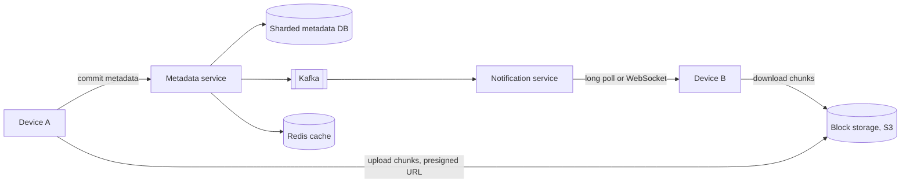

## Requirements

A **file storage and sync service** keeps your files in the cloud and mirrors them across your devices. Edit a file on your laptop and it appears on your phone. Dropbox, Google Drive and OneDrive work this way.

Functional:

- Upload, download and delete files and folders from web, desktop and mobile.
- **Sync**: a change on one device reaches the user's other devices automatically.
- Share files and folders with other users.
- **Version history**: view and restore earlier versions.

Non-functional:

- **Reliable**: never lose a file. This is the most important requirement.
- **Efficient**: editing a small part of a large file must not re-upload the whole file.
- **Fast sync**: other devices learn about a change within seconds.
- **Consistent metadata**: a user must not see a half-uploaded file or two different folder trees.

## Estimates

Assume 100 million users with 200 files each, and 50 million daily active users (DAU) who change about 4 files a day.

```estimate
q: A 1 GB file is split into 4 MB chunks. How many chunks?
answer: 250
unit: chunks
tolerance: 0.1
hint: 1 GB is about 1,000 MB.
solution: "1,000 MB / 4 MB = 250 chunks (256 if you count 1 GB as 1,024 MB). If you edit one part of the file, you upload one chunk of 4 MB instead of 1 GB."
```

```estimate
q: 100 million users x 200 files each, about 500 bytes of metadata per file. Total metadata in TB?
answer: 10
unit: TB
tolerance: 0.3
hint: 2 x 10^10 files x 500 bytes.
solution: "2 x 10^10 x 500 B = 10^13 B = 10 TB. That is far too big for one database server, so the metadata DB must be sharded. The file contents themselves are petabytes and live in object storage."
```

```estimate
q: 50 million DAU x 4 changed files per day. Average file-change events per second?
answer: 2300
unit: events/s
tolerance: 0.4
hint: 2 x 10^8 events per day divided by 86,400.
solution: "2 x 10^8 / 86,400 is about 2,300/s on average, so plan for roughly 5,000 to 7,000/s at peak. Each event is mostly a small metadata write plus a few chunk uploads."
```

## API

Contents and metadata travel on separate paths. The metadata service never sees the file bytes.

```http
POST /v1/files/commit   { "path": "/docs/cv.pdf", "base_version": 3, "chunks": ["h1", "h2", "h3"] }
-> 200 { "version": 4 }
-> 409 { "error": "conflict", "server_version": 4 }
-> 202 { "missing_chunks": ["h2"], "upload_urls": { "h2": "https://s3.../h2?sig=..." } }

GET  /v1/changes?cursor=8812
-> 200 { "changes": [ { "path": "/docs/cv.pdf", "version": 4 } ], "cursor": 8813 }
```

The `commit` call lists chunk hashes. If the server lacks some of them it replies with **presigned URLs** (temporary, signed links that let the client upload directly to S3 without passing through your servers).

## Data model

| Table | Columns | Notes |
|---|---|---|
| `files` | `file_id`, `namespace_id`, `parent_id`, `name`, `is_folder`, `latest_version`, `deleted` | Sharded by `namespace_id` (a user's or a shared folder's root) |
| `file_versions` | `file_id`, `version`, `chunk_list`, `size`, `modified_by`, `created_at` | Ordered list of chunk hashes |
| `chunks` | `chunk_hash`, `storage_key`, `size`, `ref_count` | Global; one row per distinct chunk |
| `changes` | `namespace_id`, `seq`, `file_id`, `version` | Append-only journal; clients read it from a cursor |

Metadata needs transactions (a commit must be all-or-nothing), so use a relational database such as MySQL or PostgreSQL, sharded. Dropbox famously runs sharded MySQL.

## High-level design



Upload, step by step:

1. The client splits the file into chunks and computes a hash (SHA-256) of each.
2. It sends the hash list to the metadata service.
3. The server checks which hashes already exist and returns upload URLs for the missing ones.
4. The client uploads only those chunks to S3, then calls `commit` again.
5. The server atomically writes a new file version and a row in the change journal, then publishes an event.
6. The notification service tells the user's other devices, which fetch the change list and download the new chunks.

```order
prompt: Arrange the client's upload routine so that only new chunks are sent.
lang: python
code: |
  def upload(path):
      chunks = split(path, 4_000_000)
      hashes = [sha256(c) for c in chunks]
      missing = server.check_chunks(hashes)
      for h, c in zip(hashes, chunks):
          if h in missing:
              blob.put(h, c)
      server.commit(path, hashes)
distractors:
  - "          blob.put(h, c)  # always upload every chunk"
why: "The client first asks which hashes the server lacks, uploads just those, and commits the file only after every chunk is stored. Committing before the chunks exist would let other devices see a file they cannot download."
```

## Deep dive: chunking and deduplication

**Chunking** splits a file into blocks, typically 4 MB. Each chunk is stored under its content hash. Benefits:

- **Delta sync**: a changed chunk is the only upload.
- **Resume**: an interrupted upload continues with the missing chunks.
- **Deduplication**: identical chunks are stored once. Ten users uploading the same installer share one copy; the `ref_count` tracks how many versions use a chunk.
- **Parallelism**: chunks upload and download in parallel.

Fixed-size chunking has one weakness. Insert a single byte at the start and every later chunk boundary shifts, so every hash changes. **Content-defined chunking** (CDC) chooses boundaries from the data itself with a rolling hash (for example Rabin fingerprints), so an insertion only changes the chunks near it. It costs more CPU on the client.

```predict
lang: python
prompt: How many chunks are there, and how many distinct chunks must be stored?
code: |
  import hashlib
  data = b"AAAABBBBAAAACCCC"
  chunks = [data[i:i+4] for i in range(0, len(data), 4)]
  unique = {hashlib.sha256(c).hexdigest() for c in chunks}
  print(len(chunks), len(unique))
output: 4 3
why: "The file splits into AAAA, BBBB, AAAA, CCCC. The two AAAA chunks have the same hash, so only 3 distinct chunks are stored."
```

```quiz
q: A user inserts one line at the top of a 1 GB text file. With fixed 4 MB chunks, what is uploaded?
options:
  - Only the first chunk
  - Almost the whole file, since every later chunk boundary shifts and each hash changes
  - Nothing, because identical content is deduplicated
answer: 1
why: "Fixed boundaries are measured from the start of the file, so inserted bytes shift all following data across them. Content-defined chunking fixes this by cutting at content-based positions."
```

:::warn
Deduplication across users has a privacy risk. If the server says "already have this chunk", a user can learn whether someone else stored a given file. Some services deduplicate only within one account for this reason.
:::

## Deep dive: sync, conflicts and versions

**Notifying devices.** Clients cannot poll constantly. Each device keeps a **long poll** (an HTTP request that the server holds open until something changes) or a WebSocket to the notification service. The message carries no data, only "namespace X has changes". The device then calls `/changes?cursor=N` to fetch the journal entries after its last known cursor. Since the cursor is just a number, a device that was offline for a week catches up with the same call.

**Conflicts.** Two devices edit the same file while offline. Both send `commit` with `base_version = 3`. The first becomes version 4. The second is rejected with `409`, since its base is no longer the latest. The client keeps both: the server version wins the original name and the loser is saved as `cv (conflicted copy).pdf`. No data is lost, and the user merges by hand. Real-time collaboration (Google Docs) uses operational transforms or CRDTs instead, which is a separate design.

**Versioning.** A version is just a row with a different chunk list. Chunks are shared between versions, so keeping 100 versions of a large file with small edits costs little. Delete old versions after a retention period and decrement `ref_count`; a background job deletes chunks whose count reaches zero from S3.

**Durability.** S3 stores objects redundantly across several data centres, and its design target is 99.999999999% (11 nines) durability. Add checksums on upload and a periodic scrubber that reads data and verifies it.

```quiz
q: Two offline devices both edit version 3 of a file and then reconnect. Which behaviour is safest for users?
options:
  - Last upload overwrites the first one
  - The second commit is rejected because its base version is stale, and the client saves its copy as a conflicted copy
  - The server merges both files byte by byte
answer: 1
why: "Overwriting silently loses someone's work. Byte-level merging corrupts binary files. Version-checked commits keep both versions and make the user decide."
```

## Trade-offs

| Choice | Gain | Cost |
|---|---|---|
| Larger chunks (8 to 16 MB) | Less metadata, fewer requests | More data re-uploaded per edit |
| Smaller chunks (1 MB) | Finer deltas, better dedup | More metadata and requests |
| Content-defined chunking | Stable boundaries after inserts | Client CPU, more complex |
| Global dedup | Large storage savings | Privacy leak, cross-user ref counting |
| Direct upload to S3 | Servers never carry file bytes | Need presigned URLs and a commit step |
| Conflicted copies | No data loss | User must resolve manually |

## Interview angle

- Draw two paths: metadata (service plus DB) and blocks (client straight to S3).
- Explain chunk hashes: they give delta sync, resume and dedup with one mechanism.
- Explain the commit as the single atomic step that makes a version visible.
- Likely follow-ups: large-file uploads, shared folders, offline mode, conflict handling, cost of storing old versions, end-to-end encryption.

```cards
- q: Why split files into chunks?
  a: Only changed chunks are uploaded, uploads can resume and run in parallel, and identical chunks are stored once.
- q: Why keep metadata separate from file bytes?
  a: Metadata needs transactions and queries (relational DB); bytes are large and immutable (object storage), so each scales and is stored differently.
- q: What does a presigned URL do?
  a: It lets the client upload to or download from S3 directly for a short time, so file bytes never pass through your servers.
- q: How does a device learn about changes made elsewhere?
  a: A notification says something changed; the device then fetches the change journal from its last cursor.
- q: What happens when two devices edit the same version?
  a: The second commit fails the base-version check and is saved as a conflicted copy.
- q: When can a stored chunk be deleted?
  a: When no file version references it, meaning its ref_count has reached zero.
```

## Notes

:::notes
- Sync service = metadata path (sharded relational DB) plus block path (chunks in S3).
- Chunk files (about 4 MB), hash each chunk (SHA-256), store chunks by hash: delta sync, resume, dedup.
- Fixed chunking breaks on inserts; content-defined chunking (rolling hash) keeps boundaries stable.
- Upload flow: send hashes, get missing list and presigned URLs, upload chunks, commit a new version atomically.
- Change journal per namespace with a cursor; notifications only say something changed, devices pull the list.
- Notify with long poll or WebSocket; queue events through Kafka.
- Conflicts via base-version check; loser becomes a conflicted copy; real-time editing needs OT or CRDTs.
- Versions share chunks; ref counts and a background garbage collector free unused chunks.
- Cross-user dedup saves space but leaks whether a file exists; some systems dedup per account.
:::
