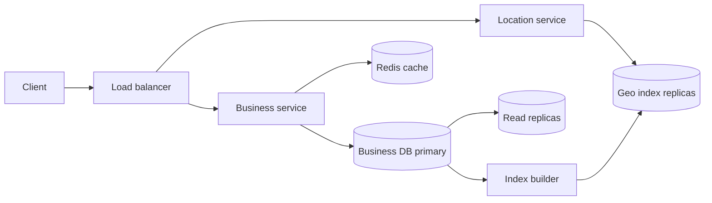

## Requirements

A **proximity service** finds places near a location: restaurants near me, ATMs within 1 km. Yelp, Google Maps places and Zomato search all start from this primitive.

Functional:

- Given a latitude, longitude and radius (500 m, 1 km, 2 km, 5 km, 20 km), return nearby businesses.
- Business owners add, update and delete their business.
- Anyone can view a business's details.

Non-functional:

- **Low latency**: search results in about 100 ms.
- **High availability**, especially for reads.
- **Read-heavy**: searches vastly outnumber business edits.
- Business changes may take until the next day to show up in search. This relaxes the design a lot.

Out of scope: reviews, photos, ranking models, routing and live traffic.

## Estimates

Assume 200 million businesses and 100 million daily active users (DAU), each making 5 searches a day.

```estimate
q: 100 million DAU x 5 searches a day. Average search queries per second?
answer: 5800
unit: queries/s
tolerance: 0.3
hint: 5 x 10^8 searches per day divided by 86,400.
solution: "5 x 10^8 / 86,400 is about 5,800/s on average. Peak is often 3x, so around 17,000/s. Edits are tiny by comparison (maybe a few per second)."
```

```estimate
q: 200 million businesses at about 1 KB each (name, address, hours, coordinates, category). Total business data in GB?
answer: 200
unit: GB
tolerance: 0.3
hint: 2 x 10^8 x 1,000 bytes.
solution: "2 x 10^8 x 1 KB = 200 GB. That fits on one large database server, so the real reason to add machines is read throughput and availability, not capacity."
```

```estimate
q: A geospatial index stores one 16-byte entry per business (8-byte cell id plus 8-byte business id). 200 million businesses. Index size in GB?
answer: 3.2
unit: GB
tolerance: 0.3
hint: 2 x 10^8 x 16 bytes.
solution: "2 x 10^8 x 16 B = 3.2 GB. This can sit in RAM on every search server, so you can replicate the index rather than shard it."
```

## API

```http
GET /v1/search/nearby?lat=28.6139&lng=77.2090&radius=1000&limit=20&cursor=...
-> 200 { "businesses": [ { "id": "b123", "name": "Chai Point", "distance_m": 310 } ], "next_cursor": "..." }

GET    /v1/businesses/b123
POST   /v1/businesses              { "name": "...", "lat": 28.61, "lng": 77.20 }
PUT    /v1/businesses/b123
DELETE /v1/businesses/b123
```

Search returns only ids, names and distance. The client calls the detail endpoint when the user taps a result, so the heavy payload is fetched on demand and cached separately.

## Data model

| Table | Columns | Notes |
|---|---|---|
| `business` | `business_id`, `name`, `address`, `lat`, `lng`, `category`, `hours`, `rating` | Primary key `business_id`; about 200 GB |
| `geo_index` | `cell_id`, `business_id` | One row per business, indexed on `cell_id` |

Why not just query `WHERE lat BETWEEN a AND b AND lng BETWEEN c AND d` with two normal indexes? Each index narrows only one dimension. The database picks one, scans a long strip of the world, and filters the other dimension row by row. Geospatial indexes fix this by turning two dimensions into one, so a normal index can answer the question.

## Geospatial indexes

### Geohash

A **geohash** encodes a location as a short string such as `ttnfv`. It repeatedly halves the world: longitude first, then latitude, one bit at a time, and writes every 5 bits as a base-32 character. Two properties matter:

- A longer string is a smaller rectangle. The precision table below uses cell sizes at the equator.
- Places in the same cell share a **prefix**, so `WHERE geohash LIKE 'ttnfv%'` becomes an ordinary index range scan.

| Length | Cell size (approx.) | Good for radius |
|---|---|---|
| 4 | 39 km x 20 km | 5 km to 20 km |
| 5 | 4.9 km x 4.9 km | 1 km to 2 km |
| 6 | 1.2 km x 0.6 km | 500 m |
| 7 | 153 m x 153 m | very small areas |

Pick the length whose cell is at least as large as the radius, then search the user's cell **and its 8 neighbours**. Why 9? A user standing at the edge of a cell has nearby places in the next cell.

Boundary problem: two points 10 metres apart can have no common prefix at all if a major dividing line (such as the equator) lies between them. Never rely on prefix match alone; always add the neighbours and then compute the exact distance.

```predict
lang: python
prompt: A grid cell is the integer part of coordinate / 0.01 degrees. What does this print?
code: |
  def cell(lat, lon, size=0.01):
      return (int(lat // size), int(lon // size))
  print(cell(28.6139, 77.2090), cell(28.6201, 77.2090))
output: (2861, 7720) (2862, 7720)
why: "The two points are only about 700 m apart, but the second crosses a latitude line at 28.62, so it falls in the next cell. This is the boundary problem, and the reason searches check the neighbouring cells too."
```

### Quadtree

A **quadtree** is an in-memory tree where each node covers a rectangle. If a rectangle holds more than a limit of businesses (say 100), it splits into 4 equal quarters, and this repeats. Dense city centres split deep; empty countryside stays as a few big leaves.

- Search: descend to the leaf containing the user, then check neighbouring leaves until the radius is covered.
- Size: 200 million businesses with at most 100 per leaf is about 2 million leaves and roughly 2.7 million nodes in total, well within one server's memory.
- Updates: inserting may split a leaf; deleting may merge. This is more complex than editing a row.
- Rebuild on server start takes minutes, so a new server needs a snapshot or a staged rollout.

### S2 and others

**S2** (Google's library) projects the sphere onto the six faces of a cube and orders cells along a Hilbert curve, a path that keeps nearby cells close in number. Cells have 64-bit ids at 30 levels. It handles the poles and the date line cleanly and can cover any region with a set of cells of mixed sizes. MongoDB's `2dsphere` index is built on S2.

| | Geohash | Quadtree | S2 |
|---|---|---|---|
| Cell shape | Rectangles, distorted near poles | Adaptive rectangles | Near-uniform spherical cells |
| Storage | A column in any database | In-memory structure | A 64-bit id in any database |
| Density handling | Fixed grid, loop to coarser or finer | Adapts automatically | Mixed-size cell coverings |
| Updates | Simple row edits | Needs tree maintenance | Simple row edits |
| Typical use | Redis GEO, Elasticsearch, simple SQL | Interview classic, in-memory services | Google Maps, MongoDB |

:::key
The three approaches do the same thing: convert a 2D location into a few 1D keys, so a normal ordered index can fetch candidates. The final step is always the same: compute the true distance for each candidate and drop those outside the radius.
:::

```order
prompt: Arrange the nearby-search routine using a geohash index.
lang: python
code: |
  def nearby(lat, lng, radius_km):
      length = precision_for(radius_km)
      cell = geohash_encode(lat, lng, length)
      cells = [cell] + neighbours(cell)
      candidates = []
      for c in cells:
          candidates += index.get(c, [])
      hits = [b for b in candidates if dist(b, lat, lng) <= radius_km]
      return sorted(hits, key=lambda b: dist(b, lat, lng))
distractors:
  - "      hits = candidates  # skip the exact distance check"
why: "The cell grid only finds candidates, and 9 cells cover a larger area than the circle. The exact distance filter removes the corners, and sorting by distance ranks what remains."
```

```quiz
q: Why does a geohash search look at the 8 neighbouring cells as well as the user's own cell?
options:
  - To increase the number of results shown
  - A nearby business can lie just across a cell border, and its geohash may share no prefix with the user's
  - Neighbouring cells are cached together
answer: 1
why: "Cells are fixed rectangles. A user near an edge is closer to businesses in the adjacent cell than to many in their own, so the neighbours must be searched, then filtered by exact distance."
```

## High-level design



- **Location service** (read-heavy, stateless): converts coordinates and radius into cells, finds candidate ids from the geo index and filters by distance. It holds no state except the in-memory or cached index, so you scale it by adding servers.
- **Business service**: handles business reads and owner edits. Detail pages are cached in Redis by `business_id`, with a TTL of minutes to hours.
- **Business DB**: one primary for writes and several read replicas (MySQL or PostgreSQL). At 200 GB, sharding is not needed for size; if you outgrow it, shard by `business_id`.
- **Index builder**: reads the business table and refreshes the geo index.

## Deep dive: scaling reads

- The geo index is only a few GB, so each Location service node can hold a full copy. This avoids shard routing and **scatter-gather** (asking every shard and merging the answers). Sharding the index by location would also create hot shards: Manhattan produces far more queries than rural Montana.
- Cache at several levels: the client caches results while the user pans slightly; a CDN or edge cache can store popular search results keyed by cell and radius; Redis stores business details.
- **Round the coordinates** into the cell id before using them as a cache key. Millions of users in the same cell then share one cache entry, whereas the raw latitude and longitude would never repeat.
- **Adaptive radius**: if a cell returns too few results (countryside), widen the search by dropping the last geohash character (a larger parent cell), and repeat until you have enough.
- Redis offers `GEOADD` and `GEOSEARCH`, which use geohash internally in a sorted set. It is a quick alternative when updates need to be live.

## Deep dive: updating business data

Since next-day visibility is acceptable, the simplest design wins:

1. An owner edit writes to the business DB primary and invalidates that business's cache entry.
2. A nightly job (or a stream consumer on the change log in Kafka) updates `geo_index` rows. A business's cell only changes if its location changes; edits to name or hours do not touch the index.
3. For an in-memory quadtree, build the new tree off to the side and swap it in atomically, so queries never see a half-built tree.
4. Deleted businesses are filtered at read time too (checking a `deleted` flag from the cache), so they vanish faster than the index refresh.

:::truth
The geospatial index is the easy part of this problem. The long-running work is data quality: duplicate listings, wrong coordinates, closed businesses and ranking. A perfect index over bad data is still a bad product.
:::

## Trade-offs

| Choice | Gain | Cost |
|---|---|---|
| Geohash in a SQL or Redis index | Simple, easy updates | Boundary handling, uneven density |
| In-memory quadtree | Adapts to density | Rebuilds, harder updates |
| Replicate index instead of sharding | Simple reads, no scatter-gather | Every node holds the full index; fine up to tens of GB |
| Nightly index refresh | Cheap and simple | New businesses invisible for up to a day |
| Cache by cell and radius | Very high hit rate | Results are slightly approximate |

## Interview angle

- Say first that searches dominate edits and that next-day updates are fine; this justifies simple batch design.
- Explain why two plain lat/lng indexes are slow, then present geohash and quadtree with their boundary and density issues.
- Always finish with the exact distance filter.
- Show you did the numbers: 200 GB of data, a 3 GB index, so replicate, do not shard.
- Likely follow-ups: moving objects (drivers), dense cities, multi-language, ranking by relevance, and how Uber's H3 hexagon grid differs.

```cards
- q: Why are two separate indexes on latitude and longitude slow for radius search?
  a: Each index narrows only one dimension, so the database scans a long strip and filters the other dimension row by row.
- q: What does a longer geohash mean?
  a: A smaller cell. Places in the same cell share the string as a prefix, so a prefix scan finds them.
- q: Why search the 8 neighbouring geohash cells?
  a: A user near a cell border has nearby places in the adjacent cell, and their geohashes may share no prefix.
- q: How does a quadtree handle uneven density?
  a: It splits a rectangle into four only when it holds too many businesses, so dense areas get small cells.
- q: Why replicate the geo index instead of sharding it?
  a: It is only a few GB, so each server can hold all of it, which avoids scatter-gather and hot location shards.
- q: What is the last step of every nearby search?
  a: Compute the exact distance to each candidate and discard those outside the radius.
```

## Notes

:::notes
- Proximity search: find businesses within a radius; read-heavy (about 5,800 queries/s average), edits are rare and can show up next day.
- Business data about 200 GB; geo index about 3 GB, so replicate the index on each search node instead of sharding it.
- Plain lat/lng range queries are slow; geo indexes turn 2D into 1D keys.
- Geohash: base-32 string, longer is smaller, shared prefix means same cell; use length matching the radius and search 9 cells.
- Cell borders break prefix matching, so always include neighbours and finish with an exact distance filter.
- Quadtree: splits cells holding more than about 100 businesses; adapts to density; in memory; harder to update.
- S2: cube-and-Hilbert-curve cells, 64-bit ids, mixed-size coverings; used by Google and MongoDB.
- Cache business details in Redis by id; cache search results by cell and radius.
- Updates: write to DB, invalidate cache, refresh the index nightly or from a Kafka change stream; swap in-memory trees atomically.
:::
