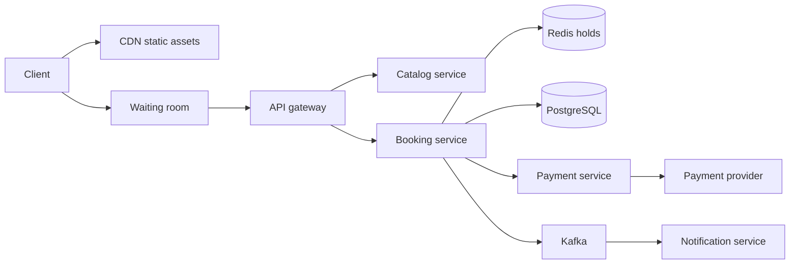

## Requirements

A **ticket booking system** lets many people pick specific seats for a show or train, pay for them and receive a confirmed ticket. The hard part is that thousands of people want the same few seats at the same moment.

Functional:

- Browse shows or trains and see which seats are free.
- Select seats and **hold** them for a few minutes (a temporary reservation).
- Pay, then receive a confirmed booking.
- Release held seats automatically if payment does not finish.
- Cancel and refund.

Non-functional:

- **Never sell one seat twice.** This is the one rule that cannot bend.
- Survive a flash sale: a popular show opens and a huge crowd arrives together.
- Seat map reads can be slightly stale; booking writes cannot.
- Fair: do not let bots or fast connections take everything.

## Estimates

Assume a stadium show with 50,000 seats and 2 million fans waiting when sales open.

```estimate
q: 2 million fans open the seat map within the first minute. Seat map requests per second, if each fan loads it once?
answer: 33000
unit: req/s
tolerance: 0.5
hint: 2,000,000 divided by 60 seconds.
solution: "2 x 10^6 / 60 is about 33,000 req/s. Far too much for the database, so the seat map must come from cache and a CDN (Content Delivery Network, servers near users)."
```

```estimate
q: All 50,000 seats sell out in 5 minutes. Successful bookings per second on average?
answer: 170
unit: bookings/s
tolerance: 0.5
hint: 50,000 divided by 300 seconds.
solution: "About 170 confirmed bookings per second. The write volume is small. The difficulty is contention, many people fighting for the same rows, not raw throughput."
```

:::key
Reads are enormous, real writes are modest, and conflicts are concentrated on a few hot seats. Design the read path for volume and the write path for correctness.
:::

## API

```http
GET  /shows/s-42/seats                  -> { "seats": [ { "id": "A1", "status": "AVAILABLE", "price": 1500 } ] }
POST /shows/s-42/holds                  { "seat_ids": ["A1", "A2"] }
     -> 201 { "hold_id": "h-9", "expires_at": "2026-10-14T18:10:00Z" }
POST /bookings                          { "hold_id": "h-9", "payment_method": "upi" }   (Idempotency-Key header)
     -> 202 { "booking_id": "b-5", "status": "PAYMENT_PENDING" }
```

- The hold call returns `409 Conflict` if any requested seat is already taken. All seats succeed together or none do.
- Booking is accepted with `202` and finished asynchronously, because payment can take a while.

## Data model

| Table | Key columns | Notes |
|---|---|---|
| `shows` | show_id, venue_id, starts_at | Read-heavy, cacheable |
| `seats` | show_id, seat_id, status, held_by, hold_until, price | Status: AVAILABLE, HELD, BOOKED |
| `bookings` | booking_id, user_id, show_id, status, payment_ref | Status follows a state machine |
| `booking_seats` | booking_id, show_id, seat_id | **Unique (show_id, seat_id)** |

That unique constraint is the last line of defence. Whatever else fails, the database refuses a second booking for the same seat.

## High-level design



- **Catalog service** serves show details and the seat map from cache.
- **Booking service** owns holds and confirmations.
- **Redis** (an in-memory key-value store) holds the short-lived reservations.
- **PostgreSQL** stores the permanent truth about bookings.
- **Kafka** (a durable event log) carries "booking confirmed" events to emails and SMS.

## Deep dive: avoiding double booking

Two users click seat A1 at the same instant. Both read "AVAILABLE". Both try to take it. Something must pick exactly one winner.

| Approach | How it works | Strength | Weakness |
|---|---|---|---|
| Pessimistic row lock | `SELECT ... FOR UPDATE` locks the seat row until commit | Simple, always correct | Waiters queue up; long locks hurt |
| Optimistic update | `UPDATE seats SET status='HELD' WHERE seat='A1' AND status='AVAILABLE'`, check rows changed | No lock held while user thinks | Losers must retry |
| Redis `SET NX` | `SET seat:s42:A1 user NX EX 600` succeeds for one caller only | Very fast, auto-expires | Not durable, needs DB backup |
| Unique constraint | `INSERT` into `booking_seats` fails on duplicate | Cannot be bypassed | Detects conflict only at the end |

**NX** means "set only if the key does not exist"; **EX 600** means "expire in 600 seconds". Redis runs commands one at a time, so exactly one caller wins.

```predict
lang: python
prompt: This imitates Redis SET NX. What does it print?
code: |
  holds = {}
  def hold(seat, user):
      if seat in holds:
          return False
      holds[seat] = user
      return True
  print(hold("A1", "u1"), hold("A1", "u2"), hold("A2", "u2"))
output: True False True
why: u1 gets A1. u2 is refused A1 because the key already exists, but gets A2. In real Redis the check and the set are one atomic command, so two callers can never both succeed.
```

A common layered design:

1. **Redis `SET NX EX`** takes the fast hold and stops most contention before it reaches the database.
2. The database `seats` row is updated with an optimistic `UPDATE ... WHERE status='AVAILABLE'` so state survives a Redis crash.
3. The unique constraint on `booking_seats` guarantees correctness at confirmation.

:::warn
Do not check availability with a plain `SELECT` and then `UPDATE` in separate steps. Between the two, another request can take the seat. The check and the change must be one atomic action.
:::

```quiz
q: 20,000 users all try to hold the same seat in one second. Which approach keeps the database healthiest while staying correct?
options:
  - Every request runs SELECT FOR UPDATE on the seat row and waits its turn
  - Redis SET NX decides the winner first; only the winner touches the database
  - Read the seat status, then update it if it looked free
answer: 1
why: "SELECT FOR UPDATE makes 20,000 requests queue on one row and hold connections. Read-then-update is a race. Letting Redis reject 19,999 losers cheaply protects the database, and the unique constraint still guards correctness."
```

## Deep dive: holds, expiry and payment

A hold stops others from buying a seat while you pay. It must disappear on its own if you walk away.

- Redis TTL (time to live) removes the key after 10 minutes. The `seats` row also stores `hold_until`.
- A **sweeper job** every minute returns seats with `hold_until` in the past to AVAILABLE. Do not rely only on Redis key-expiry notifications, which can be missed.
- When a user starts paying, **extend the hold** by a couple of minutes so expiry cannot fire in the middle of a payment.
- Use the `hold_id` as the payment **idempotency key** (a label that makes retries safe, as in the payment system lesson).

```order
prompt: Arrange the confirm step so a seat is never sold without a valid hold and a successful charge.
lang: python
code: |
  def confirm(hold_id, payment):
      hold = redis.get(hold_id)
      if hold is None:
          return "expired"
      charge = pay.charge(payment, key=hold_id)
      if not charge.ok:
          return "failed"
      db.insert_booking(hold.seats)
      redis.delete(hold_id)
      return "confirmed"
distractors:
  - "      redis.delete(hold_id)   # free the hold before charging"
why: The hold is checked first, the charge happens once under an idempotency key, and the permanent booking is written before the temporary hold is dropped. Deleting the hold early would let another user grab the seat mid-payment.
```

What if the payment succeeds after the hold expired? Try `insert_booking` anyway. If the seat is still free, confirm. If someone else took it, the unique constraint rejects it and you **refund automatically**. Say this out loud in an interview; it shows you handle the race.

## Deep dive: flash sales and the waiting room

When 2 million people arrive for 50,000 seats, no backend survives by simply being bigger.

- **CDN and cache** serve the page shell, images and a cached seat map refreshed every second or two. Slight staleness is fine because the hold call is the real check.
- **Waiting room**: a queue in front of the booking flow. Users get a place in line (often randomised, for fairness) and are let in at a rate the backend can take, for example 2,000 per minute. Tools: a Redis sorted set or Kafka for the queue, signed tokens to prove a user was admitted.
- **Rate limiting** per user, IP and device slows bots (see the rate limiting lesson). CAPTCHAs and login-required purchases help.
- **Limit seats per account** and hold time per user so one person cannot lock the whole venue.
- **Shard by show**: each show's seats live together, and a hot show can get its own Redis instance and database partition.

:::truth
A waiting room does not create seats. It trades a crashed site and an unfair free-for-all for an orderly queue where most people still lose. Be honest about that in the product, not only in the design.
:::

IRCTC-style Tatkal booking has the same shape with one extra twist: inventory is a count of berths per class, and a waiting list converts to confirmed when cancellations arrive. That conversion is a queue consumer reacting to cancel events.

## Trade-offs

- **Hold duration**: longer holds are kinder to slow payers but let abandoners lock inventory. 5 to 10 minutes is typical.
- **Redis vs database only**: Redis adds speed and a failure mode; a database-only design is simpler and fine below a few hundred conflicting requests per second.
- **Fresh vs cached seat map**: fresher maps cost load, staler maps cause more "seat just taken" errors.
- **Overselling on purpose**: airlines do it and handle the overflow with compensation. Theatres cannot, so they stay strict.
- **Strong consistency scope**: only the seat write path needs it; browsing can be eventually consistent.

## Interview angle

- Lead with "reads are huge, writes are small, conflicts are the problem".
- Name the three layers: Redis hold, optimistic DB update, unique constraint.
- Explain what happens when the hold expires mid-payment and when Redis dies.
- Mention the waiting room and bots before being asked.
- Likely follow-ups: adjacent-seat search, dynamic pricing, refunds, multi-city rollouts.

```cards
- q: Why is a unique constraint on (show_id, seat_id) essential?
  a: "It is the final guarantee. Even if locks or Redis fail, the database rejects a second booking of the same seat."
- q: What does Redis SET key value NX EX 600 do?
  a: Sets the key only if absent, and expires it after 600 seconds, so exactly one caller gets the hold.
- q: Why is read-then-update a bug for booking?
  a: Another request can take the seat between the check and the update; the check and change must be atomic.
- q: What should happen when payment succeeds after the hold expired?
  a: Try to confirm; if the seat was taken, the constraint rejects it and the user is refunded automatically.
- q: What does a waiting room do in a flash sale?
  a: Queues users and admits them at a rate the backend can handle, protecting the system and adding fairness.
```

## Notes

:::notes
- Ticket booking: reads are huge (about 33,000 req/s for a big on-sale), confirmed writes are small (about 170/s), conflicts are on hot seats.
- Hold flow: hold seats with a TTL, pay, confirm, release on timeout.
- Redis SET NX EX picks one winner cheaply; the DB row and a unique (show, seat) constraint keep it correct and durable.
- Never read-then-update; make the check and the change one atomic action.
- Sweeper job returns expired holds to AVAILABLE; extend the hold while payment is in progress.
- Use hold_id as the payment idempotency key; refund automatically if a late payment loses the seat.
- Flash sale: CDN, cached seat map, waiting room, rate limiting, per-account limits, shard by show.
- Pessimistic locks are simple but queue under contention; optimistic updates avoid long locks.
- Say it in the interview: strong consistency only on the seat write path, eventual consistency for browsing.
:::
