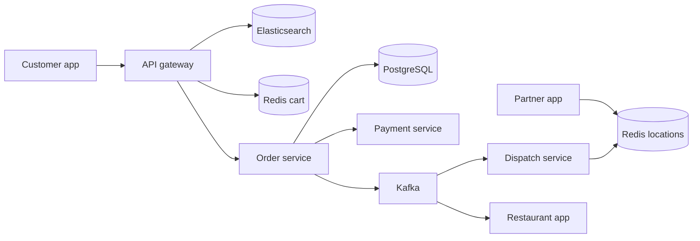
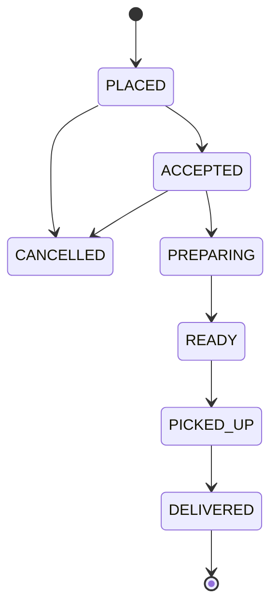

## Requirements

A **food delivery platform** connects three parties: customers who order, restaurants who cook, and delivery partners who carry the food. It is a marketplace plus a logistics system, and the clock is always ticking because the food is getting cold.

Functional:

- Search restaurants and dishes near a location.
- Build a cart, place an order and pay.
- Restaurant accepts, prepares and marks the order ready.
- Assign a delivery partner and track the order live.
- Show an ETA (estimated time of arrival) and notify on every status change.

Non-functional:

- Search is fast (under about 300 ms) and tolerates slightly stale data.
- Order placement is **correct**: no lost orders, no double charges.
- Tracking is near real time, a few seconds old at most.
- Peaks are sharp: lunch and dinner, rain, match days.

## Estimates

Assume 5 million orders a day, with peak hours carrying about 5 times the average rate, and 200,000 delivery partners online at peak.

```estimate
q: 5 million orders a day, peak is 5 times the average. Orders per second at peak?
answer: 290
unit: orders/s
tolerance: 0.5
hint: Average is 5,000,000 / 86,400, about 58 per second.
solution: "Average about 58/s, peak about 290/s. Small enough for a sharded relational database. Order writes are not the scaling problem."
```

```estimate
q: 200,000 online partners each send their GPS location every 5 seconds. Location updates per second?
answer: 40000
unit: updates/s
tolerance: 0.4
hint: 200,000 divided by 5.
solution: "200,000 / 5 = 40,000 writes/s. This is the heaviest write stream in the system. Each update is tiny and only the latest value matters, so it goes to an in-memory store, not the main database."
```

:::key
Orders are low volume and need correctness. Locations are high volume and need speed. Use different storage for each.
:::

## API and data model

```http
GET  /restaurants?lat=28.61&lng=77.20&q=biryani&cursor=...   -> list ranked by relevance and ETA
PUT  /cart/items                  { "restaurant_id": "r-8", "item_id": "i-3", "qty": 2 }
POST /orders                      { "cart_id": "c-1", "address_id": "a-4" }   (Idempotency-Key header)
     -> 201 { "order_id": "o-77", "status": "PLACED", "eta_min": 38 }
GET  /orders/o-77/track           -> { "status": "PICKED_UP", "partner": { "lat": 28.62, "lng": 77.21 }, "eta_min": 12 }
```

| Store | Data | Why |
|---|---|---|
| Elasticsearch | Restaurants, menus, geo points, open status | Text plus geo search and ranking |
| Redis | Carts (hash per user, with TTL), partner locations | Fast, short-lived, overwritten often |
| PostgreSQL | Orders, order items, payments, status history | ACID transactions, sharded by city |
| Kafka | Order events, location stream | Decouples services, replayable |

## High-level design



The **order service** is the source of truth. Everything else reacts to events on Kafka (a durable event log): dispatch assigns a partner, the restaurant app shows the new order, notifications go out.

## Deep dive: restaurant search

- Each restaurant is a document in **Elasticsearch** (a search engine built on inverted indexes) with name, cuisines, dishes, rating, location and delivery radius.
- A **geo filter** keeps only restaurants whose delivery area contains the customer. Many systems use a **geohash** or **H3** (grids that turn a location into a cell id, so "nearby" becomes a cheap cell lookup).
- Ranking mixes text relevance, rating, estimated delivery time, price band and promotions.
- Availability changes quickly: a restaurant closing or running out of an item should disappear within about a minute. Push these changes through Kafka into the index; do not rebuild it.
- Cache the first page of popular queries per area for a few seconds.

:::warn
Never trust search results as final. The menu price, item availability and restaurant status must be checked again when the order is placed, because the index can be a minute behind.
:::

## Deep dive: cart, orders and the state machine

The **cart** lives in Redis with a TTL of a few hours. It is cheap to rebuild and nobody is hurt by losing it. At checkout the order service re-reads current prices from the menu service, computes taxes and fees, and creates the order in one database transaction.

An **order state machine** lists the only legal statuses and moves between them.



```predict
lang: python
prompt: What does this transition checker print?
code: |
  ALLOWED = {
      "PLACED": {"ACCEPTED", "CANCELLED"},
      "ACCEPTED": {"PREPARING", "CANCELLED"},
      "PREPARING": {"READY"},
  }
  def move(cur, nxt):
      return nxt in ALLOWED.get(cur, set())
  print(move("PLACED", "ACCEPTED"), move("PREPARING", "CANCELLED"), move("DELIVERED", "PLACED"))
output: True False False
why: PLACED can move to ACCEPTED. Once cooking has started, cancelling is not allowed in this table, so it needs a separate refund or compensation path. A finished order has no allowed moves.
```

- Apply a transition with a conditional update: `UPDATE orders SET status='ACCEPTED' WHERE id=? AND status='PLACED'`. If zero rows change, someone else moved it first.
- Keep every change in `order_status_history` for support and disputes.
- Payment is a **saga** (a chain of local steps with compensating undo actions): create the order, charge, confirm to the restaurant. If the restaurant rejects or times out, refund.
- The restaurant has a window (say 3 minutes) to accept; a timeout cancels and refunds automatically.

```quiz
q: A restaurant taps Accept twice because the tablet lagged, and two events reach the order service. What keeps the order consistent?
options:
  - Nothing special is needed because the second tap is harmless
  - A conditional update on the expected current status, so only the first transition applies
  - Locking the whole orders table during every status change
answer: 1
why: "The state machine plus a conditional update (WHERE status='PLACED') makes repeats a no-op. Locking the whole table would stall every order for a duplicate tap."
```

## Deep dive: partner assignment

Goal: pick a partner who reaches the restaurant just as the food is ready, at low total cost.

1. **Find candidates**: partners within a radius of the restaurant, using Redis GEO (`GEOSEARCH`) or an H3 cell lookup on the location store.
2. **Score** each: travel time to the restaurant, current load, rating, and how long they have been idle.
3. **Offer** the order to the best one with a timeout (for example 15 seconds). If declined, offer to the next.

Greedy "nearest partner wins" is simple but wasteful: it grabs a partner for an order that will not be ready for 15 minutes. Better systems **batch** requests for a short window (10 to 30 seconds) and solve a matching problem across all waiting orders and free partners at once, minimising total waiting and travel.

```quiz
q: Why do dispatch systems often wait a few seconds and match orders in batches instead of assigning each order instantly to the nearest partner?
options:
  - Batching lowers the number of database writes
  - A global matching across several orders and partners gives better total pickup and wait times than a locally greedy choice
  - Partners prefer to receive offers in groups
answer: 1
why: "Instant nearest-first can steal the only nearby partner from an order that needed them more. A short delay buys a better overall assignment. Sending offers is cheap either way."
```

## Deep dive: live tracking and ETA

**Location pipeline**

- The partner app sends GPS points every few seconds over a persistent connection (WebSocket, or MQTT, a light messaging protocol suited to phones). Batch points when signal is weak.
- A location service writes the latest point to Redis (`partner:123` with a short TTL) and publishes to Kafka for analytics and ETA models.
- The customer app opens a WebSocket or polls every 5 seconds, **only while an order is active**. Throttle updates; a smooth map needs interpolation on the phone, not more server traffic.
- Stale position (no update for 30 seconds) is shown honestly as "last seen", not extrapolated forever.

**ETA** is a sum of stages:

- Time until food is ready (restaurant prep estimate, learned from history for that restaurant and time of day).
- Partner travel to the restaurant.
- Wait at the restaurant, if the partner arrives early.
- Travel to the customer from a routing engine that knows roads and traffic, plus parking and handoff time.

```blanks
prompt: Complete the pickup and ETA calculation. Partner arrival and cooking run in parallel.
lang: python
code: |
  pickup_min = [[max]](prep_left, to_restaurant)
  eta_min = pickup_min + [[to_customer|drive_to_customer]] + handoff
why: The partner cannot leave before the food is ready and cannot leave before arriving, so pickup happens at the later of the two. Adding the two durations instead would double count the overlap.
```

Update ETA when anything changes and keep it a little pessimistic. A missed promise annoys customers more than a slightly long one.

## Trade-offs

- **Instant vs batched assignment**: speed against better global matches.
- **Search freshness vs cost**: near real-time index updates cost more than hourly rebuilds.
- **Tracking interval**: faster GPS is smoother but multiplies battery and server cost.
- **Single database vs shard by city**: orders rarely cross cities, so sharding by city keeps transactions local.
- **Strict vs lenient cancellation**: refunds after cooking started cost the restaurant; policy decides the state machine.

## Interview angle

- Split the problem into search, ordering, dispatch and tracking, and say which needs correctness and which needs speed.
- Draw the order state machine and mention idempotent transitions.
- Explain why location data skips the main database.
- Show that ETA is a sum of stages with a max, not one number.
- Likely follow-ups: surge pricing, batching orders, restaurant outages, cancellations and refunds.

```cards
- q: Why keep partner locations in Redis rather than the orders database?
  a: Only the latest point matters and there are about 40,000 writes per second, which suits an in-memory store with TTL.
- q: What is an order state machine?
  a: A fixed list of statuses and allowed moves between them, applied with conditional updates so repeats and races are harmless.
- q: Why batch dispatch requests for a few seconds?
  a: A joint matching of orders and partners yields better total pickup times than assigning each order greedily.
- q: How is pickup time computed?
  a: It is the later of food-ready time and partner arrival, so max(prep_left, to_restaurant).
- q: Why re-check prices at checkout when search already showed them?
  a: The search index can lag by a minute, so the order service must read current price and availability.
```

## Notes

:::notes
- Food delivery has three actors and two clocks: order correctness and real-time tracking.
- About 290 orders/s at peak is easy; about 40,000 location writes/s is the heavy stream.
- Search uses Elasticsearch with geo filters (geohash or H3) and ranking; re-verify price and availability at checkout.
- Cart lives in Redis with a TTL; orders live in PostgreSQL sharded by city.
- Order state machine plus conditional updates make repeated events harmless.
- Payment and restaurant acceptance form a saga; timeouts and rejections trigger refunds.
- Dispatch: find nearby partners with Redis GEO, score them, offer with a timeout, and batch for better matches.
- Tracking: WebSocket or MQTT in, latest point in Redis, stream to Kafka, push or poll only while the order is active.
- ETA = max(prep left, partner to restaurant) + travel to customer + handoff.
:::
