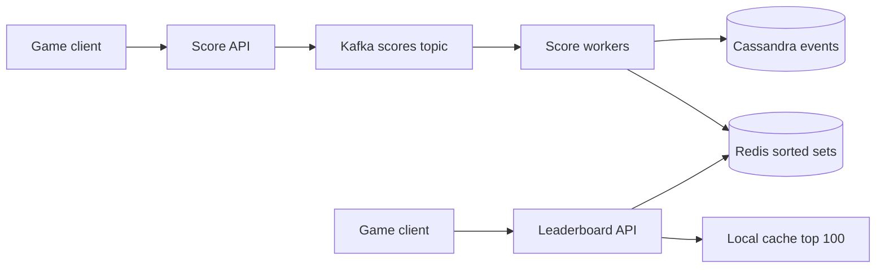

## Requirements

A **leaderboard** ranks players by score and answers questions like "who is in the top 10?" and "what is my rank?" while scores keep changing.

Functional:

- Submit or increase a player's score.
- Get the top K players (K is often 10 to 100).
- Get one player's rank and score.
- Get the players just above and below me (my neighbourhood).
- Separate boards: daily, weekly, all-time, per game or region.

Non-functional:

- Updates appear on the board within about a second.
- Reads are fast (under 50 ms) even with 100 million players.
- Rank must be consistent: two different players never share a rank unless the rules say ties are allowed.
- Scores are never lost; the board can always be rebuilt.

## Estimates

Assume 10 million daily active players, each submitting about 20 scores a day, and 100 million players on the all-time board.

```estimate
q: 10 million players each submit 20 scores a day. Average score updates per second?
answer: 2300
unit: updates/s
tolerance: 0.4
hint: 200 million updates a day divided by about 86,400 seconds.
solution: "2 x 10^8 / 86,400 is about 2,300/s on average. Assume a 3x peak, so around 7,000/s. One Redis node handles tens of thousands of simple commands per second."
```

```estimate
q: 100 million players on one board, about 100 bytes each in Redis (id, score, index overhead). Memory needed?
answer: 10
unit: GB
tolerance: 0.6
hint: 10^8 times 10^2 bytes.
solution: "10^10 bytes, about 10 GB. It fits in the memory of one large machine, so the first design needs no sharding at all. Say so before reaching for complexity."
```

:::key
Many leaderboards fit on one Redis node. Sharding is something you add when the numbers force it, not at the start.
:::

## API and data model

```http
POST /v1/games/g1/scores        { "user_id": "u-9", "points": 120 }       -> 202
GET  /v1/games/g1/leaderboard?period=daily&top=10                          -> [ { "rank": 1, "user_id": "u-4", "score": 9800 }, ... ]
GET  /v1/games/g1/leaderboard/me?period=weekly&around=5                    -> { "rank": 4021, "score": 350, "neighbours": [ ... ] }
```

| Where | What | Notes |
|---|---|---|
| Redis sorted set `lb:g1:daily:2026-10-14` | member = user id, score = points | Serves all reads |
| Kafka topic `scores` | every score event | Durable log, replayable |
| Cassandra or PostgreSQL | `score_events`, `user_totals` | Source of truth; rebuilds Redis |

## Why a sorted set

A **Redis sorted set** (ZSET) stores unique members, each with a numeric score, kept in score order. Internally it is a **skip list** (a layered linked list that allows binary-search-like jumps) plus a hash table, so most operations cost $O(\log n)$.

| Need | Command | Cost |
|---|---|---|
| Add or increase score | `ZINCRBY key 120 u-9` | $O(\log n)$ |
| Top 10, highest first | `ZRANGE key 0 9 REV WITHSCORES` | $O(\log n + K)$ |
| My rank (0-based) | `ZREVRANK key u-9` | $O(\log n)$ |
| My score | `ZSCORE key u-9` | $O(1)$ |
| Players ranked 40 to 50 | `ZRANGE key 40 50 REV` | $O(\log n + K)$ |

```predict
lang: python
prompt: Rank uses higher score first, then name as a tie-break. What does this print?
code: |
  scores = {"asha": 90, "ravi": 75, "meera": 90, "john": 60}
  ranked = sorted(scores, key=lambda u: (-scores[u], u))
  print(ranked.index("ravi") + 1, ranked[:2])
output: 3 ['asha', 'meera']
why: Asha and Meera tie on 90, and the name breaks the tie, so asha is first. Ravi comes after both, so his rank is 3. Redis breaks equal scores by member name in the same way.
```

```blanks
prompt: Fill in the Redis commands for adding a score, finding my rank and reading the top 10.
lang: python
code: |
  r.[[zadd]]("lb", {"asha": 90})
  rank = r.[[zrevrank]]("lb", "asha") + 1
  top = r.[[zrevrange]]("lb", 0, 9, withscores=True)
why: ZADD sets a score, ZREVRANK gives the 0-based position counting from the highest score (so add 1 for a human rank), and ZREVRANGE returns members from highest to lowest.
```

:::warn
Why not just SQL? `SELECT COUNT(*) FROM scores WHERE score > ?` must walk every higher row to compute a rank, so it costs $O(\text{rank})$. For a player ranked 5 million, that is 5 million rows per request. An index helps top-K, not rank.
:::

## High-level design



- Writes go through Kafka (a durable event log), so a Redis outage never loses a score. Workers apply each event to Redis and store it in the database.
- Reads go straight to Redis. The top 100 changes rarely relative to how often people look, so cache it in the API for 1 to 2 seconds.
- If Redis loses data, replay the Kafka topic or reload `user_totals` to rebuild the sets.

## Deep dive: ties, rank and top-K

- **Ties**: equal scores are ordered by member name, which is arbitrary. Games usually want "whoever reached the score first ranks higher". Pack a time component into the score, for example `score * 10^6 + (10^6 - minutes_since_season_start)`. A double holds about 15 exact digits, so budget them.
- **Dense vs competition rank**: "1, 2, 2, 4" or "1, 2, 2, 3" is a product rule. Redis positions give strict ranks, so shared ranks need extra logic.
- **Neighbours**: call `ZREVRANK` for the position, then `ZRANGE` around it, two cheap calls.
- **Top-K is cheap, deep rank is not worth being exact**. Players beyond rank 10,000 mostly want "top 12 percent". Show percentiles from a count: `rank / ZCARD`.

## Deep dive: when one node is not enough

Past about a billion members, or when one board takes more writes than one machine can do, split it.

| Strategy | Top-K | My rank | Weakness |
|---|---|---|---|
| Shard by user hash | Ask every shard for its top K, merge them | Sum `ZCOUNT` of higher scores across all shards | Every read touches every shard |
| Shard by score range | Read the top range shard only | Count of higher ranges plus local rank | Hot top shard; users move between shards when scores change |
| Approximate buckets | Keep exact top 10,000 only | Histogram of counts per score bucket | Rank is an estimate |

```quiz
q: A board has 2 billion players split across 40 shards by user hash. A player asks for the global top 10. What is the correct approach?
options:
  - Read shard 1 only, since it holds a fair sample
  - Ask each shard for its own top 10, then merge the 400 results and take the best 10
  - Copy all 2 billion members into one Redis to sort them
answer: 1
why: "The global top 10 must be among the union of each shard's top 10, because any global top-10 member is also in the top 10 of its own shard. So 40 small queries plus a merge give an exact answer."
```

Most real products pick the third row: keep an exact list for the top few thousand, and tell everyone else an approximate rank or percentile. Say this in an interview; exact global rank for every player at huge scale is rarely worth the cost.

## Deep dive: daily and weekly boards

- One sorted set **per period**: `lb:g1:daily:2026-10-14`, `lb:g1:weekly:2026-W42`, `lb:g1:all`.
- On every score event the worker updates all of them in one Redis pipeline (a batch of commands sent together). Writes triple, reads stay simple.
- Old periods expire with `EXPIRE` or are archived, so memory does not grow forever.
- Do not compute weekly by merging seven daily sets on each read. `ZUNIONSTORE` over millions of members is expensive. If you must, precompute it once a minute.
- A **season reset** is just starting a new key. No mass delete is needed.
- **Friends board**: fetch the friends' scores in one `ZMSCORE` (scores for many members) and sort the 500 results in the application.

:::truth
Cheating is the bigger long-term problem. Validate scores on the server, rate limit submissions and keep the event log so you can remove a cheater and replay the board without them.
:::

## Trade-offs

- **Single node vs sharded**: start single, shard only for memory or write limits.
- **Exact vs approximate rank**: exactness costs cross-shard queries; players rarely notice the difference deep in the table.
- **Real-time vs cached reads**: a 1 to 2 second cache cuts load massively and is invisible to players.
- **Redis as truth vs derived**: treat Redis as a fast view over the event log, never the only copy.
- **Per-period keys vs merges**: more writes, far cheaper reads.

## Interview angle

- Start with the numbers: 100 million members is about 10 GB, so one node works.
- Name `ZINCRBY`, `ZREVRANK` and `ZRANGE ... REV` and their $O(\log n)$ cost.
- Explain why SQL rank is $O(\text{rank})$.
- Describe sharding with scatter-gather for top-K and the approximate rank compromise.
- Likely follow-ups: ties, friends board, anti-cheat, regional boards, replaying after a bug.

```cards
- q: What data structure backs a Redis sorted set?
  a: A skip list plus a hash table, giving $O(\log n)$ updates, rank and range queries.
- q: Which command returns a player's rank, highest score first?
  a: ZREVRANK, which is 0-based, so add 1 for a human-friendly rank.
- q: Why is SQL poor for rank queries?
  a: Counting rows with a higher score is $O(\text{rank})$ because every higher row is scanned.
- q: How do you get an exact global top-K across hash-sharded boards?
  a: Get the top K from each shard and merge; any global top-K member is in its shard's top K.
- q: How are daily and weekly boards usually kept?
  a: As separate sorted sets per period, updated together on each event and expired when old.
```

## Notes

:::notes
- Leaderboard: update score, top-K, my rank, my neighbours, per-period boards.
- Redis sorted set is the right tool: ZINCRBY, ZREVRANK, ZRANGE REV, all $O(\log n)$.
- 100 million members is about 10 GB, so start on a single node; shard only when forced.
- SQL rank via COUNT(*) WHERE score > x costs $O(\text{rank})$, which is too slow at scale.
- Write path: API, Kafka, workers, Redis plus a database; Redis can always be rebuilt from the log.
- Cache the top 100 for 1 to 2 seconds in the API layer.
- Ties: pack a time component into the score so earlier achievers rank higher.
- Sharding by user hash: top-K by scatter-gather and merge; exact deep rank is expensive, so show percentiles.
- Daily, weekly and all-time are separate keys updated in a pipeline; resets are just new keys.
:::
