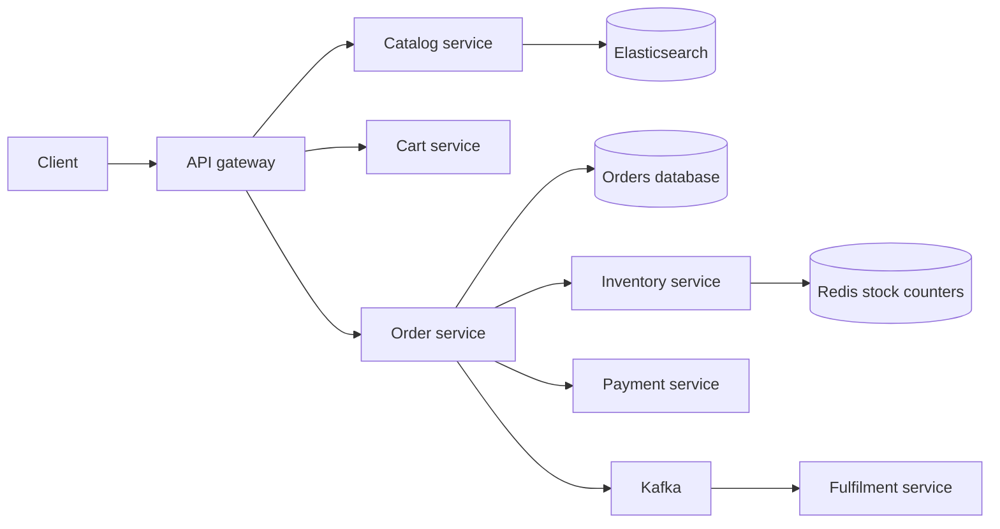

## Requirements

An **e-commerce checkout** turns a customer's cart into a paid order whose items are reserved in a warehouse. Browsing a catalog can be sloppy; checkout cannot.

Functional:

- Search and browse a catalog of products and sellers.
- Add items to a cart that survives across devices.
- Place an order: confirm prices, reserve stock, take payment.
- Show order status; cancel and refund before shipping.

Non-functional:

- **Do not oversell** (sell stock you do not have) beyond a small, deliberate margin.
- **Never double charge**, even if the user clicks twice or the network retries.
- Catalog and cart stay available during failures; checkout may fail safely.
- Survive flash sales where one item draws a huge crowd.

## Estimates

```estimate
q: A flash sale offers 10,000 phones and 1 million users click "Buy" within the first 10 seconds. Buy requests per second?
answer: 100000
unit: req/s
tolerance: 0.5
hint: 1,000,000 divided by 10.
solution: "10^6 / 10 s = 100,000 req/s aimed at 10,000 units of one SKU (stock keeping unit, one sellable item). 99 percent of these requests must be rejected cheaply before they reach the database."
```

```estimate
q: 100 million products, about 5 KB of data each. Catalog storage size?
answer: 500
unit: GB
tolerance: 0.5
hint: 10^8 times 5 x 10^3 bytes.
solution: "5 x 10^11 bytes is about 500 GB. Small enough to replicate widely, shard by product id, and mostly serve from cache and a search index. Product images are separate and live in object storage like S3."
```

:::key
Two very different workloads share one site: a huge, forgiving read path (catalog) and a small, strict write path (stock and money). Give them different consistency rules.
:::

## API and data model

```http
PUT  /cart/items                 { "sku": "tv-55", "qty": 1 }
POST /checkout                   { "cart_id": "c-1", "address_id": "a-2" }     (Idempotency-Key header)
     -> 202 { "order_id": "o-90", "status": "PENDING" }
GET  /orders/o-90                -> { "status": "CONFIRMED", "items": [...], "total_minor": 4599900 }
```

| Table or store | Key columns | Notes |
|---|---|---|
| `products` (document store or Elasticsearch) | sku, title, attributes, seller | Read-heavy, denormalised |
| `carts` (Redis with persistence or DynamoDB) | user_id, items, updated_at | Merged from guest cart on login |
| `inventory` (PostgreSQL) | sku, warehouse_id, available, reserved | Source of truth for stock |
| `reservations` | reservation_id, order_id, sku, qty, expires_at | Temporary claim on stock |
| `orders` | order_id, user_id, status, total_minor, idempotency_key (unique) | State machine |
| `order_items` | order_id, sku, qty, price_minor | Price copied at purchase time |

## High-level design



- The **order service** drives checkout and owns the order state machine.
- **Inventory** and **payment** are separate services with their own databases, so one transaction cannot span them. That is why a saga is needed.
- **Kafka** (a durable event log) announces "order confirmed" to fulfilment, email and analytics.

## Deep dive: inventory reservation

Rule one: decrement stock with a single atomic statement, never read then write.

```sql
UPDATE inventory
SET available = available - 2, reserved = reserved + 2
WHERE sku = 'tv-55' AND warehouse_id = 7 AND available >= 2;
```

If zero rows change, the stock is gone, and the check and the change happened as one step.

A **reservation** holds stock for a limited time (for example 10 minutes) while payment happens. If payment succeeds, reserved stock becomes sold. If it fails or expires, a sweeper job returns it to `available`.

| Policy | Behaviour | Fits |
|---|---|---|
| Reserve at add-to-cart | Safe for customers, locks stock for abandoners | Rare, scarce items |
| Reserve at checkout start | Balanced, the usual choice | Most shops |
| Decrement at payment success | Simple, but can oversell and refund | Large stock, low contention |

Many shops **deliberately oversell a little** on abundant items and fix it by cancelling and refunding the rare loser. Scarce items stay strict.

```quiz
q: Stock is 1. Two buyers reach checkout together. The code reads available, sees 1, then updates it to 0. What goes wrong?
options:
  - Nothing, because the second update fails
  - Both read 1 and both succeed, so two orders exist for one unit
  - The database deadlocks permanently
answer: 1
why: "Read-then-write is a race. Both reads see 1 before either write happens. A conditional UPDATE (WHERE available >= qty) or a locked row makes the check and the change one atomic step."
```

## Deep dive: order and payment saga

A **saga** is a sequence of local transactions, each with a **compensating action** that undoes it if a later step fails. There is no distributed lock and no two-phase commit across services.

Typical order, using an orchestrator (the order service tells each step what to do):

1. Create the order as `PENDING`, saving the idempotency key.
2. Reserve inventory. Failure: mark the order `FAILED`, stop.
3. Charge payment. Failure or timeout beyond limits: release the reservation, mark `FAILED`.
4. Mark `CONFIRMED` and write an event to the **outbox** (an events table in the same transaction, relayed to Kafka afterwards, so state and event never disagree).
5. Fulfilment picks up the event and ships.

```order
prompt: Arrange the checkout saga so a failed payment never leaves stock reserved.
lang: python
code: |
  def checkout(order):
      inv.reserve(order)
      try:
          pay.charge(order)
      except PaymentFailed:
          inv.release(order)
          return "failed"
      order.mark_confirmed()
      return "confirmed"
distractors:
  - "      pay.charge(order)   # charge before reserving stock"
why: Reserve first, charge second, and always undo the reservation when the charge fails. Charging before reserving would take money and then possibly find no stock, forcing a refund.
```

**Idempotency** keeps retries safe. The checkout request carries an `Idempotency-Key`; the orders table has a unique constraint on it; the payment call passes the order id as its own key; Kafka consumers remember event ids they already handled.

```predict
lang: python
prompt: A user double clicks Buy, so the same request arrives twice. What does this print?
code: |
  orders = {}
  def place(key, item):
      if key not in orders:
          orders[key] = item
      return len(orders)
  print(place("k1", "tv"), place("k1", "tv"), place("k2", "phone"))
output: 1 1 2
why: The second call uses the same key, so no new order is created and the count stays at 1. A different key creates a second order.
```

:::warn
A payment timeout means unknown, not failed. Keep the order pending, ask the payment provider by reference, and only then release stock or confirm. Guessing risks a double charge or a lost payment.
:::

## Deep dive: flash sales and consistency choices

Protect the strict core by shedding load early.

- **Static and cached pages**: the product page comes from a CDN (Content Delivery Network). The "Buy" button is the only live part.
- **Redis stock counter** preloaded with 10,000. `DECR` is atomic; if the result drops below zero, reject immediately. Only about 10,000 requests continue.
- **Queue the survivors** into Kafka and process them at a steady rate. The user sees "order received" and a final result soon after.
- **Per-user limits** and rate limiting by account, device and IP stop bots; unique constraints enforce "2 per customer".
- **Reconcile** Redis against the inventory database afterwards; the database is the truth.

This also shows which side of **CAP** (Consistency, Availability, Partition tolerance) each part chooses:

| Component | Favours | Reason |
|---|---|---|
| Catalog, search, reviews | Availability, eventual consistency | A stale price for a few seconds is acceptable |
| Cart | Availability | Losing a write is annoying, not harmful |
| Inventory, orders, payments | Consistency | A wrong answer costs money or trust |
| Order confirmation emails | Availability, at-least-once | Duplicates are tolerable, losses are not |

```quiz
q: During a network partition between data centers, which behaviour is the most sensible for the product catalog and for the payment service?
options:
  - Both refuse requests until the partition heals, to stay fully consistent
  - Catalog keeps serving possibly stale data; payments refuse or delay if they cannot guarantee correctness
  - Both keep accepting writes everywhere and sort it out later
answer: 1
why: "A slightly stale catalog page is harmless, and an unavailable shop loses sales. A payment accepted on two sides of a partition can double charge or double sell, so correctness beats availability there."
```

:::truth
No design fully removes oversells or refunds. The goal is to make them rare, detectable and cheap to fix, with good reconciliation and honest customer messaging.
:::

## Trade-offs

- **Reserve early vs late**: early protects buyers, late avoids stock locked by abandoners.
- **Orchestration vs choreography** (services react to each other's events): orchestration is easier to follow and debug, choreography has fewer central points.
- **Synchronous vs asynchronous checkout**: instant answers are friendlier, but a queue protects the core during a spike.
- **One database vs per-service**: separate databases scale and isolate failures but force sagas.
- **Price at add-to-cart vs at checkout**: honouring old prices is generous; re-pricing at checkout is safer.

## Interview angle

- Split the system into forgiving (catalog, cart) and strict (inventory, orders, payments) parts out loud.
- Show the atomic conditional update and explain why read-then-write fails.
- Draw the saga with compensations and the pending-on-timeout rule.
- Mention idempotency at each layer and the outbox for events.
- Likely follow-ups: multi-seller carts, coupons, returns, fraud checks, regional warehouses.

```cards
- q: What is a saga?
  a: A sequence of local transactions across services, each with a compensating action to undo it if a later step fails.
- q: How do you decrement stock without overselling?
  a: One atomic conditional update, such as UPDATE ... SET available = available - n WHERE available >= n, and check the rows changed.
- q: Why is the outbox pattern used?
  a: It writes the event in the same transaction as the state change, so the database and published events cannot disagree.
- q: What should a payment timeout do to the order?
  a: Keep it pending and confirm the real outcome with the provider before releasing stock or confirming.
- q: Which parts of a shop can be eventually consistent?
  a: Catalog, search, reviews and carts; inventory, orders and payments need strong correctness.
```

## Notes

:::notes
- Checkout has a forgiving read side (catalog, cart) and a strict write side (stock, orders, payments).
- Flash sale: 100,000 req/s on 10,000 units, so reject cheaply with a Redis counter before the database.
- Decrement stock atomically with a conditional UPDATE; never read then write.
- Reservations hold stock for about 10 minutes; a sweeper releases expired ones.
- Order saga: create PENDING, reserve, charge, confirm; compensate by releasing stock on failure.
- Idempotency everywhere: unique key on orders, order id as the payment key, deduplicating consumers.
- A payment timeout is unknown, so stay pending and ask the provider.
- Outbox pattern keeps order state and Kafka events consistent.
- CAP choices: catalog and cart favour availability; inventory, orders and payments favour consistency.
:::
