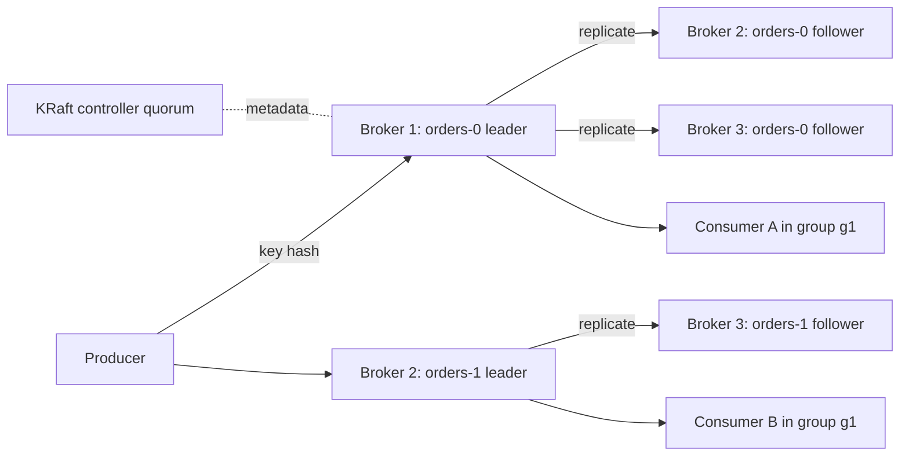

## What Kafka is

**Apache Kafka** is a distributed, replicated, append-only **commit log** (a file you only add to at the end, never edit). Producers append records; consumers read them at their own pace and can read them again.

This is different from a classic queue (see [Message Queues and Pub/Sub](/learn/system-design/message-queues-and-pubsub)), where a message vanishes once consumed. In Kafka the broker keeps the data for a configured time, and each consumer only remembers a position.

- **Broker**: one Kafka server process. A **cluster** is several brokers.
- **Topic**: a named stream, such as `orders`.
- **Partition**: one ordered log file set that holds a slice of a topic. A topic has many.
- **Record**: key, value, timestamp, headers. The **key** decides the partition.
- **Offset**: a record's sequence number inside one partition (0, 1, 2...).

Ordering is guaranteed inside a partition only, never across a whole topic.

## Architecture



- Each partition has one **leader** broker and several **followers**. Only the leader serves reads and writes for that partition; followers copy from it.
- The **ISR** (in-sync replicas) is the set of replicas that are caught up with the leader. A write is "committed" once every ISR member has it.
- **KRaft** (Kafka Raft) is Kafka's own consensus protocol for cluster metadata: topic list, leaders, configs. A small group of controller nodes elects an active controller using Raft. It replaced **ZooKeeper** (an external coordination service); ZooKeeper support was removed in Kafka 4.0 (2025), so new clusters are KRaft only.
- Brokers write to disk sequentially and let the operating system's **page cache** (RAM the OS uses to buffer files) serve hot reads. Reads to consumers use **zero-copy** (`sendfile`), moving bytes from file cache to network without copying through the application. This is why Kafka is fast on ordinary disks.

## The log on disk

Each partition is a folder of **segment** files (default 1 GB each, or 7 days). Only the newest segment is written. Each segment has a sparse **index** mapping offset to file position, so reading offset 9,000,000 is one index lookup plus a sequential scan.

```steps
title: One partition and its high watermark
view: array
frames:
  - arr: [0, 1, 2, 3, 4]
    highlight: {0: done, 1: done, 2: done, 3: done, 4: done}
    pointers: {HW: 4}
    note: Leader and both followers hold offsets 0 to 4. The high watermark (HW, the last committed offset consumers may read) is 4.
  - arr: [0, 1, 2, 3, 4, 5, 6]
    highlight: {5: active, 6: active}
    pointers: {HW: 4, LEO: 6}
    note: Producer appends 5 and 6 on the leader. LEO (log end offset) is 6 but the followers have not copied them, so HW stays at 4 and consumers cannot see them yet.
  - arr: [0, 1, 2, 3, 4, 5, 6]
    highlight: {5: done, 6: done}
    pointers: {HW: 6, LEO: 6}
    note: Every ISR follower has fetched 5 and 6. HW moves to 6. Only now does a producer with acks=all get its reply.
```

## Producers

Three settings decide your safety and speed:

- **`acks`** (acknowledgements): `0` fire and forget, `1` leader wrote it, `all` every ISR member wrote it. Since Kafka 3.0 the default is `all`.
- **`min.insync.replicas`**: with `acks=all`, the write fails if the ISR is smaller than this. Replication factor 3 plus `min.insync.replicas=2` survives one broker loss with no data loss and no downtime.
- **`enable.idempotence=true`** (default since 3.0): the broker tags each record with a producer id and sequence number, so a retry after a timeout does not create a duplicate, and ordering holds with up to 5 in-flight requests.

For speed, producers **batch**: `linger.ms` waits a few milliseconds to fill a batch, `batch.size` caps it (default 16 KB), and `compression.type` (`lz4`, `zstd`) shrinks it. Batching is the biggest throughput lever you have.

```bash
kafka-topics.sh --bootstrap-server localhost:9092 --create \
  --topic orders --partitions 12 --replication-factor 3 \
  --config min.insync.replicas=2 --config retention.ms=604800000
```

```blanks
prompt: Complete a producer config that is safe against broker loss and duplicate retries.
lang: bash
code: |
  acks=[[all]]
  enable.idempotence=[[true]]
  compression.type=lz4
  linger.ms=10
  # topic-side: replication.factor=3, [[min.insync.replicas]]=2
why: acks=all waits for the ISR, idempotence removes retry duplicates, and min.insync.replicas stops writes when too few replicas are alive.
```

:::warn
The producer picks the partition with `hash(key) % partition_count`. Adding partitions later changes that mapping, so the same key lands on a different partition and per-key ordering breaks across the change. Choose the partition count with growth in mind. You can increase it, never decrease it.
:::

## Consumers, groups and offsets

A **consumer group** is a set of consumers sharing a `group.id`. Kafka assigns each partition to exactly one consumer in the group, so a group of N consumers reads in parallel, and extra consumers beyond the partition count sit idle. Another group gets its own independent copy of the stream.

- **Offset commit**: the consumer stores "next offset to read" in an internal topic `__consumer_offsets`. Commit after processing gives **at-least-once** (a crash means re-reading some records). Commit before processing gives **at-most-once** (a crash can skip records).
- **Rebalance**: when a consumer joins, leaves or stops polling for `max.poll.interval.ms`, partitions are reassigned. The classic protocol briefly pauses the whole group. Cooperative assignors and the newer consumer protocol (KIP-848, generally available in Kafka 4.0) move only the affected partitions.
- **Lag**: latest offset minus committed offset. Growing lag is the main health signal.

```order
prompt: Arrange an at-least-once consumer loop.
lang: java
code: |
  while (true) {
      ConsumerRecords<String, String> records = consumer.poll(Duration.ofMillis(500));
      for (ConsumerRecord<String, String> r : records) {
          process(r);
      }
      consumer.commitSync();
  }
distractors:
  - "      consumer.commitSync(); // before process"
why: Committing after process() means a crash replays the batch instead of losing it. Your processing must therefore tolerate duplicates.
```

## Retention, compaction and transactions

- **Time/size retention**: segments older than `retention.ms` (default 7 days) or beyond `retention.bytes` are deleted whole. Reading does not delete anything.
- **Log compaction** (`cleanup.policy=compact`): keep only the latest record per key. A record with a key and a `null` value is a **tombstone** (a delete marker) that is removed later. Good for "current state of each user" changelogs.
- **Exactly-once semantics (EOS)**: idempotence gives no duplicates per producer session. **Transactions** (`transactional.id`) write to several partitions and commit the consumer offsets atomically. Consumers set `isolation.level=read_committed` to skip aborted data.

:::truth
Exactly-once holds inside Kafka: read from a topic, process, write to a topic. The moment you write to a database or call an HTTP API, Kafka cannot roll that back. For external side effects you still need idempotent writes, for example a unique key on the event id.
:::

```quiz
q: A consumer group has 6 consumers reading a topic with 4 partitions. What happens?
options:
  - Each consumer reads about two thirds of a partition
  - 4 consumers each read one partition and 2 stay idle
  - Kafka creates 2 new partitions automatically
  - Messages are duplicated to all 6
answer: 1
why: A partition is read by at most one consumer per group. Parallelism is capped by the partition count, so add partitions before adding consumers.
```

## Numbers to remember

- Sequential disk and batching let one broker take hundreds of MB/s; a common planning figure is about 10 MB/s per partition, and a mid-sized cluster handles millions of records per second.
- End-to-end latency is typically a few milliseconds to tens of milliseconds.
- Default max record size is about 1 MB (`message.max.bytes`). Do not send images through Kafka; send a pointer to object storage.
- Practical partition counts are in the thousands per broker at most, with metadata and recovery cost growing with the total.

```estimate
q: A cluster ingests 50 MB/s, keeps data for 3 days, with replication factor 3. How much disk is needed (ignoring compression and headroom)?
answer: 39
unit: TB
tolerance: 0.3
hint: 50 MB/s times 86,400 seconds is about 4.3 TB per day before replication.
solution: "50 MB/s x 86,400 s = 4.3 TB/day. x 3 days = 13 TB. x 3 replicas = about 39 TB. Add 30 to 40 percent headroom in practice."
```

## Operational gotchas

- **Hot partition**: a skewed key (one huge customer) overloads one partition and one consumer. Salt the key or accept the loss of ordering.
- **Rebalance storms**: slow processing exceeds `max.poll.interval.ms`, the consumer is kicked out, the group rebalances, lag grows, and it repeats. Process less per poll.
- **Unclean leader election** (`unclean.leader.election.enable=true`) allows an out-of-sync replica to lead. You gain availability and lose committed data. Keep it false.
- **Poison message**: one record that always throws blocks its partition. Use a dead-letter topic after N retries.
- **Under-replicated partitions** metric above zero means followers are lagging; page on it.
- **Too many partitions** slows leader election and consumes file handles.
- **Consumer lag is not latency**; alert on lag trend and time-based lag.

## Kafka versus the alternatives

| | Kafka | RabbitMQ | Amazon SQS | Apache Pulsar |
|---|---|---|---|---|
| Model | Replicated log, pull | Broker with queues and exchanges, push | Managed queue | Log with separate storage layer (BookKeeper) |
| Replay old data | Yes | No (once acked) | No | Yes |
| Ordering | Per partition | Per queue | FIFO queues only | Per partition |
| Throughput | Very high | Moderate | High, managed | Very high |
| Ops burden | High | Medium | None | High |
| Pick it for | Event streams, pipelines, replay | Task routing, low volume, flexible routing | Simple async jobs on AWS | Multi-tenancy, tiered storage |

## Interview angle

- Say "partition key" before you say "topic". Interviewers want to hear how you keep related events ordered.
- Quote the trio: replication factor 3, `min.insync.replicas=2`, `acks=all`.
- State delivery semantics honestly: at-least-once plus idempotent consumers beats claiming exactly-once everywhere.
- Size partitions from target throughput divided by per-partition throughput, and from the maximum consumer count you need.

```cards
- q: What guarantees ordering in Kafka?
  a: Only a single partition. Records with the same key go to the same partition, so they stay ordered.
- q: What is the ISR?
  a: In-sync replicas, the replicas fully caught up with the leader. A write is committed when all of them have it.
- q: Safe durability settings for a producer?
  a: acks=all, enable.idempotence=true, topic replication factor 3 with min.insync.replicas=2.
- q: Max useful consumers in one group?
  a: The number of partitions. Extra consumers sit idle.
- q: What does log compaction keep?
  a: The latest record per key. A null value is a tombstone that deletes the key.
- q: Where does exactly-once stop?
  a: At Kafka's boundary. External databases and APIs need idempotent writes.
```

## Notes

:::notes
- Kafka is a replicated append-only log; consumers track an offset, nothing is deleted on read.
- Order is guaranteed per partition; the record key picks the partition.
- Leader serves the partition, followers copy it; ISR is the caught-up set; high watermark is the last committed offset.
- KRaft replaced ZooKeeper; ZooKeeper is gone in Kafka 4.0.
- Durable producer: acks=all, idempotence on, replication factor 3, min.insync.replicas=2.
- Consumer group: one consumer per partition; parallelism is capped by partition count.
- Commit after processing for at-least-once; make handlers idempotent.
- Compaction keeps the latest value per key; tombstone (null value) deletes.
- Transactions give exactly-once only inside Kafka (read_committed consumers).
- Watch consumer lag, under-replicated partitions and rebalance frequency.
:::
