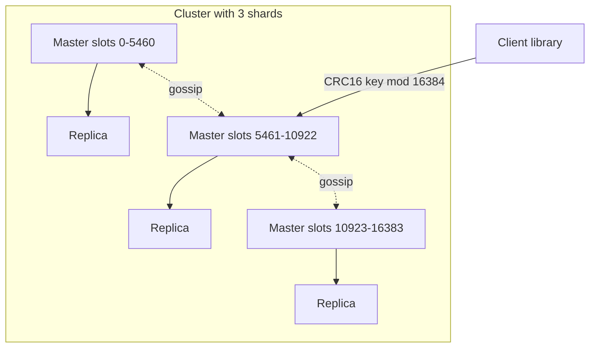

## What Redis is

**Redis** (Remote Dictionary Server) is an in-memory data structure server. You do not just store strings; you store lists, sets and sorted sets and run operations on them on the server. Data lives in RAM, so a typical command answers in well under a millisecond.

Compared with a cache like Memcached (a simpler key to string store), Redis adds rich types, optional persistence, replication and clustering. See [Caching](/learn/system-design/caching) for where it sits in an architecture.

## Why one thread is enough

Redis runs commands on a **single thread** in an **event loop** (a loop that waits for sockets to be ready, then handles each ready request in turn).

- No locks are needed, because only one command runs at a time. Every command is **atomic** (it cannot be interrupted halfway).
- Work is memory-bound, not CPU-bound, and data structures are tuned to be cheap.
- Since version 6, optional **I/O threads** read and write sockets in parallel. The commands themselves still run on one thread.
- To use many cores you run many Redis processes (shards), not one multi-threaded process.

The price: one slow command blocks everybody. `KEYS *` on 50 million keys freezes the server for seconds.

## Data structures

| Type | What it is | Typical use | Notable commands |
|---|---|---|---|
| String | Bytes, up to 512 MB; numbers too | Cache values, counters | `SET`, `GET`, `INCR` |
| Hash | Field to value map inside a key | Objects, sessions | `HSET`, `HGETALL` |
| List | Linked list of strings | Queues, recent items | `LPUSH`, `BRPOP` |
| Set | Unique unordered members | Tags, "who liked" | `SADD`, `SINTER` |
| Sorted set | Unique members with a score, ordered | Leaderboards, delay queues | `ZADD`, `ZRANGE`, `ZRANK` |
| Stream | Append-only log with consumer groups | Event pipelines, like a small Kafka | `XADD`, `XREADGROUP` |
| HyperLogLog | Probabilistic unique counter, 12 KB, about 0.8 percent error | Unique visitors | `PFADD`, `PFCOUNT` |

A **sorted set** is a skip list (a layered linked list that gives O(log N) search) plus a hash table. So `ZADD` and `ZRANK` cost O(log N) and a top-100 query is O(log N + 100).

```bash
ZADD board 1500 alice 1720 bob 1630 carol
ZRANGE board 0 1 REV WITHSCORES   # top 2: bob 1720, carol 1630
ZREVRANK board alice              # 2 (0-based position from the top)
```

```predict
lang: bash
code: |
  SET hits 10
  INCR hits
  INCRBY hits 5
  GET hits
output: "16"
why: INCR adds 1 (11), INCRBY adds 5 (16). Both are atomic, so concurrent clients never lose an update.
```

## Persistence: surviving a restart

Redis is memory-first, so persistence is optional and has two modes.

- **RDB** (Redis Database snapshot): a point-in-time file. Redis calls `fork()` and the child writes the snapshot while the parent keeps serving (using **copy-on-write**, where memory pages are copied only if changed). Compact and fast to load, but you lose everything since the last snapshot.
- **AOF** (Append Only File): every write command is appended to a log. `appendfsync everysec` (the default) flushes once a second, so a crash loses about one second; `always` loses nothing but is much slower. The log is periodically rewritten to stay small.
- Run both for the best recovery, or neither if it is a pure cache.

:::truth
Even with AOF, Redis is not a durable database in the way PostgreSQL is. Replication is asynchronous, so a master that crashes right after acknowledging a write can lose it when a replica takes over. Treat Redis as the fast layer, with the source of truth elsewhere.
:::

## Eviction: when memory is full

`maxmemory` caps RAM and `maxmemory-policy` says what to do at the limit.

- `noeviction` (default): writes fail with an error.
- `allkeys-lru` / `allkeys-lfu`: evict the **least recently used** or **least frequently used** key from all keys. Best for a pure cache.
- `volatile-lru` / `volatile-lfu` / `volatile-ttl`: only keys that have an expiry.
- Redis LRU is **approximate**: it samples a few keys (`maxmemory-samples`, default 5) and drops the oldest of the sample, which avoids tracking every access.

```viz
algo: lru-cache
input:
  capacity: 3
  ops: ["put a 1", "put b 2", "put c 3", "get a", "put d 4", "get b", "get c"]
```

## Replication, Sentinel and Cluster



- **Replication**: a replica connects to a master, gets a full copy once, then a stream of writes. It is asynchronous; `WAIT n timeout` blocks until n replicas confirm but still does not make it fully safe.
- **Sentinel**: separate monitor processes (run at least 3) that detect a dead master, vote on it using a **quorum** (majority agreement), promote a replica and tell clients the new address. Good when your data fits one machine.
- **Redis Cluster**: splits data over masters by **hash slot**. There are 16,384 slots; a key goes to slot `CRC16(key) mod 16384` (a hash function). Each master owns a range of slots.
- A client sent to the wrong node gets `MOVED slot host:port` and learns the map. Multi-key commands work only if all keys are in the same slot; force this with a **hash tag**: `{user42}:cart` and `{user42}:profile` hash only `user42`.
- Cluster nodes talk by gossip and replicas are promoted automatically when a master fails. It is similar in idea to [consistent hashing](/learn/system-design/consistent-hashing), but with fixed slots you move whole slots between nodes.

## Common uses

- **Cache**: `SET key value EX 300` with a TTL (time to live), and cache-aside reads.
- **Rate limiter**: `INCR` a per-user, per-minute key and set `EXPIRE` on first creation; do it in a Lua script so both steps are atomic.
- **Leaderboard**: sorted set, as above.
- **Session store**: hash with TTL.
- **Distributed lock**: `SET lock:order42 <random-id> NX PX 30000` (set only if absent, expire in 30 s). Release with a Lua script that deletes only if the value still matches your id.
- **Pub/sub and streams**: fire-and-forget broadcast, or a durable log with consumer groups.

:::warn
Redlock (the algorithm that takes the same lock on 5 independent Redis instances) is debated. Critics note that pauses (garbage collection, network) can let two clients both believe they hold the lock, and that it relies on clocks. If correctness matters, attach a **fencing token** (an increasing number the protected resource checks) or use a consensus system such as etcd. A single-node Redis lock is fine for efficiency, not for safety.
:::

```estimate
q: Peak traffic is 1 million cache operations per second. A single Redis shard comfortably does about 100,000 simple operations per second without pipelining. How many master shards do you need?
answer: 10
unit: shards
tolerance: order
hint: Divide, then leave headroom.
solution: "1,000,000 / 100,000 = 10 masters. With headroom for 70 percent utilisation you would plan 14 to 15, each with a replica."
```

## Pitfalls

- **Big keys**: a 2 GB list or a hash with 10 million fields makes `DEL`, replication and rebalancing stall. Use `UNLINK` (frees memory in the background) and split big structures.
- **Hot keys**: one key gets most traffic and overloads one shard whatever the cluster size. Add a local in-process cache or replicate the key under several names.
- **`KEYS` and `SMEMBERS` on huge data** block the server. Use `SCAN` (cursor-based, a few keys per call) and `SSCAN`.
- **No TTL** on cache keys means memory grows until eviction or failure.
- **Fork latency**: a snapshot of a 50 GB dataset can pause the server while the page tables are copied.
- **Cache stampede**: a hot key expires and thousands of requests rebuild it together. Add jitter to TTLs and lock rebuilds.
- **Licensing**: Redis changed its license in 2024 and added an open source AGPL option in version 8 (2025). **Valkey** is the Linux Foundation fork. Commands are the same for the topics here.

## Redis versus alternatives

| Need | Pick |
|---|---|
| Rich types, sub-millisecond, optional persistence | Redis |
| Pure string cache, multi-threaded, simple | Memcached |
| Durable log with replay at huge scale | Kafka |
| Primary database with queries and transactions | PostgreSQL or DynamoDB |

## Interview angle

- Explain why single-threaded is fast, and name its weakness (slow commands block).
- For a cache, say "cache-aside, TTL with jitter, `allkeys-lru`".
- For scale, say "Redis Cluster with 16,384 slots and replicas, hash tags for multi-key operations".
- Be honest that a Redis lock is not a safety guarantee.

```quiz
q: Your app runs `KEYS user:*` on a production Redis with 40 million keys to find a few users. What is the real problem?
options:
  - It returns the wrong keys in a cluster
  - It is O(N) on a single thread, so every other client waits until it finishes
  - It writes a snapshot to disk
  - It evicts old keys
answer: 1
why: KEYS scans the whole keyspace in one command. Since commands run one at a time, the whole server stalls. SCAN with a cursor does the same job in small slices.
```

```cards
- q: Why is Redis fast with one thread?
  a: Data is in RAM, commands are short and atomic, and there are no locks. Slow commands are the weakness.
- q: RDB versus AOF?
  a: RDB is a periodic snapshot (compact, loses data since the last one). AOF logs every write (about 1 s loss with everysec).
- q: How does Redis Cluster place a key?
  a: Slot = CRC16(key) mod 16384; each master owns a range of slots. Hash tags in braces force related keys into one slot.
- q: Best structure for a leaderboard?
  a: Sorted set. ZADD and ZRANK are O(log N); a top-N range is O(log N + N).
- q: Safe single-node lock command?
  a: SET key random-id NX PX ttl, released by a Lua script that checks the id. Not safe against pauses without a fencing token.
- q: Default eviction policy?
  a: noeviction. Writes fail at maxmemory; use allkeys-lru for a cache.
```

## Notes

:::notes
- Redis is an in-memory data structure server; commands run on one thread, so each is atomic and a slow one blocks all.
- Core types: string, hash, list, set, sorted set (skip list), stream, HyperLogLog.
- RDB = snapshot via fork and copy-on-write; AOF = write log, everysec by default; neither makes it a safe primary database.
- Eviction needs maxmemory; use allkeys-lru or allkeys-lfu for caches; the default noeviction errors on write.
- Replication is asynchronous; Sentinel automates failover for one dataset; Cluster shards over 16,384 hash slots.
- Hash tags like {user42} keep related keys in one slot for multi-key commands.
- Lock with SET NX PX plus a Lua unlock; Redlock is contested, use fencing tokens for correctness.
- Avoid KEYS, big keys and hot keys; use SCAN and UNLINK; jitter TTLs against stampedes.
:::
