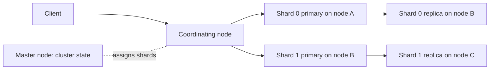

## What Elasticsearch is

**Elasticsearch** is a distributed search and analytics engine. It stores JSON documents and finds them by words, ranks them by relevance, and computes statistics over them. It is built on **Apache Lucene**, a Java library that does the actual indexing and searching inside each shard. Elasticsearch adds the distribution, a REST API and cluster management.

Two main jobs:

- **Search**: product search, site search, autocomplete, filters.
- **Log and metrics analytics**: the **ELK stack** (Elasticsearch, Logstash, Kibana).

A normal database index (see [Indexing](/learn/system-design/indexing)) answers "find the row with this key". Search needs "find documents containing these words, best first".

## The inverted index

An **inverted index** maps each **term** (a word after processing) to the list of documents that contain it. That list is called a **posting list**, and it also stores term frequency and positions.

| Doc | Text |
|---|---|
| 1 | The quick brown fox |
| 2 | A quick red fox jumped |
| 3 | Brown bears sleep |

| Term | Posting list |
|---|---|
| brown | 1, 3 |
| fox | 1, 2 |
| quick | 1, 2 |
| red | 2 |

The query `quick AND brown` intersects two sorted lists: result is doc 1. This is far faster than scanning every document.

An **analyzer** turns text into terms, in three stages:

- **Character filters**: clean the raw text (strip HTML).
- **Tokenizer**: split into tokens (words). The `standard` tokenizer splits on word boundaries.
- **Token filters**: lowercase, remove stop words ("the"), apply a **stemmer** (reduce "jumped" to "jump").

The same analyzer must run at index time and query time, or terms will not match.

```steps
title: Posting lists for the query quick AND brown
view: array
frames:
  - arr: [1, 2]
    pointers: {quick: 0}
    note: Posting list of "quick" is [1, 2].
  - arr: [1, 3]
    pointers: {brown: 0}
    note: Posting list of "brown" is [1, 3].
  - arr: [1]
    highlight: {0: match}
    note: Walk both sorted lists together. Only doc 1 appears in both, so it is the result.
```

## Cluster and write path



- An **index** is a named collection of documents, split into **primary shards**. Each shard is a complete Lucene index. The number of primaries is fixed when you create the index (you can split or shrink later with special APIs). The default is 1.
- Each shard has **replicas** (copies on other nodes) for failover and for extra read capacity.
- A document goes to shard `hash(_id) % number_of_primary_shards`. The primary applies the write, then copies it to replicas.
- A search is a **scatter-gather**: the coordinating node asks one copy of every shard for its top results (query phase), merges them, then fetches the actual documents (fetch phase).
- **Node roles**: master-eligible nodes keep the **cluster state** (which shard lives where); data nodes hold shards; coordinating nodes route requests. Three dedicated master-eligible nodes is the usual production setup.

## Near-real-time: refresh, translog, segments

Lucene never edits an index file. New documents go to an in-memory buffer; periodically they become a **segment**, an immutable mini-index on disk.

- **Refresh** (every 1 second by default) writes the buffer into a new segment you can search. That is why the search is **near-real-time (NRT)**, not instant. Fetch by `_id` is realtime.
- **Translog** (transaction log): each write is also appended here so a crash does not lose un-flushed data. By default it is fsynced per request.
- **Flush** commits segments to disk and clears the translog.
- **Merge**: many small segments slow searches, so a background process merges them into bigger ones. Deleted documents are only **marked** in a bitset and physically removed during a merge. An update is a delete plus a re-index.

:::key
Segments are immutable. That makes caching and concurrency simple and fast, and it is also why updates are expensive and why a disk fills up temporarily during merges.
:::

```order
prompt: Arrange the path of one indexed document, from request to searchable.
lang: bash
code: |
  1. primary shard receives the document
  2. append to translog
  3. add to in-memory buffer
  4. refresh turns buffer into a searchable segment
  5. background merge combines small segments
distractors:
  - "  0. document is searchable immediately"
why: Searchability arrives at refresh, roughly one second later. Durability comes from the translog earlier, and merging is later housekeeping.
```

## Relevance: BM25

Results are ranked by a score. The default is **BM25** (Best Matching 25), a refinement of TF-IDF.

- **Term frequency (TF)**: more occurrences of the word raise the score, with **saturation** (the tenth occurrence adds little).
- **Inverse document frequency (IDF)**: rare words matter more than common ones.
- **Length normalization**: a match in a short title beats the same match in a long page.
- Tunable with `k1` (saturation, default 1.2) and `b` (length effect, default 0.75). In practice you boost fields (`title^3`) rather than touch these.

## Mappings and aggregations

A **mapping** is the schema: the type and analyzer of each field.

- `text`: analyzed, for full-text search, not sortable.
- `keyword`: stored as one exact term, for filters, sorting and aggregations.
- You cannot change the type of an existing field. Create a new index and **reindex**.
- **Dynamic mapping** guesses types from the first value. Unbounded keys (user ids as field names) cause **mapping explosion**; turn it off for production.

```json
{
  "mappings": {
    "dynamic": "strict",
    "properties": {
      "title":  { "type": "text", "fields": { "raw": { "type": "keyword" } } },
      "brand":  { "type": "keyword" },
      "price":  { "type": "scaled_float", "scaling_factor": 100 },
      "created":{ "type": "date" }
    }
  }
}
```

**Aggregations** compute stats alongside the search: `terms` (top brands), `date_histogram` (events per hour), `avg`, `percentiles`. They read **doc values** (a column-oriented on-disk copy of each field), which is why fields you aggregate on must be keyword or numeric. `cardinality` (distinct count) is approximate, using HyperLogLog++.

## ELK and logs

- **Beats / Elastic Agent** ship logs from servers; **Logstash** (optional) parses and transforms them; **Elasticsearch** stores; **Kibana** is the UI for search and dashboards.
- Logs go to **data streams**, time-based indices that roll over by size or age. **ILM** (Index Lifecycle Management) moves them through hot (fast SSD), warm, cold and frozen tiers, then deletes them.
- Deleting a whole day is dropping one index, which is cheap. Deleting documents inside an index is not.

```estimate
q: A system produces 200 GB of logs per day, retention is 14 days, and every index has 1 replica. Roughly how much disk is needed, ignoring index overhead?
answer: 5600
unit: GB
tolerance: 0.4
hint: Each byte is stored twice because of the replica.
solution: "200 GB x 14 days = 2,800 GB of primaries. With 1 replica the total is 5,600 GB. Real indices add 10 to 50 percent overhead, and you need 20 to 30 percent free space for merges."
```

## Operational gotchas

- **Too many small shards**: each shard costs heap and file handles. Aim for roughly 10 to 50 GB per shard, not thousands of tiny ones.
- **Too few shards**: a single 500 GB shard cannot spread over nodes and recovers slowly.
- **Heap size**: give the JVM (Java Virtual Machine) at most half of RAM and stay below about 31 GB so pointers stay compressed. Lucene needs the rest for the OS file cache.
- **Deep pagination**: `from + size` beyond 10,000 is rejected by default. Use `search_after` with a point-in-time view.
- **Mapping explosion** and unbounded fields, as above.
- **Slow queries**: leading wildcards (`*foo`) and heavy scripts. Use `filter` context for yes/no conditions; filters are cached and skip scoring.
- **Split brain** (two masters) was a real issue before version 7; modern clusters use a voting configuration. Keep an odd number of master-eligible nodes.
- **Disk watermarks**: at 85 percent used, new shards stop being allocated; at 95 percent, indices become read-only.

## When not to use it as the primary database

:::truth
Elasticsearch is very good at search and a poor system of record. Teams that skip this get burned. There are no multi-document transactions, visibility is near-real-time, and a bad cluster event or mapping mistake can mean reindexing everything. Keep the truth in PostgreSQL, DynamoDB or similar, and feed Elasticsearch from it.
:::

| Need | Pick |
|---|---|
| Full-text, fuzzy match, relevance, facets | Elasticsearch or OpenSearch (the AWS-led fork, 2021) |
| Joins, transactions, exact accounting | PostgreSQL |
| Simple site search at small scale | PostgreSQL full-text search |
| Vector (semantic) search plus keywords | Elasticsearch `dense_vector` fields, or a vector database |

A standard pattern: write to the database, publish a change event (for example through Kafka or CDC, change data capture), and a consumer updates the search index. If the index is lost, rebuild it from the database.

```quiz
q: You index a document and immediately run a search that should match it, but it does not appear. A second later it does. What explains this?
options:
  - The replica was behind the primary by one second
  - "Search is near-real-time: the document becomes visible only after the next refresh, about 1 second by default"
  - The analyzer was changed
  - The translog was full
answer: 1
why: Documents are searchable only once a refresh writes the buffer into a new segment. The default refresh_interval is 1 second.
```

## Interview angle

- Start with "inverted index" and say what a posting list is.
- Explain primary shards, replicas, and scatter-gather in two sentences.
- Mention NRT and that it is a secondary store fed from the source of truth.
- For logs, mention time-based indices and tiered retention.

```cards
- q: What is an inverted index?
  a: A map from each term to the sorted list of documents containing it (posting list), so queries intersect lists instead of scanning documents.
- q: Why is Elasticsearch near-real-time?
  a: New documents become searchable only after a refresh creates a new segment, every 1 second by default.
- q: What is a segment?
  a: An immutable Lucene mini-index. Deletes are marked, updates are delete plus add, and merges compact segments.
- q: text versus keyword?
  a: text is analyzed for full-text search; keyword is one exact value for filters, sorting and aggregations.
- q: What does BM25 reward?
  a: Rare terms, repeated terms with saturation, and matches in shorter fields.
- q: Why not use it as a primary database?
  a: No multi-document transactions, near-real-time visibility, and costly reindexing when mappings change.
```

## Notes

:::notes
- Elasticsearch = distributed layer over Lucene; stores JSON documents, searches by terms, computes aggregations.
- Inverted index: term to posting list; analyzers (char filter, tokenizer, token filters) must match at index and query time.
- Index = primary shards (fixed count) plus replicas; doc goes to hash(_id) % primaries; search is scatter-gather.
- Segments are immutable; refresh (1 s) makes data searchable, translog gives durability, merges clean up deletes.
- BM25 ranks by term frequency with saturation, inverse document frequency and field length.
- Mappings: text for search, keyword for filters and aggregations; field types cannot change without reindex.
- Logs: ELK, data streams, ILM tiers; drop whole indices to delete old data.
- Keep shards around 10 to 50 GB, heap under about 31 GB and at most half of RAM.
- Use it as a secondary index fed from a database, not as the system of record.
:::
