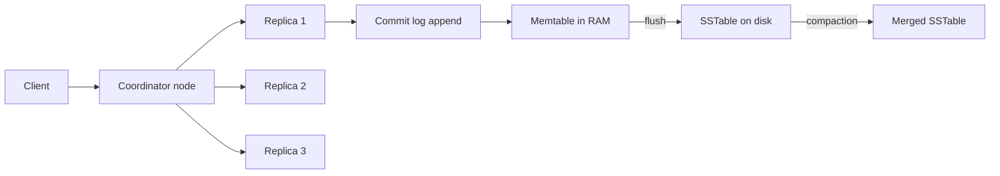

## What these stores are

**Cassandra** and **DynamoDB** are distributed databases built for huge write volume, horizontal scale and high availability. Both come from the 2007 Amazon **Dynamo paper**; Cassandra added Google's Bigtable-style storage engine. Both give up joins, ad-hoc queries and (mostly) multi-row transactions in exchange for predictable speed at any size.

- **Cassandra** is open source (Apache), self-managed or hosted (for example by DataStax or on cloud providers). It is **wide-column**: a row can have many columns and rows with the same key are stored together sorted.
- **DynamoDB** is a fully managed AWS **key-value and document** store. You never see servers.

Both tie into earlier lessons: [sharding](/learn/system-design/sharding-and-partitioning), [consistent hashing](/learn/system-design/consistent-hashing) and [CAP and consistency](/learn/system-design/cap-and-consistency).

## Data model

The **primary key** has two parts. This is the most important idea in both systems.

| Part | Cassandra name | DynamoDB name | Job |
|---|---|---|---|
| Decides which node | Partition key | Partition key (hash key) | Hashed to pick the partition |
| Orders data inside it | Clustering key(s) | Sort key (range key) | Rows kept sorted; enables range reads |

- All rows with the same partition key live together on the same replicas. Reading one partition is one fast, sequential read.
- A range query (`sent_at > X LIMIT 50`) is cheap **inside one partition** and unavailable or very expensive across partitions.
- Without the partition key you cannot query efficiently. There is no secondary lookup for free.

```sql
CREATE TABLE messages_by_chat (
  chat_id uuid,
  day date,
  sent_at timeuuid,
  body text,
  PRIMARY KEY ((chat_id, day), sent_at)
) WITH CLUSTERING ORDER BY (sent_at DESC);

SELECT * FROM messages_by_chat
WHERE chat_id = ? AND day = '2026-10-14' LIMIT 50;
```

Here `(chat_id, day)` is a **composite partition key**: it bounds each partition to one chat-day.

```blanks
prompt: Complete the primary key so each partition holds one chat for one day, sorted by time.
lang: sql
code: |
  PRIMARY KEY ((chat_id, [[day]]), [[sent_at]])
  ) WITH CLUSTERING ORDER BY (sent_at [[DESC]]);
why: The inner parentheses are the partition key (chat and day). The part after them is the clustering key, which orders rows inside the partition; DESC puts the newest first.
```

## Query-first data modeling

In SQL you model entities, then write any query. Here it is reversed.

- List your queries first. Create **one table per query**, with the partition key matching the query's equality filter.
- **Denormalize**: store the same data in several tables. Writes are cheap, so you write each fact 2 or 3 times.
- No joins. The application or a precomputed table does the joining.
- Keep partitions bounded. A guideline for Cassandra is under about 100 MB and 100,000 rows per partition. Time-bucketing (`day` above) is the standard fix.
- Avoid `ALLOW FILTERING` and unindexed `WHERE` clauses; they scan the whole cluster.

## Cassandra architecture

Cassandra has **no master**. Every node is equal, so there is no single point of failure.



- **Ring**: the partition key is hashed (Murmur3) to a **token**. The token range is a circle and each node owns slices of it. Each node uses many **virtual nodes** (vnodes, small slices; 16 by default in Cassandra 4.0 and later) so data spreads evenly and adding a node takes a little from everyone.
- **Replication factor (RF)**: each partition is copied to RF nodes, found by walking the ring. In production use `NetworkTopologyStrategy`, which places replicas in different racks and data centers.
- **Coordinator**: whichever node the client contacts. It forwards to the replicas and answers when enough have replied.
- **Gossip**: nodes exchange state every second to learn who is alive.

```viz
algo: consistent-hashing
input:
  servers: 4
  vnodes: 4
  keys: 32
```

## Tunable consistency

You pick how many replicas must answer, per query. With RF = N, a write waits for W replicas and a read asks R replicas.

- `ONE`: fastest, weakest. `QUORUM`: a majority, which is `floor(N/2) + 1` (2 of 3). `ALL`: every replica, so one dead node fails the request. `LOCAL_QUORUM`: quorum inside the local data center, the usual choice for multi-region.
- If **R + W > N**, the read set and write set overlap, so a read sees the latest write. QUORUM + QUORUM with RF 3 gives 2 + 2 > 3.
- Replicas that missed a write are healed by **hinted handoff** (the coordinator stores the write and replays it), **read repair** (a read compares versions and fixes stale copies) and **anti-entropy repair** (a scheduled job comparing Merkle trees, which are hash summaries of data).
- Conflicts are resolved by **last write wins**, using timestamps. Clock skew can pick the wrong winner.

```quiz
q: RF is 3. Which read/write consistency pairs guarantee that a read sees the latest successful write?
options:
  - Write ONE, read ONE
  - Write QUORUM, read QUORUM
  - Write ALL, read ONE
  - Write ONE, read QUORUM
answer: [1, 2]
why: The rule is R + W > RF. QUORUM + QUORUM is 2 + 2 = 4 > 3. ALL + ONE is 3 + 1 = 4 > 3. ONE + ONE is 2 and ONE + QUORUM is 3, which are not greater than 3, so a stale read is possible.
```

## Storage: LSM trees, compaction, tombstones

Cassandra uses an **LSM tree** (Log-Structured Merge tree): writes are sequential, never in place.

- **Write path**: append to the **commit log** on disk (for crash recovery), update the **memtable** (a sorted in-memory table). No read-before-write, so writes are very fast.
- When the memtable fills, it flushes to an **SSTable** (Sorted String Table), an immutable sorted file.
- **Read path**: check the memtable, then SSTables. A **Bloom filter** (a compact structure that says "definitely not here" or "maybe here") skips files without the key. The data is merged by timestamp.
- **Compaction** merges SSTables to bound how many files a read touches and to discard overwritten data. Strategies: size-tiered (write-heavy), leveled (read-heavy), time-window (time series).
- A **delete** writes a **tombstone**, a marker saying the data is gone. Tombstones live for `gc_grace_seconds` (default 10 days) so every replica learns about the delete. If a replica is down longer than that and not repaired, the deleted data can come back (zombie data).

:::truth
Reading many tombstones is slow. A queue pattern (insert, then delete, in one partition) fills partitions with tombstones, and reads crawl or fail at the tombstone failure threshold (100,000 by default). Do not use Cassandra as a queue. Run repairs within `gc_grace_seconds`. Cassandra is also not for workloads that need strong transactions or frequent updates to the same row from many writers.
:::

## DynamoDB specifics

- **Item** limit: 400 KB. Access is by primary key through `GetItem`, `Query` (one partition, optional sort key conditions) or `Scan` (whole table, slow and costly).
- **Reads** are eventually consistent by default (half price); you can request a strongly consistent read from the leader replica.
- **GSI** (Global Secondary Index): another copy of the table with a different partition and sort key, to support a second access pattern. It is updated asynchronously (eventually consistent) and has its own capacity. An **LSI** (Local Secondary Index) shares the partition key, must be created with the table, and caps a partition at 10 GB.
- **Capacity modes**: **on-demand** (pay per request, no planning, good for spiky or unknown load) or **provisioned** (you set RCU/WCU, cheaper at steady load, optional auto scaling). 1 **WCU** (write capacity unit) is one write per second of up to 1 KB; 1 **RCU** is one strongly consistent read per second of up to 4 KB (two eventually consistent).
- **Transactions** (`TransactWriteItems`, up to 100 items) cost twice a normal write. **Streams** emit a change feed. **TTL** deletes expired items. **Global tables** replicate across regions, last writer wins.
- **Hot partition**: each partition is limited to about 3,000 RCU and 1,000 WCU per second. A skewed partition key throttles you however much total capacity you bought. Pick high-cardinality keys (user id, not country) and, if one key must be hot, add a random suffix to spread it.

```estimate
q: An app writes 5,000 items per second, each 2.5 KB, to a provisioned DynamoDB table. How many WCUs are needed?
answer: 15000
unit: WCU
tolerance: 0.2
hint: Each write is rounded up to the next whole KB.
solution: "2.5 KB rounds up to 3 WCU per write. 5,000 x 3 = 15,000 WCU. Spread across partitions at 1,000 WCU each, that is at least 15 partitions of well-distributed keys."
```

## Operational gotchas

- **Unbounded partitions** in Cassandra (one key accumulates forever). Bucket by time.
- **Hot partitions** in both systems from skewed keys.
- **Repair neglected**: schedule it (Cassandra Reaper, or incremental repair) within `gc_grace_seconds`.
- **Secondary indexes in Cassandra** on high-cardinality columns scan many nodes. Prefer another table. Newer storage-attached indexes in 5.0 help but are not free.
- **Lightweight transactions** (`IF NOT EXISTS`) use Paxos consensus and are several times slower than normal writes. Use them sparingly.
- **GSI throttling** back-pressures the base table writes if the GSI lacks capacity.

## When to pick which

| Need | Pick |
|---|---|
| Millions of writes per second, time series, messages, IoT | Cassandra |
| Zero ops, spiky traffic, AWS-native | DynamoDB |
| Ad-hoc queries, joins, transactions | PostgreSQL |
| Multi-region active-active with tunable consistency, self-hosted | Cassandra |

## Interview angle

- Say "I will design the tables from the access patterns" before drawing anything.
- Name the partition key and what bounds the partition size.
- State the consistency choice as numbers: RF 3, `LOCAL_QUORUM` reads and writes.
- Mention that the cost is no joins and eventual consistency between replicas, and that you accept it for availability.

```cards
- q: What is the difference between partition key and clustering key?
  a: The partition key (hashed) picks the node; the clustering key (sort key in DynamoDB) orders rows inside the partition for range reads.
- q: When does a read see the latest write in Cassandra?
  a: When R + W > RF, for example QUORUM reads and QUORUM writes with RF 3.
- q: Why are Cassandra writes fast?
  a: Append to the commit log and update an in-memory memtable. No read-before-write, no in-place update.
- q: What is a tombstone and why is it a risk?
  a: A delete marker kept for gc_grace_seconds. Many tombstones slow reads, and an unrepaired replica can resurrect deleted data.
- q: What is a GSI in DynamoDB?
  a: A copy of the table keyed differently to support another query. Eventually consistent, with separate capacity.
- q: What causes a hot partition?
  a: A skewed partition key concentrating traffic on one partition, which has its own throughput ceiling.
```

## Notes

:::notes
- Cassandra and DynamoDB descend from Dynamo: partitioned, replicated, highly available, no joins.
- Primary key = partition key (picks the node) + clustering/sort key (orders rows inside).
- Model from queries: one table per query, denormalize, bound partition size with time buckets.
- Cassandra ring: Murmur3 tokens, vnodes, RF copies, any node can coordinate, gossip for liveness.
- Tunable consistency: R + W > RF gives read-your-latest-write; QUORUM + QUORUM with RF 3 is the default pattern.
- LSM write path: commit log, memtable, immutable SSTables, compaction; deletes are tombstones kept for gc_grace_seconds.
- Run repairs inside gc_grace_seconds; avoid queue patterns and unbounded partitions.
- DynamoDB: partition key and sort key, GSI/LSI, on-demand or provisioned (1 WCU = 1 KB/s write, 1 RCU = 4 KB/s strong read).
- Hot partitions throttle you regardless of total capacity; choose high-cardinality keys.
:::
