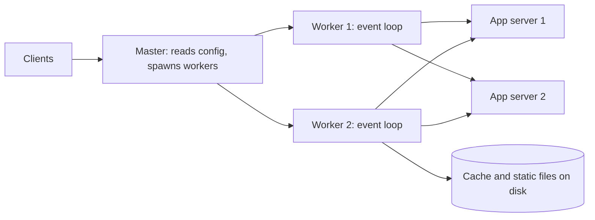

## What Nginx is

**Nginx** (pronounced "engine-x") is a web server and **reverse proxy**: a server that sits in front of your application servers, accepts client connections and forwards requests to them. The client only ever talks to Nginx.

One process can play several roles at once:

- **Static file server.** Sends images, CSS and JavaScript straight from disk.
- **Reverse proxy.** Forwards dynamic requests to an app (Node, Java, Python).
- **Load balancer** (spreads requests over several servers) at layer 7, meaning it understands HTTP.
- **TLS terminator.** Handles encryption so apps speak plain HTTP inside the private network.
- **Cache and rate limiter.** Stores responses and caps request rates.

It is the same idea as the proxies in the CDN lesson, but you run it yourself, close to your servers.

## Why it handles so many connections

Older servers like Apache's classic mode used one process or thread per connection. Ten thousand idle connections meant ten thousand stacks of memory. This is the **C10K problem** (handling 10,000 concurrent connections).

Nginx uses an **event-driven, non-blocking** model:

- One **master** process reads config and manages workers.
- Several **worker** processes, usually one per CPU core (`worker_processes auto`), do the real work.
- Each worker runs an **event loop**. It asks the kernel (using `epoll` on Linux, a call that reports which sockets are ready) "which connections have data?" and handles only those. It never waits on one slow client.
- A worker can hold tens of thousands of connections because an idle connection costs only a small buffer.



:::key
Workers never block. A slow client costs a few kilobytes, not a thread. That is why Nginx shields a slow app server from slow clients: it reads the whole request, then talks to the app quickly.
:::

:::truth
Event loops have one weakness: any blocking call inside a worker stalls every connection on it. Heavy work (image resizing, big regexes, a blocking module) belongs in the app, not in Nginx.
:::

## Config structure and a small example

Config is a tree of **contexts**: `events` (connection settings), `http` (all web traffic), `server` (one virtual host, matched by domain and port) and `location` (one URL prefix inside a server).

```nginx
worker_processes auto;
events { worker_connections 4096; }

http {
  limit_req_zone $binary_remote_addr zone=perip:10m rate=10r/s;
  proxy_cache_path /var/cache/nginx keys_zone=app:10m max_size=1g inactive=60m;

  upstream app {
    least_conn;
    server 10.0.0.11:8080 max_fails=3 fail_timeout=10s;
    server 10.0.0.12:8080 max_fails=3 fail_timeout=10s;
    server 10.0.0.13:8080 backup;
    keepalive 32;
  }

  server {
    listen 443 ssl;
    http2 on;
    server_name shop.example.com;
    ssl_certificate     /etc/ssl/shop.crt;
    ssl_certificate_key /etc/ssl/shop.key;
    ssl_protocols       TLSv1.2 TLSv1.3;

    location /api/ {
      limit_req zone=perip burst=20 nodelay;
      limit_req_status 429;
      proxy_pass http://app;
      proxy_http_version 1.1;
      proxy_set_header Connection "";
      proxy_set_header Host $host;
      proxy_set_header X-Forwarded-For $proxy_add_x_forwarded_for;
      proxy_cache app;
      proxy_cache_valid 200 1m;
      proxy_cache_use_stale error timeout updating;
    }
  }
}
```

Check a change with `nginx -t`, then apply it without dropping connections using `nginx -s reload`. Workers finish their current requests, then new workers take over.

```blanks
prompt: Complete the proxy settings so Nginx reuses connections to the upstream and passes the real client address on.
lang: nginx
code: |
  upstream app {
    server 10.0.0.11:8080;
    [[keepalive]] 32;
  }
  location / {
    proxy_pass http://app;
    proxy_http_version [[1.1]];
    proxy_set_header X-Forwarded-For $proxy_add_x_forwarded_for;
  }
why: "`keepalive` keeps idle upstream connections open for reuse, which needs HTTP/1.1 (and an empty Connection header) so the connection is not closed after each request. X-Forwarded-For tells the app the original client IP."
```

## Load balancing and health checks

`upstream` defines a pool of servers. The balancing method is chosen inside it:

| Method | Behaviour | Use when |
|---|---|---|
| round robin (default) | Servers in turn, optional `weight=` | Requests cost about the same |
| `least_conn` | Fewest active connections | Request durations vary a lot |
| `ip_hash` | Same client IP, same server | Cheap stickiness (breaks behind NAT) |
| `hash $key consistent` | Consistent hashing on any key | Cache servers, shard-aware routing |

**Health checks** decide when to stop sending traffic to a dead server:

- **Passive** (open-source Nginx): after `max_fails` failures within `fail_timeout`, the server is skipped for `fail_timeout`. It only notices by failing real user requests.
- **Active** (probing a health URL every few seconds) is a paid NGINX Plus feature. HAProxy and Envoy include it for free.
- `proxy_next_upstream` retries a failed request on another server. Be careful: retrying a non-idempotent `POST` can run it twice.

## TLS termination, HTTP/2 and caching

**TLS termination** means Nginx decrypts HTTPS and forwards plain HTTP to apps. Benefits: certificates live in one place, apps skip crypto work, and Nginx can read the request to route and cache it. The cost is that traffic inside your network is unencrypted unless you add TLS to the upstream too.

- **HTTP/2** multiplexes many requests over one connection and is enabled with `http2 on;` in the server block. It is used between browser and Nginx; the upstream hop is usually HTTP/1.1.
- **Caching** keys responses by URL by default. `proxy_cache_use_stale` serves an old copy while the app is down or refreshing, which turns many outages into slow pages.
- `proxy_cache_lock on` lets only one request fill a missing entry, avoiding a **cache stampede** (many requests hitting the app at once for the same missing item).
- **Rate limiting** with `limit_req` uses a leaky bucket: requests drain at `rate`, and `burst` is how many extra may queue. With `nodelay`, burst requests pass at once and the rest get 429.

```estimate
q: Nginx runs 4 workers with worker_connections 4096. Used as a reverse proxy, each client request holds one client connection and one upstream connection. Roughly how many simultaneous client connections can it hold?
answer: 8000
unit: connections
tolerance: 0.3
hint: Total connections is workers times worker_connections. Divide by connections used per request.
solution: "4 x 4096 = 16,384 connections in total. Each proxied request uses 2 (client side and upstream side), so about 8,000 clients. Raise worker_connections and the file-descriptor limit (worker_rlimit_nofile) to go higher."
```

## Production gotchas

- **502 Bad Gateway** means the upstream refused or closed the connection (app crashed, mid-deploy). **504 Gateway Timeout** means it was too slow (`proxy_read_timeout`, default 60 s).
- **Upstream DNS is resolved once at startup.** If a hostname's IP changes, Nginx keeps the old one until reload. Use a `resolver` plus a variable in `proxy_pass` for dynamic names.
- **Trailing slash in `proxy_pass`** changes the path sent. `proxy_pass http://app/;` strips the matched `location` prefix; without the slash it forwards the full path.
- **Body size.** `client_max_body_size` defaults to 1 MB, so uploads fail with 413 until you raise it.
- **Buffering.** By default Nginx buffers the whole upstream response. Streaming and Server-Sent Events need `proxy_buffering off`.
- **Real client IP.** Behind another load balancer, `$remote_addr` is that balancer. Use the `realip` module with trusted addresses, or every client looks like one IP and `limit_req` blocks everyone.
- **Connection limits.** Hitting "too many open files" means the OS file-descriptor limit is below `worker_connections`.
- **Idle upstream keepalive.** If the app closes idle connections sooner than Nginx expects, you get rare 502s. Keep the app's idle timeout longer than Nginx's.

```quiz
q: After a deploy, Nginx returns 502 for a few seconds while the new app instances start. Which setting best reduces user-visible errors?
options:
  - Increase worker_processes
  - "Passive health checks (`max_fails`) plus `proxy_next_upstream` so failed requests go to a healthy server"
  - Turn on `ip_hash`
answer: 1
why: "502 means a chosen upstream was unreachable. Marking it failed and retrying elsewhere hides the gap. More workers does nothing for unreachable apps, and ip_hash pins clients to the very server that may be down."
```

## Nginx versus HAProxy versus Envoy

| | Nginx | HAProxy | Envoy |
|---|---|---|---|
| Strength | Web server, static files, caching, proxy in one | Pure, very fast load balancer (layer 4 and 7) | Service-to-service traffic, rich observability |
| Active health checks | Plus only | Built in | Built in |
| Config | Static files, reload | Static file, runtime API | Dynamic via **xDS** (APIs that push config) |
| Typical home | Edge, API front door, ingress | Database and TCP balancing, high-traffic edge | Service mesh sidecars (Istio), API gateways |

:::note
Layer 4 balancing forwards raw TCP and does not read HTTP, so it is faster and protocol-agnostic. Layer 7 reads the request, so it can route by path, header or cookie.
:::

## Interview angle

- Say where Nginx sits: DNS, then a cloud load balancer, then Nginx, then apps. Mention TLS termination there.
- Name what it buys you: connection handling, caching, rate limits, one place for certificates.
- Mention the single point of failure: run two Nginx nodes with a virtual IP or put a managed load balancer in front.
- For rate limiting at scale, local per-node limits are approximate; a shared counter in Redis is exact but adds a network hop.

```cards
- q: Why can one Nginx worker handle thousands of connections?
  a: It runs a non-blocking event loop, handling only sockets the kernel reports as ready, so an idle connection costs a small buffer instead of a thread.
- q: What does TLS termination mean?
  a: Nginx decrypts HTTPS at the edge and forwards plain HTTP to the apps, centralising certificates and saving the apps from crypto work.
- q: How does open-source Nginx detect a dead upstream?
  a: Passively. After max_fails failed requests within fail_timeout it skips that server. Active probing needs NGINX Plus (or HAProxy or Envoy).
- q: What do 502 and 504 mean in Nginx?
  a: 502 means the upstream refused or closed the connection. 504 means the upstream did not answer in time.
- q: What do rate and burst mean in limit_req?
  a: rate is the steady allowed request speed (for example 10r/s). burst is how many extra requests can queue before Nginx rejects with 429.
```

## Notes

:::notes
- Nginx = web server + reverse proxy + load balancer + TLS terminator + cache, in one process.
- Master process manages workers; each worker runs a non-blocking event loop (epoll), so connections are cheap.
- Never put blocking work inside Nginx; it stalls every connection on that worker.
- Config tree: events, http, upstream, server, location. Use `nginx -t` then `nginx -s reload`.
- Balancing: round robin, least_conn, ip_hash, hash consistent. Open-source health checks are passive only.
- Proxy needs keepalive to upstream, `proxy_http_version 1.1`, and X-Forwarded-For for the client IP.
- `limit_req` is a leaky bucket (rate plus burst). It needs the true client IP to work behind a load balancer.
- 502 = upstream refused or closed; 504 = upstream too slow; 413 = body over `client_max_body_size`.
- Nginx for the edge and static files; HAProxy for pure load balancing; Envoy for meshes and dynamic config.
:::
