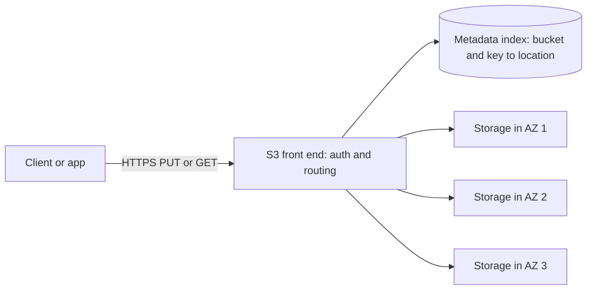

## What object storage is

**Object storage** stores whole blobs of data (images, videos, backups, logs) and finds each one by a name, not by a folder path on a disk. **Amazon S3** (Simple Storage Service) is the best-known service; Google Cloud Storage, Azure Blob Storage, Cloudflare R2 and the open-source MinIO work the same way.

Three words to know:

- **Bucket.** A named container, globally unique across all AWS accounts, created in one region.
- **Object.** The data (up to 5 TB) plus **metadata** (content type, custom tags, size).
- **Key.** The object's full name, such as `photos/2026/10/cat.jpg`. The namespace is flat. The `/` characters are just part of the string; the console draws "folders" by grouping keys with a common **prefix**.

You talk to it over HTTP: `PUT` to store, `GET` to read, `DELETE` to remove, `LIST` to enumerate keys.

| | Object storage (S3) | Block storage (EBS) | File storage (EFS, NFS) |
|---|---|---|---|
| Unit | Whole object | Fixed-size blocks | Files and directories |
| Access | HTTP API | Attached to one server like a disk | Mounted by many servers |
| Edit part of a file | No, rewrite all | Yes | Yes |
| Scale and cost per GB | Huge, cheapest | Limited, pricier | Medium |
| Good for | Media, backups, data lakes | Databases, boot disks | Shared home dirs, legacy apps |

:::warn
S3 is not a file system. You cannot append to or edit part of an object, and "rename" is really copy then delete. Treat objects as immutable: write a new object, then switch a pointer to it.
:::

## How it works inside

AWS does not publish full internals, so learn the guarantees, not the code. The public picture:

- A front-end layer authenticates the request and routes it.
- A **metadata index** maps (bucket, key) to where the bytes are. This is why `LIST` is slower and costlier than `GET`.
- Data is spread over storage nodes in **at least three Availability Zones** (separate data centres in one region), using replication or erasure coding (splitting data into fragments plus parity so lost fragments can be rebuilt).
- Checksums are verified continuously and damaged copies are repaired in the background.



## Durability, availability and consistency

Three promises people confuse:

- **Durability** is the chance data is not lost. S3 Standard is designed for 99.999999999% ("11 nines"), roughly one object lost per 10 million objects every 10,000 years. It protects against disk and data-centre failure.
- **Availability** is the chance a request succeeds right now. S3 Standard is designed for 99.99%, about 52 minutes of failure a year. Durable and unavailable are possible together.
- **Consistency.** Since December 2020, S3 gives **strong read-after-write consistency**: after a successful `PUT` or `DELETE`, every later `GET` and `LIST` sees it. Older articles that mention eventual consistency are out of date.

:::truth
11 nines does not protect you from yourself. An accidental delete, a buggy script that overwrites keys, or a stolen credential is "durably" applied. Use **versioning** (keep old versions), MFA delete or Object Lock for important data.
:::

Concurrent writes to one key are **last writer wins**: there is no locking. For safe create-only or compare-and-swap writes, S3 supports conditional `PUT` with `If-None-Match` and `If-Match` headers.

```quiz
q: Service A uploads `report.pdf` and gets HTTP 200. One second later service B in the same region lists the bucket. What does B see?
options:
  - Maybe nothing, because S3 is eventually consistent
  - "The new object, because S3 provides strong read-after-write consistency for PUT and LIST"
  - The object only after replication to all three zones finishes in a few minutes
answer: 1
why: "Since 2020 a successful write is visible to all later reads and lists in that region. The multi-zone copy is part of completing the write, not a later step. (Cross-region replication, by contrast, is asynchronous.)"
```

## Large files and direct uploads

- **Single PUT** works up to 5 GB, but a failure restarts everything.
- **Multipart upload** splits a file into parts of 5 MiB to 5 GiB (up to 10,000 parts), uploads them in parallel, retries only failed parts, then asks S3 to assemble them. AWS recommends it from about 100 MB.
- **Presigned URL.** Your server signs a time-limited URL with its credentials. The client uses that URL to upload or download directly, so big files never pass through your servers. Expiry is configurable (up to 7 days, and shorter if signed with temporary credentials).

```order
prompt: Arrange a multipart upload with boto3, the Python AWS SDK.
lang: python
code: |
  mp = s3.create_multipart_upload(Bucket=b, Key=k)
  parts = []
  for i, chunk in enumerate(chunks, start=1):
      r = s3.upload_part(Bucket=b, Key=k, UploadId=mp["UploadId"], PartNumber=i, Body=chunk)
      parts.append({"PartNumber": i, "ETag": r["ETag"]})
  s3.complete_multipart_upload(Bucket=b, Key=k, UploadId=mp["UploadId"],
                               MultipartUpload={"Parts": parts})
distractors:
  - "      parts.append(r)"
why: "You must start the upload to get an UploadId, upload numbered parts while recording each ETag (a checksum S3 returns), then complete with that list. Without the PartNumber and ETag, S3 cannot assemble the object."
```

```bash
# a link anyone can use to GET this object for the next 15 minutes
aws s3 presign s3://my-bucket/reports/q3.pdf --expires-in 900
```

## Storage classes and lifecycle rules

You pay per GB-month, and cheaper classes charge more to read.

| Class | For | Notes |
|---|---|---|
| Standard | Hot data | Milliseconds, no retrieval fee |
| Intelligent-Tiering | Unknown access pattern | Moves objects automatically for a small monitoring fee |
| Standard-IA / One Zone-IA | Infrequent access | Cheaper storage, retrieval fee, 30-day minimum; One Zone-IA keeps one zone only |
| Glacier Instant Retrieval | Archive read rarely | Milliseconds, 90-day minimum |
| Glacier Flexible / Deep Archive | Compliance archives | Minutes to hours to restore, 90 or 180-day minimum |

A **lifecycle rule** moves or deletes objects by age so nobody has to remember:

```json
{"Rules": [{
  "ID": "logs-tiering",
  "Status": "Enabled",
  "Filter": {"Prefix": "logs/"},
  "Transitions": [
    {"Days": 30, "StorageClass": "STANDARD_IA"},
    {"Days": 90, "StorageClass": "GLACIER"}
  ],
  "Expiration": {"Days": 365},
  "AbortIncompleteMultipartUpload": {"DaysAfterInitiation": 7}
}]}
```

Apply it with `aws s3api put-bucket-lifecycle-configuration --bucket my-logs --lifecycle-configuration file://lifecycle.json`.

## Costs, CDN and data lakes

You pay for four things: storage per GB-month (Standard is about $0.023 in major US regions, check current pricing), **requests** (per 1,000 `PUT` or `GET`), retrievals for cold classes, and **egress** (data leaving AWS to the internet, roughly $0.09 per GB). Uploading in is free.

```estimate
q: A video site serves 20 TB a month straight from S3 to viewers. At about $0.09 per GB egress, what is the monthly transfer bill?
answer: 1800
unit: USD
tolerance: 0.3
hint: 1 TB is about 1,000 GB.
solution: "20 TB = 20,000 GB. 20,000 x $0.09 = about $1,800 per month, far more than the storage itself. A CDN in front caches popular videos and has lower per-GB rates, so only cache misses leave S3."
```

**CDN in front.** Put CloudFront (or another CDN) before the bucket, keep the bucket private with Origin Access Control, and let the CDN serve repeat requests from edge caches. This cuts egress cost and latency, and shields S3 from request spikes.

**Data lake.** Store raw and processed data as files, usually **Parquet** (a compressed columnar file format), under prefixes like `events/dt=2026-10-14/`. Query engines such as Athena, Spark and Trino read them in place. Storage and compute scale separately, and you pay for compute only while querying.

## Production gotchas

- **Hot prefixes.** S3 supports at least 3,500 writes and 5,500 reads per second per prefix. Beyond that you see `503 SlowDown`; retry with exponential backoff and spread keys over prefixes.
- **Small files.** Millions of 2 KB objects mean huge request bills and slow scans. Batch them into 128 MB or larger files.
- **Incomplete multipart uploads** are invisible in listings but billed. Add the abort rule above.
- **Versioning without cleanup.** A delete only adds a delete marker; old versions keep costing money until a lifecycle rule expires them.
- **Listing is slow** (1,000 keys per call). Use S3 Inventory reports for big audits.
- **Public buckets.** Keep Block Public Access on; most S3 breaches are misconfiguration.
- **Browser uploads** with presigned URLs need a CORS (cross-origin resource sharing) rule on the bucket.

## Interview angle

- Default answer for "where do images, videos, backups or logs go": object storage, with metadata in a database holding the key.
- Say "presigned URL" and "multipart upload" to show you keep big bytes off app servers.
- Name the tiering story: Standard, then IA, then Glacier via lifecycle rules, and a CDN for reads.
- Know the limits: no partial update, no rename, no low-latency random writes. Use a database or block storage for those.

```cards
- q: What is an S3 key, and is there a real folder tree?
  a: The key is the full object name. The namespace is flat; "folders" are just shared key prefixes.
- q: Durability versus availability?
  a: Durability is the chance data is never lost (11 nines for Standard). Availability is the chance a request works right now (about 99.99%).
- q: What consistency does S3 offer today?
  a: Strong read-after-write consistency for PUT, DELETE and LIST (since Dec 2020). Concurrent writes to one key are last writer wins.
- q: Why use a presigned URL?
  a: A time-limited signed link lets clients upload or download directly to S3, so large files bypass your servers.
- q: Name the main S3 cost drivers.
  a: Storage per GB-month, request counts, retrieval fees on cold classes, and egress to the internet. A CDN in front reduces egress.
```

## Notes

:::notes
- Bucket (global unique name, one region) holds objects; key is the full flat name; "folders" are prefixes.
- Objects are immutable blobs up to 5 TB. No append, no partial edit, rename = copy + delete.
- Durability 11 nines (copies in 3+ AZs) is not protection from deletes; use versioning or Object Lock.
- Availability about 99.99%. Strong read-after-write consistency since 2020; same-key writes are last writer wins.
- Multipart upload for large files (parts 5 MiB to 5 GiB, max 10,000); add a lifecycle rule to abort incomplete ones.
- Presigned URLs let clients talk to S3 directly with limited time and permissions.
- Classes: Standard, Intelligent-Tiering, IA, Glacier tiers. Lifecycle rules move or expire objects by age.
- Bill = storage + requests + retrieval + egress. CDN in front cuts egress and latency.
- Data lake: Parquet files under date prefixes, queried in place; avoid millions of tiny files.
:::
