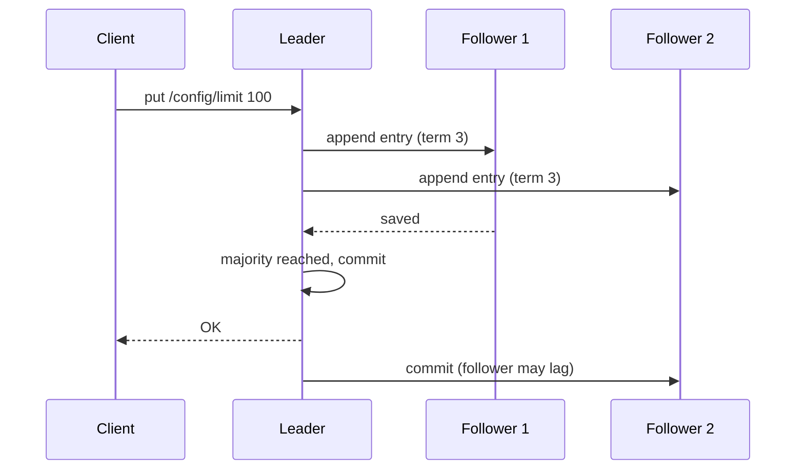

## Why coordination services exist

Many servers must agree on small facts: who is the leader, which servers are alive, what the current config is, who holds a lock. Each server asking its own database or guessing from timeouts leads to **split brain**: two servers both believe they are the leader and both write, corrupting data.

A **coordination service** is a tiny, replicated store whose job is to be the single source of truth for those facts. It trades speed and size for strong correctness:

- Holds **kilobytes**, not gigabytes. It is a control-plane tool (decides things), not a data-plane tool (stores your data).
- Every write is agreed by a **majority** of its servers before it is acknowledged.
- Reads see the latest committed value (etcd by default; ZooKeeper if you ask).

The two classic ones: **Apache ZooKeeper** (2008, Java, born at Yahoo, used by Hadoop and old Kafka) and **etcd** (2013, Go, born at CoreOS, the brain of Kubernetes). **Consul** is a third, focused on service discovery.

## Consensus in one page

**Consensus** means a group of servers agrees on one value even when some crash or messages are delayed. **Raft** (used by etcd) and **ZAB** (ZooKeeper Atomic Broadcast, used by ZooKeeper) solve it in a very similar way:

- One server is the **leader**; the others are **followers**. All writes go to the leader.
- The leader appends the write to its **log** (an ordered list of changes) and sends it to followers.
- When a **majority** (quorum) has saved it to disk, the write is **committed** and the client gets an answer.
- If the leader dies, followers notice missing heartbeats, wait a random delay, and one **campaigns**. Raft numbers each leadership period a **term**; a candidate needs votes from a majority to win. Random delays stop everyone from campaigning at once.



:::key
A majority overlaps every other majority. Any new leader must have collected votes from servers that hold every committed write, so committed data is never lost and two leaders can never both commit.
:::

## Quorum sizing

**Quorum** = floor(N / 2) + 1 servers. The cluster works while a quorum is alive.

| Members | Quorum | Failures tolerated |
|---|---|---|
| 1 | 1 | 0 |
| 3 | 2 | 1 |
| 4 | 3 | 1 |
| 5 | 3 | 2 |
| 7 | 4 | 3 |

- Use **odd** sizes. Four members tolerate no more failures than three, but need more votes.
- Use 3 for most clusters, 5 when you must survive one failure during maintenance. Seven or more makes every write slower (more members to wait for) for little gain.
- Spread members across failure zones, with no zone holding a majority.

```estimate
q: You must keep accepting writes even if 3 members are down at once (for example one in maintenance and two crashed). What is the smallest cluster size?
answer: 7
unit: members
tolerance: 0.1
hint: With N members you tolerate N - quorum failures, where quorum = floor(N/2) + 1. Stay odd.
solution: "To survive f failures you need N = 2f + 1 members. For f = 3 that is 7 (quorum 4). Each extra pair of members costs write latency, so many teams accept f = 1 or 2."
```

## What you build with it

- **Leader election.** Whoever creates a special key wins; the key disappears if the winner dies, so another takes over.
- **Service discovery.** Each instance registers itself under a key; dead instances vanish automatically. Clients **watch** the prefix and update their server list.
- **Configuration.** Store feature flags or limits; watchers get the change immediately.
- **Locks and barriers.** Mutual exclusion across machines.
- **Membership.** "Which brokers or workers are alive right now?"

The tools that make this work:

| Concept | ZooKeeper | etcd |
|---|---|---|
| Data model | Tree of **znodes** (like folders and files) | Flat keys, prefix queries, MVCC versions called **revisions** |
| Auto-expiring entries | **Ephemeral** znodes, tied to a client **session** | **Leases**: a TTL (time to live) you keep renewing; keys attached to it expire with it |
| Change notifications | **Watches**, one-shot (re-register after each) | **Watch** streams, resumable from a revision |
| Consensus | ZAB | Raft |
| API | Custom binary protocol, Java client | gRPC and HTTP |

```bash
# etcd: register an instance with a 10 second lease, keep it alive, watch the group
etcdctl lease grant 10                       # lease 694d77aa9e38260f granted with TTL(10s)
etcdctl put /services/api/10.0.0.5 up --lease=694d77aa9e38260f
etcdctl lease keep-alive 694d77aa9e38260f
etcdctl watch /services/api/ --prefix
```

```bash
# ZooKeeper (zkCli.sh): ephemeral + sequential node for leader election
create -e -s /election/n_ ""                 # Created /election/n_0000000007
ls -w /election                              # list children and set a watch
```

```order
prompt: Arrange the ZooKeeper leader-election recipe. Each candidate watches only the node just before it.
lang: python
code: |
  me = create("/election/n_", ephemeral=True, sequential=True)
  while True:
      children = sorted(get_children("/election"))
      if me == children[0]:
          return become_leader()
      prev = children[children.index(me) - 1]
      wait_until_deleted(prev)
distractors:
  - "      wait_until_deleted(children[0])"
why: "The lowest sequence number leads. Everyone else waits on only its predecessor, so a leader crash wakes one process, not all. Watching the leader would cause a herd effect: every candidate wakes and re-queries at once."
```

## Locks, leases and the pause problem

A **distributed lock** with a **lease** (the lock auto-expires if the holder stops renewing) avoids locks stuck forever when a holder crashes. But there is a trap.

:::truth
A lock holder can pause for longer than its lease (a long garbage-collection pause, a stalled VM) and wake up believing it still owns the lock, while another process already took it. No lock service can prevent this alone. Use a **fencing token**: a number that increases with every lock grant (etcd revision, ZooKeeper zxid or sequence number). The protected resource, such as the database or storage, rejects any request carrying a token lower than one it has seen.
:::

```quiz
q: Worker A holds an etcd lock with a 10 s lease, then freezes for 20 s in a GC pause. Worker B acquires the lock. A wakes up and writes to the shared database. What stops A from corrupting data?
options:
  - Nothing is needed because etcd guarantees only one holder at a time
  - "A fencing token: A's write carries an old revision number and the database rejects it"
  - Making the lease longer than any possible pause
answer: 1
why: "etcd only guarantees that the lease expired, not that A knows. The resource must check a monotonically increasing token. A longer lease just moves the problem and slows failover."
```

## Where it runs in the real world

- **Kubernetes** stores all cluster state (pods, deployments, secrets) in etcd. Only the API server talks to it. Leader election for controllers also uses leases in the API, backed by etcd.
- **Kafka** used ZooKeeper for broker membership, controller election and topic metadata. It moved to **KRaft** (Kafka Raft), where a small set of Kafka controller nodes run Raft themselves and keep metadata in an internal log. KRaft was declared production-ready in Kafka 3.3, and Kafka 4.0 (2025) removed ZooKeeper completely.
- Why Kafka moved: one system to operate instead of two, faster controller failover (a new controller already has the metadata instead of reloading it from ZooKeeper), and higher partition counts per cluster.
- **Others:** HBase and Hadoop HA use ZooKeeper; ClickHouse uses ClickHouse Keeper (a ZooKeeper-compatible Raft server); Consul and Nomad use Raft.

## Production gotchas

- **Disk speed decides latency.** Each commit waits for an fsync (forcing data to disk). Use SSDs and keep the log on its own disk; slow disks cause leader flapping.
- **Not a database.** etcd defaults to a 2 GB storage quota; exceeding it puts the cluster into read-only alarm mode. ZooKeeper limits a znode to about 1 MB. High write rates also hurt.
- **etcd needs compaction and defragmentation.** Old revisions pile up until compacted; Kubernetes does this automatically, standalone users must configure it.
- **Session or lease timeouts versus pauses.** Too short and a busy client loses leadership for nothing; too long and failover is slow.
- **ZooKeeper watches are one-shot** and can coalesce events. Re-read the state after re-registering; do not trust the event stream alone.
- **Minority partitions stop.** The side without a quorum refuses writes. That is the correct, consistent (CP) behaviour.
- **Do not stretch one cluster across distant regions.** Every write pays the round trip to a majority.
- **Back up regularly:** `etcdctl snapshot save backup.db`.

## Choosing

| Need | Pick |
|---|---|
| Kubernetes cluster state | etcd (built in) |
| Existing Hadoop, HBase or Kafka 3.x stack | ZooKeeper |
| New Kafka cluster | KRaft, no ZooKeeper |
| Service discovery with health checks and DNS | Consul (or Kubernetes Services) |
| Locks for a single app already on Redis or a database | Often enough, but a lease without fencing is only "best effort" |

## Interview angle

- Say why: "we need exactly one leader" or "all nodes need one agreed config".
- Mention quorum math (2f + 1) and that you keep the cluster small and odd.
- Bring up fencing tokens when you describe a lock. It signals depth.
- Do not store application data here; use it as the control plane.

```cards
- q: What is quorum, and how many failures does a 5-member cluster tolerate?
  a: Quorum is a majority, floor(N/2) + 1. Five members need 3, so 2 failures are tolerated.
- q: Why use an odd number of members?
  a: Even sizes tolerate no more failures than the odd size below them but need more votes.
- q: Ephemeral znode versus etcd lease?
  a: Both auto-delete entries when a client stops proving it is alive. Ephemeral nodes are tied to a session; etcd keys are attached to a lease with a TTL.
- q: What is a fencing token?
  a: An increasing number issued with each lock grant. The protected resource rejects requests with an older token, so a paused ex-holder cannot do damage.
- q: Why did Kafka replace ZooKeeper with KRaft?
  a: Operate one system instead of two, faster controller failover, and more partitions per cluster. ZooKeeper support was removed in Kafka 4.0.
```

## Notes

:::notes
- Coordination service = small, strongly consistent store used for leaders, locks, config, discovery and membership.
- ZooKeeper (ZAB, znodes, ephemeral nodes, one-shot watches) and etcd (Raft, leases, revisions, watch streams).
- Writes: leader appends, majority persists, then commit. Any new leader holds all committed data.
- Quorum = floor(N/2) + 1. Tolerate f failures with 2f + 1 members; use 3 or 5, never even.
- Leader election: ephemeral sequential node, lowest wins, watch only the predecessor.
- Leases can expire while a holder is paused; protect resources with fencing tokens.
- Kubernetes keeps all cluster state in etcd; Kafka replaced ZooKeeper with KRaft (removed in 4.0).
- Gotchas: fsync latency, 2 GB etcd quota, compaction, cross-region clusters, one-shot watches.
- Control plane only: kilobytes of data, low write rate.
:::
