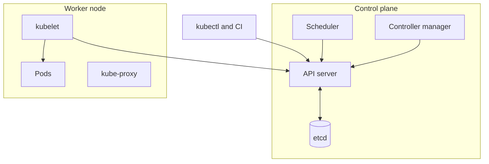

## Containers versus virtual machines

A **container** is a normal process on a Linux host that the kernel has wrapped so it sees its own file system, process list and network, and cannot use more than its share of CPU and memory. Two kernel features do this:

- **Namespaces** give the process a private view (its own process ids, network interfaces, mounts).
- **cgroups** (control groups) cap resources, such as "at most 512 MB of memory".

A **virtual machine (VM)** is different: a **hypervisor** (software that splits hardware) runs a complete guest operating system with its own kernel on top.

| | Container | Virtual machine |
|---|---|---|
| Kernel | Shared with the host | Own kernel per VM |
| Size | Tens to hundreds of MB | Gigabytes |
| Start time | Milliseconds to seconds | Tens of seconds to minutes |
| Isolation | Weaker (shared kernel) | Stronger |
| Typical use | Packaging and running apps | Isolating tenants, running other operating systems |

The main benefit is not speed but **sameness**: the same image runs on your laptop, in CI and in production, which ends "works on my machine".

## Images and layers

An **image** is a read-only package holding your app and everything it needs (runtime, libraries, config). A running copy of an image is a container. **Docker** is the most common tool to build and run them; images are stored in a **registry** (Docker Hub, AWS ECR, Google Artifact Registry).

- An image is a stack of **layers**; each Dockerfile instruction (`RUN`, `COPY`) creates one. Layers are identified by a hash and cached.
- A container adds a thin writable layer on top. When the container is deleted, that layer is gone. Keep data in **volumes** or external databases.
- Tags like `1.4.2` can be moved to point at different content. For exact reproducibility, deploy by **digest** (the content hash).

```dockerfile
# stage 1: build with all dev tools
FROM node:22-alpine AS build
WORKDIR /app
COPY package*.json ./
RUN npm ci
COPY . .
RUN npm run build

# stage 2: small runtime image
FROM node:22-alpine
WORKDIR /app
ENV NODE_ENV=production
COPY package*.json ./
RUN npm ci --omit=dev
COPY --from=build /app/dist ./dist
USER node
EXPOSE 8080
CMD ["node", "dist/server.js"]
```

- **Order for caching.** Put rarely changing steps first (install dependencies) and often changing steps last (copy source). Docker reuses cached layers until the first changed one.
- **Multi-stage builds** keep compilers and dev dependencies out of the final image: smaller, faster to pull, fewer security holes.
- Run as a **non-root user** and add a `.dockerignore` so `node_modules` and `.git` are not sent into the build.

```order
prompt: Arrange the Dockerfile so that editing source code does not reinstall dependencies.
lang: dockerfile
code: |
  FROM node:22-alpine
  WORKDIR /app
  COPY package*.json ./
  RUN npm ci
  COPY . .
  CMD ["node", "server.js"]
distractors:
  - "COPY . . # copy everything first"
why: "Docker caches each layer until an earlier layer changes. Copying only package files, then installing, then copying source means a source edit invalidates only the last COPY and below. Copying everything first would reinstall dependencies on every edit."
```

## Why Kubernetes exists

Running one container is easy. Running hundreds across many machines raises questions: where should each go, what if a machine dies, how do users reach them, how do we roll out a new version without downtime? **Kubernetes** (also called K8s: K, 8 letters, s) is an **orchestrator** that answers these. You describe the **desired state** ("3 copies of this image, reachable on port 80"), and it keeps making reality match.

## Architecture

A cluster has a **control plane** (the brain) and **worker nodes** (machines that run containers).



- **API server.** The front door. Every action goes through it, and it is the only component that talks to etcd.
- **etcd.** A consistent key-value store holding all cluster state (see the ZooKeeper and etcd lesson).
- **Scheduler.** Picks a node for each new pod based on requested CPU and memory, labels and constraints.
- **Controller manager.** Runs control loops. Each loop compares desired and actual state and fixes the difference, such as starting a replacement pod.
- **kubelet.** The agent on every node. It starts containers through the container runtime (usually containerd), runs health probes and reports status.
- **kube-proxy.** Programs node networking rules so Service addresses reach pods.

:::key
Kubernetes is a set of reconciliation loops. You do not tell it "start a container"; you declare "I want 3", and loops keep making it true, including after crashes.
:::

## The objects you use daily

- **Pod.** The smallest unit: one or more containers sharing one IP address and volumes. Pods are disposable; their IPs change.
- **Deployment.** Manages a set of identical pods through a **ReplicaSet**, handles rolling updates and rollbacks.
- **Service.** A stable virtual IP and DNS name in front of changing pods, chosen by **labels** (key-value tags). Types: `ClusterIP` (inside the cluster), `NodePort`, `LoadBalancer` (cloud load balancer).
- **Ingress.** HTTP rules (host and path) that route outside traffic to Services. It needs an **ingress controller**, such as Nginx, Traefik or an Envoy-based one, to do the work. **Gateway API** is the newer, more expressive successor, and the community ingress-nginx controller has been announced for retirement, so check what a new cluster should use.
- **ConfigMap and Secret.** Inject configuration and credentials as environment variables or files without rebuilding the image.

```yaml
apiVersion: apps/v1
kind: Deployment
metadata:
  name: shop-api
spec:
  replicas: 3
  selector:
    matchLabels: {app: shop-api}
  strategy:
    type: RollingUpdate
    rollingUpdate: {maxSurge: 1, maxUnavailable: 0}
  template:
    metadata:
      labels: {app: shop-api}
    spec:
      containers:
        - name: api
          image: registry.example.com/shop-api:1.4.2
          ports: [{containerPort: 8080}]
          envFrom:
            - configMapRef: {name: shop-config}
          resources:
            requests: {cpu: 250m, memory: 256Mi}
            limits: {memory: 512Mi}
          readinessProbe:
            httpGet: {path: /ready, port: 8080}
            periodSeconds: 5
          livenessProbe:
            httpGet: {path: /healthz, port: 8080}
            initialDelaySeconds: 10
            periodSeconds: 10
---
apiVersion: v1
kind: Service
metadata:
  name: shop-api
spec:
  selector: {app: shop-api}
  ports: [{port: 80, targetPort: 8080}]
```

`250m` means 250 millicores, a quarter of a CPU core. **Requests** are what the scheduler reserves; **limits** are enforced. A pod over its memory limit is killed (`OOMKilled`); a pod over its CPU limit is only slowed (throttled).

```blanks
prompt: Fill in the rolling-update settings for zero downtime.
lang: yaml
code: |
  strategy:
    type: RollingUpdate
    rollingUpdate:
      maxSurge: 1          # one [[extra]] pod may exist during the update
      maxUnavailable: [[0]]    # never drop below the desired count
why: "maxSurge allows extra pods above the desired count; maxUnavailable is how many may be missing. Surge 1 and unavailable 0 start a new pod, wait until it is ready, then remove an old one."
```

## Rolling updates, probes and scaling

- **Rolling update.** The Deployment replaces pods gradually. Undo with `kubectl rollout undo deployment/shop-api`; watch with `kubectl rollout status`.
- **Readiness probe.** "Can this pod receive traffic?" While failing, the pod is removed from the Service. This is what makes rolling updates safe.
- **Liveness probe.** "Is this pod stuck?" On failure the kubelet restarts the container. Do not make it check the database, or a database outage restarts every pod.
- **Startup probe.** Gives slow-starting apps time before the other probes begin.
- **HPA (HorizontalPodAutoscaler)** changes the replica count to hold a metric near a target. It needs CPU **requests** set and a metrics source (metrics-server).

```yaml
apiVersion: autoscaling/v2
kind: HorizontalPodAutoscaler
metadata: {name: shop-api}
spec:
  scaleTargetRef: {apiVersion: apps/v1, kind: Deployment, name: shop-api}
  minReplicas: 3
  maxReplicas: 10
  metrics:
    - type: Resource
      resource:
        name: cpu
        target: {type: Utilization, averageUtilization: 60}
```

The rule is $\text{desired} = \lceil \text{current} \times \text{currentMetric} / \text{targetMetric} \rceil$. If pods run out of room on the nodes, a node autoscaler (Cluster Autoscaler or Karpenter) adds machines.

```estimate
q: A Deployment has 4 replicas averaging 90% CPU against a 60% target. How many replicas will the HPA ask for?
answer: 6
unit: replicas
tolerance: 0.1
hint: desired = ceil(current x currentMetric / targetMetric).
solution: "ceil(4 x 90 / 60) = ceil(6) = 6 replicas. Scale-down is slower on purpose: by default the HPA waits about 5 minutes of lower load before removing pods, to avoid flapping."
```

:::truth
A Kubernetes Secret is base64-encoded, not encrypted. Anyone with read access to it, or to etcd, can decode it. Turn on encryption at rest, restrict access with RBAC (role-based access control), and consider an external secret manager.
:::

## Production gotchas

- **CrashLoopBackOff.** The container keeps exiting. Run `kubectl logs --previous <pod>` and `kubectl describe pod <pod>`.
- **OOMKilled.** Memory limit too low or a leak; JVM and Node heaps must fit inside the limit.
- **ImagePullBackOff.** Wrong tag, missing registry credentials or a private registry.
- **No resource requests.** The scheduler packs pods blindly and the HPA cannot compute utilisation.
- **Shutdown races.** On deletion, a pod gets `SIGTERM` (a polite stop signal) while traffic may still arrive for a moment. Handle `SIGTERM`, drain in-flight requests, and set a short `preStop` delay.
- **Aggressive liveness probes** restart healthy but busy pods under load and make an overload worse.
- **The `latest` tag** makes deployments unrepeatable. Pin versions.
- **Node drains** during upgrades evict pods. Use a **PodDisruptionBudget** to keep a minimum number running.

```quiz
q: A pod's app is up but is still warming caches for 30 seconds and returns errors until done. Which probe should fail during that time?
options:
  - "Readiness, so the Service sends it no traffic until it is ready"
  - Liveness, so Kubernetes restarts it until it is ready
  - Neither; Kubernetes detects warm-up automatically
answer: 0
why: "Readiness controls whether the pod receives traffic. A failing liveness probe restarts the container and can trap a slow-starting app in a restart loop (use a startup probe for that case). Kubernetes cannot know your warm-up state."
```

## When Kubernetes is overkill

:::truth
Kubernetes solves problems of scale and team size. It also brings upgrades, networking, security policy, YAML and on-call load. A managed service (EKS, GKE, AKS) removes the control-plane chores, not the application-level ones.
:::

| Option | Good for |
|---|---|
| One VM with Docker Compose | One to a few services, small team, steady traffic |
| Managed container platforms (Cloud Run, ECS Fargate, App Runner) | Run containers and autoscale without running a cluster |
| Serverless functions | Spiky event-driven work |
| Kubernetes | Many services and teams, custom networking, portability across clouds, heavy autoscaling, a platform team |

Rule of thumb: if you cannot name the specific problem Kubernetes would solve for you, start with a managed container platform and move later. Containers are portable, so the Dockerfile is not wasted.

## Interview angle

- Explain the flow: build image, push to registry, apply Deployment, scheduler places pods, kubelet runs them, Service and Ingress route traffic.
- Draw the control plane and say that etcd is the only state store.
- Mention probes, rolling updates and HPA when asked about zero-downtime and scaling.
- Say the honest trade-off: Kubernetes is powerful and costly, and many systems do not need it.

```cards
- q: What two kernel features make containers possible?
  a: Namespaces (a private view of processes, network, mounts) and cgroups (limits on CPU and memory).
- q: Why order Dockerfile steps with dependencies before source code?
  a: Docker caches layers until the first change, so source edits do not trigger a dependency reinstall.
- q: Which control-plane component stores cluster state, and who may talk to it?
  a: etcd stores it; only the API server talks to etcd.
- q: Readiness probe versus liveness probe?
  a: Readiness decides whether the pod gets traffic; liveness decides whether the container is restarted.
- q: Pod versus Deployment versus Service?
  a: A pod runs containers and is disposable; a Deployment keeps N pods running and does rolling updates; a Service gives them a stable address.
```

## Notes

:::notes
- Container = isolated process (namespaces for view, cgroups for limits) sharing the host kernel; lighter but weaker isolation than a VM.
- Image = layered, read-only package; container adds a writable layer that disappears. Persist data in volumes or databases.
- Dockerfile: stable steps first for caching, multi-stage builds for small images, non-root user.
- Control plane: API server, etcd, scheduler, controller manager. Nodes: kubelet, kube-proxy, container runtime.
- Kubernetes keeps reconciling actual state to your declared desired state.
- Deployment (rolling updates) manages pods; Service gives a stable address; Ingress routes HTTP in.
- Readiness gates traffic, liveness restarts, startup protects slow starts.
- HPA: desired = ceil(current x currentMetric / target). Requests must be set.
- Secrets are only base64; add encryption at rest and RBAC.
- Small team, few services: prefer Compose or a managed container platform over running Kubernetes.
:::
