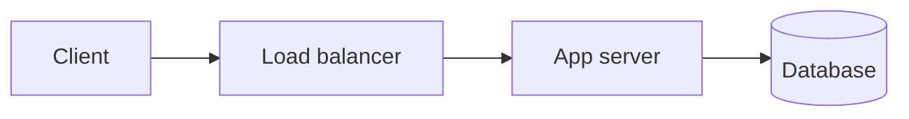

# Content guide

How to write a lesson for teacher. Every lesson is one Markdown file with YAML frontmatter. The build (`npm run content`) turns it into an interactive page; `npm run check` validates it.

## Principles

1. **Interactive, not a wall of text.** A learner should *do* something every few paragraphs: answer, predict, order, fill, step through. Minimum per lesson: **3 interactive blocks** (at least one `quiz` and one of `predict` / `order` / `blanks` / `viz` / `steps` / `estimate`) **plus one `cards` block**.
2. **Only what is required.** 500–1100 words of prose per lesson (code and blocks excluded). Bullets over paragraphs. Tables for comparisons. One idea per section.
3. **Assume first contact.** Explain every term or acronym inline the first time, in one short clause: "CAP (Consistency, Availability, Partition tolerance)".
4. **Honest.** No hype, no "master X in 10 minutes". Say when something needs practice, when a trick is rare, and what most people get wrong. Use the `truth` callout for reality checks.
5. **Correct.** Every algorithm, complexity and fact must be right. Code must compile and produce the shown output. If unsure, leave it out.
6. **Calm voice.** Second person, short sentences, no emoji, no exclamation marks, no filler ("In this lesson we will…").

## Files

```
content/<track>/<NN>-<stage-id>/<NN>-<slug>.md
content/dsa/01-arrays/04-two-pointers.md    -> /learn/dsa/two-pointers
```

- `<track>`: `dsa`, `system-design`, `lld`, `ai`. Stages are listed in `content/<track>/track.yml`.
- Stage folders: `00-foundations`, `01-arrays`, … (number = stage order, name = stage id from track.yml).
- Lesson files: two-digit order prefix + kebab-case slug. The slug must be unique inside the track.

## Frontmatter

```yaml
---
title: Two Pointers                    # 2–70 chars
summary: Walk two indices through an array to replace a nested loop with one pass.   # 10–170 chars
minutes: 25                            # honest estimate incl. interactive parts
difficulty: beginner                   # beginner | intermediate | advanced
rating: [1000, 1400]                   # DSA only: Codeforces rating band of the practice set
tags: [arrays, technique]
prereqs: [arrays-and-strings, sorting-and-searching]   # slugs in the same track
problems:                              # DSA: 6–12, easiest first. Others: optional
  - cf: 1690D
    name: Black and White Stripe       # exact Codeforces name
    rating: 1000                       # exact Codeforces rating (see below)
    core: true                         # must-solve; mark 2–4 per lesson
  - cf: 279B
    name: Books
    rating: 1400
    note: classic variable window
  - lc: two-sum-ii-input-array-is-sorted
    name: Two Sum II - Input Array Is Sorted   # exact LeetCode title
    difficulty: Medium                 # Easy | Medium | Hard (exact)
  - cses: 1640
    name: Sum of Two Values
exercises:                             # optional: design/coding tasks (inline markdown)
  - Extend the parking lot to support electric-vehicle charging spots.
resources:                             # optional: 0–4 stable, official links only
  - title: Attention Is All You Need
    url: https://arxiv.org/abs/1706.03762
---
```

### Picking problems (DSA)

Real data is in `data/`. Search it, do not guess:

```bash
node scripts/find.mjs cf --tags "two pointers" --min 1000 --max 1500 --limit 20   # sorted by solve count
node scripts/find.mjs cf --id 279B,1352C                                          # verify ids / names / ratings
node scripts/find.mjs lc --name "window"                                          # free LeetCode problems
node scripts/find.mjs lc --slug two-sum,3sum                                      # verify slugs
```

- Prefer classic, heavily solved problems (high solve count) that genuinely need the lesson's idea.
- Copy `name` and `rating` exactly from the tool output. Never use a LeetCode problem marked PREMIUM.
- CSES ids are the number in `https://cses.fi/problemset/task/<id>`; only use ones you are certain of.
- Order easiest to hardest. Spread across the lesson's rating band and a little above it.

## Section skeletons

Use `##` for sections (they become steps in Learn mode) and `###` inside them. Recommended shapes:

- **DSA**: The problem → Brute force first → The idea → Template (C++ + Java) → Walkthrough → Complexity → Pitfalls → Notes.
- **System design**: What it is → Why it exists → How it works (diagram) → Trade-offs (table) → In the real world (Redis, Kafka, Nginx…) → Interview angle → Notes.
- **LLD**: The problem it solves → Structure (class diagram) → Code (Java + C++) → When to use / avoid → Notes.
- **Case studies** (SD/LLD): Requirements → Estimates (SD) / Entities (LLD) → API or class design → High-level design → Deep dives → Trade-offs → Notes.
- **AI**: Intuition → The math (only what is needed) → Code (Python) → Practical tips → Notes.

Every lesson ends with a `:::notes` block (copy-ready summary, 5–10 bullets).

## Markdown features

### Code with a language toggle

Put the C++ and Java versions **directly after each other** (nothing between them). They become one block with a C++/Java switch. A single fence is fine when only one language applies (Python, SQL, bash…).

````md
```cpp
#include <bits/stdc++.h>
using namespace std;
int main() { int n; cin >> n; cout << n * 2 << "\n"; }
```
```java
import java.util.*;
public class Main {
    public static void main(String[] args) {
        Scanner sc = new Scanner(System.in);
        int n = sc.nextInt();
        System.out.println(n * 2);
    }
}
```
```input
21
```
```output
42
```
````

- `input` / `output` fences right after a code group show a sample run, and `npm run check:code` compiles and runs **every** language in the group against it. Use them for full programs.
- DSA code: C++17 with `#include <bits/stdc++.h>`, Java 17 with `public class Main` and fast input (`BufferedReader` + `StringTokenizer`) when input is large. Use `long long` / `long` where sums can overflow.
- LLD code: proper headers (`<iostream>`, `<vector>`, `<memory>`…, no `bits/stdc++.h`), modern C++17 (`std::unique_ptr`, `override`), Java 17. A program should compile as a single file (Java: one `public class Main` holding `main`, other classes non-public).
- Snippets that are not full programs are fine without input/output; keep them short.
- Python: 3.11+, NumPy where natural. Keep runnable examples small and deterministic (`np.random.default_rng(0)`).

### Callouts

```md
:::note
Neutral side information.
:::

:::tip
A practical trick.
:::

:::warn
A common bug or misconception.
:::

:::key
The single most important insight of the section.
:::

:::truth
A reality check: what this costs, how long it takes, what it will not do for you.
:::
```

### Collapsible depth and hints

```md
:::details[Why the greedy choice is safe (proof)]
Exchange argument…
:::

:::hint[Hint 1]
Sort first.
:::
```

`details` holds optional depth (proofs, edge cases). `hint` hides a spoiler until clicked; use 1–3 graded hints before a solution.

### Copy-ready notes (required, at the end)

```md
## Notes

:::notes
- Two pointers turn many O(n²) pair searches into O(n).
- Needs a monotonic property: moving a pointer only ever helps in one direction.
- Sorted array + target sum -> L at start, R at end.
:::
```

### Diagrams and math

````md

````

Mermaid `flowchart`, `sequenceDiagram`, `classDiagram` (great for LLD) and `stateDiagram-v2` are supported. Keep diagrams small (≤ 12 nodes).

Math: `$O(n \log n)$` inline, `$$ ... $$` on its own lines for display. Use it where it helps; plain text is fine for simple things.

No raw HTML. No images.

## Interactive blocks

A fence whose language is the block type, with a YAML body. Strings may contain inline Markdown (`code`, **bold**, `$math$`). Use `|` block scalars for code and anything multi-line. Quote strings that start with special characters or contain `: `. Answer indices are **0-based**.

### quiz

```quiz
q: Why write `mid = lo + (hi - lo) / 2` instead of `(lo + hi) / 2`?
options:
  - It is faster
  - It avoids integer overflow when lo and hi are large
  - It rounds up instead of down
answer: 1
why: "`lo + hi` can exceed the int range (about 2.1e9); the difference never does."
```

Several questions: `questions: [ {q, options, answer, why}, … ]`. Multiple correct answers: `answer: [0, 2]`. Write plausible wrong options that reflect real misconceptions, and always explain.

### predict — what does this print?

```predict
lang: cpp
code: |
  int a = 7, b = 2;
  cout << a / b << " " << a % b << " " << (double)a / b;
output: 3 1 3.5
why: Integer division truncates; the cast happens before the division in the last term.
```

Optional: `prompt`, `input` (stdin). Output is compared after trimming each line.

### order — put the lines in order (Parsons problem)

```order
prompt: Arrange binary search for the first index with a[i] >= x.
lang: cpp
code: |
  int lo = 0, hi = n;
  while (lo < hi) {
      int mid = lo + (hi - lo) / 2;
      if (a[mid] >= x) hi = mid;
      else lo = mid + 1;
  }
  return lo;
distractors:
  - "    if (a[mid] >= x) hi = mid - 1;"
why: The answer stays inside [lo, hi]; hi = mid keeps a candidate, lo = mid + 1 discards one.
```

Write `code` in the correct order (3–16 lines, indentation kept); the page shuffles it.

### blanks — fill in the missing pieces

```blanks
prompt: Complete the sliding-window loop.
lang: java
code: |
  for (int r = 0; r < n; r++) {
      sum += a[r];
      while (sum > limit) sum -= a[[[l++]]];
      best = Math.max(best, [[r - l + 1|r-l+1]]);
  }
why: The window is [l, r]; its length is r - l + 1.
```

`[[answer|alternative|…]]` marks a blank. Answers are compared ignoring spaces.

### cards — flashcards for spaced review

```cards
- q: Time complexity of binary search?
  a: $O(\log n)$
- q: What must be true for two pointers to work on pair sums?
  a: The array is sorted, so moving L right only increases the sum and moving R left only decreases it.
```

3–6 cards per lesson. One fact per card. They join the learner's review deck when they finish the lesson.

### estimate — back-of-the-envelope numbers

```estimate
q: 10 million daily active users each send 20 requests a day. Average requests per second?
answer: 2300
unit: req/s
tolerance: 0.5        # ±50%; or "order" (within 3x)
hint: A day has about 86,400 ≈ 10^5 seconds.
solution: "10^7 × 20 = 2×10^8 requests/day ÷ ~86,400 s ≈ 2,300 req/s. Peak is often 2–3× that."
```

### viz — algorithm visualizer

```viz
algo: two-pointers
input:
  arr: [1, 2, 4, 7, 11, 15]
  target: 15
```

Steps through the algorithm with a variables panel; learners can edit the input. Available `algo` values and their inputs are defined in `src/lib/viz/catalog.ts` (`node scripts/viz-list.mjs` prints them). Use the example inputs there as a starting point. Never invent an `algo` name.

### steps — a hand-made walkthrough

For a custom trace that no visualizer covers:

```steps
title: Difference array on [0, 0, 0, 0, 0]
view: array
frames:
  - arr: [0, 0, 0, 0, 0, 0]
    note: Start with d = zeros of size n + 1.
  - arr: [3, 0, 0, -3, 0, 0]
    highlight: {0: active, 3: active}
    note: Add 3 to range [0, 2] -> d[0] += 3, d[3] -= 3.
  - arr: [3, 3, 3, 0, 0, 0]
    pointers: {i: 2}
    note: Prefix sums of d give the final array.
```

Array frames: `arr`, optional `pointers` (name -> index), `highlight` (index -> active | compare | done | muted | match | bad | focus), `window` [l, r], `vars`, required `note`. Grid frames (`view: grid`): `grid` (rows of cells), `highlight` with keys `"r,c"`, optional `rowLabels`, `colLabels`, `vars`, `note`. 2–30 frames.

## Checklist before you finish a lesson

- [ ] Frontmatter valid; summary is one plain sentence.
- [ ] ≥ 3 interactive blocks + 1 cards block; every quiz has a `why`.
- [ ] Every term explained on first use; no section is a wall of text.
- [ ] Code compiles (C++17 `g++ -std=c++17 -O2`, Java 17 `javac`), sample output matches.
- [ ] DSA problems verified with `scripts/find.mjs`, easiest first, 2–4 marked `core`.
- [ ] Ends with `## Notes` and a `:::notes` block.
- [ ] `npm run check -- content/<track>/<stage>/<file>.md` passes (when available).
